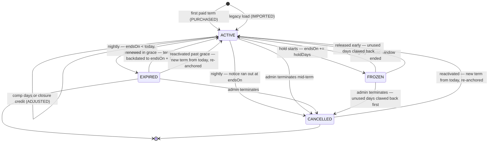

# Gym of Thrones — Membership, Access Control & QR Attendance

**Date:** 2026-08-18
**Status:** Approved for planning
**Scope:** Membership lifecycle, money, and QR-based attendance for a single-location gym in Taguig City (Asia/Manila, UTC+8), plus the platform work those two features cannot ship without.
**Builds on:** `docs/superpowers/specs/2026-08-16-rbac-auth-design.md` (phases 1–2 shipped). Where this document contradicts that one, this document wins and the amendment is named explicitly.
**Amended 2026-08-18 — owner decision #11 (§3.1), superseding decision #1.** The check-in direction is inverted: the gym's screen displays the rotating code and the member scans it, rather than the member holding a badge the desk scans. §§6–13 are written to that direction and §6.0.2 is the normative surface every one of them consumes. §§1–3 are restated here to match it. §4 and §5 are direction-independent and are unchanged — `accessVerdict()`, the four `MembershipStatus` values, grace-as-a-date, anniversary billing, holds, `Payment`, `Shift` and the nightly job are consumed by chunk 2 exactly as written.

This spec turns a working authentication shell into a gym that can take money and open a door. It ships in three chunks. **Chunk 0** repairs the platform assumptions the rest of the design would otherwise inherit as bugs: `PermissionScope` is stored but never enforced, so the first coach-facing endpoint leaks every member; `ThrottlerGuard` is configured but never registered, so nothing is rate limited; soft deletes are written but never read, so a "deleted" member keeps a valid session; the permission cache is keyed on a version nothing increments and omits `role` entirely, so a demotion fails open for sixty seconds; and every failure the front desk needs to branch on renders as `HTTP_400` or `INTERNAL_SERVER_ERROR`. **Chunk 1** adds the commercial model — plans, memberships, terms, holds, payments, and the `accessVerdict()` helper that answers "may this person train today" from dates rather than from a status column a missed cron job can falsify. **Chunk 2** adds attendance — a rotating code displayed on a screen the gym owns, scanned by the member's own phone and posted from the member's own session, a denial record that doubles as the walk-in sales funnel and reaches staff on a live desk feed, a pragmatic check-out, and a first-class staff path for the quarter of arrivals that cannot self-scan. Everything outside those three chunks — class scheduling, booking, the coach dashboard, the admin CRM beyond the desk console, notifications beyond the coach-arrival hook, the AI workout generator, PDF export — is deliberately absent and gets its own spec.

## 1. Delivery chunks

Each chunk leaves a system that works and can be demonstrated. A chunk may not start until its predecessor's exit criteria (§4.15 for chunk 0) are green.

| Chunk | Contents | Working system at the end | Status |
|---|---|---|---|
| **0 — Foundations** | `scopeFilter()` with a compiler-enforced call contract, `CoachAssignment`, permission-cache correctness, soft-delete enforcement, `ThrottlerGuard` registration, domain error codes + Prisma constraint mapping, the `Idempotency-Key` contract, CORS repair, gym-time helpers and the `iso()` fix, the first DTO pattern, `@nestjs/schedule`, real `/login` + `/register` with `?next=` | A coach reading a member list sees only their own members; rate limits are real; a suspended or deleted account is rejected; a business failure returns a code the client can switch on; a deep link into the portal survives a login | **Specified — this document, §4** |
| **1 — Membership core** | `Plan`, `Membership`, `MembershipEvent`, `MembershipHold`, `Payment`, `Shift`, anniversary billing, `accessVerdict()`, the nightly job, member import | Staff can sell, renew, freeze and cancel a membership, record cash or GCash against it, reconcile a drawer at end of shift, and the system can answer "may this person train today" | Specified — §5, plus §7's routes 5–41 |
| **2 — Station QR attendance** | The rotating station token, `Station`, `StationCredential`, `StationScan`, `CheckIn`, `CheckInDenial`; `POST /api/v1/checkin` from the member's own session; check-out, stale-close and reopen as a second scan of the same code; the outward station display `/desk/station` and the staff console `/desk` with its SSE denial feed, `TO COLLECT` list and till; first-class manual check-in by member code or name search; the inline walk-in sale and guest passes; relocated photo capture; the coach-arrival hook; `station.manage` | A member points their phone at the desk screen and gets a verdict on their own handset in about a second; a denial lands on the desk feed with a face and a script while the member is still standing there, and converts into a ₱90 walk-in without leaving the screen; anyone with a dead phone is checked in by name or member code in the same console, attributed to a named operator | Specified — §§6, 8–10, plus §7's routes 42–57 |

---

## 2. Context and current state

Blunt, because every design decision below is shaped by how little exists.

### 2.1 What is actually built

**Three tables.** `User`, `Permission`, `RolePermission`. That is the entire schema. There is no membership, plan, payment, attendance, station, class, booking, or coach-assignment model of any kind. `CoachAssignment` is designed in the RBAC spec §5.4 and does not exist.

**Three endpoints.** `GET /api/health`, `GET /api/v1/me`, `GET /api/v1/admin/permissions`. All three are `GET`, which is why the codebase contains **zero class-validator DTOs** — the global `ValidationPipe` runs `whitelist` + `forbidNonWhitelisted` + `transform` with `enableImplicitConversion`, so the first `POST` in this project both needs the first DTO and sets the pattern every later one copies.

**Authentication is done and is good.** Supabase Auth issues JWTs; `JwtVerifierService` verifies them locally against a cached JWKS with no per-request network call; `AuthGuard` is registered as a global `APP_GUARD` with `@Public()` as the opt-out; `UserProvisioningService.resolve` creates the local row just-in-time and deliberately refuses to let a token claim set `role` or `status`; a non-`ACTIVE` user gets a 403 rather than a 401 so the client does not loop through re-login.

**RBAC phase 2 is done.** `PermissionsGuard` enforces `@RequirePermission`, which takes **exactly one key per route** and is resolved with `getAllAndOverride`, so a method-level decorator *replaces* a class-level one rather than ANDing with it. `PermissionsService` caches an effective-permission array for 60 seconds and freezes it before caching. Twenty-six keys are seeded from `permission-registry.ts` — including `checkin.self` (*"Check in by scanning the counter QR"*) and `checkin.station_token.issue` (*"Render the counter check-in QR"*), both of which describe the settled direction exactly and both of which stay as seeded.

### 2.2 What is built and does not work

These are not future features. They are live defects the next feature will silently inherit.

| Defect | Evidence | Consequence for chunks 1–2 |
|---|---|---|
| **`PermissionScope` is never enforced** | `permissions.service.ts` `hasPermission()` matches on `key` and discards `scope`; the string `scopeFilter` appears nowhere in `server/src` | `coach.read` at scope `OWN` returns every member in the gym. Any coach-facing or member-facing list built today is a data breach. |
| **The permission cache omits `role`** | cache key is `` `${user.id}:${user.permissionVersion}` ``, but the permission set is resolved *from* `user.role` (`permissions.service.ts:57`) | An ADMIN→CLIENT demotion keeps the full ADMIN set live for the rest of the TTL. |
| **Nothing increments `permissionVersion`** | the column is read in the cache key and written nowhere in `src/` or `prisma/` | Revocation — including a seed-driven `RolePermission` prune — fails **open** for up to 60 seconds. |
| **`deletedAt` is written by nobody and read by nobody** | the identifier does not occur anywhere in `server/src`; `AuthGuard` checks `status` only; `resolve()` upserts unconditionally and refreshes `lastSeenAt` | A soft-deleted member keeps a valid session, keeps checking themselves in, and is resurrected by their own next request. |
| **`ThrottlerGuard` is not registered** | `ThrottlerModule.forRoot` is imported in `app.module.ts`; no `APP_GUARD` provides the guard | Rate limiting is inert. `POST /checkin` is a member-operated write from a public lobby, and the station-token endpoint is polled all day by an unattended screen — neither has any bound until this is fixed. |
| **There is no domain error channel** | `http-exception.filter.ts:45` hard-codes `` `HTTP_${statusCode}` ``; non-`HttpException` throws become a bare `INTERNAL_SERVER_ERROR` | The member's phone cannot tell "expired" from "frozen" from "that code had just changed", the desk feed cannot either, and every CHECK-constraint violation is an opaque 500. |
| **`Permission.requires` is stored and never read** | seeded by `seed.ts`; no code path validates it; the phase-4 grant API that would return the documented 422 does not exist | Any composite permission key can be granted to a role that holds neither underlying capability. |
| **CORS blocks the headers this design needs** | `main.ts:27` — `methods` lacks `PUT`, `allowedHeaders` is `['Content-Type','Authorization']`, no `exposedHeaders` | The browser strips `Idempotency-Key` at preflight, and the failure presents as duplicate charges rather than as a CORS problem. |
| **No scheduler** | `@nestjs/schedule` is not a dependency | Nightly expiry, hold activation, auto-close and `StationScan` purging have nowhere to run. |

### 2.3 The client

The member portal is **nine fully-built React screens running on 100% mock data**. `client/src/lib/portalData.ts` is 755 lines of fixtures with an artificial `delay()`; `apiFetch` is imported by **zero** portal pages. The screens are `portal/{dashboard,schedule,checkins,subscription,pay,progress,coach,book,qr,announcements}`.

`portal/qr/page.tsx` already tells members *"Hold your phone up to the code on the screen at the front desk"* (line 62). That copy is correct under decision #11 and its file-header comment is not — but neither is *evidence* for the decision, and §3.1 records the reversal as a decision rather than smuggling it in as a restoration. The route is renamed to `/portal/checkin` in §9.2, because a folder named `qr` will out-argue this spec in six months.

There is **no `/login` and no `/register` route.** They are a `useState<Route>` swap inside `client/src/app/page.tsx:23`, with an `onNavigate` prop threaded through seven landing components. `portal/layout.tsx:56` redirects an anonymous user to `/` and discards the destination — so a renewal SMS pointing at `/portal/subscription`, or a member opening the check-in screen at the door on a fresh browser, lands on the marketing homepage. Under the inversion that screen is the **highest-value cold deep link in the product**, which is why the real routes and `?next=` are chunk 0 work and not a polish item.

There is **no admin, staff, or coach frontend of any kind** — and the inversion adds a second physical surface, the outward-facing station display, that also does not exist.

`client/src/lib/api.ts` throws a bare `Error(message)` with no status and no code, and it throws on `!body.success` — which is why §3.3 fixes the shape of denial responses before a single screen is wired. A denial now lands on a member's own phone, so an untyped throw there is a blank card in someone's hand at the counter.

**The known timezone bug.** `portalData.ts:138`:

```ts
function iso(d: Date): string {
  return d.toISOString().slice(0, 10);   // UTC
}
```

At UTC+8 this attributes every 00:00–08:00 Manila moment to the **previous** calendar day. The gym opens at 05:00, so a large share of real check-ins would land on the wrong heatmap square and the streak counter would be wrong for anyone who trains before work. The fix in §4.9 is not "use local accessors" — it is to stop confusing an instant with a business day.

### 2.4 The reference material

`../screenshots/reference/` holds exported HTML mockups of the three surfaces (`Gym of Thrones.dc.html`, `Member Portal.dc.html`, `Admin CRM.dc.html`) plus the gym's own photography. They are the visual spec. Note that the mockups specify Barlow Condensed / Barlow; the shipped app self-hosts **Outfit** (headings) and **Inter** (body) via `next/font` in `layout.tsx`. The shipped app wins. Nothing in the mockups depicts an outward-facing station display; §8.3 designs it from scratch against the same tokens.

---

## 3. Decisions and rationale

### 3.1 Fixed by the project owner

These are settled. They are recorded here so no later reader relitigates them, and each carries the constraint it imposes on the design.

**Decision #1 is superseded by decision #11, and the supersession is recorded as a decision with a named cost — not as a restoration and not as a correction of an earlier mistake.** Decision #1 was a documented owner decision and every section written under it was written correctly. It was overturned on 2026-08-18 by the owner saying so, and by nothing else: the older RBAC design's §8.2 and the placeholder copy in `client/src/app/portal/qr/page.tsx` agree with the new direction, but a prior draft and a mock screen's microcopy do not overturn an owner decision, and nothing in §§6–13 rests on them. What the inversion buys and what it costs are itemised in row 11 below, in §6.0.3, and — with the arithmetic that does *not* justify it — in §8.0.

| # | Decision | Constraint it imposes |
|---|---|---|
| 1 | ~~**The member holds a rotating QR badge; the front desk scans it.**~~ **Superseded by #11 on 2026-08-18.** | Recorded so the reasoning survives, not to be implemented. Nothing member-held is built: there is no `BadgeNonce`, no pre-signed member badge batch, no `GET /me/badge`, no `POST /front-desk/scans`. The direction it forbade — a kiosk or a staff scan — is now a documented upgrade path (§6.13.2, §12.4), not a prohibition. |
| 2 | **Check-out is pragmatic.** `endedAt` is nullable from day one, closed by a second scan of the same station code, and auto-closed at the gym's own closing time. It is never mandatory. | A visit with no check-out is normal data, not an error. Any duration metric must exclude both auto-closed and stale-closed rows — which is the overwhelming majority (§3.2, "session length"). |
| 3 | **Keep Supabase password auth.** No OTP on every login. Idle timeout applies to staff and admin terminals only, never to member phones. | The member's check-in screen must render its no-signal fallback from a local session read and a cached identity (§6.10.3); the desk console locks to a PIN rather than signing out; and the station display holds **no user session at all** — it authenticates with a `StationCredential` on a separate origin (§6.2.2). |
| 4 | **Both self-service signup and staff-created members.** | Registration is free and creates no membership. "Registered with no plan" is a valid, non-error state on every screen. |
| 5 | **Anniversary billing from each member's own join date. Zero proration code in v1.** | Terms are `n` months from an anchor day, clamped at month end. A mid-term plan change is a new term at the new price, never a pro-rated credit. |
| 6 | **`EXPIRED` gets a 3-day configurable grace with a staff-visible banner. `FROZEN` and `CANCELLED` deny immediately.** | Grace is a property of a lapsed paid term, never of a paused or terminated one. The grace notice now renders on the member's own phone (`tone: 'GRACE'`) *and* on the desk feed, because under the inversion nobody at the counter watches a grace admission happen — §8.4's `TO COLLECT` and `EXPIRING THIS WEEK` lists are what replace the conversation that used to be automatic. |
| 7 | **A denial offers an inline walk-in sale at the desk.** Published prices: walk-in ₱90, Monthly ₱800, Quarterly ₱2,200, Annual ₱7,500. | A denial is a normal, renderable outcome with a next action — never an HTTP error, never a dead end. The denial now reaches staff through the live feed rather than through the scan they performed, so §8.5 budgets the seconds between the member's phone saying *"see the front desk"* and a staff member speaking to them. The prices are confirmed mock (§13.7); they live in `Plan` rows and are never hardcoded in a client. |
| 8 | **Money is integer centavos everywhere, never floats.** The plan price is snapshotted onto the term at purchase. | No `Decimal`, no `BigInt` (Prisma maps it to JS `BigInt`, which `JSON.stringify` throws on, and every response passes through `TransformInterceptor`). Field names end in `Centavos`. An admin repricing a plan changes zero existing rows. |
| 9 | **Payments are staff-recorded only** — cash, or GCash reference text typed by staff. No file uploads, no proof screenshots, no payment processing. | `client/src/app/portal/pay/page.tsx`, which is a GCash screenshot-upload flow, is rebuilt as read-only payment instructions. Nothing in the portal may POST a purchase — including the `nextStep` on a denied check-in, which routes to the desk and never renders a payable price. **Amendment (2026-09-03, `docs/superpowers/specs/2026-09-03-gcash-slip-walkins-design.md`):** uploads remain forbidden, now with the reasoning written down — RA 10173 proportionality, the NPC's screen-capture precedent, GCash's own advisory that a screenshot proves nothing against AI fakes, and no AuditLog to answer "who looked at it". What replaced the screenshot: `referenceNormalized` + the all-time partial unique index (a reused "proof" is, definitionally, a duplicate reference) + a named staff attestation (`gcashVerifiedAt/ById`, "seen in our GCash Transactions tab", required above `GCASH_VERIFY_THRESHOLD_CENTAVOS`). `receiptNo` is now reachable from every sale form; §5.7.6's configurable receipt-prompt threshold stays unbuilt — it would push a TIN-adjacent setting into the `@Public()` config route. |
| 10 | **A check-in can notify the member's assigned coach that their client has arrived.** | One column pair and one service seam — not a notifications module. Its *value* rises under the inversion: with no staff member watching every arrival, this is the only automated signal that a specific client walked in. |
| 11 | **A rotating QR is displayed on a screen at the front desk; the member scans it with their own phone.** The check-in POSTs from the member's own authenticated session. Staff are not in the loop for a normal check-in. Dated 2026-08-18, **superseding decision #1**. | Agrees with RBAC design **§8.2** and **keeps the seeded key `checkin.station_token.issue`**, which exists for exactly this. `CheckIn.recordedById` becomes **nullable and biconditional with `method = 'STATION_QR'`**, and `CheckIn.shiftId` becomes nullable — two accountability columns, paid deliberately (§6.4.2). **The costs, in full:** nobody verifies identity on the happy path (§6.12); the member's handset becomes a hard network dependency and the gym's wifi becomes part of the check-in system, with a hardware line item and a launch blocker attached (§6.10, §8.0); the grace-collection moment moves from the counter to the member's phone (§13.6); recorded arrivals become a lower bound of unknown tightness (§6.13.1); and the primary threat becomes **relayed check-in**, bounded rather than eliminated (§6.11). **What it buys:** no member-held credential exists at all, so 340 rotating badges and the entire screenshot-a-badge class disappear; nothing displayed in public names a member; and the desk stops being the serialization point for the happy path. §§4–5 are untouched by it. |

### 3.2 Adjudications

Four independent design tracks fed this document and disagreed on load-bearing nouns. Each row below is binding; the losing alternative is named so nobody re-derives it. **For chunk 2, `§6.0.2` is the normative surface** — every value in the attendance rows below is restated *from* it, and where any section of this document disagrees with it, that section is wrong and is corrected in the same commit.

| Question | Decision | Why |
|---|---|---|
| **Station token scheme** | Payload `GOTS1.<stationCode>.<slot>.<mac>` (36–37 chars, QR **version 2 at ECC M**, alphanumeric mode). **30-second slots**, accept window **`{ currentSlot − 1, currentSlot }`** → 30–60 s effective validity. MAC = first 10 bytes of `HMAC-SHA256` over `stationId ‖ Station.tokenEpoch ‖ slot` — never the short code, never a member. Display holds a **10-slot batch** (5 minutes of runway), invalidated within one slot by an epoch bump via the head check. | Satisfies decision #11 and puts the only rotating credential in the system on hardware the gym owns. **The QR names nobody and authenticates nothing** — identity arrives on the POST from the member's session, so a photograph of the screen reveals nothing about the roster. Replay is defeated by `StationScan @@unique([userId, stationId, slot])`, claimed *before* the verdict is computed, with the rendered body stored and replayed verbatim. **The MAC is verified before any other branch**, so a forged token writes nothing and cannot poison the desk feed, the sales funnel or the detection signals. **Rejected:** the member-held badge and its `BadgeNonce` batch (decision #11); a per-rotation fetch by the display (dies the moment the AP blinks); and a symmetric `±1` window — the phone computes no slot, so a *future* slot has exactly one benign cause, a drifting display, and is worth far more as an alarm (`STATION_TOKEN_NOT_YET_VALID`) than as tolerance. |
| **Station identity, and how the display authenticates** | A **`Station` table** (`code`, `gymCode`, `tokenEpoch`, `isActive`), plus a **`StationCredential`** — a per-station opaque secret stored hashed, sent as **`X-Station-Key`**, served from a **separate origin**, whose only capability is minting its own station's display tokens. Built in v1, not deferred. `station.manage` (ADMIN, dangerous) covers both. | The off switch — "the tablet was stolen", "that entrance is closed" — must be a database write, not a redeploy or a global secret rotation; `stationId` inside the MAC is what makes a second branch a data change rather than a token-format migration; and `CheckIn.stationId` is how "which door" is answerable the day there are two. **Rejected:** a `STATION_CODES` env list, and — the tempting one — reusing the desk console's `FRONT_DESK` session because the display is the outward half of the same machine. That session holds the member roster with photos and phone numbers at `ALL`, does not expire on idle (decision #3 makes the PIN an operator switch, not a session teardown), and can mint *future* slots indefinitely. Rejecting a dedicated staff session on blast-radius grounds and then choosing the console's own session is choosing precisely the option that was rejected. |
| **Member-side offline queue** | **None, at any TTL.** No `queued` flag, no `decodedAt`, no `SELF_QUEUED` method value, no `CHECKIN_SELF_QUEUE_MAX_MINUTES`. | A queued station token has *expired* by the time it flushes, and accepting it would widen the relay window from 60 seconds to the queue TTL — set by a client-supplied flag on a request that proves nothing about having been offline. Every variant reduces to **"let the client choose its own TTL"**, which destroys the only thing the token proves. **Rejected:** bounded 5- and 15-minute versions — the same hole at 10× and 30× the window. The **desk's own** queue is untouched and still ships: a staff-typed member code is attributed to a named operator, which is exactly the kind of write a queue can safely carry. |
| **Check-in methods, and the route** | `CheckInMethod = **STATION_QR \| MEMBER_CODE \| MANUAL**`. Member path: **`POST /api/v1/checkin`** under `checkin.self` at `OWN`. Staff path: `POST /front-desk/check-ins` under `checkin.create`. Both go through one `CheckInService.record({ subjectUserId, station, slot, method, actor, origin })`. | Three values, no more: there is no `SELF_QR` (every self check-in *is* a station scan), no `SELF_QUEUED` (there is no queue) and no `SELF_KIOSK` in v1 (§6.13.2 adds it if a kiosk is ever built). The staff path is **not a fallback**: per-visit self-scan failure — no smartphone, dead battery, phone in a locker, no load and no wifi, logged out on a new handset, camera permission denied months ago, an old Android with no `BarcodeDetector` — is realistically **15–30% of arrivals and worst at both peaks**. A path carrying a quarter of the traffic at three times the transaction time is designed as a main road, not as an exception, and the word "fallback" appears nowhere staff can see it. |
| **Membership cardinality** | **One `Membership` header row per member** (`userId @unique`), carrying current status and the current term's snapshot. Per-term history lives on `Payment.termStartsOn` / `termEndsOn`; there is no separate term table. | The door lookup stays a single `findUnique` with no "which row is current" tie-break on a path read hundreds of times a day, and revenue-per-term stays a plain query on `Payment` rather than a replay of the event ledger. **Rejected:** row-per-term (reintroduces the tie-break) and a separate `MembershipTerm` table — §5 records the accepted trade, that `userId @unique` forecloses concurrent membership products and should be revisited before a second location. |
| **Date column naming** | `startsOn` / `endsOn` on every term-bearing model. Business dates are `@db.Date`; instants are `@db.Timestamptz(3)`. | One vocabulary. `startDate`/`endDate` and `startedOn` were both in circulation; pick one and delete the others. |
| **Membership statuses** | **Exactly four: `ACTIVE`, `EXPIRED`, `FROZEN`, `CANCELLED`** (§5.0, §5.2). | `PAST_DUE` is dropped because grace is `today <= endsOn + graceDays`, computed from columns already on the row — a status for it would be a second source of truth a missed nightly run silently falsifies. `PENDING_CANCELLATION` is replaced by `Membership.cancelRequestedOn`, a nullable date on an otherwise `ACTIVE` row, which keeps the portal's "no lock-in" promise without contradicting decision #6. **Rejected:** `TRIAL` (no trial product exists on the price list) and `EXPIRING` (that is `endsOn − today`). The inversion touches none of this. |
| **Grace is bounded by dates, not by a job** | `graceDays` is snapshotted onto the membership at purchase; there is **no `graceEndsOn` column**. `accessVerdict` computes `today <= addDays(endsOn, graceDays)` directly. `EXPIRED` is materialised by the nightly job as a convenience. | The nightly job is an optimiser, never a gatekeeper. **This is what closes an unbounded-grace hole:** a design in which grace ends only when a job writes `graceEndsOn` grants free training forever the moment that job stops. A three-day outage must be boring. |
| **"At most one X" invariants** | **Nullable-unique sentinel columns** (`CheckIn.openUserId`, `CoachAssignment.activeMemberId`), each paired with two `CHECK` constraints so the sentinel cannot lie or be omitted. | Prisma introspects indexes: a partial unique index that exists in the database and not in `schema.prisma` is drift, and the next unrelated `migrate dev` emits a `DROP INDEX` for it. The safety net evaporates silently. `CHECK`, `EXCLUDE` and triggers are invisible to Prisma and therefore safe; partial unique indexes are the one category that is both unsupported and visible. `openUserId` stays necessary alongside `StationScan`: `MEMBER_CODE` and `MANUAL` entries carry no slot, so only the sentinel catches a manual-plus-station race. |
| **Idempotency** | A required **`Idempotency-Key` header** on every money- or attendance-writing `POST`, backed by an `IdempotencyRecord` table storing a hash of the canonical request body (§4.7). **`POST /checkin` is the single exempt route in the system** — `StationScan @@unique([userId, stationId, slot])`, claimed before the verdict with the rendered response stored, *is* its idempotency key. | A shared `apiFetch` wrapper injects the header on every POST invisibly; a required body field is one each call site can forget. Storing the request hash is what stops a replay with a *different* body returning the first request's receipt with a 200. The check-in exemption is not a weakening: the scan key is **strictly stronger**, because it also catches two devices signed into one account presenting the same code, which a per-request header cannot. Honouring both would give two idempotency mechanisms that can disagree — worse than either alone. |
| **Walk-ins** | A **`CheckIn` with `entryType = WALK_IN`** plus a `Payment`. The row carries a nullable `userId` with `guestName` / `guestPhone` for an unregistered guest, and entitlement for the rest of the gym-local business date is derived from that row — a second entry the same date re-enters free rather than re-charging. | A walk-in is frequently not a `User` at all, and zero of the four membership statuses apply to it. **Rejected:** modelling a walk-in as a membership row (would overwrite a real membership) and a separate `DayPass` entitlement table (two places to ask "may this person train today"). **There is no `DayPass` model and none is introduced**; `dayPassValidToday` in §5.4 reads the `CheckIn` row. Walk-in guests have no account and no phone in the loop, so this flow is entirely manual at the desk and the inversion does not touch it. |
| **Money shape** | `grossCentavos`, `discountCentavos`, `netCentavos`, plus `discountType (NONE\|SENIOR\|PWD\|PROMO\|STAFF\|GUEST_PASS\|GOODWILL)`, `statutoryIdNo`, and `vatExempt`. `CHECK (netCentavos >= 0)`, not `> 0`. | RA 9994 names workout gyms explicitly and RA 10754 mirrors it for PWD: a 20% discount plus VAT exemption is **mandatory** and refusal is a criminal offence. A model in which the amount must equal the plan price, and any deviation needs an ADMIN, guarantees the desk rings it at full price and settles the difference out of the drawer. A `> 0` amount check additionally makes the guest passes and free PT session **already printed on the live pricing page** literally unrepresentable. Chunk 1 owns the columns; the decision is fixed here. |
| **Cash accountability** | A `Shift` model — opening float, blind count on close, computed variance. **`Payment.shiftId` is `NOT NULL` and stays that way.** `CheckIn.shiftId` and `CheckInDenial.shiftId` are **nullable, and required by `CHECK` exactly when money or a staff action is involved** — `entryType = WALK_IN`, or `method IN ('MEMBER_CODE','MANUAL')`. A member self-scan populates it best-effort from the open shift and leaves it null otherwise. | ~₱12,450/day, mostly cash, across rotating staff. Reconciliation is the only question a cash business needs software to answer. The guarantee is preserved exactly where it pays for itself, and relaxed exactly where enforcing it would break the building: requiring a shift on a member self-scan means **nobody can check in until staff remembers to open the drawer at 05:00**, with the failure presenting to members rather than to staff. **Rejected:** a synthetic floatless, operatorless "system shift" row — it punches a hole through the one table whose entire purpose is that every row in it was counted by a named person. Attendance without a drawer is reconcilable later; a fake drawer is not. |
| **Going live with existing members** | A one-shot `POST /admin/memberships/import` (DEV/ADMIN, dangerous, idempotent on phone or email) that creates users, member codes, memberships and historical terms **with no `Payment` row**, writing `MembershipEvent(IMPORTED)`. | ~340 members exist in a notebook today. Without this, day one either fabricates a quarter of a million pesos of revenue or runs a parallel notebook forever. This is the **only** path permitted to create a payment-less term. |
| **Member photo** | Desk-side capture ships in chunk 2 as a **dated campaign with a worklist**, not as a gate on the happy path. There is no ALLOW panel and no camera aimed at anyone, so `F3 TAKE PHOTO` lives on the manual check-in confirm, the walk-in sheet, a desk-feed row where `photoOnFileAtTime = false`, and staff member creation. `membersWithoutPhoto` leads the nightly report. | **The old argument is dead and repeating it would be dishonest.** Under decision #1 the photo was *the* stated control behind every credential trade-off, which made capture a hard prerequisite. Under decision #11 nobody looks at a face on a normal entry, so that justification is gone and the photo has to earn its place at its real, reduced value — which it does, four times over: the manual/no-phone path is 15–30% of arrivals and is the **only path in the system where a human compares a face to a photo** (train it as the *verified* path, not the degraded one); the denial feed needs a face to pick a bounced member out of a room of thirty before they leave, which is what makes the sales funnel work at all; counter lookup when a denied member comes over to pay; and dispute resolution against `CheckIn` history. Coverage will **not** converge by itself now — 340 imported members start with none and no camera points at anyone on the happy path — which is precisely why it needs a date rather than a hope. `CheckIn.photoOnFileAtTime` keeps its name and column: it records whether an identity check *would have been possible*, never that one happened. |
| **Staff identity** | Every person who works the desk has **their own `User`**. `FRONT_DESK` is a role, not a shared login. The console's idle-lock PIN is an *operator switch*: it re-attributes every subsequent write to whoever just took the desk. | `recordedById`, `soldById` and the manual-check-in counter are fraud controls that mean nothing if they name a terminal. This amends the RBAC design's `enums.prisma` comment describing `FRONT_DESK` as a shared counter device. Under the inversion the control narrows rather than weakens: `recordedById` is **null exactly when nobody recorded it**, so every non-null value is a real person who acted — writing a staff id on a self-scan would be a lie in a fraud column. The station display is the one device that is *not* a person, which is why it gets a `StationCredential` and no `User` row at all. |
| **Duplicate-scan semantics** | One ladder, decided by server state, on one route with no `intent` field: same `(member, station, slot)` → the **stored response replayed verbatim**, `replayed: true`, no second row; open visit younger than **20 min** (`CHECKIN_MIN_SESSION_MINUTES`) → `ALREADY_INSIDE`, slot consumed, nothing written; open visit 20 min to **3 h** (`CHECKIN_STALE_VISIT_HOURS`) on the same business date → **check-out**; open visit older than 3 h *or* carrying an earlier business date → **stale-close plus a new visit** in one transaction (`RECHECKED_IN`); a scan within 20 min of a `STATION_QR` check-out → **`REOPENED`**, same visit, `reopenCount` incremented. `CHECKIN_REENTRY_COOLDOWN_MINUTES` is **not** implemented. | A re-entry cooldown protects nothing `openUserId` plus the minimum-session window does not already cover — a per-*state* bound is strictly stronger than a per-*clock* one, and it is what makes *labas pasok* free: the member who steps out for taho never left the visit. It exists only to create arguments at the counter, and under the inversion the argument would be with a phone showing a refusal the member cannot appeal to anyone. The stale rule closes a real 24-hour bug (the nightly job's `businessDate < today` predicate leaves Monday's open visit alive until Tuesday night), and the reopen window makes an accidental check-out recoverable instead of costing a phantom visit. |
| **The primary threat, and what bounds it** | **Relayed check-in** — a photographed or camera-relayed screen submitted by someone not in the building — replaces the shared badge, and it is **bounded, not eliminated**. Bounds: the 30–60 s window; one slot per member per station; one open visit per member; **10 / 60 s per member** plus a per-origin limit that exempts `GYM_EGRESS_CIDRS`; `CHECKIN_MAX_VISITS_PER_DAY`; a hashed **off-site origin flag that flags and never denies**; a **rolling 5-minute distinct-member fan-out** anomaly that denies nobody; and a privacy louvre film on the panel. | A successful relay does not open a door, does not admit anyone who could not walk in, and an expired relayer still gets `DENY MEMBERSHIP_EXPIRED` — the ladder runs on their own account. What it costs is attendance-data fidelity, worth **₱0 today**. So the engineering is deliberately proportionate: cheap bounds plus **detection surfaced to a human nightly**, not geofencing a ₱90 asset. Denying on network origin would turn a signal into an outage — members on cellular inside the building are entirely legitimate — and a hard per-station rate limit would break the 06:00 peak, which is the thing the gym most needs to work. **If attendance ever needs to be *proved* rather than bounded — a class pack, a streak reward, an employer subsidy, a "10 visits = a free month" promo — the answer is a turnstile, not a longer token, not a geofence and not a second software factor** (§13.5 is the trigger; §12.12 records it so nobody proposes the software version). |
| **Desk feed transport** | **Server-Sent Events** — `GET /api/v1/front-desk/stream` under `checkin.read`, read with `fetch` + a `ReadableStream` so the `Authorization` header survives (`EventSource` cannot set one), published after commit from an in-process `EventEmitter2`. `GET /front-desk/today?since=` is both the polling fallback and the reconnect catch-up, so the fallback is never dead code. | With the happy path off the desk, the denial feed *is* the desk's job, and it needs one authorisation model. **Rejected: Supabase Realtime**, despite already being in the stack — streaming `CheckIn` / `CheckInDenial` rows to a browser needs RLS policies this project has not designed, and would stand a second authorisation model beside `PermissionsGuard` on the most sensitive tables in the schema. SSE lets the server control the projection: the stream carries the narrow `DeskMember` shape, never raw rows, and the staff-directive wording never travels to the member's phone because it travels in a different HTTP response entirely. |
| **Session length as a metric** | Dropped as a headline number. Replaced by **arrivals per hour by weekday over a trailing four weeks**, which needs no check-out at all. | With check-out optional, the overwhelming majority of sessions end as `AUTO_CLOSE` or `STALE_CLOSE`, so an average computed from the remainder is a self-selected sample. A garbage metric is worse than no metric, because someone acts on it. **The inversion costs this metric something and the cost is stated rather than smoothed over:** nobody in the building knows who walked past a screen without scanning, so arrivals-per-hour becomes a **lower bound of unknown tightness**, and the undercount is correlated with the two groups the owner most cares about — the pre-work crowd on older phones and the evening crowd on dead batteries. The mitigation is not a detector; it is one number a human types: a one-tap `WALKED IN — NOT CHECKED IN` counter and the nightly *"42 arrivals recorded — does that match what you saw?"* prompt. |
| **Coach arrival hook** | Kept, at minimum size: `CheckIn.assignedCoachId` (snapshotted at admission) + `coachNotifiedAt`, and one `CoachArrivalNotifier.notifyArrival()` seam, called **after commit**, whose v1 writes a structured log line. The coach's read path is the already-scoped `GET /check-ins?status=OPEN`. | Owner decision 10. No new model, no new endpoint, no new permission key, and no delivery transport in v1. |
| **Kiosk and staff-scan mode** | **Not in v1 — and both are documented upgrade paths rather than forbidden ones.** A counter kiosk adds `SELF_KIOSK` to `CheckInMethod` and one `StationCredential` per kiosk. Staff-scan mode — decision #1's own direction — is a second controller method and a second parse-and-verify branch: **two files, no migration, no data change, no re-print.** `Station` deliberately carries **no `kind` column**: how a check-in was submitted is already `CheckInMethod`, not a property of the installation. | The seam is not aspirational — `MEMBER_CODE` and `MANUAL` already go through the same direction-agnostic `CheckInService.record({ subjectUserId, station, slot, method, actor, origin })` in v1, with the subject resolved from a typed code or a name search instead of a JWT. Any two modes can run **simultaneously**, because they are controllers over one service and one set of tables. They are out of scope now because v1 has one manned counter and no measured queue: §8.0's arithmetic puts the worst hour at **0.3–0.4 arrivals/minute against a staffed capacity of 2.0–2.4**, so throughput justifies nothing. The trigger is §13.1's answer on the no-phone population plus the first two weeks' paper tally. Explicitly **not** "decision #1 forbids it" — decision #1 is superseded, and no design choice below may lean on it. |

### 3.3 Rules that apply to every chunk

1. **The server decides; the client formats.** No screen derives entitlement from dates in the browser. The member's phone renders a verdict the server computed with `accessVerdict()` — the same helper the desk feed reads — and it never parses the station token, never computes a slot, and never checks freshness locally. A client that tried would be a second clock in a system that deliberately has one.
2. **A denial is a `200`.** Business outcomes travel as payload fields. `apiFetch` throws on `!body.success`, so a 403 denial would reach the member's own phone as a bare `Error` with no reason, no tone and no next step — at the door, in front of a queue, which is the exact screen it most needs to render.
3. **Two kinds of temporal value, two column types, two formatting rules.** A business day is `@db.Date` and is formatted with UTC accessors (Prisma hands it back at UTC midnight). An instant is `@db.Timestamptz(3)` and is formatted with `Intl.DateTimeFormat(..., { timeZone: GYM_TIMEZONE })`. Applying the wrong one is the `iso()` bug; §4.9 makes the distinction structural.
4. **Every invariant that can be a database constraint is one** — and every one of them is *also* checked in the service, so a constraint firing is a bug report rather than a user-facing path (§4.6 maps them anyway, because "also" is not "always").
5. **No hard deletes.** Every relation is `onDelete: Restrict`; `member.delete` means setting `deletedAt`. A hard `DELETE` fails loudly on a foreign key instead of quietly destroying the answer to "did Juan pay in June".
6. **No screen runs mock and live behind a flag.** One screen flips fully to the API and deletes its mock function in the same commit. Two code paths in one screen means the mock rots and the live path is under-tested.
7. **Nothing displayed in a public space is bearer-shaped or names a member.** The station QR encodes a station and a time slot and nothing else; identity arrives on the POST from the member's own session. The console is the opposite — faces, full names, denial reasons — which is why it faces staff and its physical siting is a listed requirement rather than a preference (§13.9).

## 4. Chunk 0 — Foundations

Nothing in chunks 1 or 2 may start until this chunk is green. Each item below states what changes and, precisely, what it blocks.

### 4.1 `scopeFilter()`, and a call contract the compiler enforces

**Blocks:** every read endpoint in both later chunks. `hasPermission()` matches on `key` and discards `scope`, so `coach.read` at `OWN` and at `ALL` are indistinguishable to the guard. The first `GET /members` written today returns the whole gym to every coach.

**`OWN` has exactly one definition, and it is role-independent:** *rows that are mine, or that belong to a member actively assigned to me as their coach.* Defining it once stops `OWN` meaning "my own rows" for a `CLIENT` and "my clients' rows" for a `COACH` — two meanings for one enum value is a permanent source of leaks. For a `CLIENT` with no assignments the second branch is empty and it degenerates to `id = me`.

**New file — `server/src/rbac/scope.util.ts`:**

```ts
import type { Prisma } from '@prisma/client';

/**
 * Branded so a `where` fragment cannot be built by hand or spread away.
 * Spreading a scope fragment — `where: { ...filters, ...scope }` — silently
 * destroys a co-existing top-level OR and can WIDEN the query. The brand
 * makes that a type error rather than a code-review convention.
 */
export type ScopedWhere<T> = T & { readonly __scoped: unique symbol };

/** Which model the fragment is destined for. Required, never defaulted: a
 *  wrong default silently widens a filter, which is the one failure mode
 *  this file exists to prevent. */
export type ScopeSubject = 'user' | 'ownedByUser' | 'coachAssignment';

export function ownUserWhere(userId: string): Prisma.UserWhereInput {
  return {
    OR: [{ id: userId }, { assignedCoach: { some: { coachId: userId, endedAt: null } } }],
  };
}

/** The same rule, one hop away, for any row hanging off a User via `userId`. */
export function ownRowWhere(userId: string) {
  return {
    OR: [
      { userId },
      { user: { assignedCoach: { some: { coachId: userId, endedAt: null } } } },
    ],
  };
}

export function ownCoachAssignmentWhere(userId: string): Prisma.CoachAssignmentWhereInput {
  return { OR: [{ coachId: userId }, { memberId: userId }] };
}
```

**Added to `PermissionsService`** — it already owns the cached set, so this costs no extra query:

```ts
/** The widest scope the caller holds for `key`. Implements the RBAC design's
 *  §6 `scope(k) = max(scope)`, so a Phase-3 UserPermission GRANT at ALL wins
 *  over a role default at OWN with no change here. */
async resolveScope(user: PermissionUser, key: string): Promise<PermissionScope> {
  const held = (await this.getEffectivePermissions(user)).filter((p) => p.key === key);
  if (held.length === 0) {
    // PermissionsGuard already let this request through, so we were asked for a
    // different key than the decorator declared. A wiring bug, not a client error.
    throw new Error(`scopeFilter('${key}') on a route that does not require it`);
  }
  return held.some((p) => p.scope === 'ALL') ? 'ALL' : 'OWN';
}

async scopeFilter(u: PermissionUser, key: string, s: 'user'): Promise<ScopedWhere<Prisma.UserWhereInput>>;
async scopeFilter(u: PermissionUser, key: string, s: 'ownedByUser'): Promise<ScopedWhere<object>>;
async scopeFilter(u: PermissionUser, key: string, s: 'coachAssignment'): Promise<ScopedWhere<Prisma.CoachAssignmentWhereInput>>;
async scopeFilter(user: PermissionUser, key: string, subject: ScopeSubject): Promise<object> {
  if ((await this.resolveScope(user, key)) === 'ALL') return {} as never;
  switch (subject) {
    case 'user':            return ownUserWhere(user.id) as never;
    case 'ownedByUser':     return ownRowWhere(user.id) as never;
    case 'coachAssignment': return ownCoachAssignmentWhere(user.id) as never;
  }
}
```

**The call contract.** Every scoped repository method takes `scope: ScopedWhere<…>` as a **required** parameter and ANDs it internally:

```ts
// WRONG — clobbers filters.OR, or is clobbered by it, and widens the query
where: { ...filters, ...scope }

// RIGHT — always an AND array. `{}` (the ALL case) is a no-op inside AND,
// so the call site is identical for both scopes.
where: { AND: [filters, scope] }
```

A service that forgets the parameter does not compile, and a branded fragment loses its brand the moment it is spread — so the two ways this leaks are both type errors rather than review findings.

**Deviation from the RBAC design, recorded:** its §6 example shows `scopeFilter(user, key)` with two arguments. Two arguments cannot produce a correct `where` for `User`, for a `userId`-owned row, and for `CoachAssignment` — those are three shapes. The third argument is required so that adding a fourth scoped model is a compile error, not a leak.

**`PermissionsGuard` change:** it must stash the matched `EffectivePermission` on the request, not just decide yes/no, so the handler can reach the scope without re-resolving.

**Call sites in chunks 1–2, exhaustively:**

| Service method | Model | Key | Subject |
|---|---|---|---|
| `MembersService.list` / `.findOne` | `user` | `member.read` | `user` |
| `MembershipsService.list` / `.findOne` | `membership` | `membership.read` | `ownedByUser` |
| `PaymentsService.list` / `.findOne` | `payment` | `payment.read` | `ownedByUser` |
| `CheckInsService.list` / `.findOne` / `.listActive` | `checkIn` | `checkin.read` | `ownedByUser` |
| `DenialsService.list` | `checkInDenial` | `checkin.read` | `ownedByUser` |
| `CoachAssignmentsService.list` / `.findOne` | `coachAssignment` | `coach.read` | `coachAssignment` |

Nothing else. Every `/me/*` route hard-codes `userId` and carries no permission key at all — exactly like the existing `GET /me` — and every write names its target in the path or body and asserts ownership explicitly rather than filtering rows. **A `findOne` that finds nothing under a narrowed scope returns 404, never 403:** a 403 confirms the row exists and turns the endpoint into an enumeration oracle.

**Tests (non-optional):** a unit test asserting the exact `where` shape per scope and per subject, and one e2e test per scoped endpoint proving a `COACH` sees an assigned member's rows and not another coach's. `scopeFilter` accidentally resolving to `{}` is invisible without them.

### 4.2 `CoachAssignment`

**Blocks:** §4.1 — `OWN` is undefined without a table that says who coaches whom.

Field names follow the RBAC design §5.4 (`coachId` / `memberId`, relations `Coach` / `Member`). Two amendments to that spec:

**(a) `@@unique([coachId, memberId])` is wrong** for a soft-ended relation: once coach A's assignment to member M is ended, A can never be reassigned to M. The real business rule is *at most one active coach per member*, with full history retained.

**(b) It is enforced with a nullable-unique sentinel, not a partial index** (§3.2).

```prisma
// Which coach is responsible for which member.
//
// This is what makes PermissionScope.OWN mean anything for a COACH:
// scopeFilter turns { key: 'member.read', scope: 'OWN' } into
// `{ assignedCoach: { some: { coachId, endedAt: null } } }`. Without it,
// every coach-facing query is an unscoped read of the whole member list.
//
// Ended assignments stay as rows so "who coached Juan last year" is
// answerable and a check-in recorded under a previous coach still resolves.
model CoachAssignment {
  id       String @id @default(uuid()) @db.Uuid
  coachId  String @db.Uuid
  memberId String @db.Uuid

  status CoachAssignmentStatus @default(ACTIVE)

  // Nullable-unique sentinel: equals memberId while ACTIVE, NULL once ENDED.
  // Gives "at most one active coach per member" as a real unique index that
  // Prisma owns and will never drop. If the gym ever wants concurrent coaches
  // (strength + conditioning), the only change is dropping this column and its
  // two CHECKs — nothing else in the model assumes one.
  activeMemberId String? @unique @db.Uuid

  startedAt DateTime  @default(now()) @db.Timestamptz(3)
  endedAt   DateTime? @db.Timestamptz(3)

  assignedById String  @db.Uuid
  endedById    String? @db.Uuid
  notes        String?

  createdAt DateTime @default(now()) @db.Timestamptz(3)
  updatedAt DateTime @updatedAt @db.Timestamptz(3)

  coach      User  @relation("Coach",  fields: [coachId],      references: [id], onDelete: Restrict)
  member     User  @relation("Member", fields: [memberId],     references: [id], onDelete: Restrict)
  assignedBy User  @relation("CoachAssignmentAssignedBy", fields: [assignedById], references: [id], onDelete: Restrict)
  endedBy    User? @relation("CoachAssignmentEndedBy",    fields: [endedById],    references: [id], onDelete: Restrict)

  @@index([coachId, status])                     // "my members"
  @@index([memberId, startedAt(sort: Desc)])     // assignment history
}
```

Hand-written SQL appended to the generated migration:

```sql
ALTER TABLE "CoachAssignment"
  ADD CONSTRAINT "CoachAssignment_not_self"
    CHECK ("coachId" <> "memberId"),
  ADD CONSTRAINT "CoachAssignment_active_marker"
    CHECK ("activeMemberId" IS NULL OR "activeMemberId" = "memberId"),
  ADD CONSTRAINT "CoachAssignment_active_marker_agrees"
    CHECK (("status" = 'ACTIVE') = ("activeMemberId" IS NOT NULL)),
  ADD CONSTRAINT "CoachAssignment_end_shape"
    CHECK (("status" = 'ACTIVE' AND "endedAt" IS NULL)
        OR ("status" = 'ENDED'  AND "endedAt" IS NOT NULL));
```

**Endpoints** — all three keys (`coach.read`, `coach.assign`, `coach.update`) are already seeded and currently guard nothing:

| Method | Path | Permission | Behaviour |
|---|---|---|---|
| `GET` | `/coach-assignments` | `coach.read` | Scoped via `scopeFilter(…, 'coachAssignment')`. Query DTO: `coachId?`, `memberId?`, `activeOnly?` (default `true`), `page`, `limit`. |
| `POST` | `/coach-assignments` | `coach.assign` | One transaction: assert the coach's role is `COACH \| ADMIN \| DEV`, assert `coachId !== memberId`, **soft-end any existing active assignment for that member**, insert. Reassignment is one POST. Errors: `404`, `422 COACH_NOT_A_COACH`, `422 COACH_SELF_ASSIGNMENT`, `409 MEMBER_ALREADY_ASSIGNED` (concurrency guard). |
| `DELETE` | `/coach-assignments/:id` | `coach.update` | Soft end — `endedAt = now()`, `activeMemberId = NULL`. Idempotent: ending an already-ended assignment returns 200 with the existing row, so a double-click is harmless. Returns the row, not 204 — the client wants `endedAt` to render "ended 18 Aug". |

No `PATCH`. Nothing on an assignment is worth editing that is not "end it and make a new one".

### 4.3 Permission-cache correctness

**Blocks:** every permission key added in chunks 1 and 2 inherits both defects, including `payment.void` and `membership.cancel`.

Three changes, all small:

1. **Put `role` in the cache key.** `` `${user.id}:${user.role}:${user.permissionVersion}` ``. `role` is already on `AuthUser`, so this closes the demotion window at zero cost.
2. **Increment `permissionVersion`.** Every write that changes `User.role`, `RolePermission`, or (Phase 3) `UserPermission` includes `permissionVersion: { increment: 1 }` for the affected users **in the same transaction**. `prisma/seed.ts` gains a bump pass after its prune (`updateMany` over users holding an affected role), so a revocation re-seed is visible immediately rather than after a TTL.
3. **Bound the cache.** Once versions actually increment, every bump orphans a `Map` entry permanently, and every member's phone is now a client of this API — `POST /api/v1/checkin` resolves a *different* user's permission set on every arrival, so the working set at the 05:00–07:00 peak is the whole gym rather than the two people on the desk. Replace the unbounded `Map` with a bounded LRU (2,000 entries) or sweep expired entries on `set`.

**Also in this item — enforce `Permission.requires`.** It is stored, seeded, and read by nothing, while chunks 1–2 introduce composite keys (`membership.sell`, `walkin.sell`) whose entire safety argument is that prerequisites are enforced on grant. The only live grant path today is the seed, so that is where the check goes: before the grant pass, expand each role's granted keys through the transitive `requires` closure and **throw** if any prerequisite is missing. Also validate at registry level that every string in `requires` names a key that exists in `PERMISSION_CATALOGUE` — a typo is silently ignored today. ~15 lines, fails the seed loudly.

### 4.4 Soft-delete enforcement and the provisioning read path

**Blocks:** the entire `onDelete: Restrict` argument (§3.3 rule 5), `POST /api/v1/checkin`, and every member list.

`deletedAt` appears in `user.prisma` and in **no query anywhere in `server/src`**. Today a "deleted" member keeps a valid session, keeps checking themselves in at the station, and is resurrected by their own next request, because `resolve()` upserts unconditionally and writes `lastSeenAt` on the update branch.

- Add `deletedAt` to `AUTH_USER_FIELDS` and reject in `AuthGuard` alongside the status check: `if (user.deletedAt) throw new ForbiddenException('Account is not active')` — the same 403 and the same message, so there is no enumeration difference.
- `resolve()` must not resurrect: a soft-deleted row is not touched and the request is rejected.
- Add `deletedAt: null` to every member-facing `where` in the new services — `/members`, `/memberships`, the member load inside `POST /checkin`, the desk's name and `memberCode` lookup, and search.
- Add the unit test. There is no coverage today because the column is entirely unreferenced.

**While in this file — two performance changes that `POST /checkin` and the desk console depend on.** `AuthGuard` runs a Prisma **upsert on every authenticated request**, before any rate limiting can reject anything (see §4.5). Change `resolve()` to `findUnique` first and fall through to `upsert` only on a miss — the create branch is needed once per user, ever. And throttle `lastSeenAt`: write it at most once per 15 minutes per user. A `lastSeenAt` accurate to a quarter hour is worth exactly the same and costs a fraction of the writes at the 05:00–07:00 peak.

**`memberCode` allocation, decided here because it touches this file.** The format is **6 characters of Crockford base32** (excluding `I`, `L`, `O`, `U`), CSPRNG-generated, `@unique` on `User`, with a bounded retry on collision. It is **not** a sequential `GOT-YYYY-NNNN`: sequential codes are printed on the card, accepted as a lookup handle by manual check-in, and therefore let anyone walk the whole roster. 32⁶ ≈ 1.07 × 10⁹ makes collisions negligible and enumeration useless. The enumeration argument is the whole of it, and it is unchanged; the *encoding* argument that used to sit beside it is deleted, because `memberCode` now appears in no QR at all — nothing member-identifying is displayed anywhere (§6.1.2). The character set is therefore chosen for a **human** channel instead: this is the string staff types on the `MEMBER_CODE` fallback and reads back to a member over the phone, and excluding `I`, `L`, `O` and `U` is what stops a one/I or zero/O mis-key at the counter with a queue behind it. It is allocated **lazily, inside the first membership or day-pass transaction** — not at provisioning, which must stay a single upsert on the per-request hot path, and where staff accounts would burn codes they never use.

### 4.5 `ThrottlerGuard` registration

**Blocks:** `POST /api/v1/checkin` (submitted from every member's own phone, from inside the building and from outside it), the station-token endpoints (a credential check served to a screen that faces a public lobby), and every money write.

**New file — `server/src/common/guards/user-throttler.guard.ts`:**

```ts
/**
 * Rate-limits by authenticated user, falling back to IP for @Public() routes.
 *
 * The default IP tracker is actively wrong here: every member on the gym's
 * wi-fi shares one NAT address, and every member's phone is now a client of
 * this API, so one member retrying a check-in would throttle the entire
 * building out of the door at 06:00.
 *
 * Note this does NOT make IP tracking useless: §6.11.3 adds a SEPARATE
 * per-source-IP limit on POST /checkin that exempts GYM_EGRESS_CIDRS. That
 * one exists to bound a relay behind a consumer pool, it is deliberately not
 * this tracker, and the exemption is what keeps gym wi-fi out of its way.
 */
@Injectable()
export class UserThrottlerGuard extends ThrottlerGuard {
  protected override async getTracker(req: Request & { user?: AuthUser }): Promise<string> {
    return req.user ? `user:${req.user.id}` : `ip:${req.ip ?? 'unknown'}`;
  }
}
```

Registered **between** `AuthGuard` and `PermissionsGuard` in `app.module.ts` — global guards execute in provider-array order — so it can key on the user, and so a throttled request never reaches the permission cache.

> **Stated honestly, because a comment claiming otherwise would be believed:** placing the throttler after `AuthGuard` does *not* keep a flood off the database. `AuthGuard` resolves the local user before the throttler runs, so an authenticated flood costs one read per request regardless of the limit. That is what §4.4's `findUnique`-first change is for. The throttler's job here is bounding abuse, not shielding Postgres.

Also add `app.set('trust proxy', 1)` in `main.ts` before `enableCors`, so `req.ip` is the client rather than the proxy.

`@SkipThrottle()` on `HealthController` — a probe every 10 seconds would eat the budget. Per-route overrides:

| Route | Limit |
|---|---|
| `POST /checkin` | **10 / 60s per member**, plus a per-source-IP limit that exempts `GYM_EGRESS_CIDRS` (§6.11.3) |
| `GET /checkin/station-tokens` | 2 / 60s per station credential — a display polls 0.4/min, and this bounds a cloned credential to five minutes of runway (§6.2.1) |
| `GET /checkin/station-tokens/head` | 30 / 60s per station credential — one poll per slot boundary is 2/min (§6.2.1) |
| `POST /front-desk/check-ins` | 60 / 60s — the manual fallback is a routine path now, not an exception |
| `POST /payments`, `/memberships`, `/front-desk/walk-ins` | 30 / 60s |

Known limitation, unchanged and documented: storage is in-memory, so limits are per instance.

### 4.6 Domain error codes, database-error mapping, and the transaction rule

**Blocks:** the member's own check-in screen and the desk's denial feed — both must branch on *why* a check-in failed, and the member's phone is now the surface that renders the verdict; and every `CHECK` constraint chunk 1 relies on, all of which currently surface as an opaque 500.

**(a) `DomainException`** — `server/src/common/exceptions/domain.exception.ts`:

```ts
/**
 * An expected, named failure the client is meant to branch on.
 *
 * HttpExceptionFilter reads `code` off the response body; anything thrown as a
 * plain Nest exception keeps the generic HTTP_<status> code, so adopting this
 * is opt-in and changes nothing that already exists.
 */
export class DomainException extends HttpException {
  constructor(code: string, message: string, status: HttpStatus = HttpStatus.UNPROCESSABLE_ENTITY) {
    super({ code, message }, status);
  }
}
```

**(b) `HttpExceptionFilter`** — replace the hard-coded `` `HTTP_${statusCode}` `` at line 45 with: read `code` off the response body when present, else `` `HTTP_${statusCode}` `` for `HttpException`s, else `INTERNAL_SERVER_ERROR`. `ValidationPipe`'s 400 body (`{ statusCode, message, error }`) carries no `code`, so validation failures still report `HTTP_400` and nothing regresses.

**(c) Map Prisma database errors.** Catch `Prisma.PrismaClientKnownRequestError`, read `error.meta?.constraint`, and translate known constraint names to domain codes through a small lookup — `CheckIn_entry_shape` → `CHECKIN_ENTRY_SHAPE_INVALID`, `MembershipHold_no_overlap` → `HOLD_OVERLAPS`, and so on — returning 422 instead of 500. Log the raw constraint name server-side either way. Constraints remain **backstops**: everything they enforce is also validated in the service, so one firing is a bug report.

**(d) The transaction rule, stated once so it is never re-derived.** Inside `prisma.$transaction`, **never catch a unique-violation and then issue another statement on the same `tx`.** Postgres aborts the transaction on the first statement error and Prisma issues no per-statement `SAVEPOINT`, so every subsequent statement dies with `25P02` — the replay-detection path in a naïve implementation is dead code that 500s at exactly the double-tap it was written to handle. Use the non-throwing form:

```ts
const { count } = await tx.stationScan.createMany({ data: {...}, skipDuplicates: true });
if (count === 0) { /* replay: read the recorded outcome, return 200 replayed:true */ }
```

`createMany({ skipDuplicates: true })` compiles to `INSERT … ON CONFLICT DO NOTHING`, returns 0 on conflict, and leaves the transaction alive. If a throwing form is ever unavoidable, wrap it in an explicit `SAVEPOINT` / `ROLLBACK TO SAVEPOINT` via `$executeRawUnsafe`.

**(e) The code union lives in `shared/src/types/api.types.ts`** so the client can switch exhaustively:

```ts
export type DomainErrorCode =
  | 'STATION_TOKEN_MALFORMED' | 'STATION_TOKEN_INVALID' | 'STATION_TOKEN_NOT_YET_VALID'
  | 'STATION_AMBIGUOUS' | 'STATION_BATCH_STALE' | 'GYM_CLOSED'
  | 'MEMBERSHIP_NOT_FOUND' | 'MEMBERSHIP_NOT_ACTIVE' | 'MEMBERSHIP_ALREADY_FROZEN'
  | 'MEMBERSHIP_NOT_FROZEN' | 'MEMBERSHIP_ALREADY_CANCELLED' | 'MEMBER_HAS_NO_MEMBERSHIP'
  | 'PLAN_NOT_FOUND' | 'PLAN_ARCHIVED'
  | 'PAYMENT_NOT_FOUND' | 'PAYMENT_ALREADY_VOIDED' | 'PAYMENT_AMOUNT_MISMATCH'
  | 'STATUTORY_ID_REQUIRED' | 'CONFIRMATION_REQUIRED'
  | 'CHECKIN_NOT_FOUND' | 'CHECKIN_ALREADY_CLOSED'
  | 'HOLD_OVERLAPS' | 'HOLD_LIMIT_EXCEEDED'
  | 'SHIFT_NOT_OPEN' | 'SHIFT_ALREADY_OPEN'
  | 'IDEMPOTENCY_KEY_REUSED'
  | 'COACH_ASSIGNMENT_NOT_FOUND' | 'COACH_NOT_A_COACH' | 'COACH_SELF_ASSIGNMENT'
  | 'MEMBER_ALREADY_ASSIGNED';
```

**(f) `client/src/lib/api.ts`** throws `ApiError extends Error` carrying `status` and `code`. It is still an `Error` with the same `message`, so existing callers are unaffected — but the portal can now distinguish 401 (session died → login with `?next=`), 403, 429 (silent retry), and a network failure (stale-cache path, no error UI).

### 4.7 The idempotency contract

**Blocks:** every money write. A double-tap at the counter, a slow-network retry, or an impatient staff member must not cost a member ₱800.

**One table, one interceptor, one header.**

```prisma
// Replay protection for staff-typed writes. A member's own station scan is
// covered by StationScan's (userId, stationId, slot) claim; this covers
// everything a human types twice.
model IdempotencyRecord {
  key            String   @id                 // client-generated UUID v4
  userId         String   @db.Uuid            // the staff member who sent it
  endpoint       String                       // method + route, so one key cannot cross endpoints
  requestHash    String   @db.Char(64)        // sha256 of the canonical body
  responseStatus Int
  responseBody   Json
  createdAt      DateTime @default(now()) @db.Timestamptz(3)

  @@index([createdAt])                        // nightly purge
}
```

An `@Idempotent()` interceptor claims the key (`createMany … skipDuplicates`, per §4.6d) before the handler runs, and on a hit:

- **same `requestHash`** → return the stored body with the stored status (a `201` replays as **`200`**);
- **different `requestHash`** → `409 IDEMPOTENCY_KEY_REUSED`. Returning the first request's receipt for a different body is worse than no idempotency, because it manufactures a plausible-looking success.

Retention is 24 hours; the purge is one step in the nightly job (§4.11). Applied to `POST /memberships`, `/memberships/:id/renew`, `/payments`, `/front-desk/walk-ins`, `/front-desk/check-ins`, and `/shifts/:id/close`. **Exempt:** `POST /api/v1/checkin`, where `StationScan @@unique([userId, stationId, slot])` is already the key — and a strictly stronger one, because it also catches two devices signed into the same account presenting the same code. The shared wrapper still sends the header on that route and the server ignores it; honouring both would give two idempotency mechanisms that can disagree (§6.5.1).

`client/src/lib/api.ts` mints the UUID and injects the header on every `POST` — which is precisely why this is a header and not a body field: a shared wrapper cannot forget it, whereas each call site can.

### 4.8 CORS

**Blocks:** §4.7 (the browser strips an unlisted request header at preflight, and the symptom presents as duplicate charges rather than as a CORS problem) and the throttler's backoff (`Retry-After` is not a CORS-safelisted *response* header, so the browser cannot read it on a 429).

```ts
app.set('trust proxy', 1);

app.enableCors({
  origin: corsOrigin.split(',').map((o) => o.trim()),
  credentials: true,
  methods: ['GET', 'POST', 'PUT', 'PATCH', 'DELETE', 'OPTIONS'],
  allowedHeaders: ['Content-Type', 'Authorization', 'Idempotency-Key'],
  exposedHeaders: ['Retry-After'],
});
```

`PUT` is added not speculatively but because the already-approved RBAC design §11 specifies `PUT /admin/users/:id/permissions` and `PUT /admin/roles/:role/permissions` for phase 4. No endpoint in chunks 0–2 uses it.

### 4.9 Gym time — the structural fix for `iso()`

**Blocks:** the check-in heatmap, streak counts, membership expiry, the nightly job, day-pass validity, and the auto-close — i.e. every date in both later chunks.

**The rule (§3.3 rule 3), made executable.** New file `server/src/common/time/gym-time.ts`, mirrored as `client/src/lib/gymTime.ts`:

```ts
export type CivilDate = string & { readonly __civil: unique symbol }; // 'yyyy-mm-dd'

/** The gym's civil calendar date for an instant. en-CA renders ISO-ordered
 *  parts, so there is no dependency, no hand-rolled offset arithmetic, and
 *  DST / tzdata changes are the platform's problem rather than ours. */
export function gymToday(now: Date, timeZone: string): CivilDate {
  return new Intl.DateTimeFormat('en-CA', {
    timeZone, year: 'numeric', month: '2-digit', day: '2-digit',
  }).format(now) as CivilDate;
}

/** 'yyyy-mm-dd' → the value a Prisma `@db.Date` column expects. */
export function toDateColumn(day: CivilDate): Date { return new Date(`${day}T00:00:00.000Z`); }

/** A `@db.Date` column comes back from Prisma as a JS Date at UTC MIDNIGHT.
 *  For those values `toISOString().slice(0,10)` is CORRECT — the identical
 *  call that is a bug on a real timestamp. This is the only place either
 *  form is allowed. */
export function civilDateFromPrisma(d: Date): CivilDate {
  return d.toISOString().slice(0, 10) as CivilDate;
}

export function addDays(d: CivilDate, n: number): CivilDate;         // via Date.UTC — no DST to trip on
export function civilDaysBetween(a: CivilDate, b: CivilDate): number;
// Comparison is plain lexicographic: 'a < b' works on yyyy-mm-dd. No helper.
```

`gymToday` takes `now` as a parameter rather than reading the clock, so every date rule is unit-testable without a fixture — including the 23:59 / 00:01 Manila pair that is the regression test for the `iso()` bug.

**Client changes.** `portalData.ts`'s `iso()` is deleted; the still-mock schedule and booking fixtures move to `localCivilDate()` in `client/src/lib/date.ts`. The **check-in heatmap stops using client-generated dates entirely** — buckets are computed server-side and arrive as `{ date, visits }`, so the browser never re-derives a business day. Times of day are formatted with an explicit `timeZone`, so a member checking their history from abroad sees gym-local times.

**Timezone validation.** `Intl.supportedValuesOf('timeZone')` returns only *canonical* names and rejects valid IANA aliases such as `Asia/Calcutta`, crashing startup on a legitimate value. Validate by construction instead:

```ts
function isIanaTimeZone(value: string): boolean {
  try { new Intl.DateTimeFormat('en-US', { timeZone: value }); return true; }
  catch { return false; }   // Intl throws RangeError only on an unknown zone
}
```

A regex would pass `Asia/Manilla` and then format as UTC for the life of the deployment.

**Documented constraint:** civil business date equals calendar date, which holds while the gym is closed at local midnight. If it ever goes 24/7, the single change is a cutover hour inside `gymToday()`. Not built now.

### 4.10 The first DTO pattern

**Blocks:** every `POST` in chunks 1–2. `ValidationPipe` runs `whitelist: true`, `forbidNonWhitelisted: true`, `transform: true`, `enableImplicitConversion: true`, so an endpoint without a DTO 400s on its own body.

Four consequences every DTO author here must know, in the order they bite:

1. **Every endpoint with a body or a typed query needs a DTO**, or unknown properties reject the request outright.
2. **`strict` TypeScript** means every required property takes the definite-assignment `!`.
3. **`enableImplicitConversion` coerces by the reflected design type *before* validators run.** `{"netCentavos": "8000"}` passes `@IsInt()`. Input is lenient, storage is strict — acceptable, but it means `@IsInt()` alone is not proof the client sent a number. Always pair money with `@Min`/`@Max`.
4. **Nested objects need `@Type(() => Dto)` *and* `@ValidateNested()`**, or `whitelist` strips them to `{}` and validation silently passes.

**`server/src/common/dto/pagination-query.dto.ts`** — extended by every list DTO, because `forbidNonWhitelisted` means a list DTO that forgets these two fields rejects `?page=2`:

```ts
export class PaginationQueryDto {
  @IsOptional() @Type(() => Number) @IsInt() @Min(1)
  page: number = PAGINATION_DEFAULTS.PAGE;

  @IsOptional() @Type(() => Number) @IsInt() @Min(1) @Max(PAGINATION_DEFAULTS.MAX_LIMIT)
  limit: number = PAGINATION_DEFAULTS.LIMIT;
}
```

Pagination is offset-based and reuses `PaginatedData<T>` and `PAGINATION_DEFAULTS` from `@got/shared` — one gym, tens of thousands of check-ins at most, and the shared type already exists. Reusing it beats a second pagination contract.

**Two shared validators the later chunks depend on** — `server/src/common/validators/`:

```ts
/**
 * A gym-local civil date, yyyy-mm-dd.
 *
 * Deliberately NOT @IsDateString(): that accepts a full timestamp, and a
 * timestamp arriving where a civil date is meant is exactly how the UTC+8 bug
 * gets reintroduced. If it has a time in it, it is not a gym date.
 */
export const IsGymDate = (): PropertyDecorator =>
  applyDecorators(Matches(/^\d{4}-\d{2}-\d{2}$/, { message: '$property must be a yyyy-mm-dd date' }));

/** Class-level: exactly one of `fields` must be present and non-empty.
 *  Used by walk-in (member vs guest) and manual check-in (id vs member code). */
export function ExactlyOne(fields: string[], options?: ValidationOptions): ClassDecorator;
```

The canonical example, and the first DTO written in this codebase, is the station check-in DTO — copy its shape, comments included:

```ts
export class CheckInDto {
  // Runs before validators: some in-browser QR decoders emit lowercase, and
  // the deferred kiosk / staff-scan mode (§6.13.2) uses keyboard-wedge
  // hardware that appends a newline. Normalising here is the difference
  // between "works on the desk hardware" and "works on my laptop".
  @Transform(({ value }) => (typeof value === 'string' ? value.trim().toUpperCase() : value))
  @IsString()
  @Length(36, 37)
  @Matches(/^GOTS1\.[0-9A-HJKMNP-TV-Z]{4}\.\d{8,9}\.[0-9A-HJKMNP-TV-Z]{16}$/, {
    message: 'payload is not a Gym of Thrones station code',
  })
  stationToken!: string;
}
```

Note what is *absent*, because it is the pattern as much as the decorators are: there is no `userId` and no `occurredAt`. Identity comes from the JWT — a body that could name a member would let any authenticated account check in anyone else — and the instant comes from the server, because a client-supplied one lets a phone backdate attendance (§6.5.1). The station-code character class lives once in `@got/shared` and is imported by both this regex and the seed's code allocator.

Validating the shape here means a malformed scan is a 400 from the pipe and never reaches the HMAC verifier, which should only ever see well-formed input.

### 4.11 `@nestjs/schedule`

**Blocks:** membership expiry, hold activation and completion, check-in auto-close, `StationScan` purging, and idempotency-record purging.

`npm i @nestjs/schedule --workspace=server`, `ScheduleModule.forRoot()` in `AppModule`. Jobs are registered through `SchedulerRegistry` at bootstrap rather than with static `@Cron` decorators, because the schedule depends on `GYM_TIMEZONE` and `GYM_CLOSE_TIME`, which come from config. Every job is `timeZone`-pinned and is a no-op when `SCHEDULER_ENABLED=false`, so exactly one instance runs them.

| Job | Schedule | Effect |
|---|---|---|
| `autoCloseCheckIns` | `GYM_CLOSE_TIME` + 15 min | Closes every open `CheckIn` whose `businessDate < today`, stamping `endedAt` = **that row's own business date's** closing time, `closeMethod = AUTO_CLOSE`, releasing the `openUserId` sentinel. Not tonight's closing time — that manufactures ~23-hour sessions indistinguishable from real data. |
| `membershipNightly` | `05 00 * * *` | Ordered, in one transaction: activate scheduled holds → complete expired holds → `ACTIVE → PAST_DUE` where `endsOn < today` → `PAST_DUE → EXPIRED` where grace is exhausted → reconcile `daysRequested` vs `daysApplied` on holds. |
| `pruneEphemera` | `30 03 * * *` | Deletes `StationScan` older than 24h and `IdempotencyRecord` older than 24h. The one-slot look-back is the real replay gate, so retention only has to comfortably exceed it (§6.4.1). |
| `ownerDailySummary` | `GYM_CLOSE_TIME` + 30 min | The nightly figure: cash counted vs expected with the variance and who counted, GCash total, walk-ins split new vs repeat, new members and renewals, memberships expiring within three days, members unseen for 30 days, and every void, discount, freeze, manual check-in and grace admission with a staff name attached. |

**Idempotency is structural, not conventional.** Every step is a conditional `UPDATE` whose own effect falsifies its `WHERE` clause (`status = 'ACTIVE' AND endsOn < today` cannot match again once the row is `PAST_DUE`), and **no step contains an increment** — the freeze extension is applied when a hold *starts*, never credited when it ends, so a job that runs twice cannot double-credit. Each step logs one structured line with a row count, and a failure raises rather than being swallowed.

There is deliberately **no** "run job now" HTTP endpoint beyond a single ADMIN-only `POST /admin/jobs/:name` behind a dangerous permission, for post-downtime catch-up. Because every step is date-driven and idempotent, one catch-up run produces exactly the state as if it had run nightly.

### 4.12 Real `/login` and `/register`, with a return URL

**Blocks:** every deep link into the portal, which is how a renewal SMS, a QR poster, and a member opening `/portal/checkin` at the door on a fresh browser all work. That route is now the highest-value cold deep link in the product — it is the one screen a member opens while standing in a queue — and today there is nothing to redirect them to.

**Routes.** A route group so these do not inherit the portal shell or `portal.css`:

```
client/src/app/(auth)/layout.tsx
client/src/app/(auth)/login/page.tsx
client/src/app/(auth)/register/page.tsx
```

Both are thin wrappers around the existing `LoginPage` / `RegisterPage` components, which lose their `onNavigate` prop in favour of `next/link` and `useRouter`. `app/page.tsx` drops its `Route` state and both early returns; the seven landing components' `onNavigate` props become `<Link href="/login">` / `<Link href="/register">`. This is a coordinated prop removal across those files and is done in **one commit**, at the start of chunk 0, rather than incrementally.

**Return URL.** `portal/layout.tsx:56` becomes:

```ts
const next = pathname + (search.toString() ? `?${search}` : '');
router.replace(`/login?next=${encodeURIComponent(next)}`);
```

and the login form validates before navigating:

```ts
/** Allowlist, not a denylist. `//evil.example` is a protocol-relative URL, and
 *  browsers normalise `/\evil.example` into one too — `startsWith('/')` alone
 *  is an open redirect, which is the single most-reported bug in return-URL flows. */
function safeNext(raw: string | null): string {
  if (!raw) return '/portal/dashboard';
  if (raw.includes('\\') || raw.startsWith('//')) return '/portal/dashboard';
  if (!raw.startsWith('/portal')) return '/portal/dashboard';
  return raw;
}
```

Next 16 detail: `useSearchParams()` forces dynamic rendering and **must** sit inside a `<Suspense>` boundary or the build errors. Read `next` inside the client form component and wrap it in the route's `page.tsx`.

**Two exceptions the member's check-in screen requires, written down so nobody "fixes" them back:**

- **Do not bounce `/portal/checkin` to login while offline.** `getSession()` is a local read and works offline. If the pathname is `/portal/checkin`, `navigator.onLine` is false and a **cached member identity** exists, render the no-signal card — member code, name and photo at maximum size on a forced white field, wake lock held — instead of redirecting. The rule is unchanged; its content is not. There is **no offline queue at any TTL** (§6.10.2), so this screen no longer survives without the network in any functional sense: check-in genuinely requires a round trip, and the screen's offline job is to get the member served by a human at the desk rather than to bounce them to a login page that cannot load.
- **`signOut` must clear the cached member identity and membership snapshot** from device storage. Today it calls `supabase.auth.signOut()` and nothing else; without this, a shared or resold phone renders the previous member's name, code and photo on a card that is designed to be handed to staff.

**And one non-change:** no idle timeout on member phones (owner decision 3). Say so in the code comment, or someone will add one "for consistency".

### 4.13 Environment and database configuration

Added to `server/src/config/env.validation.ts`, `.env.example`, and local `.env` — the schema crashes on start if any is missing, which is the existing house style.

| Var | Default | Validation / note |
|---|---|---|
| `GYM_TIMEZONE` | `Asia/Manila` | `isIanaTimeZone` (§4.9), not a regex and not `supportedValuesOf`. |
| `GYM_OPEN_TIME` | `05:00` | `/^([01]\d\|2[0-3]):[0-5]\d$/`. A single gym-wide opening time, paired with `GYM_CLOSE_TIME`. **Load-bearing now, not reporting-only:** §6.2.4 gates the station-token endpoint and the `STATION_QR` path of `POST /checkin` on these hours, so a wrong value refuses real members at the door — which is exactly why that gate is scoped to that one method and never applies to `MEMBER_CODE` or `MANUAL`, leaving staff able to record an entry whatever the clock says. Per-weekday hours are still **not** modelled in v1 — §6 records why auto-closed rows make a wrong closing time harmless to reported figures, and §13.11 asks the owner for the real per-weekday hours that would justify a table later. |
| `GYM_CLOSE_TIME` | `22:00` | Same. Drives auto-close and the owner summary. |
| `MEMBERSHIP_GRACE_DAYS` | `3` | int 0–14. **Default for new terms only** — it is snapshotted onto the membership at purchase, so changing it never retroactively re-admits someone the desk already turned away. |
| `MEMBERSHIP_EXPIRING_SOON_DAYS` | `7` | int 1–30. |
| `MEMBERSHIP_FREEZE_MIN_DAYS` | `7` | int 1–30. |
| `MEMBERSHIP_FREEZE_MAX_DAYS` | `90` | int ≥ min. |
| `MEMBERSHIP_FREEZE_ANNUAL_CAP_DAYS` | `90` | int ≥ max, rolling 365 days. |
| `STATION_TOKEN_SECRET` | — | `min(32)`, "generate with `openssl rand -base64 32`". HMACs the station display token over `stationId ‖ tokenEpoch ‖ slot`. |
| `STATION_TOKEN_SECRET_PREVIOUS` | — | Optional, `min(32)`, **verify-only**. Set on a rotation's first deploy so codes already on screen keep working; dropping it on the second invalidates every outstanding token everywhere within one slot — the global panic button. The per-station equivalent is a `Station.tokenEpoch` bump, which is a database write and needs no deploy (§6.1.3). |
| `STATION_TOKEN_SLOT_SECONDS` | `30` | int 15–120. 30, not 60: neither endpoint needs offline slack now, and it halves the value of a photographed screen (§6.1.3). |
| `STATION_TOKEN_BATCH_SIZE` | `10` | int 2–20. Ten slots is five minutes of **display runway**, not five minutes of admissions — a station batch is screen time, which is why it is 10 where the badge batch was 5 (§6.2.3). |
| `STATION_CREDENTIAL_PEPPER` | — | `min(32)`. Peppers a `StationCredential` secret before hashing. Never logged, never returned. |
| `CHECKIN_MIN_SESSION_MINUTES` | `20` | int 0–120. The check-out threshold (§3.2). |
| `IDEMPOTENCY_RETENTION_HOURS` | `24` | int 1–168. |
| `SCHEDULER_ENABLED` | `true` | `z.enum(['true','false']).transform(v => v === 'true')` — **not** `z.coerce.boolean()`, which maps the string `"false"` to `true`. |

**Database connection.** `DATABASE_URL` is Supabase's transaction pooler and every interactive transaction in chunks 1–2 runs through it. Append `?pgbouncer=true` (and an explicit `connection_limit`) or you get intermittent *"prepared statement s0 already exists"* under concurrency, which presents as random 500s rather than as configuration. Set an explicit `timeout` on the scan transaction rather than inheriting Prisma's 5s, and keep the statement count inside it minimal — anything that need not be atomic (the coach-notification write, logging) goes outside. Add both to CLAUDE.md's rough-edges list.

### 4.14 Shared package and enum parity

`@got/shared` gains `membership.types.ts` and `attendance.types.ts`, mirroring the enums both runtimes switch on: `MembershipStatus`, `PlanKind`, `PaymentMethod`, `PaymentStatus`, `DiscountType`, `CheckInMethod`, `AccessDecision`, `AccessReason`, `DenialReason`, plus the `DomainErrorCode` union from §4.6.

`AccessDecision` is three-valued — `ALLOW | GRACE | DENY` — and any caller that collapses it to a boolean is rejected in review: the door opens for both `ALLOW` and `GRACE`, but `GRACE` must render an amber banner and fire the collection prompt.

**`server/src/prisma/enum-parity.spec.ts` gains one `it()` per mirrored pair, in the same commit that adds the enum.** It currently covers exactly two enums; nine new mirrored enums is nine new ways for Prisma and `@got/shared` to drift, and a drifted `DenialReason` renders a blank verdict card in the member's own hand at the counter and a blank row on the desk's denial feed. Enums that are internal to the server (`MembershipEventType`, `HoldStatus`, `DenialOutcome`, `CoachAssignmentStatus`) stay Prisma-side and are deliberately not mirrored.

Also prune or comment the dead `API_ROUTES.AUTH` block in `shared/src/constants/routes.ts` — Supabase owns those routes and nothing calls them.

### 4.15 Chunk 0 exit criteria

Chunk 1 does not start until every line here is true.

1. `scopeFilter` exists, returns a branded `ScopedWhere`, and `PermissionsGuard` stashes the matched permission. A unit test asserts the exact `where` per scope per subject; an e2e test proves a `COACH` sees an assigned member's rows and not another coach's.
2. `CoachAssignment` is migrated with all four `CHECK` constraints, and an integration test asserts the constraints **exist** — not merely that the service sets the columns.
3. The permission cache key includes `role`; `permissionVersion` is incremented by every role/grant write and by the seed; the cache is bounded; the seed fails loudly on an unmet `requires` closure or an unknown prerequisite key.
4. A soft-deleted user is rejected by `AuthGuard`, is not resurrected by `resolve()`, and is invisible to every member-facing query — with a test for each.
5. `UserThrottlerGuard` is registered as an `APP_GUARD` between auth and permissions, `trust proxy` is set, and a 429 carries a `Retry-After` the browser can read.
6. `DomainException`, the filter change, and the Prisma constraint mapping are in place; a forced `CHECK` violation returns a 422 with a named code, not a 500.
7. `IdempotencyRecord` and the `@Idempotent()` interceptor exist; a replay with an identical body returns 200 with the stored response, and a replay with a different body returns `409 IDEMPOTENCY_KEY_REUSED`.
8. CORS lists `Idempotency-Key` and exposes `Retry-After`.
9. `gym-time.ts` and its client mirror exist with full unit coverage, including 23:59 and 00:01 Manila on the same civil date; `iso()` is deleted from `portalData.ts`.
10. `PaginationQueryDto`, `IsGymDate`, `ExactlyOne` and `CheckInDto` exist, and `CheckInDto` has a spec covering trimming, case, rejection of a foreign QR, and the four-versus-five-character station-code regression — §6.1.1's canonical example payload must pass and a five-character station code must fail.
11. `@nestjs/schedule` is installed, `ScheduleModule.forRoot()` is wired, and a trivial registered job proves `timeZone` and `SCHEDULER_ENABLED` both work.
12. `/login` and `/register` are real routes; `portal/layout.tsx` redirects with `?next=`; `safeNext` rejects `//evil.example`, `/\evil.example`, and any non-`/portal` path, with a test for each; `signOut` clears device-cached member state.
13. The env schema, `.env.example` and local `.env` carry every var in §4.13, and the server refuses to start without them.
14. `enum-parity.spec.ts` covers every enum mirrored into `@got/shared`.

---

## 5. Chunk 1 — Membership core

**Depends on** Chunk 0: `scopeFilter()`, the `deletedAt` filter in `AuthGuard`, `permissionVersion` bumping, `ThrottlerGuard` registration, the first DTO pattern, `@nestjs/schedule`, CORS `allowedHeaders` including `Idempotency-Key`, and `GYM_TIMEZONE` as a validated IANA env var.
**Consumed by** Chunk 2: `accessVerdict()` is the decision function **every** check-in path calls — the member's own station scan, the desk's typed or name-searched entry, and the walk-in sale alike — `Plan` is where the walk-in price lives, `Payment` is what a walk-in sale writes.

Five new models (`Plan`, `Membership`, `MembershipEvent`, `MembershipHold`, `Payment`), one supporting model (`Shift`), eleven new enums, two extensions to `User`, one migration.

---

### 5.0 Adjudication — the naming and cardinality this chunk fixes for every other chunk

Four exploratory designs preceded this one and they disagreed on load-bearing nouns. Those disagreements are settled here, once, and every other section of this spec inherits the results.

| Question | Decision | Why |
|---|---|---|
| Term boundary columns | **`startsOn` / `endsOn`**, `@db.Date` | Not `startDate/endDate`, not `startedOn`. One name, everywhere, including `MembershipHold`. |
| Membership cardinality | **One row per user, forever.** `userId @unique` | The door lookup is `findUnique({ where: { userId } })` on the path scanned ~200×/day — no "which row is current" tie-break, and "two active memberships" is unrepresentable. |
| Per-term history | **`Payment` carries `termStartsOn`/`termEndsOn`** alongside its plan and price snapshot | This is the answer to "one row per user loses per-term reporting." Revenue-per-term, "which plan was Juan on in March," and average term length are all one indexed `Payment` query. No sixth table, no ledger replay. |
| Status set | **`ACTIVE \| EXPIRED \| FROZEN \| CANCELLED`** — exactly four | `TRIAL` is dropped (§5.10). `PAST_DUE` is dropped because grace is derived from dates (§5.1 R1), so a status for it would be a second source of truth. `PENDING_CANCELLATION` is replaced by `Membership.cancelRequestedOn` (§5.5), which preserves the portal's "no lock-in" promise without contradicting the owner's rule that `CANCELLED` denies immediately. |
| Grace | **`Membership.graceDays` snapshotted at purchase**; there is **no `graceEndsOn` column** | Grace end is `endsOn + graceDays`, computed. A stored copy goes stale the moment the nightly job misses a run, which is the exact failure this chunk is designed to survive. |
| Idempotency on money | **`Idempotency-Key` request header + a stored request hash** | A header can be injected once in a shared `apiFetch`/interceptor and cannot be forgotten per call site; a required body UUID can. The stored hash is what makes it safe (§5.7.4). Requires the Chunk 0 CORS fix. |
| Walk-in price | **A `Plan` row with `kind = WALK_IN`** | So no price is hardcoded in any client. Chunk 2's `DayPass` snapshots from it. |
| Freeze arithmetic | **Applied when the hold *starts*, clawed back on early release or cancellation** | §5.6. |

### 5.1 Three rules the whole chunk obeys

**R1 — Dates are the authority; stored status is a materialised convenience.**
`accessVerdict()` never trusts `Membership.status` alone. It recomputes from `endsOn`, `graceDays` and the hold window on every call. The nightly job (§5.9) keeps lists, reports and the CRM honest — **it is never a gatekeeper**. A row still reading `ACTIVE` four days after its term ended is denied at the door anyway, because `endsOn + graceDays` says so; a row reading `FROZEN` whose hold ended yesterday admits, because the hold window says so.

This is what makes "the scheduler was down for three days" a boring incident rather than either a revenue hole or a wave of wrongly refused members. It is also why `graceDays` is a column on the row and not an env read at flip time: the bound exists from the moment the membership is sold, not from the moment a job happens to notice it lapsed.

**R2 — Business dates are `@db.Date`; instants are `@db.Timestamptz(3)`.**
`Membership.startsOn/endsOn`, `MembershipHold.startsOn/endsOn`, `Payment.termStartsOn/termEndsOn`, `Payment.businessDate` are `DATE` holding a gym-local civil date. `Payment.receivedAt`, `MembershipEvent.effectiveAt`, every `createdAt` are `timestamptz`. A gym sells *days*, and a day in Taguig is not a day in UTC.

> **Prisma hazard, to be repeated in the code comment.** A `@db.Date` column comes back from Prisma as a JS `Date` pinned to **UTC midnight**. For those values `toISOString().slice(0,10)` is *correct* — the identical call that is a bug on a real instant. Wrap it once as `civilDateFromPrisma()` in `server/src/common/time/civil-date.ts` and ban `toISOString` everywhere else in the domain.

**R3 — Money is `Int` centavos, and every invariant that can be a database constraint is one.**
No `Decimal`, no floats, no `BigInt` (Prisma maps it to JS `BigInt`, which `JSON.stringify` throws on, and every response passes through `TransformInterceptor`). `int4` caps at ₱21,474,836.47 per row against a largest published price of ₱7,500; `SUM()` over `int4` returns `bigint` in Postgres so aggregates cannot overflow. Prisma 6 cannot express `CHECK` or `EXCLUDE`, so those ship as hand-written SQL appended to the generated migration (§5.8) — and because Prisma does not model them, it never reports drift on them and never drops them. **Partial unique indexes are deliberately not used anywhere in this chunk**: Prisma *does* introspect indexes, so one present in the database and absent from `schema.prisma` is drift, and the next unrelated `migrate dev` will emit a `DROP INDEX` for it. Where "at most one row in state X per parent" is needed, this chunk uses a nullable-unique sentinel column (§5.6.3, §5.7.5) — Postgres unique indexes ignore `NULL`, so it *is* a partial unique index, one Prisma owns.

---

### 5.2 Enums — append to `server/prisma/schema/enums.prisma`

The file's existing header scopes it to enums mirrored in `@got/shared`. That rule holds: the five marked **mirrored** below get a TS twin in `shared/src/types/membership.types.ts` and one new `it()` each in `server/src/prisma/enum-parity.spec.ts`, **in the same commit that adds them**. The rest are internal and deliberately not mirrored.

```prisma
// ── Membership ───────────────────────────────────────────────────────────

// A membership's lifecycle. Deliberately four values.
//
// No PAST_DUE / GRACE: grace is `today <= endsOn + graceDays`, computed from
// columns already on the row. A status for it would be a second source of
// truth that a missed nightly run silently falsifies.
//
// No PENDING_CANCELLATION: notice is `cancelRequestedOn`, a nullable date on
// an otherwise ACTIVE row. That keeps the portal's "cancel any time, no
// lock-in" promise while honouring the rule that CANCELLED denies at once.
//
// No TRIAL and no EXPIRING: see §5.10.
enum MembershipStatus {   // mirrored
  ACTIVE
  // Term elapsed. Still admits while within the row's own graceDays.
  EXPIRED
  // Paused by a MembershipHold. Denies entry immediately, no grace.
  FROZEN
  // Terminated. Denies entry immediately, no grace. Reactivating reuses
  // this same row with a fresh, re-anchored term.
  CANCELLED
}

// Why a membership row changed. Carried alongside fromStatus/toStatus because
// the status pair alone is ambiguous — ADJUSTED and RENEWED can both leave the
// status untouched while moving endsOn.
enum MembershipEventType {
  IMPORTED                // legacy member loaded at go-live; no Payment row
  PURCHASED
  RENEWED
  REACTIVATED             // bought again after grace ran out or after cancel
  EXPIRED
  HOLD_APPLIED
  HOLD_RELEASED
  CANCELLATION_REQUESTED
  CANCELLATION_WITHDRAWN
  CANCELLED
  // endsOn moved with no status change: comp days, closure credit, hold
  // clawback, staff correction of a date.
  ADJUSTED
  // An admin overrode the transition table. Reason mandatory.
  STATUS_CORRECTED
}

enum HoldStatus {
  SCHEDULED
  ACTIVE
  COMPLETED
  CANCELLED
}

// TERM plans create or extend a Membership. WALK_IN plans never do — they
// price a single day's entry and produce a Payment (and, in Chunk 2, a DayPass
// and a CheckIn), nothing else.
enum PlanKind {           // mirrored
  TERM
  WALK_IN
}

// ── Money ────────────────────────────────────────────────────────────────

enum PaymentPurpose {     // mirrored
  MEMBERSHIP
  WALK_IN
  FREEZE_FEE
}

// Staff-recorded only. No card processing, no e-wallet API, no file uploads.
// GCASH means "the member showed a GCash receipt and staff typed the
// reference from their screen".
enum PaymentMethod {      // mirrored
  CASH
  GCASH
}

// A Payment row exists because money changed hands, so there is no PENDING and
// no FAILED. Mistakes are VOIDED, never deleted, never edited, never partially
// refunded.
enum PaymentStatus {      // mirrored
  RECORDED
  VOIDED
}

// Why the collected amount differs from the list price. SENIOR and PWD are
// statutory and mandatory (§5.7.2); the rest are commercial decisions.
enum DiscountType {
  NONE
  SENIOR
  PWD
  PROMO
  STAFF
  GUEST_PASS
  GOODWILL
}

enum ShiftStatus {
  OPEN
  CLOSED
}

// ── Access ───────────────────────────────────────────────────────────────

// Stored on an admitted entry (Chunk 2's CheckIn). Only ever an allow —
// refusals carry a DenialReason on their own table. Kept as a stored column so
// "how many people did we admit on grace last month" is one query.
enum AccessVerdict {      // mirrored
  ALLOWED
  ALLOWED_IN_GRACE
}

// The membership-side reasons a check-in is refused. Chunk 2 appends the
// station-side reasons (STATION_TOKEN_EXPIRED, ALREADY_CHECKED_IN,
// CHECKIN_DAILY_LIMIT, GYM_CLOSED) to this same enum — there is exactly one
// DenialReason in the system and it is mirrored to the client, because the
// member's phone and the desk's denial feed both switch on the code and
// never on the English.
//
// Deliberately NO *_INVALID and NO *_REPLAYED value: an unverifiable station
// token is a 4xx that writes no row at all, and a replay returns the stored
// outcome rather than a second denial (§6.4.1).
enum DenialReason {       // mirrored
  NO_MEMBERSHIP
  MEMBERSHIP_EXPIRED
  MEMBERSHIP_FROZEN
  MEMBERSHIP_CANCELLED
  ACCOUNT_SUSPENDED
  ACCOUNT_DEACTIVATED
}
```

---

### 5.3 The models

Every relation is `onDelete: Restrict`, matching `User`'s existing soft-delete convention. **Consequence, accepted deliberately:** the seeded `member.delete` permission can only ever mean setting `User.deletedAt`. A hard `DELETE` now fails loudly on a foreign key rather than quietly destroying a member's payment history — the correct direction to fail in for a business that must answer "did Juan pay in June".

#### 5.3.1 `user.prisma` — extend

```prisma
  // Human-readable identity for the front desk: printed on the member card
  // and typed in when a phone is dead. Six Crockford base32 characters
  // (0-9 A-Z minus I, L, O, U), CSPRNG-generated with a bounded retry on
  // collision — 32^6 ≈ 1.07e9, so collisions are negligible and the roster
  // is not enumerable. Allocated lazily inside the first membership-purchase
  // or import transaction, never at provisioning: staff accounts never need
  // one, and UserProvisioningService must stay a pure upsert on the
  // per-request hot path.
  memberCode String? @unique

  // Statutory ID for the mandatory senior/PWD discount (§5.7.2). Held on the
  // person, not re-typed at every sale. Personal data — never in a list DTO.
  seniorPwdIdNo String?

  membership       Membership?
  payments         Payment[]         @relation("PaymentMember")
  recordedPayments Payment[]         @relation("PaymentRecordedBy")
  voidedPayments   Payment[]         @relation("PaymentVoidedBy")
  membershipEvents MembershipEvent[] @relation("MembershipEventActor")
  approvedHolds    MembershipHold[]  @relation("HoldApprovedBy")
  releasedHolds    MembershipHold[]  @relation("HoldReleasedBy")
  openedShifts     Shift[]           @relation("ShiftOpenedBy")
  closedShifts     Shift[]           @relation("ShiftClosedBy")
```

Every existing `DateTime` on `User` also gains `@db.Timestamptz(3)`; the conversion is the most dangerous statement in the migration and is handled in §5.8.

#### 5.3.2 `plan.prisma`

```prisma
// The published price list. Editable by admin; seeded once from
// server/src/billing/plan-registry.ts to bootstrap an empty database.
//
// Unlike the permission catalogue, the plan seed is CREATE-ONLY. Prices are
// business data owned by whoever runs the gym, and a convergent seed that
// re-ran on deploy would quietly revert every price change they made.
model Plan {
  id   String @id @default(uuid()) @db.Uuid
  // Stable machine identifier — MONTHLY, QUARTERLY, ANNUAL, WALKIN.
  // Snapshotted onto Membership and Payment, so it must never be reused for a
  // different product; retire a plan with isActive instead.
  code String @unique
  name String

  description String?
  kind        PlanKind

  // Centavos of PHP. No currency column: one gym, one location, one currency.
  priceCentavos Int

  // NULL exactly when kind = WALK_IN. 1..60.
  termMonths Int?

  // Whether this plan may be frozen at all. FALSE on MONTHLY by design
  // (§5.6): a monthly member simply renews later, which removes the majority
  // of freeze requests by volume and is explainable in one sentence.
  freezable Boolean @default(false)

  // Entitlements granted at each purchase or renewal, copied onto the
  // Membership so a later price-list edit cannot retroactively change what a
  // member already bought.
  guestPassesPerTerm Int @default(0)
  graceDays          Int @default(3)

  // Bullet points for the pricing grid. Same TEXT[] shape as
  // Permission.requires — a Perk table would be four joins for something
  // nobody queries. Marketing copy that is not billing data stays client-side.
  perks String[] @default([])

  isActive  Boolean @default(true)
  sortOrder Int     @default(0)

  createdAt DateTime @default(now()) @db.Timestamptz(3)
  updatedAt DateTime @updatedAt @db.Timestamptz(3)

  memberships Membership[]
  payments    Payment[]

  @@index([isActive, sortOrder])
}
```

Seed values — `server/src/billing/plan-registry.ts`, mirroring the shape of `permission-registry.ts`:

| `code` | `name` | `kind` | `priceCentavos` | `termMonths` | `freezable` | `guestPassesPerTerm` | `graceDays` | `sortOrder` |
|---|---|---|---|---|---|---|---|---|
| `WALKIN` | Walk-in | `WALK_IN` | `9000` | `null` | false | 0 | 0 | 0 |
| `MONTHLY` | Monthly | `TERM` | `80000` | 1 | **false** | 0 | 3 | 1 |
| `QUARTERLY` | Quarterly | `TERM` | `220000` | 3 | true | 0 | 3 | 2 |
| `ANNUAL` | Annual | `TERM` | `750000` | 12 | true | 2 | 3 | 3 |

#### 5.3.3 `membership.prisma`

```prisma
// A member's subscription. Exactly one row per member for the life of the
// account: renewals mutate this row rather than inserting a second one.
//
// Snapshot columns (planCode..graceDays) freeze the CURRENT term's commercial
// terms. Nothing reads Plan.priceCentavos after purchase, so an admin editing
// the price list cannot rewrite what anyone agreed to. Per-term history lives
// on Payment (money, plan, term dates) and MembershipEvent (state changes).
model Membership {
  id     String @id @default(uuid()) @db.Uuid
  userId String @unique @db.Uuid
  planId String @db.Uuid

  status MembershipStatus @default(ACTIVE)

  // ── Snapshot of the plan as sold, for the CURRENT term ──
  planCode           String
  planName           String
  planPriceCentavos  Int
  termMonths         Int
  // Days this term still admits after endsOn. Frozen at purchase from
  // Plan.graceDays, so changing the price list or the env default never
  // retroactively extends or shortens anyone already in grace.
  graceDays          Int
  guestPassesPerTerm Int @default(0)

  // ── Business dates, gym-local (R2) ──
  startsOn DateTime @db.Date
  // INCLUSIVE last day of access.
  endsOn   DateTime @db.Date
  // Day-of-month of the member's ORIGINAL join, 1..31. Never rewritten by
  // month-end clamping — this column is the only thing preventing anniversary
  // drift for anyone who joined on the 29th-31st (§5.7... see §5.5.3).
  billingAnchorDay Int
  // Display only ("Member since Aug 2026"). Never used in arithmetic.
  joinedOn DateTime @db.Date

  // Notice given, term honoured to the end. NULL means no notice. The nightly
  // job flips ACTIVE -> CANCELLED once endsOn passes. Withdrawing notice is
  // setting this back to NULL.
  cancelRequestedOn DateTime? @db.Date
  cancelledOn       DateTime? @db.Date

  // ── Per-term counters, all reset on RENEWED / REACTIVATED ──
  // Bounded so grace cannot be cycled indefinitely (§5.4.3).
  graceAdmissionsThisTerm Int @default(0)
  // One freeze per term (§5.6).
  freezesUsedThisTerm     Int @default(0)
  guestPassesRemaining    Int @default(0)

  // Instant the current term was sold. Distinct from createdAt, which is when
  // the row first appeared and never moves again.
  purchasedAt DateTime @db.Timestamptz(3)

  createdAt DateTime @default(now()) @db.Timestamptz(3)
  updatedAt DateTime @updatedAt @db.Timestamptz(3)

  user   User             @relation(fields: [userId], references: [id], onDelete: Restrict)
  plan   Plan             @relation(fields: [planId], references: [id], onDelete: Restrict)
  events MembershipEvent[]
  holds  MembershipHold[]
  payments Payment[]

  // The nightly sweep: WHERE status = 'ACTIVE' AND endsOn < :today.
  @@index([status, endsOn])
  // "Expiring in the next 7 days" — the renewal call list.
  @@index([endsOn])
  @@index([planId])
}
```

#### 5.3.4 `membership-event.prisma`

```prisma
// Append-only transition log. Every status change and every movement of
// endsOn writes exactly one row, and rows are never updated or deleted —
// enforced by a BEFORE UPDATE OR DELETE trigger (§5.8.5), not by convention.
model MembershipEvent {
  id           String @id @default(uuid()) @db.Uuid
  membershipId String @db.Uuid

  type MembershipEventType
  // NULL only on the very first event, when there was no prior status.
  fromStatus MembershipStatus?
  toStatus   MembershipStatus

  // Both NULL when the event did not move the term; populated together, so
  // the log explains every date change without replaying the whole history.
  previousEndsOn DateTime? @db.Date
  newEndsOn      DateTime? @db.Date

  // Mandatory for ADJUSTED, STATUS_CORRECTED and CANCELLED (§5.8.4).
  reason String?
  // NULL means the system did it — the nightly job. A human actor is always
  // recorded. This is the accountability column.
  actorId String? @db.Uuid
  // The money that caused this transition, when there was money.
  paymentId String? @db.Uuid
  // Set by a bulk operation (a holiday or typhoon closure credit, §5.5.5).
  // Unique per membership, so re-running the same closure is a no-op instead
  // of a second extension.
  batchRef String?

  // When the change takes effect in the business timeline. Usually equal to
  // createdAt; a nightly catch-up run after downtime sets it to the day the
  // transition SHOULD have happened.
  effectiveAt DateTime @db.Timestamptz(3)
  // When the row was written. No updatedAt — the row is immutable.
  createdAt DateTime @default(now()) @db.Timestamptz(3)

  membership Membership @relation(fields: [membershipId], references: [id], onDelete: Restrict)
  actor      User?      @relation("MembershipEventActor", fields: [actorId], references: [id], onDelete: Restrict)
  payment    Payment?   @relation(fields: [paymentId], references: [id], onDelete: Restrict)

  // The membership timeline, newest first.
  @@index([membershipId, effectiveAt(sort: Desc)])
  // "How many memberships expired last month" without a table scan.
  @@index([type, effectiveAt])
  // Bulk-operation idempotency.
  @@unique([membershipId, batchRef])
}
```

#### 5.3.5 `membership-hold.prisma`

```prisma
// A freeze. endsOn is REQUIRED at creation — an open-ended hold is how a gym
// ends up with a member frozen for fourteen months and nobody noticing.
//
// The extension is applied when the hold STARTS, not when it is booked, and
// is clawed back on early release or cancellation. daysRequested and
// daysApplied together always reconstruct the exact arithmetic (§5.6.2).
model MembershipHold {
  id           String @id @default(uuid()) @db.Uuid
  membershipId String @db.Uuid

  status HoldStatus @default(SCHEDULED)

  // Inclusive window, gym-local business dates. 7..90 days.
  startsOn DateTime @db.Date
  endsOn   DateTime @db.Date

  // endsOn - startsOn + 1. Stored rather than derived so an audit does not
  // depend on anyone reimplementing date subtraction correctly.
  daysRequested Int
  // Days actually added to Membership.endsOn. 0 until the hold starts; equals
  // daysRequested while running; reduced by an early release; returned to 0
  // by a cancellation. Never exceeds daysRequested (CHECK).
  daysApplied Int @default(0)

  // Nullable-unique sentinel (R3): equals membershipId while the hold is
  // ACTIVE, NULL otherwise. Gives "at most one running freeze per membership"
  // as a real unique index Prisma owns and will never drop — which is what
  // guarantees the extension arithmetic never has two writers.
  activeMembershipId String? @unique @db.Uuid

  reason       String
  // Waived (no Payment row) when the reason is medical.
  feeWaived    Boolean @default(false)
  approvedById String  @db.Uuid

  releasedAt   DateTime? @db.Timestamptz(3)
  releasedById String?   @db.Uuid

  createdAt DateTime @default(now()) @db.Timestamptz(3)
  updatedAt DateTime @updatedAt @db.Timestamptz(3)

  membership Membership @relation(fields: [membershipId], references: [id], onDelete: Restrict)
  approvedBy User       @relation("HoldApprovedBy", fields: [approvedById], references: [id], onDelete: Restrict)
  releasedBy User?      @relation("HoldReleasedBy", fields: [releasedById], references: [id], onDelete: Restrict)

  @@index([membershipId, startsOn(sort: Desc)])
  // The nightly job's predicates: SCHEDULED to activate, ACTIVE to complete.
  @@index([status, startsOn])
  @@index([status, endsOn])
}
```

#### 5.3.6 `payment.prisma`

```prisma
// A record that money changed hands, entered by staff after the fact. This
// system never processes a payment, never holds a card, never accepts an
// upload. GCASH means "staff typed the reference from the member's screen".
//
// Rows are immutable in practice: a mistake is VOIDED, with who and why.
// There is no partial refund and there are no negative amounts — a refund is
// a void plus a cash-out the gym records in its own books.
model Payment {
  id String @id @default(uuid()) @db.Uuid
  // NULL for an off-the-street walk-in guest with no account.
  userId String? @db.Uuid
  // NOT NULL exactly when purpose IN (MEMBERSHIP, FREEZE_FEE).
  membershipId String? @db.Uuid
  planId       String  @db.Uuid

  purpose PaymentPurpose
  status  PaymentStatus @default(RECORDED)

  // Snapshot of the plan as sold. A renamed or repriced plan cannot rewrite a
  // receipt already handed to a member.
  planCode String
  planName String

  // ── Money (§5.7.2). All Int centavos, all non-negative. ──
  // List price × what was sold. Always > 0.
  grossCentavos Int
  // The base the discount applies to. Equals grossCentavos unless vatExempt,
  // in which case it is gross net of the 12% VAT.
  vatBaseCentavos Int
  discountType    DiscountType @default(NONE)
  discountCentavos Int         @default(0)
  // vatBaseCentavos - discountCentavos. This is what was collected.
  netCentavos Int
  vatExempt   Boolean @default(false)
  // Required when discountType IN (SENIOR, PWD). BIR keeps this record
  // separately, so it is a column and not a note.
  statutoryIdNo String?
  // Free text for the discretionary types. Required when discountType IN
  // (PROMO, STAFF, GOODWILL).
  discountReason String?

  // ── The term this payment bought. NOT NULL exactly when purpose =
  //    MEMBERSHIP. This pair is what makes per-term reporting a single query
  //    against a one-row-per-member Membership table. ──
  termMonths   Int?
  termStartsOn DateTime? @db.Date
  termEndsOn   DateTime? @db.Date

  method PaymentMethod
  // The GCash reference the member showed. Required when method = GCASH — a
  // GCash payment with no reference cannot be reconciled and is worthless.
  reference String?
  // The number staff physically wrote in the BIR-registered booklet. Free
  // text, deliberately NOT a Postgres sequence: the reconciliation problem is
  // tying a booklet number to a system row, not generating one (§5.7.6).
  receiptNo     String?
  receiptIssued Boolean @default(false)

  // When money changed hands, and the gym-local day it counts toward. Both
  // separate from createdAt because staff can backdate an entry they forgot
  // to make yesterday, and the daily till report keys on businessDate.
  receivedAt   DateTime @db.Timestamptz(3)
  businessDate DateTime @db.Date

  // The cash-drawer session this belongs to. NOT NULL: an unattributed
  // payment cannot be reconciled, which is the entire point of the model.
  shiftId      String @db.Uuid
  recordedById String @db.Uuid
  notes        String?

  // ── Idempotency (§5.7.4) ──
  idempotencyKey  String @unique
  // SHA-256 of the canonical request body. A replay with a DIFFERENT body is
  // a 409, not a silent stale 200.
  idempotencyHash String @db.Char(64)

  voidedAt   DateTime? @db.Timestamptz(3)
  voidedById String?   @db.Uuid
  voidReason String?

  createdAt DateTime @default(now()) @db.Timestamptz(3)
  updatedAt DateTime @updatedAt @db.Timestamptz(3)

  user       User?       @relation("PaymentMember", fields: [userId], references: [id], onDelete: Restrict)
  membership Membership? @relation(fields: [membershipId], references: [id], onDelete: Restrict)
  plan       Plan        @relation(fields: [planId], references: [id], onDelete: Restrict)
  shift      Shift       @relation(fields: [shiftId], references: [id], onDelete: Restrict)
  recordedBy User        @relation("PaymentRecordedBy", fields: [recordedById], references: [id], onDelete: Restrict)
  voidedBy   User?       @relation("PaymentVoidedBy", fields: [voidedById], references: [id], onDelete: Restrict)

  events MembershipEvent[]

  // Payment history on the member's billing screen.
  @@index([userId, receivedAt(sort: Desc)])
  // Daily till report and the shift close.
  @@index([shiftId, status])
  @@index([businessDate, status])
  // "Which plan was this member on in March", revenue per term.
  @@index([membershipId, termStartsOn])
  // The statutory-discount register BIR asks for.
  @@index([discountType, businessDate])
}
```

#### 5.3.7 `shift.prisma`

```prisma
// One cash-drawer session. Roughly ₱12,450/day passes across this counter,
// mostly in cash, with two or three staff rotating through one drawer. Every
// Payment carries a shiftId, so "is the money in the box equal to what the
// system says" has an answer — which is the only question a cash business
// needs software to answer, and the reason the owner will or will not trust
// any revenue figure this system produces.
//
// The staff member who opens a shift is who every subsequent write is
// attributed to. Chunk 2's desk console PIN pad selects the operator, and
// selecting the operator is what opens the shift.
model Shift {
  id     String      @id @default(uuid()) @db.Uuid
  status ShiftStatus @default(OPEN)

  openedById           String   @db.Uuid
  openedAt             DateTime @db.Timestamptz(3)
  openingFloatCentavos Int

  closedById String?   @db.Uuid
  closedAt   DateTime? @db.Timestamptz(3)
  // The physical count, submitted BEFORE the expected figure is revealed. A
  // visible expected total gets back-fitted every single time.
  countedCentavos Int?
  // openingFloat + SUM(net) of RECORDED CASH payments in this shift.
  expectedCentavos Int?
  // counted - expected. Signed. Beyond ±₱200 a note is required.
  varianceCentavos Int?
  note             String?

  businessDate DateTime @db.Date

  // Nullable-unique sentinel (R3): the literal string 'OPEN' while open, NULL
  // once closed. One counter, therefore at most one open drawer, enforced by
  // the database rather than by the UI.
  openMarker String? @unique

  createdAt DateTime @default(now()) @db.Timestamptz(3)
  updatedAt DateTime @updatedAt @db.Timestamptz(3)

  openedBy User     @relation("ShiftOpenedBy", fields: [openedById], references: [id], onDelete: Restrict)
  closedBy User?    @relation("ShiftClosedBy", fields: [closedById], references: [id], onDelete: Restrict)
  payments Payment[]

  @@index([businessDate])
  @@index([status, openedAt])
}
```

---

### 5.4 `accessVerdict()` — the door ladder

#### 5.4.1 Shape

A **pure function**: no clock, no database, no config read. `graceDays` is a column on the snapshot, not an env lookup. `MembershipService.verdictFor(userId, now)` does the loading; this function does the deciding — the same split as `PermissionsService` / `PermissionsGuard`.

```ts
// server/src/membership/access-verdict.ts
export type AccessDecision = 'ALLOW' | 'GRACE' | 'DENY';

export type AllowReason =
  | 'MEMBERSHIP_ACTIVE'
  | 'MEMBERSHIP_EXPIRES_TODAY'
  | 'MEMBERSHIP_EXPIRING_SOON'
  | 'MEMBERSHIP_ENDING'        // notice given, term still running
  | 'MEMBERSHIP_IN_GRACE'
  | 'DAY_PASS_VALID';

export interface MembershipSnapshot {
  status: MembershipStatus;
  startsOn: CivilDate;
  endsOn: CivilDate;
  graceDays: number;
  graceAdmissionsThisTerm: number;
  cancelRequestedOn: CivilDate | null;
  planName: string;
  planPriceCentavos: number;
  /** The running hold's window, when status === 'FROZEN'. */
  hold: { startsOn: CivilDate; endsOn: CivilDate } | null;
}

export interface AccessSubject {
  userStatus: UserStatus;
  membership: MembershipSnapshot | null;
  /** Chunk 2 resolves this from a WALK_IN CheckIn on the current gym-local
   *  business date; the verdict takes a boolean so this file has no
   *  dependency on the attendance schema. */
  dayPassValidToday: boolean;
}

export interface AccessResult {
  decision: AccessDecision;
  /** Which stored verdict Chunk 2 writes on the CheckIn. Null when DENY. */
  verdict: AccessVerdict | null;
  allowReason: AllowReason | null;
  denialReason: DenialReason | null;
  /** One sentence, composed server-side: what happened and what to do. The
   *  desk feed renders it verbatim; §9 maps the same result to the member-facing
   *  wording the member's own phone shows on a self check-in. */
  message: string;
  /** Gym-local date the desk should show, or null. */
  relevantDate: CivilDate | null;
  /** Days left in the term. Clamped to >= 0. Null when there is no term. */
  daysRemaining: number | null;
  /** Days of grace left. 0 unless allowReason === 'MEMBERSHIP_IN_GRACE'. */
  graceDaysRemaining: number;
  /** The console's primary button. Walk-in is ALWAYS offered as a secondary
   *  action on any non-ALLOW result — that is the owner's decision 7. */
  offer: 'NONE' | 'RENEW' | 'UNFREEZE' | 'OVERRIDE' | 'MANAGER';
}

export function accessVerdict(
  subject: AccessSubject,
  today: CivilDate,
  cfg: { expiringSoonDays: number; graceAdmissionsMax: number },
): AccessResult;
```

#### 5.4.2 The ladder — first match wins

```
0.  effectiveStatus:
      m.status === 'FROZEN' && m.hold && today > m.hold.endsOn  →  treat as ACTIVE
      m.status === 'ACTIVE' && m.cancelRequestedOn && today > m.endsOn
                                                                →  treat as CANCELLED
      (Self-heal for a nightly job that has not run. Exact, not approximate:
       the extension was already applied when the hold started, so nothing is
       being guessed at.)

1.  userStatus === 'SUSPENDED'    → DENY  ACCOUNT_SUSPENDED     offer MANAGER
2.  userStatus === 'DEACTIVATED'  → DENY  ACCOUNT_DEACTIVATED   offer MANAGER
      Account gates are absolute. They sit above the day-pass check, so an
      entitlement can never override a closed account — and the day-pass sale
      endpoint runs this same ladder, so one can never be sold to a suspended
      account either.

3.  m && effectiveStatus === 'ACTIVE' && today <= m.endsOn
      m.cancelRequestedOn !== null           → ALLOW MEMBERSHIP_ENDING          offer NONE
      today === m.endsOn                     → ALLOW MEMBERSHIP_EXPIRES_TODAY   offer RENEW
      daysBetween(today, m.endsOn) <= cfg.expiringSoonDays
                                             → ALLOW MEMBERSHIP_EXPIRING_SOON   offer RENEW
      else                                   → ALLOW MEMBERSHIP_ACTIVE          offer NONE

4.  m && effectiveStatus IN ('ACTIVE','EXPIRED')
      && today <= addDays(m.endsOn, m.graceDays)
      && m.cancelRequestedOn === null
        m.graceAdmissionsThisTerm < cfg.graceAdmissionsMax
                                             → GRACE MEMBERSHIP_IN_GRACE        offer RENEW
        else                                 → DENY  MEMBERSHIP_EXPIRED         offer RENEW
      ACTIVE is included on purpose: it is the window before the nightly job
      has run. Because graceDays lives on the row, the bound exists whether or
      not that job ever runs again — this is R1, and it is what makes grace
      finite rather than "free forever if the scheduler dies".

5.  dayPassValidToday                        → ALLOW DAY_PASS_VALID             offer NONE
      Below the membership allow-checks, above every membership denial. This
      is what lets a frozen, expired, cancelled or membership-less person
      train on a pass they already paid for today — and it is what stops the
      desk double-charging someone who bought one this morning.

6.  effectiveStatus === 'FROZEN'             → DENY MEMBERSHIP_FROZEN           offer OVERRIDE
7.  effectiveStatus === 'CANCELLED'          → DENY MEMBERSHIP_CANCELLED        offer RENEW
8.  m (EXPIRED, or past grace, or grace exhausted)
                                             → DENY MEMBERSHIP_EXPIRED          offer RENEW
9.  !m                                       → DENY NO_MEMBERSHIP               offer RENEW
```

`decision === 'GRACE'` maps to the stored `AccessVerdict.ALLOWED_IN_GRACE`; `'ALLOW'` maps to `ALLOWED`; `'DENY'` produces a `CheckInDenial` and no `CheckIn`.

**Staff are not special.** There is deliberately no `if (role !== CLIENT) return ALLOW`. A coach who trains here gets a comped membership on a ₱0 `STAFF`-discounted payment. A role bypass would blow a hole straight through the attendance data and the scan audit trail.

#### 5.4.3 Grace is finite, counted, and a staff action

Rule 4 does not grant grace silently and does not grant it indefinitely. `Membership.graceAdmissionsThisTerm` is incremented by Chunk 2 on every admission where `decision === 'GRACE'`, bounded by `MEMBERSHIP_GRACE_ADMISSIONS_MAX` (default 3, which is the same as `graceDays` for a member training daily). It resets to 0 on `RENEWED` and `REACTIVATED`.

Two more service-level rules make grace un-farmable:

- **Grace is refused outright if the previous term also ended in grace without a same-day renewal.** Computed from `MembershipEvent`: if the most recent `RENEWED` event's `previousEndsOn` was already behind its own `effectiveAt` date, this term starts with `graceAdmissionsThisTerm = graceAdmissionsMax` — i.e. no grace at all. Without this, a Monthly member trains three free days every cycle, forever.
- **Both surfaces see it.** A grace admission on the self path happens with no staff member in the loop, so it converts nothing unless it reaches a human: the GRACE result is published to the desk feed as an amber row **and** rendered on the member's phone. The `message` always names both numbers — *"Membership ended 16 Aug. Grace — 1 of 3 admissions left, 1 day remaining. Let them in and collect ₱800."* — that sentence being the desk's; §9 owns the member-facing wording of the same result.

#### 5.4.4 The ten cases the desk actually sees

| Situation | Decision | Reason | Front-desk sentence |
|---|---|---|---|
| Active, mid-term | `ALLOW` | `MEMBERSHIP_ACTIVE` | "Monthly — active until 28 Aug (14 days left). Let them in." |
| Active, 5 days left | `ALLOW` | `MEMBERSHIP_EXPIRING_SOON` | "Monthly — 5 days left, ends 28 Aug. Let them in; ask about renewing." |
| Last day | `ALLOW` | `MEMBERSHIP_EXPIRES_TODAY` | "Monthly — **last day**. Let them in, and ask if they want to renew today (₱800)." |
| Notice given, term running | `ALLOW` | `MEMBERSHIP_ENDING` | "Monthly — cancelling on 28 Aug. Let them in." |
| Grace day 2 of 3 | `GRACE` | `MEMBERSHIP_IN_GRACE` | "Ended 16 Aug. **Grace — 1 of 3 admissions left, 1 day remaining.** Let them in and collect ₱800." |
| Expired past grace | `DENY` | `MEMBERSHIP_EXPIRED` | "Ended 12 Aug, grace is over. Renew for ₱800, or sell a ₱90 walk-in." |
| Frozen | `DENY` | `MEMBERSHIP_FROZEN` | "Frozen until 1 Oct. Sell a ₱90 walk-in, or a manager can end the freeze early." |
| Cancelled | `DENY` | `MEMBERSHIP_CANCELLED` | "Cancelled on 3 Aug. Start a new plan, or sell a ₱90 walk-in." |
| No membership | `DENY` | `NO_MEMBERSHIP` | "No plan on file. Sell a ₱90 walk-in, or sign them up — Monthly is ₱800." |
| Day pass bought today | `ALLOW` | `DAY_PASS_VALID` | "Day pass for today — already paid. Let them in." |
| Account suspended | `DENY` | `ACCOUNT_SUSPENDED` | "This account is suspended. Do not let them in — get a manager." |

Rules for the sentence: composed server-side from a template plus values, so there is one source of truth and every surface stays dumb; always contains the number or date the staffer needs; always ends in an instruction; carries no PII beyond the first name — which matters more than it did, because the same sentence now travels to a desk feed rendered continuously on a screen in a public lobby. The photo is drawn separately by the surfaces that need it — the feed row, so staff can pick a bounced member out of a room of thirty, and the manual-confirm card, where a human actually compares a face (§6.12) — and is never embedded in the text.

#### 5.4.5 Non-negotiables for callers

- **The verdict never mutates.** It is a read. Chunk 2 calls it, then writes.
- **Re-evaluate inside the write transaction.** Verdict-then-write across two round trips is a TOCTOU window a concurrent cancel or freeze walks straight through.
- **Snapshot the outcome.** `AccessVerdict` and, on refusal, `DenialReason` are written onto the `CheckIn` / `CheckInDenial` row. Six months later "why was this person let in on the 3rd" must be answerable from one row, not by re-deriving from data that has since changed.
- **`GRACE` is not `ALLOW`.** The door opens for both, but `GRACE` must render differently and must fire the collection prompt. Callers that collapse the three-value enum to a boolean are rejected in review.

---

### 5.5 The state machine

#### 5.5.1 Diagram



#### 5.5.2 Complete transition table

`anchor` = `billingAnchorDay`. `today` = `gymToday(now, GYM_TIMEZONE)`. Every row writes exactly one `MembershipEvent`; `actorId` is `null` only for SYSTEM rows.

| # | From | To | Trigger | Permission | Effect on the row | Event |
|---|---|---|---|---|---|---|
| 1 | — | `ACTIVE` | First paid term | `membership.sell` | `startsOn=today`; `anchor=DOM(today)`; `joinedOn=today`; `endsOn=anniversary(anchor,today,n)−1`; snapshots copied from `Plan`; counters zeroed; `memberCode` allocated | `PURCHASED` (+ `paymentId`) |
| 2 | — | `ACTIVE` | Legacy member loaded at go-live | `membership.import` | `startsOn`, `endsOn`, `joinedOn` as supplied; `anchor=DOM(startsOn)`; **no `Payment` row** | `IMPORTED` |
| 3 | `ACTIVE` | `ACTIVE` | Renewal before expiry (`today <= endsOn`) | `membership.sell` | `startsOn=endsOn+1`; `endsOn=anniversary(anchor,startsOn,n)−1`; anchor unchanged; snapshots refreshed; counters reset | `RENEWED` (+ `paymentId`) |
| 4 | `EXPIRED` | `ACTIVE` | Renewal inside grace | `membership.sell` | **`startsOn = previous endsOn + 1` (backdated)**; `endsOn=anniversary(anchor,startsOn,n)−1`; anchor unchanged; counters reset | `RENEWED` (`reason: 'in grace'`) |
| 5 | `ACTIVE` | `ACTIVE` | Notice given | `membership.cancel.request` | `cancelRequestedOn=today` | `CANCELLATION_REQUESTED` |
| 6 | `ACTIVE` | `ACTIVE` | Notice withdrawn before `endsOn` | `membership.cancel.request` | `cancelRequestedOn=null` | `CANCELLATION_WITHDRAWN` |
| 7 | `ACTIVE` | `FROZEN` | Hold starts (same-day at creation, or nightly for a scheduled one) | `membership.freeze` | `endsOn += hold.daysRequested`; `hold.daysApplied = daysRequested`; `hold.status=ACTIVE`; `hold.activeMembershipId=membershipId`; `freezesUsedThisTerm += 1` | `HOLD_APPLIED` |
| 8 | `FROZEN` | `ACTIVE` | Nightly: `hold.endsOn < today` | SYSTEM | `hold.status=COMPLETED`; `hold.activeMembershipId=null`. **No date arithmetic** — it was applied at row 7 | `HOLD_RELEASED` |
| 9 | `FROZEN` | `ACTIVE` | Released early | `membership.freeze` | `unused = civilDaysBetween(today, hold.endsOn)`; `endsOn −= unused`; `hold.daysApplied −= unused`; `hold.status=COMPLETED`; sentinel cleared | `HOLD_RELEASED` (`reason: 'early'`) |
| 10 | `FROZEN` | `CANCELLED` | Admin terminates during a freeze | `membership.cancel` | Row 9's clawback runs first, then `status=CANCELLED`, `cancelledOn=today` | `HOLD_RELEASED` then `CANCELLED` |
| 11 | `ACTIVE` | `EXPIRED` | Nightly: `endsOn < today`, `cancelRequestedOn IS NULL` | SYSTEM | none — grace is `endsOn + graceDays`, already on the row | `EXPIRED` |
| 12 | `ACTIVE` | `CANCELLED` | Nightly: `endsOn < today`, `cancelRequestedOn IS NOT NULL` | SYSTEM | `cancelledOn = endsOn + 1` | `CANCELLED` (`reason: 'notice'`) |
| 13 | `ACTIVE`/`EXPIRED` | `CANCELLED` | Admin terminates | `membership.cancel` (dangerous) | `cancelledOn=today`; `endsOn` untouched (history) | `CANCELLED` (**reason required**) |
| 14 | `EXPIRED` | `ACTIVE` | Reactivation past grace | `membership.sell` | `startsOn=today`; **`anchor` re-anchored**; `endsOn=anniversary(...)−1`; counters reset | `REACTIVATED` |
| 15 | `CANCELLED` | `ACTIVE` | Reactivation | `membership.sell` | as row 14; `cancelledOn=null`; `cancelRequestedOn=null` | `REACTIVATED` |
| 16 | `ACTIVE`/`EXPIRED`/`FROZEN` | *(same)* | Comp days — goodwill, staff error, gym closure | `membership.term.adjust` (ADMIN, dangerous) | `endsOn += n`, `1 ≤ n ≤ 60` | `ADJUSTED` (**reason required**; `batchRef` set when bulk) |
| 17 | *any* | *any* | Admin correction of a data error | `membership.status.correct` (ADMIN, dangerous) | as supplied in the DTO | `STATUS_CORRECTED` (**reason required**, before/after in the date columns) |

#### 5.5.3 Forbidden transitions — reject with **422 `MEMBERSHIP_INVALID_TRANSITION`**, never silently no-op

| Attempt | Why refused |
|---|---|
| `EXPIRED` / `CANCELLED` → `FROZEN` | You cannot pause a term you have not paid for. Freeze is a benefit of a current membership. Staff response: renew, then freeze. |
| `FROZEN` → renewal | 422 `MEMBERSHIP_NOT_ACTIVE`. Unfreeze first, so the extension arithmetic never has two writers. |
| `FROZEN` → second freeze | 422 `MEMBERSHIP_ALREADY_FROZEN`. Structurally impossible anyway — `activeMembershipId @unique`. |
| `CANCELLED` → notice | Nothing left to give notice on. |
| Freeze on a non-`freezable` plan | 422 `PLAN_NOT_FREEZABLE` (§5.6). |
| Second freeze in one term | 422 `FREEZE_ALREADY_USED_THIS_TERM`. |
| Import onto a user who already has a `Membership` | 409 `MEMBER_ALREADY_IMPORTED`. |

Enforced in one place: a `TRANSITIONS: Record<MembershipStatus, Set<MembershipStatus>>` table in `server/src/membership/membership-transitions.ts`, asserted by `assertTransition(from, to)` at the top of every mutating service method. `membership.status.correct` is the only caller permitted to bypass it, and it must supply a reason.

#### 5.5.4 Loading the existing member base

The gym has ~340 members in a notebook today. Without an import path, go-live means keying everyone as a fresh sale, which fabricates roughly ₱270,000 of week-one revenue and resets every member's anniversary. `POST /api/v1/admin/memberships/import` (`membership.import`, ADMIN/DEV, dangerous, `confirm: true`) takes an array of `{ email, firstName, lastName, phone, planCode, startsOn, endsOn, joinedOn }`, is idempotent on `email` (and on `phone` when `email` is absent, in which case a placeholder address is minted), creates `User` + `memberCode` + `Membership` with the supplied dates, and writes `MembershipEvent(IMPORTED, actorId = importer)` with **no `Payment` row**.

**This is the only path in the system permitted to create a membership without a payment.** Phones are imported in the same pass — they are the renewal call list, and re-keying 340 of them later will not happen.

#### 5.5.5 Bulk term extension (closures)

Typhoon days, brownouts and holiday closures need a credit applied to every member at once. Nobody will run a per-member ADMIN action 340 times, so staff will promise the extension verbally at the desk and it will be honoured inconsistently. `POST /api/v1/admin/memberships/extend` (`membership.term.adjust`, ADMIN, dangerous) takes `{ days, reason, batchRef, confirm: true }` and applies row 16 to every `ACTIVE` and `FROZEN` membership in one transaction, writing one `ADJUSTED` event per membership carrying `batchRef`. The `@@unique([membershipId, batchRef])` on `MembershipEvent` makes a re-run a no-op instead of a second extension. One action, auditable, idempotent.

---

### 5.6 Freeze rules

The freeze rules commonly published by US gyms assume auto-billing, where a freeze is a retention tool that keeps a card on file. This gym is prepaid and cash: it already holds the money, so a freeze is **pure days-owed liability with zero retention upside**. Rules that make sense there invert here, and if the desk can approve a freeze for free in one tap it will approve every request, because refusing a regular is unpleasant and costs the staff member nothing.

| Rule | Value | Why |
|---|---|---|
| Eligible plans | **`Plan.freezable` only — Quarterly and Annual, never Monthly** | A monthly member simply renews later. Monthly is the majority of the member base by count, so this removes most requests by volume, and it is explainable in one sentence at the counter. |
| End date | **Mandatory** | An open-ended freeze is a cancellation the member never asked for, accruing silent liability. |
| Backdating | **Forbidden** — `startsOn >= today` | A backdated freeze is a refund in disguise with no audit trail. "I was sick last week" is answered with comp days (row 16): auditable, reasoned, admin-only. |
| Future scheduling | Allowed, `startsOn <= today + 60d` | Members phone ahead before travelling. Costs one nightly job step. |
| Minimum | **7 days** | Below that the paperwork costs more than the days, and it invites freeze-every-weekend gaming. |
| Maximum per hold | **90 days** | One quarter. Longer is a cancellation and a re-join. |
| Per term | **One** — `freezesUsedThisTerm` | The abuse pattern here is many short freezes, not one long one, so a days-per-year cap alone does not bite. |
| Rolling cap | **90 days per rolling 365** | Summed over holds overlapping `[today−365, today]`, including the one being requested. |
| Concurrency | One running hold | `activeMembershipId @unique`, plus an `EXCLUDE` on overlapping non-cancelled windows (§5.8.3). |
| Fee | **₱100 (`MEMBERSHIP_FREEZE_FEE_CENTAVOS`), waived when the reason is medical** | A real `Payment` row with `purpose = FREEZE_FEE`, so it lands in the till and the freeze has a visible cost. |
| Who authorises | **`membership.freeze` — ADMIN only. Not `FRONT_DESK`.** | This is the load-bearing rule. It moves the "no" off the desk staff and onto the owner, where it belongs. A formal request-and-approve workflow with its own status is deliberately not built: it is a notification system pretending to be a state machine, and a phone call already exists. |
| Member self-service | **No.** The portal says "ask the front desk." | Self-freeze without approval is free suspension-on-demand. |

#### 5.6.1 Does a freeze extend the term? Yes — day for day, always

The member bought N days of access, not N calendar days. Not extending means charging for days you did not provide, which is the single largest source of gym billing disputes and, locally, of DTI complaints. It is also the only rule a front-desk staffer can explain in one sentence.

#### 5.6.2 Apply at start, claw back on release or cancellation

```
hold starts        (row 7):  endsOn += daysRequested ;  daysApplied  = daysRequested
released early     (row 9):  unused  = civilDaysBetween(today, hold.endsOn)
                             endsOn -= unused        ;  daysApplied -= unused
completes on time  (row 8):  no arithmetic at all — status flip + event only
hold CANCELLED before start: no arithmetic — daysApplied was still 0
hold CANCELLED while running: identical clawback to row 9, then status = CANCELLED
```

Two deliberate choices here, and both are load-bearing:

- **Applied at hold *start*, not at booking.** Booking-time application banks days a member has not yet given up — and combined with a cancellable hold and no cap, it is a two-call loop that mints unlimited free membership. Starting the extension when the freeze starts, inside the same transaction that flips the status, closes that loop. The `daysApplied` column is what makes the clawback exact rather than recomputed.
- **Applied *up front for the whole window*, not credited at the end.** Crediting-at-end is an increment, so a nightly job that runs twice credits twice. Extend-at-start makes the nightly completion (row 8) a pure idempotent status flip, and it means `endsOn` is always correct even if the job never runs again — which is what makes the §5.4.2 step-0 self-heal exact rather than approximate. It also makes the portal honest: "resumes 1 Oct, 28 days left after that" is read straight off the row.

#### 5.6.3 Same-day freeze has no window

A hold created at 09:00 with `startsOn = today` **flips the status and applies the extension inside the creating transaction**, not on the next nightly run. Deferring it would bank the days immediately while leaving the member `ACTIVE` — and therefore admitted by ladder rule 3 — for up to a full day. They would get both the extension and the day. Only genuinely future-dated holds are left to the job.

The mirror case is deliberately *not* self-healed: `accessVerdict` does **not** honour a `SCHEDULED` hold whose `startsOn` has passed but which the job has not activated. Denying entry on a stale schedule while the day-credit has not been applied would be actively unfair, so a missed run errs toward letting a paying member train. The job logs the count of late activations so the omission is visible.

---

### 5.7 Money and anniversary billing

#### 5.7.1 Anniversary arithmetic

`Plan` carries `termMonths`, never a day count. "+30 days" is exactly what makes anniversaries drift. Two pure, dependency-free helpers in `server/src/common/time/civil-date.ts` — no date library is installed and none is needed:

```ts
export type CivilDate = string & { readonly __civil: unique symbol };   // 'yyyy-mm-dd'

/** Today in the gym's civil calendar. en-CA renders ISO-ordered date parts. */
export function gymToday(now: Date, tz: string): CivilDate {
  return new Intl.DateTimeFormat('en-CA', {
    timeZone: tz, year: 'numeric', month: '2-digit', day: '2-digit',
  }).format(now) as CivilDate;
}

export function addDays(d: CivilDate, n: number): CivilDate;          // via Date.UTC — no DST to trip on
export function civilDaysBetween(a: CivilDate, b: CivilDate): number;
/** Same day-of-month N months out, clamped to that month's last day. */
export function anniversary(anchorDay: number, from: CivilDate, months: number): CivilDate;
// Comparison is plain lexicographic: 'a < b' is correct on yyyy-mm-dd.
```

`endsOn` is the **inclusive** last day of access:

```
endsOn      = addDays(anniversary(billingAnchorDay, startsOn, termMonths), -1)
graceEndsOn = addDays(endsOn, graceDays)          // computed, never stored
```

#### 5.7.2 Month-end — the anchor is what stops the drift

`billingAnchorDay` comes from the member's **original** join date and is never rewritten by clamping. Each term computes from the anchor, not from the previous clamped date. Without it, a 31st joiner clamps to Feb 28 and then bills on the 28th forever.

| Term | `startsOn` | `anniversary(anchor=31, ·, 1)` | `endsOn` |
|---|---|---|---|
| 1 | 2027-01-31 | 2027-02-28 *(clamped)* | 2027-02-27 |
| 2 | 2027-02-28 | 2027-03-31 *(**anchor recovers**)* | 2027-03-30 |
| 3 | 2027-03-31 | 2027-04-30 *(clamped)* | 2027-04-29 |
| 4 | 2027-04-30 | 2027-05-31 *(recovers)* | 2027-05-30 |

Leap years behave identically: anchor 29 from 2028-02-29 → 2029-02-28 → 2030-02-28 → 2031-02-28, and the 29th returns in 2032. Quarterly from a 31st anchor: 2027-01-31 → anniversary 2027-04-30, `endsOn` 2027-04-29. A short February is inherent to anniversary billing and is what every subscription business does; the member is never *net* short, because the anchor recovers next cycle.

#### 5.7.3 Renewal timing — four cases

| When | New `startsOn` | Anchor | Rationale |
|---|---|---|---|
| **Before expiry** (`today <= endsOn`) | `endsOn + 1` | unchanged | Early renewal must never cost days. `today + 1 month` punishes the gym's best-behaved members and is the number-one complaint about gym software. |
| **Inside grace** | **`endsOn + 1` (backdated)** | unchanged | They were admitted on those days and consumed them. Grace extends *trust*, not term. At most 3 days, and it is the only rule that keeps anniversaries stable across a lapse. |
| **After grace** (`EXPIRED`) | `today` | **re-anchored** | A restart, not a renewal. Their old anniversary is meaningless. Event is `REACTIVATED`, not `RENEWED` — churn reporting depends on the distinction. |
| **After `CANCELLED`** | `today` | **re-anchored** | Same. |

Backdating in grace is commercially right and will surprise a member who renews on grace day 3 and sees a term that "already started". That is a copy problem, not a logic problem, and it is solved with one line the desk and the portal both show: **"Settle today and your term still runs from 19 Aug."** Staff who want to be generous use comp days (row 16) — visible, reasoned, admin-approved — not an ad-hoc start date.

**Zero proration, anywhere.** A mid-term plan switch is: new term computed from today at the new plan's price, logged as `ADJUSTED`. Whatever the member had left is a goodwill decision made by a human and written into `MembershipEvent.reason`. There is no `pendingPlanId` column and none is needed — the portal already promises "switching takes effect at your next renewal", which is satisfied by simply selling the new plan then.

#### 5.7.4 Statutory discounts — mandatory, and the desk must be able to ring them

RA 9994 names workout gyms under recreation-centre coverage and RA 10754 mirrors it for PWD: a **20% discount plus VAT exemption**, and refusal is a criminal offence. This is the most routine legally-required transaction at the counter, so it must not require a manager, must capture the OSCA/PWD ID, and must not trip an amount-mismatch check. Otherwise the desk rings full price and settles the difference out of the drawer, and the till never reconciles.

```
computeAmounts(plan, discountType, vatRegistered):

  gross = plan.priceCentavos

  if discountType IN (SENIOR, PWD):
      vatExempt = vatRegistered
      vatBase   = vatRegistered ? roundHalfUp(gross / 1.12) : gross
      discount  = roundHalfUp(vatBase * 0.20)
  else:
      vatExempt = false
      vatBase   = gross
      discount  = discountType === NONE ? 0 : <the amount the operator entered>

  net = vatBase - discount
```

Rounding is **half-up to the centavo**, deterministic, applied once, and the three results are stored — never recomputed on read. Staff never type an amount for a statutory discount; they select the type and enter the ID, and the server computes. `SENIOR`/`PWD` are granted to `FRONT_DESK` at `ALL` via the new `payment.discount.statutory` key; the discretionary types (`PROMO`, `STAFF`, `GOODWILL`) stay ADMIN-only under `payment.discount.grant`. `GET /api/v1/reports/statutory-discounts?from=&to=` returns the register BIR requires kept separately.

**Comps are representable.** `netCentavos = 0` is legal exactly when `discountType IN (PROMO, STAFF, GUEST_PASS, GOODWILL)` — this is what makes the free PT session and the guest passes already printed on the live pricing page recordable, and it is what lets a coach who trains here hold a comped ₱0 membership rather than a role bypass at the door. `grossCentavos > 0` always, so a ₱0 collection still carries the list price it was discounted from. The DTO validates `@IsInt() @Min(1)` on `grossCentavos` and `@Min(0)` on `netCentavos`, matching the constraints exactly — there is no input the pipe accepts that the database then rejects.

Guest passes: `Membership.guestPassesRemaining` is set from `Plan.guestPassesPerTerm` on every `PURCHASED` / `RENEWED` / `REACTIVATED`. Chunk 2's redemption decrements it and writes a `Payment` with `discountType = GUEST_PASS` and `netCentavos = 0` capturing the guest's name and phone — which is also a lead.

#### 5.7.5 Idempotency

Every money write — `POST /memberships`, `POST /memberships/:id/renew`, `POST /payments`, and Chunk 2's walk-in sale — **requires an `Idempotency-Key` header** carrying a UUID v4 minted by the client when the sale sheet opens. It is stored on the resulting `Payment` as `idempotencyKey @unique`, alongside `idempotencyHash`, the SHA-256 of the canonical (key-sorted, whitespace-normalised) request body.

- Key unseen → process normally, **201**.
- Key seen, hash matches → return the stored row, **200**.
- Key seen, hash differs → **409 `IDEMPOTENCY_KEY_REUSED`**.

The third branch is the one that matters. Returning a stale 200 for a different body means `{key: X, gross: 9000}` followed by `{key: X, gross: 800000}` hands back the ₱90 receipt and the desk believes ₱8,000 was recorded — worse than no idempotency, because the failure is silent and looks like success.

The header is chosen over a body field because a shared client interceptor can inject it on every POST invisibly, whereas a required body UUID is a field each call site can forget. **It requires the Chunk 0 CORS fix** (`allowedHeaders: ['Content-Type', 'Authorization', 'Idempotency-Key']`); until that lands the browser strips it at preflight and the failure presents as duplicate charges rather than as a CORS problem.

Implementation note that is easy to get wrong: the conflict must be detected **without aborting the transaction**. Postgres aborts the whole transaction on the first statement error, and Prisma issues no per-statement `SAVEPOINT`, so catching a `P2002` in JavaScript and then querying the same `tx` fails with `25P02`. Use `createMany({ data: [...], skipDuplicates: true })` — which compiles to `INSERT ... ON CONFLICT DO NOTHING`, returns `count: 0` on conflict and leaves the transaction alive — then branch on `count === 0`.

#### 5.7.6 Voids, receipts, and the cash drawer

Payments are immutable. There is no `PATCH /payments/:id`. A mistake is voided and re-recorded, which is what an auditor expects and what makes the daily cash count reconcilable. Voiding does **not** roll back the membership it bought — that is a separate, deliberate cancel.

**Who may void, and when.** `FRONT_DESK` may void a payment **they recorded, inside their own still-open shift** — a mis-keyed ₱90 at 18:00 must not stay wrong all evening waiting for the owner, or staff will correct it with cash instead. Once the shift is closed, voiding is `payment.void` (ADMIN, dangerous, `confirm: true`). Both paths write `voidedAt`, `voidedById`, `voidReason`, and both appear on the owner's nightly summary.

**Receipts.** `receiptNo` is free text — the number staff physically wrote in the BIR-registered booklet — not a Postgres sequence. A sequence bound to a Prisma-managed column default is the most drift-prone construct available, and it solves the wrong problem: the accountant's difficulty is tying a booklet number to a system row, not generating a number. The sale sheet prompts for it above a configurable amount threshold, and "payments recorded without a receipt number" is a line on the nightly report. `GET /api/v1/reports/gcash?from=&to=` lists references for monthly statement matching.

**Shifts.** `POST /api/v1/shifts/open { openingFloatCentavos }` and `POST /api/v1/shifts/:id/close { countedCentavos, note? }`, both under `shift.manage` (FRONT_DESK + ADMIN). The physical count is submitted **before** the expected figure is returned — a visible expected total gets back-fitted every time. `expectedCentavos` is `openingFloat + SUM(netCentavos)` over `RECORDED`, `CASH` payments in the shift; variance beyond ±₱200 requires a note. Recording a payment with no open shift is **422 `SHIFT_NOT_OPEN`**.

---

### 5.8 Migration and the SQL Prisma cannot write

One migration for this chunk: `npx prisma migrate dev --name add_membership_billing` from `server/`, then **hand-edit the generated `migration.sql`** to append §5.8.2–§5.8.6, then apply. `DIRECT_URL` must be set or every command fails P1012. Ordering constraint: `MembershipEvent.paymentId` references `Payment`, and `Payment.shiftId` references `Shift`, so all six tables ship as one migration rather than three.

#### 5.8.1 The timestamptz conversion trap

Existing `User` columns are `TIMESTAMP(3)` — *without* time zone. Adding `@db.Timestamptz(3)` makes Prisma generate a bare `SET DATA TYPE TIMESTAMPTZ(3)`. **That is wrong and must be edited.** A bare cast interprets the naked value using the *session's* `TimeZone`. Prisma writes UTC into these columns, so the cast is only correct if the migrating session is in UTC — run it from a developer machine with `TimeZone = Asia/Manila` and every historical timestamp silently shifts eight hours, with no error, ever. This is the highest-consequence statement in the whole sequence.

```sql
SET TIME ZONE 'UTC';

ALTER TABLE "User"
  ALTER COLUMN "createdAt"  TYPE TIMESTAMPTZ(3) USING "createdAt"  AT TIME ZONE 'UTC',
  ALTER COLUMN "updatedAt"  TYPE TIMESTAMPTZ(3) USING "updatedAt"  AT TIME ZONE 'UTC',
  ALTER COLUMN "lastSeenAt" TYPE TIMESTAMPTZ(3) USING "lastSeenAt" AT TIME ZONE 'UTC',
  ALTER COLUMN "deletedAt"  TYPE TIMESTAMPTZ(3) USING "deletedAt"  AT TIME ZONE 'UTC';
```

#### 5.8.2 `Plan`

```sql
ALTER TABLE "Plan"
  ADD CONSTRAINT "Plan_price_bounded"   CHECK ("priceCentavos" BETWEEN 0 AND 10000000),
  ADD CONSTRAINT "Plan_grace_bounded"   CHECK ("graceDays" BETWEEN 0 AND 14),
  ADD CONSTRAINT "Plan_passes_bounded"  CHECK ("guestPassesPerTerm" BETWEEN 0 AND 12),
  ADD CONSTRAINT "Plan_term_matches_kind" CHECK (
    ("kind" = 'TERM'    AND "termMonths" IS NOT NULL AND "termMonths" BETWEEN 1 AND 60) OR
    ("kind" = 'WALK_IN' AND "termMonths" IS NULL AND "freezable" = false)
  );
```

#### 5.8.3 `Membership` and `MembershipHold`

```sql
ALTER TABLE "Membership"
  ADD CONSTRAINT "Membership_dates_ordered"  CHECK ("endsOn" >= "startsOn"),
  ADD CONSTRAINT "Membership_anchor_valid"   CHECK ("billingAnchorDay" BETWEEN 1 AND 31),
  ADD CONSTRAINT "Membership_term_bounded"   CHECK ("termMonths" BETWEEN 1 AND 60),
  ADD CONSTRAINT "Membership_grace_bounded"  CHECK ("graceDays" BETWEEN 0 AND 14),
  ADD CONSTRAINT "Membership_price_nonneg"   CHECK ("planPriceCentavos" >= 0),
  ADD CONSTRAINT "Membership_counters_sane"  CHECK (
    "graceAdmissionsThisTerm" >= 0 AND "freezesUsedThisTerm" >= 0
    AND "guestPassesRemaining" BETWEEN 0 AND "guestPassesPerTerm"
  ),
  ADD CONSTRAINT "Membership_cancel_shape"   CHECK (
    ("status" = 'CANCELLED') = ("cancelledOn" IS NOT NULL)
  );

CREATE EXTENSION IF NOT EXISTS btree_gist;

ALTER TABLE "MembershipHold"
  ADD CONSTRAINT "MembershipHold_dates_ordered" CHECK ("endsOn" >= "startsOn"),
  ADD CONSTRAINT "MembershipHold_days_bounded"
    CHECK ("daysRequested" BETWEEN 7 AND 90
       AND "daysApplied" BETWEEN 0 AND "daysRequested"),
  -- The sentinel points at the right membership …
  ADD CONSTRAINT "MembershipHold_active_marker"
    CHECK ("activeMembershipId" IS NULL OR "activeMembershipId" = "membershipId"),
  -- … and cannot be forgotten. Without this, an UPDATE that omits the sentinel
  -- creates a second running hold invisible to the unique index, and two
  -- writers race on endsOn.
  ADD CONSTRAINT "MembershipHold_active_marker_agrees"
    CHECK (("status" = 'ACTIVE') = ("activeMembershipId" IS NOT NULL)),
  ADD CONSTRAINT "MembershipHold_release_shape"
    CHECK (("status" IN ('COMPLETED','CANCELLED')) = ("releasedAt" IS NOT NULL)),
  -- Overlapping holds would double-extend endsOn with no way to reconstruct
  -- the arithmetic afterwards. Cancelled holds are excluded so a cancellation
  -- frees the window; the one-freeze-per-term counter is what stops that being
  -- a loop.
  ADD CONSTRAINT "MembershipHold_no_overlap"
    EXCLUDE USING gist (
      "membershipId" WITH =,
      daterange("startsOn", "endsOn", '[]') WITH &&
    ) WHERE ("status" IN ('SCHEDULED', 'ACTIVE'));
```

`daterange(date, date, text)` is `IMMUTABLE`, and `btree_gist` has supported `uuid` since PostgreSQL 9.5 — Supabase is well past that.

#### 5.8.4 `MembershipEvent` append-only trigger

"Append-only enforced by convention" is a comment. Enforced by the database it is a guarantee:

```sql
CREATE OR REPLACE FUNCTION "membership_event_append_only"() RETURNS trigger
LANGUAGE plpgsql AS $$
BEGIN
  RAISE EXCEPTION 'MembershipEvent is append-only (attempted %)', TG_OP
    USING ERRCODE = 'restrict_violation';
END;
$$;

CREATE TRIGGER "MembershipEvent_append_only"
  BEFORE UPDATE OR DELETE ON "MembershipEvent"
  FOR EACH ROW EXECUTE FUNCTION "membership_event_append_only"();

ALTER TABLE "MembershipEvent"
  ADD CONSTRAINT "MembershipEvent_reason_required" CHECK (
    "type" NOT IN ('ADJUSTED','STATUS_CORRECTED','CANCELLED')
    OR ("reason" IS NOT NULL AND length(btrim("reason")) >= 3)
  ),
  ADD CONSTRAINT "MembershipEvent_dates_paired" CHECK (
    ("previousEndsOn" IS NULL) = ("newEndsOn" IS NULL)
  );
```

Two consequences, both intentional: `MembershipEvent → Membership` is `onDelete: Restrict`, so no cascade can ever try to delete an event; and integration-test teardown cannot use `deleteMany()` — `TRUNCATE` does not fire row-level triggers, so cleanup uses `TRUNCATE "MembershipEvent", "Membership", … RESTART IDENTITY CASCADE`. `prisma migrate reset` drops the schema and is unaffected.

#### 5.8.5 `Payment` and `Shift`

```sql
ALTER TABLE "Payment"
  ADD CONSTRAINT "Payment_gross_positive" CHECK ("grossCentavos" BETWEEN 1 AND 10000000),
  ADD CONSTRAINT "Payment_money_consistent" CHECK (
    "vatBaseCentavos" BETWEEN 0 AND "grossCentavos"
    AND "discountCentavos" BETWEEN 0 AND "vatBaseCentavos"
    AND "netCentavos" = "vatBaseCentavos" - "discountCentavos"
    AND ("vatExempt" OR "vatBaseCentavos" = "grossCentavos")
  ),
  -- A ₱0 collection is legal only when it is a comp. This is what makes guest
  -- passes, the free PT session and comped staff memberships representable.
  ADD CONSTRAINT "Payment_zero_only_when_comped" CHECK (
    "netCentavos" > 0 OR "discountType" IN ('PROMO','STAFF','GUEST_PASS','GOODWILL')
  ),
  ADD CONSTRAINT "Payment_discount_shape" CHECK (
    ("discountType" = 'NONE' AND "discountCentavos" = 0)
    OR ("discountType" IN ('SENIOR','PWD')
        AND "statutoryIdNo" IS NOT NULL AND length(btrim("statutoryIdNo")) > 0)
    OR ("discountType" IN ('PROMO','STAFF','GUEST_PASS','GOODWILL')
        AND "discountReason" IS NOT NULL AND length(btrim("discountReason")) >= 3)
  ),
  ADD CONSTRAINT "Payment_purpose_shape" CHECK (
    ("purpose" = 'MEMBERSHIP' AND "membershipId" IS NOT NULL AND "userId" IS NOT NULL
                              AND "termMonths" BETWEEN 1 AND 60
                              AND "termStartsOn" IS NOT NULL AND "termEndsOn" IS NOT NULL
                              AND "termEndsOn" >= "termStartsOn") OR
    ("purpose" = 'FREEZE_FEE' AND "membershipId" IS NOT NULL AND "userId" IS NOT NULL
                              AND "termMonths" IS NULL
                              AND "termStartsOn" IS NULL AND "termEndsOn" IS NULL) OR
    ("purpose" = 'WALK_IN'    AND "membershipId" IS NULL
                              AND "termMonths" IS NULL
                              AND "termStartsOn" IS NULL AND "termEndsOn" IS NULL)
  ),
  ADD CONSTRAINT "Payment_gcash_reference" CHECK (
    "method" <> 'GCASH' OR ("reference" IS NOT NULL AND length(btrim("reference")) > 0)
  ),
  ADD CONSTRAINT "Payment_void_shape" CHECK (
    ("status" = 'RECORDED' AND "voidedAt" IS NULL     AND "voidedById" IS NULL) OR
    ("status" = 'VOIDED'   AND "voidedAt" IS NOT NULL AND "voidedById" IS NOT NULL
                           AND "voidReason" IS NOT NULL)
  );

ALTER TABLE "Shift"
  ADD CONSTRAINT "Shift_float_nonneg" CHECK ("openingFloatCentavos" >= 0),
  ADD CONSTRAINT "Shift_open_marker" CHECK (
    ("status" = 'OPEN') = ("openMarker" IS NOT NULL)
  ),
  ADD CONSTRAINT "Shift_close_shape" CHECK (
    ("status" = 'OPEN'   AND "closedAt" IS NULL AND "countedCentavos" IS NULL) OR
    ("status" = 'CLOSED' AND "closedAt" IS NOT NULL AND "closedById" IS NOT NULL
                         AND "countedCentavos" IS NOT NULL
                         AND "expectedCentavos" IS NOT NULL
                         AND "varianceCentavos" = "countedCentavos" - "expectedCentavos")
  );
```

Note the upper bounds on `daysRequested`, `termMonths` and `priceCentavos`. They are not decoration: an unbounded integer feeding `endsOn += n` or `addMonths(date, n)` reaches `22008 date/time field value out of range`, which surfaces as an opaque 500 from a path a DTO did not cover (seed, import, direct SQL).

#### 5.8.6 Constraint violations must not be 500s

`HttpExceptionFilter` renders every non-`HttpException` as a bare `INTERNAL_SERVER_ERROR`, and a Postgres `23514`/`23P01`/`23001` arrives as a `PrismaClientKnownRequestError`, not an `HttpException`. The front-desk console has to branch on *why* a write failed, and it cannot branch on a 500.

Every constraint above is a **backstop, not a validation path**: the service validates the same rule first and throws a `DomainException` with a named code. A constraint actually firing is a bug report. To make that bug report legible rather than opaque, `PrismaExceptionFilter` catches `PrismaClientKnownRequestError`, reads `error.meta?.constraint`, and maps it:

| Constraint | HTTP | `code` |
|---|---|---|
| `MembershipHold_no_overlap` | 422 | `HOLD_OVERLAPS` |
| `MembershipHold_active_marker_agrees` | 409 | `MEMBERSHIP_ALREADY_FROZEN` |
| `MembershipHold_days_bounded` | 422 | `FREEZE_WINDOW_INVALID` |
| `Membership_dates_ordered`, `Membership_counters_sane` | 422 | `MEMBERSHIP_STATE_INVALID` |
| `Payment_money_consistent`, `Payment_gross_positive`, `Payment_zero_only_when_comped` | 422 | `PAYMENT_AMOUNT_MISMATCH` |
| `Payment_discount_shape` | 422 | `DISCOUNT_ID_REQUIRED` |
| `Payment_purpose_shape`, `Payment_gcash_reference`, `Payment_void_shape` | 422 | `PAYMENT_SHAPE_INVALID` |
| `Payment_idempotencyKey_key` | 409 | `IDEMPOTENCY_KEY_REUSED` |
| `Shift_open_marker`, `Shift_close_shape` | 409 | `SHIFT_ALREADY_OPEN` |
| `Membership_userId_key` | 409 | `MEMBER_ALREADY_IMPORTED` |
| `MembershipEvent_append_only` trigger (`restrict_violation`) | 500 | `INTERNAL_SERVER_ERROR` — this one genuinely is a bug; log the raw constraint |

Anything unmapped keeps `INTERNAL_SERVER_ERROR` and is logged in full server-side, per the existing house rule.

#### 5.8.7 Drift

| Object | Prisma sees it? | Drift risk |
|---|---|---|
| `CHECK` constraints | No | **None.** Never created, never dropped, never reported |
| `EXCLUDE` constraint | No | **None** |
| Trigger + function | No | **None** |
| Nullable-unique sentinels (`activeMembershipId`, `openMarker`) | Yes, and correctly | **None** — they are declared in `schema.prisma` |
| Partial unique indexes | Yes | **High** → which is why this chunk uses none |

One residual hazard: if a future migration makes Prisma *recreate* a table (it does this for certain enum-value removals), that table's `CHECK` and `EXCLUDE` constraints go with it, silently. The mitigation is the discipline this chunk already requires — read every generated `migration.sql` before applying it — plus an integration test per constraint that asserts the constraint *exists* by attempting a violating write and expecting the mapped domain code. A service-level test is not sufficient; it passes whether or not the constraint is there.

---

### 5.9 The nightly job

`MembershipNightlyJob`, registered through `SchedulerRegistry` at bootstrap (not a static `@Cron` decorator, because the timezone comes from config) as `15 3 * * *` with `timeZone: GYM_TIMEZONE`. 03:15 local: after close, well before the 05:00 rush, off the top of the hour so it does not collide with everything else on the box. The whole job is a no-op when `SCHEDULER_ENABLED` is false, so only one instance runs it.

Chunk 2's check-in auto-close is a separate job at gym closing time and is specified there. This one owns memberships and holds only.

#### 5.9.1 Steps, in this order

| # | Step | Predicate | Action |
|---|---|---|---|
| 1 | **Complete finished holds** | `MembershipHold.status = 'ACTIVE' AND endsOn < today` | hold → `COMPLETED`, `activeMembershipId = NULL`, `releasedAt = now`; membership `FROZEN → ACTIVE`; event `HOLD_RELEASED`. **No date arithmetic** — the extension was applied at hold start. First, so a hold ending today and one starting today cannot interleave. |
| 2 | **Activate scheduled holds** | `MembershipHold.status = 'SCHEDULED' AND startsOn <= today` | hold → `ACTIVE`, `activeMembershipId = membershipId`, `daysApplied = daysRequested`; membership → `FROZEN`, `endsOn += daysRequested`, `freezesUsedThisTerm += 1`; event `HOLD_APPLIED`. Log the count where `startsOn < today` — a late activation means a missed run and is the one place this job's failure has a real (if benign) commercial effect. |
| 3 | **Close terms under notice** | `Membership.status = 'ACTIVE' AND cancelRequestedOn IS NOT NULL AND endsOn < today` | → `CANCELLED`, `cancelledOn = endsOn + 1`; event `CANCELLED`. Before step 4, so a member who gave notice is never briefly `EXPIRED`. **No grace** — they told us they were leaving. |
| 4 | **Expire lapsed terms** | `Membership.status = 'ACTIVE' AND cancelRequestedOn IS NULL AND endsOn < today` | → `EXPIRED`; event `EXPIRED`, `actorId = null`. Nothing else changes — grace is `endsOn + graceDays`, already on the row. `FROZEN` is deliberately excluded: a membership frozen with two days left sails past its `endsOn` mid-freeze, and that is correct. |
| 5 | **Reconcile hold arithmetic** | all memberships with at least one hold | Assert `endsOn` equals the term's computed end plus `SUM(daysApplied)` over its non-cancelled holds plus the sum of `ADJUSTED` deltas since the term started. Log every mismatch with the membership id. Does not repair — a silent repair would hide the bug that caused it. |
| 6 | **Emit the owner's summary payload** | — | Assembles the figures §5.9.4 lists and hands them to the reporting seam. |

Each step logs one structured line with a row count. Steps 1 and 2 wrap the hold write and the membership write in **one transaction** each, guarded on the hold's own status (`UPDATE … WHERE id = ? AND status = 'ACTIVE'`, proceed only if one row changed), so two workers cannot both apply the same freeze.

Manual trigger for post-downtime catch-up: `POST /api/v1/admin/jobs/membership-nightly` behind `job.run` (ADMIN, dangerous). There is no `JobRun` table — the job is stateless and derives everything from dates, so a run ledger would be state to keep correct for no gain.

#### 5.9.2 Idempotency

Two mechanisms, both structural rather than conventional.

**Every step is a conditional `UPDATE` whose `WHERE` clause its own effect falsifies.** `status = 'ACTIVE' AND endsOn < today` cannot match again once the row is `EXPIRED`; `status = 'SCHEDULED'` cannot match once the hold is `ACTIVE`. Running the job at 03:15 and again at 09:00 is a no-op the second time.

**There is exactly one increment in the entire job** — `endsOn += daysRequested` in step 2 — and it is guarded by the `SCHEDULED → ACTIVE` transition in the same statement, so it can fire at most once per hold. Everything else is an assignment. This is the payoff for applying the freeze extension at hold start rather than crediting it at hold end: crediting-at-end is an increment on the completion path, which a double run doubles.

**No partial unique index is used to deduplicate events.** An earlier draft proposed `CREATE UNIQUE INDEX MembershipEvent_lifecycle_once … WHERE type IN (…)`; it is dropped, because Prisma introspects indexes and the next unrelated `migrate dev` would emit a `DROP INDEX` for it — taking the job's stated idempotency guarantee with it, silently, with nothing failing until a double run double-logs. The conditional-`UPDATE` property above is the guarantee, and it needs no index to hold. The one place a database-level dedupe *is* needed — bulk closure credits, which are not status transitions and therefore have no self-falsifying predicate — uses `@@unique([membershipId, batchRef])`, a plain composite unique that Prisma owns.

#### 5.9.3 If it does not run for three days

**Nothing breaks at the door.** That is R1's entire purpose, and four self-heals carry it:

| Symptom | Self-heal |
|---|---|
| Term ended; row still `ACTIVE` | `accessVerdict` compares `today` against `endsOn` and `endsOn + graceDays`, not against `status`. The member gets `GRACE`, then `DENY`, on exactly the right days — and grace is still bounded, because `graceDays` and `graceAdmissionsThisTerm` are columns on the row. |
| Freeze ended; row still `FROZEN` | Ladder step 0 treats `FROZEN` with a past `hold.endsOn` as active. Exact, not approximate, because `endsOn` was already extended when the hold started. |
| Notice ran out; row still `ACTIVE` | Ladder step 0 treats `ACTIVE` with `cancelRequestedOn` set and `today > endsOn` as `CANCELLED` — no grace, matching step 3. |
| Guest-pass and grace counters | Reset only on a renewal, which is a staff action, not a job step. Unaffected. |

What genuinely degrades, stated honestly:

- **Stale statuses in admin lists.** A member reads `ACTIVE` in the CRM while the door correctly denies them. Mitigation: every list endpoint projects `status` through the same `accessVerdict` helper the door uses, so the CRM and the desk can never disagree in front of a member.
- **A scheduled freeze does not start.** The member stays `ACTIVE` and can train (§5.6.3). Deliberate — erring toward letting a paying member train is the right side to fail on — but it is a real commercial cost and is why step 2 logs late activations.
- **The owner's nightly summary does not arrive**, which is the failure the owner will actually notice, and is the de facto monitor for this job. A missing 22:30 message is the alert.

Recovery is one authenticated POST to the manual trigger. Because every step is date-driven and idempotent, a single catch-up run produces exactly the state as if it had run each night, with each event's `effectiveAt` set to the day the transition *should* have happened rather than the day it was detected.

#### 5.9.4 The owner's nightly summary

Step 6 is the highest-value output of this chunk and the reason the data is collected at all. Thirty-three endpoints and no report means a system nobody reads, and staff correctly infer that nobody is checking — which is when recording discipline collapses. One cron at closing time + 30 minutes produces a single message (email in v1, behind a one-method `SummaryTransport` interface so Viber or SMS is a swap):

cash counted vs expected with variance and who counted · GCash total and count · new memberships and renewals, by name · memberships expiring within three days · members not seen in 30 days · and every void, discount, freeze, comp and grace admission with the staff name attached.

Built on `Shift`, `Payment` and `MembershipEvent`, it costs a day and it is what makes the rest of this chunk worth having.

---

### 5.10 Deliberately not built

- **`TRIAL` as a status.** A free intro term is a `Plan` with `priceCentavos = 0` sold as a normal membership; "has this person used their trial" is `Payment where planCode = 'INTRO' and userId = ?`. A status would add three transitions, a no-grace special case, a no-freeze special case, and a per-person-for-life uniqueness rule, for a product the gym does not currently sell.
- **`PENDING_CANCELLATION` as a status** — replaced by `cancelRequestedOn` (§5.0), which is one nullable date instead of a fifth status with four new edges.
- **`graceEndsOn` as a column** — computed from `endsOn + graceDays`, which cannot go stale.
- **`MembershipTerm` as a sixth table** — `Payment.termStartsOn/termEndsOn` gives per-term reporting from a one-row-per-member design. Recorded as an accepted trade: `Membership.userId @unique` forecloses concurrent membership products (family plans, a second location, a PT package sold *as a membership*). A PT session pack is a separate product with its own table when it ships, not a second `Membership`, so this ceiling is not load-bearing for anything on the roadmap. Unwinding it later, with live payment history attached, is a genuinely painful migration and should be revisited before any second location.
- **PT session packs and coach payout.** Real, high-margin, and out of this chunk's scope — but `PaymentPurpose` and `Plan.kind` are both extensible without a data migration, so adding `SESSION_PACK` later is additive.
- **A formal freeze request/approval workflow.** Freeze is ADMIN-only (§5.6), which achieves the same outcome — the desk cannot say yes — without a fifth `HoldStatus` value and a notification system.
- **Proration, partial refunds, and negative `Payment` rows.** A refund is a void plus a cash-out the gym records in its own books.
- **A `receiptNo` sequence.** §5.7.6.
- **A `GymClosure` model.** The bulk-extension endpoint plus `MembershipEvent.batchRef` (§5.5.5) delivers the operational outcome with no new table. Publishing closures to the member portal is a content concern for the announcements chunk.
- **`JobRun` / a scheduler ledger.** §5.9.1.

---

### 5.11 Files, permissions, and configuration

**New files**, following the existing conventions (one model per `.prisma` file, enums shared in `enums.prisma`, pure logic beside its `.spec.ts`):

```
server/prisma/schema/{plan,membership,membership-event,membership-hold,payment,shift}.prisma
server/prisma/schema/enums.prisma                        ← append §5.2
server/src/common/time/civil-date.ts + .spec.ts          ← pure, dependency-free
server/src/membership/access-verdict.ts + .spec.ts       ← pure
server/src/membership/membership-terms.ts + .spec.ts     ← anniversary arithmetic, pure
server/src/membership/membership-transitions.ts
server/src/membership/membership.service.ts
server/src/membership/membership-nightly.job.ts
server/src/membership/membership.module.ts
server/src/membership/dto/*.dto.ts
server/src/billing/plan-registry.ts
server/src/payments/{payments,shifts}.service.ts + module
server/src/common/filters/prisma-exception.filter.ts     ← §5.8.6
shared/src/types/membership.types.ts                     ← + barrel export
server/src/prisma/enum-parity.spec.ts                    ← + 7 mirrored enums
```

**Permission keys** added to `permission-registry.ts` (one key per route — method-level `@RequirePermission` replaces class-level via `getAllAndOverride`, so every route names its own):

| Key | CLIENT | FRONT_DESK | COACH | ADMIN | Dangerous | `requires` |
|---|---|---|---|---|---|---|
| `plan.read` | ALL | ALL | ALL | ALL | | — |
| `plan.manage` | | | | ALL | | `plan.read` |
| `membership.read` | | ALL | OWN | ALL | | — |
| `membership.sell` | | ALL | | ALL | | `membership.read`, `payment.record` |
| `membership.cancel.request` | | ALL | | ALL | | `membership.read` |
| `membership.freeze` | | | | ALL | | `membership.read` |
| `membership.cancel` | | | | ALL | ✔ | `membership.read` |
| `membership.term.adjust` | | | | ALL | ✔ | `membership.read` |
| `membership.status.correct` | | | | ALL | ✔ | `membership.read` |
| `membership.import` | | | | ALL | ✔ | `membership.read`, `member.create` |
| `payment.read` | | ALL | | ALL | | — |
| `payment.record` | | ALL | | ALL | | — |
| `payment.discount.statutory` | | ALL | | ALL | | `payment.record` |
| `payment.discount.grant` | | | | ALL | | `payment.record` |
| `payment.void` | | | | ALL | ✔ | `payment.read`, `payment.record` |
| `shift.manage` | | ALL | | ALL | | `payment.read` |
| `job.run` | | | | ALL | ✔ | — |

A member's own membership and payment history is served by keyless `/me/*` routes with a hard-coded `userId`, exactly like the existing `GET /me` — `CLIENT` is deliberately not granted `membership.read` at `OWN`, so `OWN` never has to mean two different things depending on the caller's role.

> **Hard dependencies, both from Chunk 0.** `membership.read` at scope `OWN` for `COACH` is decorative until `scopeFilter()` lands — `permissions.service.ts` matches on `key` only today and discards `scope` entirely. **No membership or payment endpoint may ship before `scopeFilter()`**, or every coach reads every member's payment history on day one. Equally, `prisma/seed.ts` must gain transitive `requires` validation before any composite key above is granted: `Permission.requires` is stored and seeded today but nothing reads it, and the seed is the only live grant path.

**New env vars** (zod in `env.validation.ts`, `.env.example`, and local `.env` — the schema crashes on start otherwise):

```ts
function isIanaTimeZone(value: string): boolean {
  try {
    new Intl.DateTimeFormat('en-US', { timeZone: value });
    return true;
  } catch {
    return false;   // Intl throws RangeError on an unknown zone
  }
}
```

`Intl.supportedValuesOf('timeZone')` is deliberately **not** used: it returns only *canonical* names and would reject valid IANA aliases such as `Asia/Calcutta`, crashing startup on a legitimate value.

| Var | Default | Validation |
|---|---|---|
| `GYM_TIMEZONE` | `Asia/Manila` | `isIanaTimeZone` |
| `MEMBERSHIP_GRACE_DAYS` | `3` | int 0–14 — **default for new terms only**; the row's own `graceDays` governs |
| `MEMBERSHIP_EXPIRING_SOON_DAYS` | `7` | int 1–30 |
| `MEMBERSHIP_GRACE_ADMISSIONS_MAX` | `3` | int 0–14 |
| `MEMBERSHIP_FREEZE_MIN_DAYS` | `7` | int 1–30 |
| `MEMBERSHIP_FREEZE_MAX_DAYS` | `90` | int ≥ min, ≤ 90 |
| `MEMBERSHIP_FREEZE_ANNUAL_CAP_DAYS` | `90` | int ≥ max |
| `MEMBERSHIP_FREEZE_FEE_CENTAVOS` | `10000` | int 0–100000 |
| `SHIFT_VARIANCE_NOTE_THRESHOLD_CENTAVOS` | `20000` | int ≥ 0 |
| `GYM_VAT_REGISTERED` | `false` | `z.enum(['true','false']).transform(v => v === 'true')` |
| `SCHEDULER_ENABLED` | `true` | same form — **not** `z.coerce.boolean()`, which maps the string `'false'` to `true` |

**DTO conventions.** `ValidationPipe` runs `whitelist` + `forbidNonWhitelisted` + `transform` with `enableImplicitConversion`, so every endpoint needs a DTO or the request 400s. Civil dates use `@Matches(/^\d{4}-\d{2}-\d{2}$/)`, never `@IsDateString()` — the latter accepts a full UTC instant, which is precisely how the timezone bug class gets reintroduced. Money fields are `@IsInt()` with the same bounds as their `CHECK` constraint, so no input the pipe accepts can be rejected by the database. Note that `enableImplicitConversion` coerces before validators run, so `{"grossCentavos": "8000"}` passes `@IsInt()` — input is lenient, storage is strict, and that is accepted.

---

### 5.12 Test contract for the pure core

All of this is pure-function testing: no database, no clock, no Nest test module. That is the point of keeping the decision logic out of the services.

`access-verdict.spec.ts`:

- All eleven §5.4.4 rows, asserting `decision`, `allowReason`/`denialReason` **and** `offer`.
- Boundary triple around each edge: `endsOn − 1` / `endsOn` / `endsOn + 1`, and the same around `endsOn + graceDays`.
- 23:59 and 00:01 Manila on the expiry date both yield `MEMBERSHIP_EXPIRES_TODAY` — the regression test for the UTC date-bucketing bug, and the reason `gymToday` takes an injected `now`.
- `FROZEN` with `hold.endsOn < today` falls through to `ACTIVE` (self-heal); `ACTIVE` with notice and `today > endsOn` falls through to `CANCELLED`.
- Suspended + valid day pass → `DENY ACCOUNT_SUSPENDED` (account gate beats entitlement).
- Frozen / cancelled / expired / no-membership + today's day pass → `ALLOW DAY_PASS_VALID` (entitlement beats membership state).
- `graceAdmissionsThisTerm === graceAdmissionsMax` inside the grace window → `DENY MEMBERSHIP_EXPIRED`.
- `daysRemaining` is never negative; `graceDaysRemaining` is 0 for every non-grace result.

`membership-terms.spec.ts`:

- The four-term Jan-31 table in §5.7.2, plus the Feb-29 anchor across a full leap cycle to 2032, plus quarterly and annual from a 31st anchor.
- Renewal timing: before-expiry, in-grace (backdated), post-grace (re-anchored) and post-cancel each produce the asserted `startsOn` / `endsOn` / `billingAnchorDay`.
- `computeAmounts` for SENIOR and PWD, VAT-registered and not, asserting the exact centavo results and that `net = vatBase − discount` holds in every branch.
- Freeze arithmetic: apply-at-start, complete-on-time (no arithmetic), early release, cancel-while-running — each asserting both `endsOn` and `daysApplied`, and that applying twice is impossible.

`membership-transitions.spec.ts`: `assertTransition` accepts every §5.5.2 row and rejects every §5.5.3 row with `MEMBERSHIP_INVALID_TRANSITION`.

Integration, which cannot be pure and must exist anyway: one test per constraint in §5.8 that attempts a violating write and asserts the mapped domain code from §5.8.6 — a service-level test passes whether or not the constraint is actually in the database, and the nullable-unique sentinels are only as good as their `CHECK`s; and one test that runs the nightly job twice against the same fixture and asserts identical state and no duplicated events.

---

## 6. Chunk 2 — Station QR attendance (the member scans the desk)

**Depends on:** §4 (`scopeFilter`, `UserThrottlerGuard` registration, `DomainException` + Prisma constraint mapping, the `Idempotency-Key` contract, the CORS repair, `gymToday`/`toDateColumn`/`civilDateFromPrisma`, the first-DTO pattern, `@nestjs/schedule`, real `/login` + `/register` with `?next=`) and §5 (`Plan`, `Membership`, `MembershipEvent`, `MembershipHold`, `Payment`, `Shift`, and **`accessVerdict()` exactly as §5.4 specifies it — called, never modified**).

**Delivers:** the station token, `Station`, `StationCredential`, `StationScan`, `CheckIn`, `CheckInDenial`, the member-initiated check-in write path, the walk-in sale, the coach-arrival seam, and the desk-feed publish seam that §8 renders.

---

### 6.0 The direction, and what actually changed

#### 6.0.1 The inversion

The project owner has settled the scan direction, and it is the **opposite** of the one §3.1 decision #1 recorded:

> A rotating QR is **displayed on a screen at the front desk**. The **member** opens the portal on their own phone, points the camera at that screen, and the check-in **POSTs from the member's own authenticated session**. Staff are not in the loop for a normal check-in.

This is recorded as **owner decision #11**, dated 2026-08-18, superseding decision #1. It is recorded as a *decision with a named cost*, not as a restoration: the appeals to the older RBAC design's §8.2 and to the placeholder copy in `client/src/app/portal/qr/page.tsx` are not evidence of anything — a prior draft and a mock screen's microcopy do not overturn a documented owner decision, and nothing below rests on them. What overturns it is the owner saying so. The trade it buys and the trade it pays are in §6.0.3 and §6.13.

The seeded key `checkin.station_token.issue` exists for exactly this and is **kept as seeded**; §7.3's "Removed (1)" paragraph is deleted, and `permission-registry.spec.ts:12`'s three-part-key assertion keeps its original subject.

Six things invert. None is a relabel.

| # | Old (member holds badge, desk scans) | New (station displays, member scans) |
|---|---|---|
| 1 | QR encodes **member identity** (`memberCode` + MAC over `userId`) | QR encodes **station + key epoch + time slot**. Identity comes from the JWT on the POST. **Nothing bearer-shaped and nothing naming a member is displayed in public.** |
| 2 | Threat = a shared badge screenshot admitting the wrong person | Threat = **relayed check-in** — a photographed or camera-relayed screen submitted by someone not in the building |
| 3 | Member's phone could be offline; the desk held the network | **The member's phone must reach the API.** A dead AP means no self check-in. Genuine regression (§6.10) |
| 4 | Staff saw the member's **photo** before admitting — the stated identity control behind every badge trade-off | **Nobody verifies identity on the happy path** (§6.12) |
| 5 | Desk console = a scanner | Desk console = station display driver + **live denial feed** + manual fallback + walk-in counter + till (§6.9, §8) |
| 6 | Verdict rendered at 88 px for staff | **Verdict renders on the member's phone.** The desk's constraint becomes *notice a denial before the member walks off* |

Check-out is a second scan of the same station code (§6.6). Walk-ins are **unchanged and remain entirely manual at the desk**: a `CheckIn` with `entryType = WALK_IN` plus a `Payment` (§6.7). **There is no `DayPass` model** and none is introduced. `MembershipStatus` still has exactly four values and grace is still a date on the row.

**What survives the inversion untouched**, because none of it was direction-dependent: the `Idempotency-Key` contract, the domain error-code channel, outcome-stored-and-replayed, integer centavos, `Payment.shiftId NOT NULL`, the coach-arrival hook, `CheckIn` with nullable `endedAt` + the `openUserId` sentinel + nightly auto-close stamped at that row's own business date, `CheckInDenial` as a first-class table driving the sales funnel, redundant accessibility channels, the performance-budget discipline, and the testing-strategy shape.

#### 6.0.2 Normative surface — the values §§7–13 consume

Four design passes fed this chunk and disagreed on load-bearing nouns. **This subsection is the single source of truth for every one of them.** Where a later section restates a value, it restates *these*; where it disagrees, it is wrong and is corrected in the same commit. Building from a disagreeing set produces a schema that satisfies none of them, which is the most expensive failure available here.

| Question | Settled | Why this one |
|---|---|---|
| Payload | `GOTS1.<stationCode>.<slot>.<mac>`, 36–37 chars | §6.1.1 |
| Symbol | QR **version 2, ECC M**, alphanumeric mode, 25 × 25 modules | Capacity 38 with an encoder assertion. Version 3 / ECC Q is a strictly larger symbol for no benefit on a pristine emissive screen. |
| Slot | **30 s** | §6.1.3 |
| Accept window | **`{ currentSlot − 1, currentSlot }`** — asymmetric, 30–60 s effective | The phone computes no slot, so latency runs forward only. A future slot has exactly one benign cause. |
| MAC covers | `stationId` (UUID) ‖ `Station.tokenEpoch` ‖ `slot` | §6.1.2 |
| Batch | **10 slots** (5 min of display runway), invalidated within one slot by an epoch bump via the head check | §6.2.1, §6.2.3 |
| Station identity | A **`Station` table** (+ `StationCredential`). Not a `STATION_CODES` env list | §6.3 |
| Display credential | **`StationCredential`, `X-Station-Key`, hashed at rest, separate origin.** Not the console's session | §6.2.2 |
| Member offline queue | **None, at any TTL** | §6.10.2 |
| `CheckInMethod` | `STATION_QR` \| `MEMBER_CODE` \| `MANUAL`. **No `SELF_QR`, no `SELF_QUEUED`** | §6.4 |
| Route | **`POST /api/v1/checkin`** | §6.5 |
| Throttle | **10 / 60 s per member**, plus a per-origin limit that exempts gym egress | §6.11.3 |
| `CheckIn.shiftId` | **Nullable, and non-null whenever money or a staff action is involved.** No "system shift" row | §6.4.2 |
| `CheckIn.recordedById` | **Nullable, biconditional with `method = 'STATION_QR'`** | §6.4.2 |
| Desk feed transport | **SSE** (`GET /api/v1/front-desk/stream`), one authorisation model. Supabase Realtime rejected | §6.9 |
| Fan-out threshold | **Rolling 5-minute distinct-member window**, soft, denies nobody | §6.11.3 |

#### 6.0.3 What is bought and what is paid

Bought: no member-held credential exists at all, so 340 rotating badges and the entire screenshot-a-badge class disappear; nothing displayed in public names a member; the desk stops being the serialization point for the happy path.

Paid, in full, itemised: nobody checks a face on a normal entry (§6.12); the member's phone is now a hard dependency and the gym's wifi is part of the check-in system (§6.10); two accountability columns go nullable (§6.4.2); and relayed check-in replaces badge-sharing as the primary threat and is **bounded, not eliminated** (§6.11, §6.13).

---

### 6.1 The station token

#### 6.1.1 Payload

```
GOTS1.9F2K.59570000.4RTXK8B2QWY5H3PZ
└───┘ └──┘ └──────┘ └──────────────┘
 fmt  stn    slot         mac
```

| Part | Format | Notes |
|---|---|---|
| `GOTS1` | literal | Payload-format version. `S` for station, so a v1 member badge (`GOT1.…`) and a station token are distinguishable at the fourth character and a rollout can accept both rather than needing a flag day. |
| `stationCode` | `[0-9A-HJKMNP-TV-Z]{4}` | Crockford base32 (no `I`, `L`, `O`, `U`), CSPRNG, `Station.code @unique`. A lookup handle, not a secret — it is physically printed under the screen. |
| `slot` | decimal, 8–9 digits | `Math.floor(epochSeconds / STATION_TOKEN_SLOT_SECONDS)`. |
| `mac` | `[0-9A-HJKMNP-TV-Z]{16}` | First 10 bytes of `HMAC-SHA256(STATION_TOKEN_SECRET, "GOTS1|" + station.id + "|" + station.tokenEpoch + "|" + slot)`, Crockford-base32 encoded. |

**36 characters today, 37 from 2065**, every one inside the QR **alphanumeric** charset. That fits a **version-2 symbol (25 × 25 modules) at ECC level M**, whose alphanumeric capacity is exactly 38. The encoder **asserts `length ≤ 38`**, because crossing it silently promotes the symbol to version 3 (29 × 29), shrinking every module by 17% on a screen sized for the old grid — the kind of regression nobody notices until members start saying scanning "got slower".

**Physical sizing, computed from the panel rather than asserted.** The recommended station hardware is a 10.1″ 16:10 tablet in **portrait**, whose short dimension is ≈ 136 mm. Sizing runs *outward from the module*, never inward from a millimetre target: `modulePx = Math.floor(shortEdgePx × 0.58 / 25)`, symbol width `= 25 × modulePx`, which on a 1200 × 1920 panel is ≈ 27 px/module and an **≈ 78 mm symbol** — 2× the `distance ÷ 10` print rule of thumb at a 40 cm scan distance, with a 4-module quiet zone plus ≥ 18 mm of white card still inside the panel. A 120–150 mm symbol does not fit a 10″ portrait panel at all and must not be specified for one; if a larger symbol is ever wanted, the hardware line item changes to a ≥ 15″ landscape monitor and §8 says so explicitly. The numbers here are engineering rules of thumb, not measurements from this lobby — §6.15's manual test verifies them on the cheapest and oldest phone on staff, **before** the tablet is mounted.

#### 6.1.2 What is signed, and the verification order

The MAC covers the **internal `stationId` UUID and the station's `tokenEpoch`**, never the short code, never `gymCode`, and never any member identity. Consequences, each load-bearing:

- **The QR carries no member identity and no bearer credential.** It cannot authenticate an API call, it names nobody, and a photograph of it reveals nothing about the roster. A strict privacy improvement over the badge direction, where every displayed code named a member.
- **A token for station A cannot be replayed as station B**, because `stationId` is inside the MAC. This is what makes a second branch a data change rather than a token-format migration.
- **`tokenEpoch` is the per-station panic button** (§6.2.3). Verification deliberately does **not** try `epoch − 1`: immediacy is the entire point of a bump.
- **The station code is not covered**, because it is derived from `stationId` at lookup. A second copy of the same fact is a second thing that can disagree with itself.

**Verification order — MAC first, and this ordering is the security property.**

| # | Step | On failure |
|---|---|---|
| 1 | Shape (`CheckInDto` regex, §6.5.1) and `slot ≤ 2147483647` | `400 STATION_TOKEN_MALFORMED`, **no row** |
| 2 | `stationCode → Station` | *no observable branch* — carry the result forward |
| 3 | Recompute the MAC over `stationId ‖ tokenEpoch ‖ slot` and compare with `crypto.timingSafeEqual` after a length check. Try `STATION_TOKEN_SECRET`, then `STATION_TOKEN_SECRET_PREVIOUS`. **When step 2 found nothing or found `isActive: false`, run the same HMAC against a fixed dummy UUID and discard the result**, so the response time does not distinguish the cases | `400 STATION_TOKEN_INVALID`, **no row**, indistinguishable on the wire from unknown station, inactive station, forged MAC and wrong secret. The real distinction is logged server-side only |
| 4 | Slot window, **MAC-valid tokens only**: `slot > currentSlot` | `422 STATION_TOKEN_NOT_YET_VALID`, **no row** — a station-clock alarm, never a member action (§6.11.4) |
| 5 | Slot window: `slot < currentSlot − 1` | **200 DENY `STATION_TOKEN_EXPIRED`**, `CheckInDenial` row + `tokenStalenessSeconds` |
| 6 | Gym-hours gate, **`method = 'STATION_QR'` only** (§6.2.4) | **200 DENY `GYM_CLOSED`** |

**Why the order matters, stated plainly, because getting it wrong is the whole game.** If the slot window is checked before the MAC, then `GOTS1.<any real station code>.<any old slot>.<sixteen garbage characters>` is a 200 that writes a `CheckInDenial` row with an attacker-chosen `tokenStalenessSeconds`. Three attacks follow immediately: any member mints denial rows at 10/minute and poisons the desk feed and the nightly report; a relaying member floods low-staleness forged denials to drag their own 7-day median under §6.11.4's threshold, defeating the one detection signal this chunk spends a column on; and a printed sticker carrying a real station code and a stale slot, taped near the desk, makes *real* members accrue denials and land on the accounts-to-watch list — a framing attack costing one sheet of paper. **Nothing is written and no outcome is distinguishable until the MAC verifies.**

#### 6.1.3 TTL, clock skew, and the asymmetric window

| Parameter | Value | Env |
|---|---|---|
| Slot length | **30 s** | `STATION_TOKEN_SLOT_SECONDS` (15–120) |
| Accepted window | **`currentSlot − 1 … currentSlot`** | — |
| Effective validity | **30–60 s** | — |
| Batch | 10 slots = 5 min of display runway | `STATION_TOKEN_BATCH_SIZE` (2–20) |

**Why 30 seconds and not the badge's 60.** In the badge direction, 60 s was sized around a member's phone that might be holding a pre-signed batch while offline. Here neither endpoint needs slack: the display is server-anchored, and the member's phone relays an opaque string it never interprets. The only latency in the loop is *decode → POST*, realistically 1–4 s on gym wifi and under 8 s on a bad mobile connection. A 30-second slot with a one-slot look-back gives 30–60 s of validity — 4× to 8× the worst realistic latency — and it halves the value of a photographed screen relative to the badge design. Below 30 s the retry budget gets uncomfortable on a poor connection for no threat-model gain worth having.

**Why the window is asymmetric, and this is an improvement rather than a shortcut.** The badge design accepted `±1` because the *member's phone clock* was a variable. Here it is not: the phone never computes a slot. The only observable failure runs **forward in time only** — a member presents a code the display has already rolled past. A token from a *future* slot is unreachable by any legitimate path; with the MAC verified first it means a drifting station display and nothing else. So `currentSlot + 1` is refused with its own code, `STATION_TOKEN_NOT_YET_VALID`, which has **exactly one benign cause** and is therefore a clean alarm rather than noise. Accepting it would have converted the sharpest diagnostic this design has into silence.

**Nobody's clock matters except the server's.** The token-issue response carries `serverTime`, and each token carries its explicit `slot`, `notBefore` and `notAfter`. The display computes `offset = serverTime − Date.now()` once per fetch and re-anchors every 2.5 minutes, so a display clock can drift arbitrarily between fetches and be corrected within one batch cycle. The member's phone clock is not consulted at any point in the system.

**The tolerance belongs to the verifier, never to the renderer.** Each token's `notAfter` is the end of **its own slot**, not the end of the server's look-back window. The display stops painting a code the instant its slot ends; the server's extra 30 s exists solely to admit scans already in flight. Letting the display consume the tolerance would spend the entire skew budget before the first packet leaves the phone.

**Rotation.** `STATION_TOKEN_SECRET` signs; `STATION_TOKEN_SECRET_PREVIOUS` is optional and **verify-only**. Rotation is a two-deploy operation with no member-visible effect. Dropping the previous secret on the second deploy invalidates every outstanding token everywhere within one slot — the global panic button, with `Station.tokenEpoch` as its per-station equivalent. Both are only immediate because of the head check in §6.2.3; without it, the batch is a five-minute delay on the panic button.

#### 6.1.4 Rotation cadence and legibility on screen

One code per slot, repainted on the slot boundary — **not** faster than the slot, because a code the server has not been told about is a denial.

- **The canvas is never blank.** A slot change swaps the module matrix in place with a 180 ms crossfade. A blank frame while a phone camera is aimed at it is a failed scan and a re-aim. The skeleton path exists only before the first batch has ever arrived.
- **No numeric countdown.** A draining hairline arc **outside the quiet zone**, plus a slow-pulsing `Live` chip and a ticking wall clock. A "refreshes in 4 s" digit invents time pressure at the exact moment a member is aiming one-handed, and it is the single easiest way to make a working scanner feel broken.
- **Pure `#000` on a forced `#FFF` field, in every state including the failure panel.** Brand colour lives in the wordmark, well outside the quiet zone. iOS has no torch API, so on roughly half the member base the display's own luminance is the only light source available — a themed, dimmed or amber-behind-the-symbol variant silently breaks scanning for those members and the cause will not be obvious.
- **SVG `<rect>` at integer device pixels with `shape-rendering: crispEdges`**, never a scaled canvas. A half-device-pixel module edge is the most common cause of a screen QR that "sometimes" reads.
- **≥ 4-module quiet zone plus ≥ 18 mm of white card beyond it**, dark surround outside the card, and **no animation within 40 mm of the symbol** — movement adjacent to the target makes phone autofocus hunt, which is 2–3 s per member.
- **Physical, and it is the real failure mode:** the screen must not sit under a downlight or face the entrance glass, and it is tilted 10–15° back from vertical with the code centre at ≈ 115 cm. Glare is the lobby equivalent of "raise your screen brightness", and no amount of software fixes it.
- One `setInterval(1000)` that recomputes only when the slot index changes. A 60 s timer drifts and leaves a stale code on screen after a tab is backgrounded and resumed.
- **A privacy-filter louvre film (±30°) on the panel is a hardware line item, not an accessory.** It is the only control in this design that actually attacks a camera aimed at the screen from across the lobby or through the entrance glass (§6.11.2), it costs a few hundred pesos, and it is listed beside the tablet, the mains outlet and the AP in §8.0.

---

### 6.2 Issuing tokens to the display

#### 6.2.1 The endpoints

```
GET /api/v1/checkin/station-tokens[?station=<code>]
Auth:   X-Station-Key  (StationCredential)  OR  checkin.station_token.issue
Rate:   2 / 60 s per credential   (a display polls 0.4/min)

GET /api/v1/checkin/station-tokens/head[?station=<code>]
Auth:   as above
Rate:   30 / 60 s per credential  (one poll per slot boundary = 2/min)
```

```jsonc
{
  "station":     { "id": "…", "code": "9F2K", "name": "Front desk" },
  "epoch":       1,
  "batchEtag":   "9F2K:1:59570000",
  "slotSeconds": 30,
  "serverTime":  "2026-08-18T10:14:03.221Z",
  "openUntil":   "2026-08-18T14:15:00.000Z",   // gym-hours edge; when to show CLOSED
  "tokens": [
    { "slot": 59570000, "notBefore": "…", "notAfter": "…", "payload": "GOTS1.9F2K.59570000.4RTXK8B2QWY5H3PZ" }
    // … STATION_TOKEN_BATCH_SIZE of them
  ]
}
```

`station` is **omitted** when the credential names exactly one station, and is **required** the moment a credential could serve two (`409 STATION_AMBIGUOUS`). Zero configuration on day one, forced explicit configuration the day it stops being safe to guess.

The batch is refetched every `batchSize / 2` slots (2.5 min at the defaults), so there is always at least half a batch of runway — ~24 calls/hour from one screen.

#### 6.2.2 How the display authenticates — `StationCredential`, in v1

**Decision: the display authenticates with a per-station opaque secret stored hashed, sent as `X-Station-Key`, served from a separate origin. It is built now, not deferred.**

The alternative that first suggests itself — reuse the desk console's existing `FRONT_DESK` device session, since `/desk/display` is the outward-facing half of the same machine — is rejected, and the reasoning is worth writing down because it is exactly the argument that talks itself into the wrong answer. `FRONT_DESK` holds `member.read`, `checkin.read`, `checkin.create` and `member.photo.capture` at `ALL`, plus the whole sales surface. The console does not sign out on idle (owner decision #3) — the PIN lock is a *client-side operator switch*, not a session teardown, so the Supabase refresh token sits in storage on a machine whose second window faces the public. Thirty unattended seconds at the counter, a stolen tablet, or devtools yields a non-expiring credential that reads the entire member roster with photos and phone numbers from anywhere. Worse, that same session can call the token endpoint repeatedly for *future* slots indefinitely, which is a strictly better attack than photographing the screen and falsifies any claim that a stolen display yields only its cache. Rejecting a dedicated staff session on blast-radius grounds and then choosing the console's own session is choosing precisely the option that was rejected.

```prisma
// The only thing a station display is allowed to do: mint its own station's
// rotating tokens. No JWT, no User row, no permission set, no member data.
model StationCredential {
  id        String @id @default(uuid()) @db.Uuid
  stationId String @db.Uuid
  // sha256(secret + STATION_CREDENTIAL_PEPPER). The plaintext is shown exactly
  // once, at provisioning, and is never recoverable.
  keyHash String @unique @db.Char(64)
  label   String                       // 'Front desk tablet'

  lastUsedAt    DateTime? @db.Timestamptz(3)
  lastUsedIpHash String?  @db.Char(64) // §6.11.2; hashed, never a raw IP
  revokedAt     DateTime? @db.Timestamptz(3)

  createdAt   DateTime @default(now()) @db.Timestamptz(3)
  createdById String   @db.Uuid

  station   Station @relation(fields: [stationId], references: [id], onDelete: Restrict)
  createdBy User    @relation("StationCredentialCreatedBy", fields: [createdById], references: [id], onDelete: Restrict)

  @@index([stationId, revokedAt])
}
```

Five rules that make this a control rather than a ceremony:

- **The credential's only capability is minting its own station's display tokens.** It reaches no other route. A `StationGuard` resolves it and populates `req.station`; `PermissionsGuard` is not involved and no `User` is loaded.
- **The display is served from a separate origin** (`display.<host>` or, at minimum, a separate browser profile), so it cannot reach the console's session storage and no `BroadcastChannel` can carry member data to it. The display bundle imports no member-rendering component, and an import-boundary lint rule enforces that — this is precisely the kind of coupling a refactor reintroduces six months later with the best intentions.
- **The display never holds the signing secret and never mints a token.** A stolen tablet yields at most the tokens in its cache, all of which expire within five minutes — and, because of the head check below, within one slot of an epoch bump.
- **Revocation is `revokedAt` plus a `tokenEpoch` bump**, both database writes, both immediate, neither requiring a deploy or a global secret rotation.
- **The route also accepts `checkin.station_token.issue`**, so a staff member can preview or diagnose a station from the console without a station key. That is why the seeded key stays and why §7.3's removal is reversed.

#### 6.2.3 When the display loses network, and the epoch head check

| Situation | Behaviour |
|---|---|
| Offline, batch unexhausted | Renders identically, from cache, for up to `batchSize × slotSeconds` = **5 minutes**. A quiet chip: *"Reconnecting."* |
| Offline, batch exhausted | **Stops rendering a QR.** Full-panel: `CHECK-IN UNAVAILABLE — please see the front desk`, plus the station code, on the same forced-white field. |
| Head check returns `409 STATION_BATCH_STALE` | **Discards the cache immediately**, shows the same panel, refetches |
| Reconnect | One fetch, offset re-anchored, QR resumes on the next slot boundary |

**The head check exists because otherwise the panic button has a five-minute blast radius pointed at members.** `tokenEpoch` is sold as invalidating every outstanding token within one slot; a display holding ten pre-signed slots would keep painting dead codes for five minutes after the bump, producing a queue of members receiving denials for a fault that is not theirs — the exact outcome the "stale QR is worse than no QR" rule forbids. The display therefore polls `…/head` on every slot boundary — one cheap round trip per 30 s — sending `If-None-Match: <batchEtag>`; the server returns `204` when the epoch and secret generation are unchanged and `409 STATION_BATCH_STALE` when either has moved. The same mechanism makes dropping `STATION_TOKEN_SECRET_PREVIOUS` on a rotation's second deploy invisible to members.

**Batch sizing, compared honestly to the badge design's.** A batch of *member badge* codes was N independently usable admissions for that member, which is why the badge batch was cut from 20 to 5. A batch of *station* tokens is N × 30 seconds of screen runway; compromising it buys the ability to render the right QR somewhere else for a few minutes, which is the same relay threat as photographing the screen with a longer window. Ten slots is where five minutes of resilience stops being worth more window.

#### 6.2.4 Gym hours, and the gate that must not lock the building

Three behaviours, and the first one closes a real hole:

1. **The token endpoint refuses to mint outside `[GYM_OPEN_TIME − 15 min, GYM_CLOSE_TIME + 15 min]` in `GYM_TIMEZONE`**, returning `410 GYM_CLOSED` with `nextOpensAt`; the display renders `CLOSED — opens 5:00 AM`. **`POST /checkin` applies the same gate independently for `method = 'STATION_QR'`**, so a code photographed at 22:29 and relayed at 03:00 is worthless twice over. This is the first time `DenialReason.GYM_CLOSED` is genuinely produced; §6.3.1's old comment calling it "reserved, never produced in v1" is corrected.
2. **Polling backs off to once every 10 minutes** between close and open, so an unattended screen does not hammer the endpoint for seven hours or keep a pooled connection warm all night for nothing.
3. **Wake lock is released and the panel drops to a near-black low-luminance state** outside hours — burn-in on a cheap panel is a real cost when a thing runs 365 days a year, and a hot tablet in a closed gym is a real risk.

**The gate never applies to `MEMBER_CODE` or `MANUAL`, and this is not a detail.** §6.13.2's central claim is that every path goes through one `CheckInService.record()`; a gate applied there without a method predicate means an early opening, a public holiday, a `GYM_TIMEZONE` typo or the still-open per-weekday-hours question (§13.11) leaves **staff standing at the desk with a member in front of them, unable to record anything**. A staff-attributed entry is already accountable and does not need a clock to authorise it. So: the gate is scoped to `STATION_QR`; `checkin.override` additionally admits through it on the self path with an `AuditLog` row; and an outside-hours self-scan raises an amber operational chip on the desk feed (*"gym hours may be misconfigured"*) rather than only a silent member denial.

The gate lives in `CheckInService`, **not** in `accessVerdict()`. §5.4 is a pure function of a `CivilDate` with no time-of-day; adding an hours check there would break its purity and its test contract. §5 is final and stays final.

---

### 6.3 `Station` — one table, no behaviour

**Decision: yes, a table.** A `STATION_CODES` env string fails on three counts. First, **the off switch**: "the tablet was stolen" and "that entrance is closed for renovation" must be answerable by a database write, not a redeploy — with a config string the only lever is rotating the global secret, which kills every station at once. Second, **the token format**: the MAC covers `stationId`, and getting that identity's *shape* right now is free, where changing it after codes are printed on labels and members have learned the flow is exactly the migration this section exists to avoid. Third, **`CheckIn.stationId`** is how "which door did they come in" is answerable the day there are two.

```prisma
// A physical check-in point: a screen that renders the rotating QR members
// scan with their own phones. One row in v1 ("Front desk").
//
// The token MAC covers this row's `id` and `tokenEpoch`, never `code` and
// never `gymCode` — `id` already determines both, and a second copy of a fact
// is a second thing that can disagree with itself.
model Station {
  id String @id @default(uuid()) @db.Uuid
  // 4 chars Crockford base32, CSPRNG, printed under the screen and carried in
  // the QR payload. GLOBALLY unique, so a second branch allocates from the
  // same space and the payload never needs a gym segment.
  code String @unique
  name String

  // Reporting only, and the seat the future `gymId` FK takes over. Deliberately
  // NOT a Gym table: §5.0 already records Membership.userId @unique as
  // foreclosing a second location, and a Gym table next to that would be a lie
  // of readiness. The point of this column is that the TOKEN FORMAT already
  // carries a gym dimension, so a second branch is a data change — a Gym table
  // and an FK — and not a new QR, new labels, or a client parser change.
  gymCode String @default("GOT")

  // Per-station key version, covered by the MAC. Bumping it invalidates every
  // outstanding token for THIS station within one slot (§6.2.3's head check is
  // what makes "within one slot" true rather than "within five minutes"), with
  // no effect on any other station and no secret rotation. Verification never
  // tries epoch − 1: immediacy is the whole point.
  tokenEpoch Int @default(1)

  isActive          Boolean   @default(true)
  lastTokenIssuedAt DateTime? @db.Timestamptz(3)

  createdAt DateTime @default(now()) @db.Timestamptz(3)
  updatedAt DateTime @updatedAt @db.Timestamptz(3)

  checkIns      CheckIn[]       @relation("CheckInStation")
  closedCheckIns CheckIn[]      @relation("CheckInCloseStation")
  denials       CheckInDenial[]
  stationScans  StationScan[]
  credentials   StationCredential[]

  @@index([isActive])
}
```

```sql
ALTER TABLE "Station"
  ADD CONSTRAINT "Station_code_shape"     CHECK ("code" ~ '^[0-9A-HJKMNP-TV-Z]{4}$'),
  ADD CONSTRAINT "Station_epoch_positive" CHECK ("tokenEpoch" >= 1);
```

**No `kind` column.** A mode enum with one value is dead weight, and the kiosk / staff-scan upgrade (§6.13.2) is a property of *how a check-in was submitted* — already expressed by `CheckInMethod` — not of the installation.

**Seeding.** `server/src/checkin/station-registry.ts`, mirroring `plan-registry.ts`: **create-only**, one row `{ name: 'Front desk', gymCode: 'GOT' }` with a CSPRNG `code`. Create-only because the code is physically labelled on the hardware, and a convergent seed that regenerated it on every deploy would silently invalidate the label. The station's first `StationCredential` is minted by an explicit admin action, never by the seed — a secret a seed script knows is a secret in the repository's history.

**One new permission key**, `station.manage` (ADMIN, `isDangerous: true`), covering `GET /admin/stations`, `PATCH /admin/stations/:id` (toggle `isActive`, bump `tokenEpoch`), `POST /admin/stations/:id/credentials` and `DELETE /admin/stations/credentials/:id`. No `station.read` — the list is one row, and a coarse key on a small surface is more honest than a key that exists to look tidy.

---

### 6.4 Data-model deltas

Three enum families change and one model is replaced. The net is a **reduction**: there is no member-side credential any more, so there are no member-credential denial reasons.

#### 6.4.1 Enums and `StationScan`

```prisma
// STATION_QR  — the member scanned the desk display with their own phone.
// MEMBER_CODE — staff typed the member's printed code (no phone / no signal).
// MANUAL      — staff found the member by name search.
enum CheckInMethod {        // mirrored into @got/shared
  STATION_QR                // was QR_BADGE
  MEMBER_CODE
  MANUAL
}

enum CheckOutMethod {
  STATION_QR                // was QR_BADGE
  MANUAL
  AUTO_CLOSE                // nightly job
  // A visit found stale (older than CHECKIN_STALE_VISIT_HOURS, or carrying an
  // earlier business date) at the moment of the member's next scan. Closed and
  // a new visit opened in the same transaction — §6.6.2.
  STALE_CLOSE
}

enum DenialReason {         // mirrored into @got/shared
  // membership / account — §5.2, unchanged
  NO_MEMBERSHIP
  MEMBERSHIP_EXPIRED
  MEMBERSHIP_FROZEN
  MEMBERSHIP_CANCELLED
  ACCOUNT_SUSPENDED
  ACCOUNT_DEACTIVATED
  // station / attendance
  STATION_TOKEN_EXPIRED     // a REAL token for this station, presented late.
                            // Carries tokenStalenessSeconds — the relay signal.
  ALREADY_CHECKED_IN        // produced by the MEMBER_CODE / MANUAL paths only
  CHECKIN_DAILY_LIMIT       // §6.5.5
  GYM_CLOSED                // now genuinely produced (§6.2.4)
  // DELETED: BADGE_EXPIRED, BADGE_INVALID, BADGE_UNKNOWN_MEMBER, BADGE_REPLAYED.
  // There is deliberately NO STATION_TOKEN_INVALID and no *_REPLAYED value:
  // an unverifiable token is a 4xx that writes nothing (§6.5.4), and a replay
  // returns the stored outcome rather than a second row (§6.11.1).
}

enum StationScanOutcome {
  CHECKED_IN
  RECHECKED_IN              // stale visit closed, new visit opened, one scan
  REOPENED                  // an accidental check-out undone — §6.6.4
  CHECKED_OUT
  ALREADY_INSIDE            // consumes a slot, writes no CheckIn — must be
                            // storable so a double-tap replays it
  DENIED
}
```

`CheckInEntryType`, `AccessVerdict`, `DenialOutcome` and `MembershipStatus` are untouched. Every mirrored enum gets one `it()` in `server/src/prisma/enum-parity.spec.ts` **in the same commit** — the member's phone now switches on `display.tone` and the desk on `DenialReason`, and a drifted enum renders a blank card in someone's hand at the counter.

```prisma
// Replay protection for the station token, and nothing else.
//
// A row is claimed the moment a token is PRESENTED — before the verdict is
// computed — so a slot is consumed by presentation regardless of outcome. The
// rendered response is written back in the same transaction, so re-presenting
// the same code returns the SAME BODY rather than a second denial row. A
// member denied for expiry who renews at the desk is admitted from the sale
// confirmation, not by re-scanning.
//
// Rows older than 24h are deleted by pruneEphemera; the one-slot look-back is
// the real gate, so retention only has to comfortably exceed it.
model StationScan {
  id        String @id @default(uuid()) @db.Uuid
  userId    String @db.Uuid
  stationId String @db.Uuid
  // Int, not BigInt. Prisma maps BigInt to a JS BigInt, JSON.stringify throws
  // on it, and every response goes through TransformInterceptor. A 30-second
  // slot counter overflows int4 in the year 4111. The DTO additionally refuses
  // any slot above 2^31 − 1 so a range error can never reach a Prisma write.
  slot Int

  outcome   StationScanOutcome?   // NULL only inside the claiming tx
  // NOT @unique: a check-out links back to the SAME CheckIn the opening scan
  // linked to, and a plain unique index would raise 23505 inside the
  // interactive transaction on the ordinary check-out path. Scoped uniqueness
  // is a partial index, below.
  checkInId String? @db.Uuid
  denialId  String? @unique @db.Uuid

  // The exact rendered body, written in the claiming transaction. This is what
  // makes "the replay returns an identical response" literally true instead of
  // approximately true — ALREADY_INSIDE links to no row at all, and membership
  // summaries and visit counts legitimately change between two presentations
  // of one code. Twenty lines, and it removes an entire class of "the second
  // tap said something different" support call.
  responseSnapshot Json?

  // Hashed request origin, for the relay signal in §6.11.2. Never a raw IP:
  // a member's IP address is personal data under the Data Privacy Act, and
  // clustering only needs equality.
  originIpHash  String?  @db.Char(64)
  offSiteOrigin Boolean  @default(false)

  consumedAt DateTime @default(now()) @db.Timestamptz(3)

  user    User           @relation(fields: [userId],    references: [id], onDelete: Restrict)
  station Station        @relation(fields: [stationId], references: [id], onDelete: Restrict)
  checkIn CheckIn?       @relation(fields: [checkInId], references: [id], onDelete: Restrict)
  denial  CheckInDenial? @relation(fields: [denialId],  references: [id], onDelete: Restrict)

  // THE replay constraint. stationId is in the key even though there is one
  // station: without it, a scan at station A would block a legitimate scan at
  // station B inside the same 30 seconds. One column now, a data migration
  // later.
  @@unique([userId, stationId, slot])
  @@index([consumedAt])                 // nightly purge
  @@index([stationId, consumedAt])      // the rolling fan-out query (§6.11.3)
}
```

```sql
-- Exactly one scan may OPEN a given visit; any number may reference it
-- afterwards (the check-out, a stale close). A plain @unique here is what
-- makes the ordinary check-out abort its own transaction.
CREATE UNIQUE INDEX "StationScan_opening_checkin_once"
  ON "StationScan" ("checkInId")
  WHERE "outcome" IN ('CHECKED_IN', 'RECHECKED_IN', 'REOPENED');
```

This partial index is one of the few Postgres objects Prisma cannot model, and it is therefore one of the few that a stray `migrate dev` will not silently drop (§3.2). It is asserted by name in §6.15's constraint-presence tests all the same.

#### 6.4.2 `CheckIn` — the deltas, and the accountability cost

`CheckIn` is exactly as §6.3.2 specifies, with the changes below. Everything not listed — `entryType`, `verdict`, `membershipId`, `membershipStatusAtTime`, `paymentId`, `guestName`/`guestPhone`, `occurredAt`/`businessDate` stamped from one service-supplied instant, `openUserId`, `offlineQueued`, `photoOnFileAtTime`, `assignedCoachId`/`coachNotifiedAt`, `idempotencyKey`/`idempotencyHash`, the void columns, every relation and every index — is unchanged.

| Change | Detail |
|---|---|
| `badgeSlot Int?` → `stationId String? @db.Uuid` + `stationSlot Int?` | Correlation only; `StationScan` still owns slot uniqueness |
| **new** `closeStationId String? @db.Uuid` + `closeStationSlot Int?` | Where the visit was closed. `StationScan` is purged after 24 h, so an audit trail that resolved the closing station through it would evaporate within a day — that is not an audit trail |
| **new** `originIpHash String? @db.Char(64)`, `offSiteOrigin Boolean @default(false)`, `closeOffSiteOrigin Boolean?` | §6.11.2 |
| **new** `reopenCount Int @default(0)` | Accidental check-outs undone (§6.6.4). Recorded rather than hidden, so "this visit was closed and reopened" is visible in a dispute |
| `recordedById` → **nullable** | Non-null **exactly when** `method IN ('MEMBER_CODE','MANUAL')`. On a self-scan it is NULL, because nobody recorded it — the accountable party is the member (`userId`). Writing a staff id there would be a lie in a fraud column |
| `shiftId` → **nullable, best-effort** | Populated from the open shift when one exists |
| `closeMethod` gains `STALE_CLOSE`; `autoClosed` covers it | Both auto-closed and stale-closed rows are excluded from every duration statistic |

```prisma
  stationId          String? @db.Uuid
  stationSlot        Int?
  closeStationId     String? @db.Uuid
  closeStationSlot   Int?
  originIpHash       String? @db.Char(64)
  offSiteOrigin      Boolean @default(false)
  closeOffSiteOrigin Boolean?
  reopenCount        Int     @default(0)

  recordedById String? @db.Uuid
  shiftId      String? @db.Uuid

  station      Station? @relation("CheckInStation",      fields: [stationId],      references: [id], onDelete: Restrict)
  closeStation Station? @relation("CheckInCloseStation", fields: [closeStationId], references: [id], onDelete: Restrict)
  recordedBy   User?    @relation("CheckInRecordedBy",   fields: [recordedById],   references: [id], onDelete: Restrict)
  shift        Shift?   @relation(fields: [shiftId], references: [id], onDelete: Restrict)

  stationScans StationScan[]

  @@index([stationId, occurredAt(sort: Desc)])
```

```sql
ALTER TABLE "CheckIn"
  -- BICONDITIONAL, both directions. A one-way implication of the form
  -- (method = 'STATION_QR' OR recordedById IS NOT NULL) is satisfied by a
  -- self-scan carrying a staff id, which is precisely the row this column
  -- exists to make impossible, and it passes every test that only inserts the
  -- rows it forbids.
  ADD CONSTRAINT "CheckIn_recorder_shape" CHECK (
    ("method" = 'STATION_QR') = ("recordedById" IS NULL)
  ),
  -- Money or a staff action must always be reconcilable to a till session.
  -- A member self-scan is best-effort — see the note below.
  ADD CONSTRAINT "CheckIn_shift_required" CHECK (
    NOT ("entryType" = 'WALK_IN' OR "method" IN ('MEMBER_CODE','MANUAL'))
    OR "shiftId" IS NOT NULL
  ),
  ADD CONSTRAINT "CheckIn_station_shape" CHECK (
    ("method" = 'STATION_QR') = ("stationId" IS NOT NULL AND "stationSlot" IS NOT NULL)
  ),
  ADD CONSTRAINT "CheckIn_close_station_shape" CHECK (
    ("closeStationId" IS NULL) = ("closeStationSlot" IS NULL)
      AND ("closeStationId" IS NULL OR "closeMethod" = 'STATION_QR')
  ),
  -- NULL-safe. The naive form `autoClosed = (closeMethod IN (...))` evaluates
  -- to NULL on an open visit, so the CHECK passes and autoClosed = true on an
  -- open row is accepted.
  ADD CONSTRAINT "CheckIn_autoclosed_agrees" CHECK (
    ("closeMethod" IS NULL AND "autoClosed" = false)
    OR "autoClosed" = ("closeMethod" IN ('AUTO_CLOSE','STALE_CLOSE'))
  ),
  ADD CONSTRAINT "CheckIn_reopen_nonneg" CHECK ("reopenCount" >= 0);
```

**Stated plainly, because it is a real loss.** Under the old design every entry named an accountable staff member and a till session. Two columns going nullable is the price of the direction change, and every query that assumed non-null — the `manual N / total` counter, the operator-attribution report, the nightly exceptions list — is audited in the same commit rather than discovered later returning silently wrong numbers. The guarantee is preserved *exactly where it pays for itself*: `Payment.shiftId` stays `NOT NULL` and untouched, and any entry involving money or a human keeps both columns. Requiring `shiftId` on a member self-scan would mean **nobody in the building can check in until staff remembers to open the drawer at 05:00**, with the failure presenting to members rather than to staff. A synthetic floatless, operatorless "system shift" row is worse than either: it punches a hole through the one table whose entire purpose is that every row in it was counted by a named person. Attendance without a drawer is reconcilable later; a fake drawer is not.

#### 6.4.3 `CheckInDenial` — the deltas

Unchanged in shape, purpose and every index. Three column changes and one new column:

```prisma
  // Nullable on exactly the same argument, and with the same biconditional
  // CHECK, as CheckIn.
  recordedById String? @db.Uuid
  shiftId      String? @db.Uuid

  // was badgeSlot
  stationId   String? @db.Uuid
  stationSlot Int?

  // Seconds between the presented token's slot end and the request arriving.
  // NOT NULL exactly when reason = STATION_TOKEN_EXPIRED. Turns a noisy
  // counter into a real signal: a member 3 s late on a bad connection and a
  // member 40 s late off a photograph are the same row without it (§6.11.4).
  tokenStalenessSeconds Int?

  originIpHash  String? @db.Char(64)
  offSiteOrigin Boolean @default(false)

  station Station? @relation(fields: [stationId], references: [id], onDelete: Restrict)
```

```sql
ALTER TABLE "CheckInDenial"
  ADD CONSTRAINT "CheckInDenial_recorder_shape" CHECK (
    ("method" = 'STATION_QR') = ("recordedById" IS NULL)
  ),
  ADD CONSTRAINT "CheckInDenial_shift_required" CHECK (
    "method" = 'STATION_QR' OR "shiftId" IS NOT NULL
  ),
  ADD CONSTRAINT "CheckInDenial_station_shape" CHECK (
    ("method" = 'STATION_QR') = ("stationId" IS NOT NULL AND "stationSlot" IS NOT NULL)
  ),
  ADD CONSTRAINT "CheckInDenial_staleness_shape" CHECK (
    ("reason" = 'STATION_TOKEN_EXPIRED') = ("tokenStalenessSeconds" IS NOT NULL)
  ),
  ADD CONSTRAINT "CheckInDenial_staleness_nonneg" CHECK (
    "tokenStalenessSeconds" IS NULL OR "tokenStalenessSeconds" >= 0
  );
```

`CheckInDenial_resolution_shape` and `CheckInDenial_override_shape` are unchanged.

---

### 6.5 `POST /api/v1/checkin`

```
POST /api/v1/checkin
Permission: checkin.self  (scope OWN — already seeded; grants widen to
                           COACH, FRONT_DESK and ADMIN at OWN so staff who
                           also train can check themselves in)
Throttle:   10 / 60 s per member, plus a per-origin limit (§6.11.3)
Returns:    200 in every business outcome, including every denial
```

#### 6.5.1 The DTO — the canonical example for this codebase

This replaces §4.10's and §7.4's `RedeemBadgeDto` / `ScanBadgeDto`. Copy its shape, comments included.

```ts
// server/src/checkin/dto/check-in.dto.ts
import { Transform } from 'class-transformer';
import { IsString, Length, Matches } from 'class-validator';

/**
 * The literal string the member's phone decoded from the station display.
 *
 * Shape: `GOTS1.<stationCode>.<slot>.<mac>` — §6.1.1. Validated by regex here
 * so a malformed scan is a 400 from the pipe and never reaches the HMAC
 * verifier, which should only ever see well-formed input.
 *
 * The bounds are tight on purpose. `\d{8,9}` is the real slot range from now
 * to 2065; a wider one produces payloads past the 38-character version-2
 * capacity the encoder asserts, and slots past int4 that would raise a range
 * error at the Prisma write rather than a 400 here. The service additionally
 * refuses slot > 2147483647 before any database call, because the ordering of
 * two guards must not be the thing that keeps a value in range.
 *
 * The @Transform runs before validators: some decoders emit lowercase, and
 * keyboard-wedge hardware (the deferred kiosk mode, §6.13.2) appends a
 * newline. Normalising here is the difference between "works on the desk
 * hardware" and "works on my laptop".
 *
 * There is deliberately NO `userId`, NO `occurredAt`, NO `intent`, NO
 * `decodedAt` and NO `queued`:
 *   - Identity comes from the JWT. A body that could name a member would let
 *     any authenticated account check in anyone else.
 *   - A client-supplied instant would let a phone backdate attendance.
 *   - Check-in vs. check-out is decided by server state (§6.6), never asserted
 *     by the client — §3.3 rule 1.
 *   - A client-declared "this was queued offline" flag is a client-chosen TTL,
 *     which is the one thing the token must not have. §6.10.2.
 */
export class CheckInDto {
  @Transform(({ value }) => (typeof value === 'string' ? value.trim().toUpperCase() : value))
  @IsString()
  @Length(36, 37)
  @Matches(/^GOTS1\.[0-9A-HJKMNP-TV-Z]{4}\.\d{8,9}\.[0-9A-HJKMNP-TV-Z]{16}$/, {
    message: 'payload is not a Gym of Thrones station code',
  })
  stationToken!: string;
}
```

The station-code format lives once, in `@got/shared`, and is imported by both this regex and the seed's code allocator, with a table-driven test asserting the canonical example payload passes the DTO. Two copies of a character class is how a five-character mnemonic station code and a four-character regex ship in the same release and 400 every scan in the building.

**`Idempotency-Key` is exempt on this route**, exactly as badge scans were: `StationScan @@unique([userId, stationId, slot])` *is* the idempotency key and is strictly stronger — it also catches two devices signed into one account presenting the same code. `client/src/lib/api.ts` injects the header on every POST; it is ignored here. Honouring both would give two idempotency mechanisms that can disagree, which is worse than either alone.

#### 6.5.2 The transaction

Verification and reads run **outside** the interactive transaction — the pooled Supabase connection must be held for as few statements as possible (§4.13).

```
── outside the transaction ───────────────────────────────────────────────
parse → shape → station lookup → MAC → slot window → hours gate     (§6.1.2)
originIpHash := sha256(req.ip + IP_HASH_PEPPER)
offSiteOrigin := req.ip ∉ GYM_EGRESS_CIDRS                          (§6.11.2)
resolve the open Shift, if any                     (best-effort, never fatal)

── BEGIN, timeout 8 s ────────────────────────────────────────────────────
1. claim StationScan(userId, stationId, slot)
     createMany({ data: {...}, skipDuplicates: true })   -- INSERT … ON CONFLICT DO NOTHING
     count === 0 → return the stored responseSnapshot verbatim, replayed: true

2. open := CheckIn where openUserId = userId
   if open:
       age := now − open.occurredAt
       a) age < CHECKIN_MIN_SESSION_MINUTES              → ALREADY_INSIDE, no write
       b) age < CHECKIN_STALE_VISIT_HOURS
          AND open.businessDate = today                  → conditional close → CHECKED_OUT
       c) otherwise (stale)                              → conditional close as STALE_CLOSE,
                                                            autoClosed = true, then fall
                                                            through to the admit path
       -- Membership is NEVER evaluated on the way out (b). A member whose term
       -- expired mid-session must still be able to check out.

   else if a visit was closed with closeMethod STATION_QR less than
        CHECKIN_MIN_SESSION_MINUTES ago and not voided:
       conditional reopen                                → REOPENED            (§6.6.4)

3. admit path (no open visit, or case (c)):
       if user.role = 'CLIENT':
           visitsToday := count CheckIn where userId, businessDate = today, voidedAt IS NULL
           visitsToday >= CHECKIN_MAX_VISITS_PER_DAY  → DENY CHECKIN_DAILY_LIMIT

       subject := { userStatus, membership(+running hold), dayPassValidToday }  -- read HERE,
                                                                                -- inside the tx
       result  := accessVerdict(subject, gymToday(now, tz), cfg)                -- §5.4, unchanged

       DENY  → INSERT CheckInDenial (reason, method STATION_QR, occurredAt, businessDate,
                                     stationId, stationSlot, membershipStatusAtTime,
                                     recordedById NULL, shiftId := openShift?.id ?? NULL,
                                     originIpHash, offSiteOrigin)
       ALLOW
       /GRACE→ createMany CheckIn (skipDuplicates)  -- ON CONFLICT DO NOTHING on openUserId
                   count === 0 → re-read by openUserId, return ALREADY_INSIDE
                   verdict, entryType MEMBERSHIP, method STATION_QR,
                   occurredAt = now, businessDate = today, openUserId := userId,
                   stationId, stationSlot, originIpHash, offSiteOrigin,
                   photoOnFileAtTime, assignedCoachId snapshot,
                   recordedById NULL, shiftId := openShift?.id ?? NULL,
                   idempotencyKey := randomUUID(), idempotencyHash := NULL_HASH
               if GRACE → Membership.graceAdmissionsThisTerm { increment: 1 }

4. render the response body
5. UPDATE StationScan SET outcome, checkInId | denialId, responseSnapshot
── COMMIT ────────────────────────────────────────────────────────────────
after commit: CoachArrivalNotifier.notifyArrival(checkIn)     -- never inside the tx
after commit: DeskFeed.publish(event)                          -- §6.9
```

Six properties this shape depends on, each of which has bitten someone before:

- **Every insert that can hit a unique index uses `createMany({ skipDuplicates: true })`, never a caught `P2002`.** Postgres aborts the transaction on the first statement error and Prisma issues no per-statement `SAVEPOINT`, so catching a unique violation and then querying the same `tx` fails with `25P02` (§4.6d). This applies to the `StationScan` claim **and to the `CheckIn` insert**. The second is not theoretical: two devices signed into one account presenting *different* slots do not collide on `StationScan` at all, both reach the admit path, and both insert a `CheckIn` with the same `openUserId` — a raw 23505 that 500s a member at the counter. The realistic trigger is mundane: a phone and a tablet on one account, or a member whose first request stalls and who scans again after the slot rolls. §6.15 tests it with **adjacent** slots specifically, because a same-token test cannot see it.
- **The verdict is re-evaluated inside the transaction** (§5.4.5). Verdict-then-write across two round trips is a TOCTOU window a concurrent cancel or freeze walks straight through.
- **Every close and every reopen is a conditional `updateMany`**, guarded on `id = open.id AND endedAt IS NULL AND voidedAt IS NULL` (close) or `id = prior.id AND endedAt IS NOT NULL AND voidedAt IS NULL AND openUserId IS NULL` (reopen). Two requests racing produce exactly one winner; the loser sees `count === 0` and either throws `409 CHECKIN_ALREADY_CLOSED` or falls through to the admit path, where `skipDuplicates` turns the collision into `ALREADY_INSIDE`.
- **`accessVerdict()` is called with `AccessSubject` exactly as §5.4.1 defines it** — `userStatus`, the membership snapshot including any running hold, and `dayPassValidToday`. **It takes no station, no method, no origin and no `via` field, and none may be added:** the door ladder answers "may this person train today", which has nothing to do with how they arrived. `GRACE` maps to the stored `ALLOWED_IN_GRACE`, `ALLOW` to `ALLOWED`, and no caller collapses the three-valued decision to a boolean.
- **`dayPassValidToday` is resolved from a non-voided `WALK_IN` `CheckIn` on today's gym-local business date.** The name is a §5 artifact and §5 is final; there is no `DayPass` model, there never was, and none is introduced here. The comment at the call site says exactly that so the next reader does not go looking for a table.
- **Business dates are compared as `CivilDate` strings end to end.** A `@db.Date` column comes back from Prisma as a JS `Date` at **UTC midnight**; comparing that against a gym-local civil date is wrong for every visit before 08:00 Manila, and the gym opens at 05:00 — which is exactly the band the stale-visit rule branches on. `businessDate` is read through `civilDateFromPrisma` (§4.9) and compared with `===`, never as a `Date`.

Six to nine statements inside the transaction. Budget: **≤ 80 ms p95** server time (looser than the badge design's 60 ms because of the daily-visit count), **≤ 1.5 s p95** scan-to-verdict end to end on gym wifi — measured from the gym before anyone promises "instant". `DATABASE_URL` must carry `?pgbouncer=true` or Supabase's transaction pooler produces intermittent "prepared statement already exists" errors that read as random 500s (§4.13).

#### 6.5.3 The response the member's phone renders

The one-second-glance constraint moved from a staff panel to a phone held by someone standing at a counter with people behind them.

```ts
type CheckInOutcome =
  | 'CHECKED_IN' | 'RECHECKED_IN' | 'REOPENED'
  | 'CHECKED_OUT' | 'ALREADY_INSIDE' | 'DENIED';

interface CheckInResult {
  outcome: CheckInOutcome;
  replayed: boolean;

  /** The entire rendering contract. FOUR tones, and the phone maps tone →
   *  colour + word + glyph with no client-side branching on reason. A client
   *  that switched on DenialReason for colour would render a blank card the
   *  first time the enum gained a value — the drift failure §4.14 exists for. */
  display: {
    tone: 'WELCOME' | 'GRACE' | 'GOODBYE' | 'SEE_DESK';
    /** Display size. ≤ 24 characters. */
    headline: string;        // "YOU'RE IN"
    /** Body size, never larger. The server decides what the queue behind the
     *  member is allowed to read; a client rendering this at display size is a
     *  review rejection, not a copy note. */
    subhead: string;         // "Monthly · 27 days left"
    detail: string | null;   // "Ended 16 Aug. Settle at the desk — ₱800."
  };

  checkIn: { id; occurredAt; businessDate; verdict; visitNumberThisMonth } | null;
  session: { startedAt; endedAt; durationMinutes } | null;   // CHECKED_OUT only

  /** DENIED only. `memberMessage` has §9's dignity mapping applied
   *  server-side; ACCOUNT_SUSPENDED never renders its real reason on a phone
   *  in a queue. */
  denial: { id: string; reason: DenialReason; memberMessage: string } | null;

  /** Never a price the member can pay in-app — owner decision 9 forbids the
   *  portal POSTing a purchase. Informational, and it routes to the desk. */
  nextStep: { kind: 'NONE'|'SEE_DESK'|'RENEW_AT_DESK'|'WALK_IN_AT_DESK'; label: string } | null;

  membership: MyMembershipSummary;   // so the portal refreshes without a 2nd call
  station:    { code: string; name: string };
  serverTime: string;
}
```

**The old design's two-message split survives, and gets stronger.** The desk needed *"STOP — expired 11 days. Do not admit."* while the member must not be shown why their account was suspended. Those two messages now travel in **two different HTTP responses** — `memberMessage` to the phone, the staff-directive form to the desk feed (§6.9) — rather than as two fields in one body. The member's response *structurally cannot* leak the staff reason.

| `tone` | Outcomes | Phone renders |
|---|---|---|
| `WELCOME` | `CHECKED_IN`, `RECHECKED_IN`, `REOPENED`, `ALREADY_INSIDE` (verdict `ALLOWED`) | Green field, `YOU'RE IN`, plan + days left, visit count |
| `GRACE` | verdict `ALLOWED_IN_GRACE` | Amber, `YOU'RE IN`, *"Your plan ended 16 Aug — settle at the desk. ₱800."* Admitted, and it says so first |
| `GOODBYE` | `CHECKED_OUT` | Gold/slate, `SEE YOU SOON`, session duration, plus the undo line from §6.6.4. Never green — a check-out must not read as an admission |
| `SEE_DESK` | `DENIED` | Neutral dark card on the normal background, **never full-screen red, never `DENIED`/`REJECTED`/`FAILED`**. *"Please see the front desk."* plus `nextStep` |

`display` is composed server-side from a template plus values, so there is one source of truth and the phone stays dumb. Colour is never the only channel: tone drives colour **and** glyph **and** word **and** field geometry (full-bleed for `WELCOME`/`GRACE`, a card for `SEE_DESK`), and only `headline` goes into the phone's `aria-live` region.

#### 6.5.4 Which failures are 4xx, and which are a 200 with a denial row

The line is drawn on **"was this a check-in attempt I can reason about?"**, and it matters because `client/src/lib/api.ts` throws on `!body.success`.

| Outcome | HTTP | Row written |
|---|---|---|
| `STATION_TOKEN_MALFORMED` | 400 | none — the client's own regex should have caught it; a 400 here is a client bug |
| `STATION_TOKEN_INVALID` — unknown station, inactive station, forged MAC, wrong secret, all indistinguishable | 400 | none |
| `STATION_TOKEN_NOT_YET_VALID` | 422 | none — **a station-clock alarm, not a member action** (§6.11.4) |
| `STATION_TOKEN_EXPIRED` | **200** | `CheckInDenial` + `tokenStalenessSeconds` |
| `GYM_CLOSED`, `CHECKIN_DAILY_LIMIT` | **200** | `CheckInDenial` |
| every membership / account reason (§5.2) | **200** | `CheckInDenial` |
| `CHECKIN_ALREADY_CLOSED` (lost close race) | 409 | none |

`STATION_TOKEN_EXPIRED` is a **200**, changing the badge design's 410. The member scanned a real code for the real station and was a few seconds late; that is a business outcome the phone must render calmly (*"That code had just changed — try again"*), not an exception. The 4xx rows are rare and the portal renders a single catch-all for any non-2xx on this route — *"Check-in is unavailable — please see the front desk"* — rather than five error screens for five things that mean the same thing to a member.

Collapsing unknown/inactive/forged into one code also closes an oracle: a distinguishable `409 STATION_INACTIVE` tells any member that a specific station was deliberately disabled, which is exactly the "the tablet was stolen" signal `isActive` exists to produce, and at two branches it would reveal which door is live.

#### 6.5.5 The daily visit ceiling

`CHECKIN_MAX_VISITS_PER_DAY` (default **8**) counts non-voided `CheckIn` rows for that member on that gym-local business date. The 9th admission is `DENY CHECKIN_DAILY_LIMIT`. Check-outs and reopens create no row and never count.

**It applies to `CLIENT` accounts only.** `checkin.self` widens to `COACH`, `FRONT_DESK` and `ADMIN` at `OWN` so staff who train can check in, and a coach training between clients across a split shift is exactly the person a low ceiling denies. A limit whose only realistic victims are legitimate is not a control.

It is deliberately a **denial with a row**, not a silent throttle: it lands on the desk feed, staff sees it, and `checkin.override` is one PIN away. A limit that fails silently teaches members the system is flaky; a limit that fails *visibly at the desk* is a conversation. Eight is generous against every modelled legitimate pattern and is a number to re-tune against the first month of real data — §6.11.5 makes that review a scheduled line rather than an intention.

---

### 6.6 Check-out, staleness, and re-entry

#### 6.6.1 The same endpoint, decided by server state

There is no `intent` field and no second route. `POST /checkin` distinguishes the two by the presence and age of an open visit, per the ladder in §6.5.2 step 2. The member is told in advance: §9's pre-flight renders *"You're checked in since 6:12 PM (1 h 12 m). Scanning again checks you out."* on their own screen before the camera arms — the single thing that prevents the most common accidental action in a second-scan design.

| Path | Behaviour |
|---|---|
| Second scan, `< CHECKIN_MIN_SESSION_MINUTES` (20) | `ALREADY_INSIDE`. A slot is consumed, no row is written, the phone shows `WELCOME` again. Someone re-scanning immediately is confused, not leaving. |
| Second scan, 20 min ≤ age < `CHECKIN_STALE_VISIT_HOURS`, same business date | `CHECKED_OUT`, `closeMethod = STATION_QR`, `closeStationId`/`closeStationSlot` stamped |
| Second scan, age ≥ `CHECKIN_STALE_VISIT_HOURS` **or** an earlier business date | `RECHECKED_IN` — §6.6.2 |
| Scan within 20 min of a `STATION_QR` check-out | `REOPENED` — §6.6.4 |
| Desk rail `⏻ CHECK OUT` | `closeMethod = MANUAL`, `closedById` = operator |
| Nightly job | `closeMethod = AUTO_CLOSE`, `autoClosed = true` |

**`CHECKIN_STALE_VISIT_HOURS` defaults to 3, not 4, and the difference is a bug.** At 4 hours, a member who trains 06:00–07:30, works nearby, and returns at 09:30 has an open visit aged 3.5 h on the same business date — so their arrival scan is read as a *departure*, the phone says `SEE YOU SOON`, they walk in anyway, and the second visit is never recorded. At 3 hours that same scan is a stale close plus a new visit, which is the truth. A genuine 3.5-hour session does exist and is rare; it is stale-closed, excluded from duration statistics like every other auto-closed row, and costs one extra visit row. Losing a real arrival is the more expensive error, and the check-out band [20 min, 3 h) still covers the overwhelming majority of real sessions.

#### 6.6.2 The stale-visit rule — new, and it closes a latent 24-hour bug

`autoCloseCheckIns` runs at `GYM_CLOSE_TIME + 15 min` with predicate `businessDate < today` (§4.11), which is correct for the reason §6.9 of the old spec gives — stamping tonight's closing time on last night's row would manufacture ~23-hour sessions. But it means **Monday's open visits survive until Tuesday 22:15**. A member who checks in Monday 06:00, forgets to scan out, and scans again Tuesday 06:00 would, under the plain rule, receive a check-out with a 24-hour session: the exact pathology, arriving through a different door.

**Rule:** an open visit older than `CHECKIN_STALE_VISIT_HOURS`, **or** carrying an earlier `businessDate`, is not a live session. It is closed in the same transaction as `STALE_CLOSE` with `autoClosed = true` — so it is excluded from every duration statistic exactly like an auto-closed row — and a **new** visit is opened from the same scan, running the full `accessVerdict` ladder (they may have expired overnight). One scan, correct data, no 30-second wait for the next slot, and no member standing at a desk being told to scan twice.

`STALE_CLOSE` rows are a line on the owner's nightly summary. A rising count means members are not scanning out, which is expected and harmless; a rising count of *same-day* stale closes means something else and is worth seeing.

#### 6.6.3 The per-member cooldown, and *labas pasok*

**There is no re-entry cooldown, and there must never be one.** §3.2 deleted `CHECKIN_REENTRY_COOLDOWN_MINUTES` on the grounds that it protects nothing `openUserId` does not already cover and exists only to create arguments at the counter with a member who stepped out for water. The inversion strengthens that, because the argument would now be with a phone showing a refusal the member cannot appeal to anyone.

**The open-visit sentinel *is* the cooldown**, and the daily ceiling is the only other bound. Walk through the real case:

| Time | Member does | System |
|---|---|---|
| 18:00 | Arrives, scans | `CHECKED_IN`. Visit 1. |
| 19:10 | Leaves for taho. **Does not scan** — nothing asks them to; the desk is not a turnstile | no change |
| 19:30 | Returns. **Does not scan** — the portal says *"You're checked in since 6:00 PM"* | no change |
| 20:30 | Leaves | no change |
| next day | Arrives, scans | stale visit closed `STALE_CLOSE`, new visit opened, `RECHECKED_IN` |

**One visit, one scan, zero friction, and no cooldown ever engaged.** That is why the cooldown is the wrong primitive: the correct model of *labas pasok* is that the member never left the visit, and the sentinel expresses that natively. It is also a strictly stronger bound than a time window against relay, because it is per-state rather than per-clock — a relayed code yields *one* admission, not many.

The member who *does* scan on the way out and back in gets a legitimate second visit and consumes 2 of 8. Fine.

#### 6.6.4 Undoing an accidental check-out

An accidental check-out was previously unrecoverable and cost a phantom visit: with no open visit, a re-scan opens a **new** `CheckIn`, consuming a daily-limit slot and inflating the visit count. Worse, the pre-flight line that prevents the mistake requires a network read, which is exactly what is missing in the bad-signal case where surprises are most likely.

**Rule:** a scan within `CHECKIN_MIN_SESSION_MINUTES` of a `STATION_QR` check-out on a non-voided visit **reopens that same visit** rather than creating a new one — a conditional `updateMany` clearing `endedAt`, `closeMethod`, `closedById`, `closeStationId`, `closeStationSlot`, restoring `openUserId`, and incrementing `reopenCount`. Outcome `REOPENED`, tone `WELCOME`, and the `GOODBYE` card that preceded it already said *"Scanned by mistake? Scan again within 20 minutes."*

`reopenCount` is recorded rather than hidden, so a dispute can see that a visit was closed and reopened. Two racers reopening the same visit produce one winner; the loser falls through to the admit path and `skipDuplicates` turns it into `ALREADY_INSIDE`.

---

### 6.7 Walk-in sale and guest passes — unchanged

Substance is unchanged from the badge design and is restated only because the direction change makes it the *desk's* flow rather than a branch of a scan. **Walk-in guests have no account and no phone badge; this flow is entirely manual at the desk and nothing in the inversion touches it.**

`POST /api/v1/front-desk/walk-ins`, permission `walkin.sell`, `Idempotency-Key` **required**. One transaction:

```
INSERT Payment  (purpose WALK_IN, planCode 'WALKIN', shiftId NOT NULL, discountType, …)
INSERT CheckIn  (entryType WALK_IN, verdict ALLOWED, paymentId,
                 method MANUAL, recordedById = operator, shiftId NOT NULL,
                 openUserId := userId | NULL)
UPDATE CheckInDenial (outcome RESOLVED_WALK_IN, resolvedByCheckInId, resolvedAt)  -- when denialId given
```

- **There is no `DayPass` model** and none is introduced. A walk-in is a sale plus an entry; entitlement for the rest of the gym-local business date is derived from that `CheckIn` row, which is what `dayPassValidToday` reads (§6.5.2). A second entitlement table would be a second place to ask "may this person train today".
- **Walk-ins are not anonymous.** `guestPhone` is required with an explicit one-tap decline; a returning walk-in matches on phone, and the sale sheet shows `walkInsThisMonth` and `spentThisMonthCentavos` so the desk can say the sentence that converts.
- **Statutory discounts are a routine desk transaction, not a manager override.** RA 9994 and RA 10754 both name workout gyms: 20% plus VAT exemption is mandatory and refusal is a criminal offence. Staff select `discountType` and type the OSCA/PWD ID; the server computes `netCentavos`. `payment.discount.statutory` at `FRONT_DESK`/`ALL`. Missing ID → `422 STATUTORY_ID_REQUIRED`.
- **Guest passes are entries, not sales.** `kind: 'GUEST_PASS'` requires `hostMembershipId`, decrements `Membership.guestPassesRemaining` in the same transaction (`422 GUEST_PASS_EXHAUSTED` at zero), and writes a `CheckIn` with `entryType = GUEST_PASS` and **no `Payment`** — which is why `Payment_amount_positive` never has to be relaxed.
- Three entry points, one sheet: the desk feed's denial card (`WALK-IN ₱90`, prefilled with the member and `denialId`), the header `+ WALK-IN` for someone off the street, and the rail's `TO COLLECT [TAKE]` for a renewal. The key is minted when the sheet opens, so a retry after a slow network is free and a double-tap cannot charge ₱90 twice.

`Payment.shiftId` remains `NOT NULL` throughout. Money without a counted drawer is the one thing that cannot be reconciled later.

---

### 6.8 The coach-arrival hook — unchanged

Owner decision #10, at the same minimum size, and the direction change touches nothing:

- `CheckIn.assignedCoachId` is snapshotted at admission from the member's `ACTIVE` `CoachAssignment`. A later reassignment must not rewrite who was notified.
- `CoachArrivalNotifier.notifyArrival(checkIn)` is called **after the transaction commits**, never inside it. Its v1 implementation writes one structured log line and stamps `coachNotifiedAt`. One injectable, one method — the seam a real transport drops into with zero call-site changes.
- **The coach's read path already exists.** `GET /api/v1/check-ins?status=OPEN` under `checkin.read` at scope `OWN` returns "my clients who are in the gym right now". No new model, no new endpoint, no new permission key.

Delivery — push, email, SMS, Viber — remains out of scope. One thing does change in *value*: with no staff member watching every arrival, this hook is now the only automated signal that a specific client has walked in, so its eventual transport moves from "nice" to "the thing a coach actually asked for".

---

### 6.9 The desk seam

§8 owns the pixels. §6 owns two things it must not own alone.

**`DeskFeed.publish(event)` fires after commit**, in-process (`EventEmitter2`), and is consumed by `GET /api/v1/front-desk/stream` — **Server-Sent Events**, permission `checkin.read`, read with `fetch` + a `ReadableStream` reader so the `Authorization` header survives (`EventSource` cannot set one). Supabase Realtime is rejected despite already being in the stack: streaming `CheckIn` / `CheckInDenial` rows to a browser needs RLS policies on the attendance tables that this project has not designed, and it would put a second authorisation model beside `PermissionsGuard` on the most sensitive tables in the schema. SSE keeps one auth model and lets the server control the projection — the stream carries the narrow `DeskMember` shape (name, member code, photo, plan summary), never raw rows. Two operational details that otherwise fail silently in production: emit `X-Accel-Buffering: no`, and send a heartbeat comment every 20 s or an intermediary closes the connection. `GET /front-desk/today?since=` polled every few seconds is both the fallback and the reconnect catch-up, so the fallback is never dead code.

**The publish is immediate and the end-to-end budget is §8's**, because it is a UI latency and belongs with the surface that renders it. What §6 guarantees is that the event is emitted after the row commits, carries the staff-directive message that never travelled to the member's phone, and is not collapsed or deduplicated server-side — a run of denials is a signal (a drifting station, a mis-set grace window, a dead AP) and burying it means nobody notices for a week.

The console's five jobs — station display driver, live denial feed, manual/no-phone fallback, walk-in counter, shift and cash reconciliation — are §8's to lay out. The only one §6 constrains is the third: `POST /api/v1/front-desk/check-ins` is unchanged in mechanics and is now a **first-class** path, not an exception (§6.10.4).

---

### 6.10 Offline — the honest regression

**This gets worse, and pretending otherwise would be the most expensive line in the document.** Previously the member's phone could be offline because the desk held the network. Now the member's phone must reach the API to POST, and a dead AP or a basement dead-spot means no self check-in.

#### 6.10.1 Gym wifi is a launch requirement, not an amenity

An SSID reachable **from the entrance**, with no captive portal — a captive portal breaks the POST and produces a failure mode nobody at the desk can diagnose. And it is a **40-device dependency now, not a one-device dependency**: at 18:00 that is twenty to forty handsets associating with one AP plus their background traffic. A consumer router at forty clients drops associations and stalls DHCP, and the symptom presents to members as random check-in failures with no diagnosable cause. The hardware line item is therefore specific: **a business-grade AP rated for 50+ concurrent clients, on a dedicated SSID, no captive portal, mains-powered, sited at the entrance**, verified with thirty phones before launch. This is the one place the design has a hard ops dependency and it is named as a launch blocker rather than discovered in week one.

#### 6.10.2 There is no member-side offline queue, and this is deliberate

A queued station token is a token that has **expired** by the time it flushes. Accepting a stale token on a flushed entry would widen the relay window from 60 seconds to the queue TTL — and since the client controls the `queued` flag and the `decodedAt` value, an attacker simply sets them. Pairing the flag with "and the token's own slot must be within N minutes" does not help: it accepts an N-minute-stale token on a request the client merely *declares* was queued, and nothing about the request proves it was ever offline. Every variant reduces to **"let the client choose its own TTL"**, which destroys the only thing the token proves.

**Rejected: a client-flagged offline queue at any TTL.** Five- and fifteen-minute bounded versions were both considered; they are the same hole with smaller numbers, at 10× and 30× the relay window respectively. There is therefore no `queued`, no `decodedAt`, no `SELF_QUEUED` method value and no `CHECKIN_SELF_QUEUE_MAX_MINUTES`.

#### 6.10.3 What the phone actually does

1. **Retry twice with backoff (200 ms, 800 ms)** — *within the token's validity window*. This covers a flaky connection, which is the common case; it does not pretend to cover an absent one.
2. **If it still fails:** render `NO SIGNAL — show this screen at the desk`, with the member's `memberCode` at 48 px tabular, their full name, and their photo at maximum size, on a forced white field with a screen wake lock held. No error card, no stack trace, no retry-forever spinner, and no apology that implies the member did something wrong.
3. **The portal caches `memberCode` + name + photo**, so step 2 works with **zero** network. Three strings and an image are the only thing on this screen that must survive offline.

§4.12's badge-screen exceptions are amended, not deleted: **do not bounce `/portal/checkin` to login while offline** (`getSession()` is a local read) — but the condition becomes "a cached member identity exists" and the shell it renders is the member-code card, not a badge. And **`signOut` still purges the cached identity**, so a shared or resold phone does not present the previous member's code.

**The cache is not reliable on iOS, and the design says so rather than assuming it.** Safari's ITP evicts script-writable storage — IndexedDB, localStorage, service worker registrations — after seven days without site interaction for non-installed sites. For a member who trains weekly in a Safari tab, the cache is empty precisely when it is needed, and so is the Supabase refresh token, so they are also silently signed out at the door. Three consequences, all of them cheap: installed PWAs are exempt from the seven-day cap, so on iOS the install prompt fires on the **first** successful check-in rather than the third and its copy says what it buys (*"so check-in works when the signal doesn't"*); when no cached profile exists the screen renders a **member-code entry field seeded from the printed card** rather than a login redirect; and the **printed member-code card issued at signup (~₱15) is a launch requirement, not a nicety** — it is the only artefact in the system that works with no phone, no battery, no signal and no storage.

**There is deliberately no typed station fallback for the member.** A member cannot type a station code, because four characters produce neither a slot nor a MAC. A 6-digit numeric code derived from the MAC's first 20 bits was considered and **cut**: a second verification path to build, test and keep correct, weakening an 80-bit MAC to 20 bits, for a case the desk — three metres away — already covers completely.

#### 6.10.4 The manual fallback becomes a normal path

`POST /api/v1/front-desk/check-ins` is unchanged in mechanics (identified by `userId` **or** `memberCode`, exactly one; `method = MEMBER_CODE` when typed and `MANUAL` when found by name; protected by `openUserId @unique`, which is the whole reason that sentinel exists as a separate mechanism from `StationScan`; `identityConfirmed: true` required when the member has no photo). Three things change:

- **It is a first-class flow.** The word "fallback" appears nowhere staff can see it. It is `F2 CHECK IN BY NAME`, a header action beside `+ WALK-IN`. Per-visit self-scan failure — no smartphone, dead battery, phone in a locker, no load and no wifi, logged out on a new handset, camera permission denied months ago, a cracked screen, an old phone with no `BarcodeDetector` decoding a glossy panel — is realistically **15–30% of arrivals and worst at both peaks**. That is not an exception, and a path carrying a quarter of traffic at three times the transaction time has to be designed as a main road. Its rate limit rises from 30 to **60 / 60 s**.
- **The `manual N / total` counter splits.** It was a fraud signal. It is now *also* a coverage signal, and a high number means the wifi is bad rather than that staff is cheating. The rail shows `manual N` and `no-signal N` separately; conflating them makes both useless, and the fraud threshold moves from "any manual entry" to "manual share above X %".
- **The reason stays optional — but the console pre-selects it.** A mandatory tap on the slowest path buys data nothing branches on. But the reason now *does* branch something: it tells the owner whether to fix the wifi. Resolution: the console pre-selects `NO_SIGNAL` when it has itself observed a check-in-endpoint failure in the last 5 minutes. **Zero taps in the common case, and the data arrives anyway.**

The **desk's own** offline queue (IndexedDB, `Idempotency-Key`, `occurredAt` clamped to `now − CHECKIN_OFFLINE_MAX_AGE_HOURS`, verdict recomputed server-side at flush, `offlineQueued = true`) is unchanged and still applies. A staff member typing a member code is a staff-attributed write, which is exactly the kind of write a queue *can* safely carry — the accountable party is a named operator, not a client-set boolean.

---

### 6.11 Replay, abuse, and detection

#### 6.11.1 The cases, and which mechanism covers each

| Case | Mechanism | Verdict |
|---|---|---|
| **Double-tap** (bad network, impatient thumb, two devices on one account, same slot) | `StationScan @@unique([userId, stationId, slot])`, claimed before the verdict, **rendered body stored and replayed verbatim** | **Defeated.** The second request returns the identical body with `replayed: true`. No second row, no 500. |
| **Two devices, one account, *different* slots, concurrent** | `CheckIn` inserted with `createMany({ skipDuplicates: true })` against `openUserId @unique`; a zero-row insert takes the `ALREADY_INSIDE` branch | **Defeated**, and it is the case a same-token test cannot see (§6.15). |
| **Forged or wrong-secret token** | MAC verified before any branch or write (§6.1.2) | **Defeated**, and it writes nothing, so it cannot poison the feed, the funnel or the detection signals. |
| **Shared screenshot inside the window** — a friend POSTs with their **own** JWT | *Nothing crypto can do.* The unique key does not fire: different user, same token. Bounded by the 30–60 s TTL, the daily ceiling, the origin signal, and the friend's own `accessVerdict` still running | **Bounded, not defeated.** |
| **Relayed check-in** — a photographed or camera-relayed screen submitted from elsewhere | Same bounds, plus `tokenStalenessSeconds` and the origin signal (§6.11.2) | **Bounded, not defeated.** |
| **Rapid re-scan for check-out** | `openUserId @unique` + the age ladder + the conditional close + the reopen window | **Defeated.** |
| **Lost update** — two requests closing one visit | Conditional `updateMany` on `endedAt IS NULL AND voidedAt IS NULL` | **Defeated.** One winner; the loser sees `count === 0`. |

`openUserId @unique` remains orthogonal and remains necessary: `MEMBER_CODE` and `MANUAL` entries carry no slot, so only the sentinel catches a manual-plus-station race.

#### 6.11.2 The live-relay oracle, and the origin signal

The strongest attack is not a photograph. It is **one cheap device with a camera aimed at the display** — a taped-up phone, a laptop on a table, a view through the entrance glass — decoding every slot and republishing it to a group chat or a webhook. Against that:

- the 30–60 s TTL is **irrelevant**, because every relayed token is always fresh;
- `tokenStalenessSeconds` is **zero** for every relayed check-in, so the relay signature reads *better* than a legitimate member on a poor connection — the one signal the extra integer column buys is **inverted by the strongest attack** if it is the only signal;
- a per-slot fan-out limit is evaded by spreading consumers across slots;
- the per-member throttle never fires, because each account submits once.

**Three layers, all cheap, and they are what make this bounded rather than merely admitted.**

1. **A network-origin signal on every attempt.** The service hashes the request source IP with a server pepper into `originIpHash` and sets `offSiteOrigin = req.ip ∉ GYM_EGRESS_CIDRS` (a comma-separated env allowlist of the gym's egress ranges). It **denies nobody** — members on cellular inside the building are entirely legitimate, and denying on network origin would turn a signal into an outage. It is surfaced on the desk feed as a quiet chip and counted nightly. A relay farm's consumers are on other networks, which converts the strongest attack from undetectable to a one-line query. Hashing rather than storing raw IPs is deliberate: clustering only needs equality, and a member's IP address is personal data under the Data Privacy Act.
2. **A rolling-window fan-out signal, not a per-slot one.** More than `STATION_FANOUT_SOFT_LIMIT` (default 20) **distinct members** admitted against one station inside a rolling **5 minutes**, or more than `STATION_OFFSITE_SOFT_LIMIT` (default 5) distinct off-site origins in the same window, raises a `STATION_FANOUT` anomaly on the desk feed and the nightly report and **denies nobody**. Twenty members in five minutes is 4/min against a realistic single-room peak of ~0.4/min at 18:00 — a 10× margin — so it fires on "someone posted the code to a group chat" and on nothing legitimate. There is deliberately **no hard per-station rate limit**: forty people arriving in ten minutes at 06:00 is the peak the gym most needs to work.
3. **The physical control.** The privacy-filter louvre film in §6.1.4 is the only measure here that actually attacks a camera across the room, and it is the cheapest line in the whole chunk.

#### 6.11.3 Rate limits

| Route | Limit | Why |
|---|---|---|
| `POST /checkin` | **10 / 60 s per member** (`UserThrottlerGuard`, keyed `user:${id}`) **plus 60 / 60 s per source IP, exempting `GYM_EGRESS_CIDRS`** | The per-member limit bounds one account's retries and nothing else — a relay is N accounts submitting once each, which never trips it. The per-origin limit is what bounds a consumer pool behind one address, and exempting gym egress leaves the 06:00 peak untouched. |
| `GET /checkin/station-tokens` | **2 / 60 s per credential** | A display polls 0.4/min. A 150× allowance exists only to make a leaked credential more useful. |
| `GET /checkin/station-tokens/head` | 30 / 60 s per credential | One poll per slot = 2/min. |
| `POST /front-desk/check-ins` | **60 / 60 s** | Raised from 30: it is now a routine path at peak (§6.10.4). |
| `POST /front-desk/walk-ins`, `/payments`, `/memberships` | 30 / 60 s | unchanged |
| `GET /front-desk/stream` | `@SkipThrottle()`, max 3 concurrent per user | A long-lived connection is not a request; the cap stops a reload loop exhausting sockets. |
| `GET /me/badge` | **deleted** | the endpoint no longer exists |

**Throttler storage is in-memory, so every limit above is per instance.** Running two instances doubles the effective per-member limit. This chunk's own scaling story — pooled Supabase connections, a nightly job, SSE fan-out — points at more than one instance eventually, so `§6.14` records a shared store (Redis, or a Postgres table keyed by subject + window) as a prerequisite of horizontal scaling rather than as an optimisation.

#### 6.11.4 Detection, which is where the real defence lives

The nightly job's **accounts-to-watch** block is re-aimed at the new threat. Collecting these and never showing them to a human is the failure mode this exists to close.

| Signal | Query | Means |
|---|---|---|
| **`offSiteOrigin` share per member over 7 days**, and any member whose admissions are *predominantly* off-site | `CheckIn` | **The relay signature that survives a live relay.** The only one of these that a zero-staleness relay cannot evade. |
| **Median `tokenStalenessSeconds` > 20 s over 7 days, ≥ 3 attempts** | `CheckInDenial` where `reason = STATION_TOKEN_EXPIRED` | The photograph-and-forward signature. A member 3 s late on a bad connection and one 40 s late off a photo are indistinguishable as a *count*; as a *distribution* they are not. This is what the one extra integer column buys — and, because forged tokens now write nothing, it can no longer be diluted at will. |
| **Any `STATION_TOKEN_NOT_YET_VALID`** | logged and counted per station | **The station display's clock is drifting**, and after §6.1.2's reordering that is its only cause. A clean alarm, surfaced as a persistent console chip showing the delta. |
| **`STATION_FANOUT`** | `StationScan` over a rolling 5-minute window per station | The code was broadcast. |
| **Members hitting `CHECKIN_DAILY_LIMIT`** | `CheckInDenial` | Script, bug, or a member cycling deliberately. |
| **Recorded arrivals vs. the staff's own count** | `CheckIn` + one number staff types at close | The undercount signal — the one that threatens the deliverable (§6.13.1). |
| **> 45 check-ins in a calendar month**, or bimodal daily arrival times | `CheckIn` | Carried over unchanged: the account-sharing signal. |

**The denial funnel is a query, not a column.** `GYM_CLOSED`, `CHECKIN_DAILY_LIMIT` and `STATION_TOKEN_EXPIRED` denials would otherwise sit in `DenialOutcome.UNRESOLVED` forever and poison the conversion rate. The funnel filters to the sellable reasons (`NO_MEMBERSHIP`, `MEMBERSHIP_EXPIRED`, `MEMBERSHIP_FROZEN`, `MEMBERSHIP_CANCELLED`). One `WHERE` clause, no enum change.

#### 6.11.5 The numbers that must be re-tuned, and when

`CHECKIN_MAX_VISITS_PER_DAY`, `CHECKIN_STALE_VISIT_HOURS`, `STATION_FANOUT_SOFT_LIMIT` and `STATION_OFFSITE_SOFT_LIMIT` are all denominated in behaviour nobody has measured yet. Every one of them is a guess sized against a modelled arrival pattern, and a guess with no review date becomes a fact. **`ownerDailySummary` therefore carries, from day one, the observed distributions behind all four** — visits per member per day at the 99th percentile, open-visit ages at close, distinct members per rolling 5 minutes at peak, and off-site share. After thirty opening days the values are re-set from that data in one commit. That is the telemetry step, and it is a line in the job rather than an intention in a document.

---

### 6.12 The member photo — what it is still for

The badge design named the desk seeing a face as *the* identity control behind every trade-off. **On the happy path, that control is now gone.** Nobody looks at anything; the member scans and walks in.

**What the photo is still for**, and all four are real:

1. **The manual / no-phone path.** Staff searches by name, gets photo-first result cards, and the confirm button *names the person* (`CONFIRM — THIS IS REY`) to force the face comparison. This is now 15–30% of arrivals, so the photo is used **more often** than before, not less — and it makes the manual path, quietly, the **strongest identity path in the system**: the only one where a human compares a face to a photo. Say so in training. Manual is not the degraded path; it is the verified one.
2. **The desk feed.** A denial row carries the photo so staff can **recognise the person who just got bounced** in a room of thirty and intercept them before they leave. This is the photo's new highest-value use and it is what makes the sales funnel work at all.
3. **Staff lookup at the counter** when a denied member comes over to argue or to pay.
4. **Dispute resolution** — *"I was definitely here on the 14th"* — against `CheckIn` history.

**What is now bounded only by the rotating window**, stated without hedging: whether the account holder is the person who scanned. A shared phone, a shared password, a stolen unlocked phone and a lent account are all indistinguishable to this system. One thing did get *harder*: sharing now requires handing over a logged-in account rather than forwarding an image. That is a higher bar, and it is the only compensating movement available.

**Coverage will not converge by itself, and the design does not pretend it will.** Under staff-scanning the camera was already open on every admission, so coverage converged over a fortnight of normal traffic; now no camera points at anyone on the happy path, and 340 imported members start with zero photos. Three consequences:

- **The capture prompt moves.** There is no ALLOW panel and no camera aimed at a member, so `F3 TAKE PHOTO` lives on the manual check-in confirm, the walk-in sale sheet, the desk-feed row where `photoOnFileAtTime = false`, and staff member creation — all moments when the member is already standing at the counter laptop. `getUserMedia` opens on demand for this alone and is torn down after. `member.photo.capture` and `POST /members/:id/photo` are otherwise unchanged.
- **It is a dated campaign, not a passive process.** The console carries a worklist of members without a photo, sorted by last-seen, with one-tap capture from any desk surface, and a target date. `membersWithoutPhoto` on the nightly report becomes **more** important, not less, because it is now the only thing that will say the campaign has stalled.
- **Consent is explicit at registration and at staff capture**, and the storage bucket stays private with short-lived signed URLs. A face photo beside `heightCm`/`weightKg` is sensitive personal data under the Data Privacy Act, and §13.12 is answered before the first capture, not after.

`CheckIn.photoOnFileAtTime` keeps its name and its column; only the comment changes. It records whether an identity check **would have been possible**, not whether one happened — which was always technically true and is now the whole of what it means.

---

### 6.13 What this design does not prove, and the upgrade path

#### 6.13.1 Blunt

A successful check-in proves **exactly one thing**: someone holding a valid session for account *X* submitted a string that was displayed at station *S* within the last 30–60 seconds, from a request origin the system recorded, and that string had not already been submitted for (*X*, *S*, that slot).

It does **not** prove:

- **That the member is physically at the gym.** Photograph or camera relay defeats it inside the window. This is inherent to any presence proof without hardware.
- **That the person scanning is the account holder.** No human sees a face on the happy path.
- **That the QR came from the real station.** A photo of the display is byte-identical to the display. Nothing distinguishes them.
- **That the member entered the building.** There is no turnstile. The record is a record, and a `DENIED` verdict is **advisory** — it lands on the member's own phone, and the gym has no affordance that stops them walking in. §8's denial feed exists precisely because a machine saying no is not a door saying no.
- **That a session *duration* means anything.** The check-out is chosen freely by whoever holds the account, membership is deliberately not evaluated on the way out, and the band is 20 minutes to 3 hours. `closeStationId`, `closeStationSlot` and `closeOffSiteOrigin` make a close's provenance auditable, and any visit whose close arrived from a different origin than its open is excluded from duration aggregates alongside auto-closed and stale-closed rows — but the honest statement is that **duration proves nothing**, and the first feature tempted to use it has to read this line first.
- **Anything at all when the check-in came through `MEMBER_CODE` or `MANUAL`** — those bypass the presence proof by design and are attributed to a named operator instead.

**And the thing this design costs that no query can detect:** under staff-scanning, "did this person check in?" was answered by "did staff scan them?" — observable, attributable, and manageable through the manual counter. Under self-scan, nobody in the building knows who walked past a screen without scanning, and the undercount is systematic and correlated with the segments that matter most (the pre-work crowd on older phones, the evening crowd on dead batteries). *Arrivals per hour by weekday* — the metric §3.2 chose precisely because it needs no check-out — becomes a lower bound of unknown tightness. The mitigation is not a detector; it is one number a human types: the nightly *"42 arrivals recorded — does that match what you saw?"* prompt in §6.11.4, plus a one-tap "walked in without checking in" counter on the console. One honest owner-facing number beats four anomaly queries aimed at a threat that costs ₱0 today.

What this design *does* give is a bounded, countable, single-use-per-slot association with a 60-second worst-case window, a per-member daily ceiling, per-member and per-origin throttling, a network-origin signal, and six named detection signals surfaced to a human nightly. That is the right amount of engineering for an asset whose worst realistic loss is one session of gym access (§10.1) — and the same table that records it is the sales funnel and the support trail.

#### 6.13.2 The upgrade path is a mode, and the seam is already load-bearing in v1

**The single structural decision that makes this true:** the write path is direction-agnostic. `CheckInService.record({ subjectUserId, station, slot, method, actor, origin })` takes an **already-resolved member and station**. The controller's only job is deciding where `subjectUserId` came from and which permission guards the route.

That seam is **not aspirational — it is already exercised**, because `MEMBER_CODE` and `MANUAL` go through exactly that service method in v1 with `subjectUserId` resolved from a typed code or a name search instead of a JWT.

| Upgrade | What changes | What does not |
|---|---|---|
| **Staff-scan mode** (owner decision #1's direction, restorable without a rewrite) | The portal renders a member badge in the `GOT1.<memberCode>.<slot>.<mac>` format §10.2 already fully specifies; the console POSTs `/checkin/scan` with `{ memberToken }` under `checkin.create`. A second controller method and a second parse-and-verify branch. **Two files.** | The transaction, the ladder, `accessVerdict`, `StationScan` (keyed on the desk's own station row), `openUserId`, the response shape, every constraint, every table. **No migration, no data change, no re-print.** |
| **Counter kiosk** — a gym-owned tablet facing the member, checked in by member code, phone number suffix, name search or a recent-arrivals face grid | A `StationCredential` per kiosk, `CheckInMethod` gains `SELF_KIOSK`, and the caller is the station credential rather than the member. The device-attributed write means the desk's own offline queue safely covers it. | Everything else, including the token format — a kiosk does not need one. |
| **Second branch** | A `Gym` table, `Station.gymId` replacing `gymCode`, and a second `Station` row. | **The token format.** `stationId` is already inside the MAC and `Station.code` is already globally unique, which is the entire reason this is a data change and not a flag day. |
| **Turnstile** | If relayed check-in ever needs *eliminating* rather than bounding — the moment attendance gates money, a class pack, an employer wellness subsidy, a "10 visits = free month" promo — the answer is hardware, not a longer token, not a geofence, not a second software factor. Recorded so nobody proposes the software version, and written into whichever spec first ties attendance to money. | — |

Any two of these can run **simultaneously** — a station display for members who prefer it, a kiosk or a staff scan for the queue at 18:00 — because they are controllers over one service and one set of tables.

---

### 6.14 Configuration, permissions, files, and the migration

#### 6.14.1 Environment (zod in `env.validation.ts`, `.env.example`, local `.env` — the schema crashes on start otherwise)

```ts
  // HMAC key for the station display token. openssl rand -base64 32
  STATION_TOKEN_SECRET: z.string().min(32),
  // Verify-only. Set during a rotation so tokens already on screen keep
  // working; remove on the following deploy.
  STATION_TOKEN_SECRET_PREVIOUS: z.string().min(32).optional(),
  STATION_TOKEN_SLOT_SECONDS: z.coerce.number().int().min(15).max(120).default(30),
  // 10 slots = 5 minutes of display runway when the screen loses network.
  STATION_TOKEN_BATCH_SIZE: z.coerce.number().int().min(2).max(20).default(10),
  // Peppers a StationCredential secret and a request IP before hashing. Never
  // logged, never returned. openssl rand -base64 32
  STATION_CREDENTIAL_PEPPER: z.string().min(32),
  IP_HASH_PEPPER: z.string().min(32),
  // Comma-separated CIDRs for the gym's own egress. Empty is legal and means
  // "every request looks off-site", which degrades the signal to noise rather
  // than denying anyone.
  GYM_EGRESS_CIDRS: z.string().default(''),

  // Below this, a second scan is a no-op rather than a check-out; and within
  // this window after a check-out, a scan REOPENS the same visit. §6.6.4.
  CHECKIN_MIN_SESSION_MINUTES: z.coerce.number().int().min(0).max(120).default(20),
  // Above this (or across a business date), a second scan closes the stale
  // visit AND opens a new one. 3, not 4 — §6.6.1.
  CHECKIN_STALE_VISIT_HOURS: z.coerce.number().int().min(1).max(24).default(3),
  // CLIENT accounts only. §6.5.5.
  CHECKIN_MAX_VISITS_PER_DAY: z.coerce.number().int().min(1).max(20).default(8),
  // Soft anomaly thresholds only — they never deny. §6.11.2.
  STATION_FANOUT_SOFT_LIMIT:  z.coerce.number().int().min(2).max(120).default(20),
  STATION_OFFSITE_SOFT_LIMIT: z.coerce.number().int().min(1).max(60).default(5),
  // Desk-side offline queue only (staff-attributed writes). Unchanged.
  CHECKIN_OFFLINE_MAX_AGE_HOURS: z.coerce.number().int().min(1).max(24).default(12),
```

**Deleted:** `BADGE_TOKEN_SECRET`, `BADGE_TOKEN_SECRET_PREVIOUS`, `BADGE_SLOT_SECONDS`, `BADGE_BATCH_SIZE`, `CHECKIN_BADGE_SECRET`, `CHECKIN_BADGE_SLOT_SECONDS`, `CHECKIN_BADGE_BATCH_SIZE`. **Never added:** `CHECKIN_REENTRY_COOLDOWN_MINUTES` (§6.6.3), `CHECKIN_SELF_QUEUE_MAX_MINUTES` / `STATION_TOKEN_MAX_QUEUE_AGE_MINUTES` (§6.10.2).

`GYM_OPEN_TIME` and `GYM_CLOSE_TIME` (§4.13) become load-bearing: they gate the token endpoint and the self-scan path of `POST /checkin` (§6.2.4), and never the staff paths.

#### 6.14.2 Permission catalogue — a net simplification

| Key | Change |
|---|---|
| `checkin.station_token.issue` | **KEPT as seeded.** §7.3's "Removed (1)" is reversed and that paragraph is deleted; `permission-registry.spec.ts:12`'s three-part-key assertion keeps its original subject and needs no substitute. |
| `checkin.self` | Description already correct (*"Check in by scanning the counter QR"*). Grants widen to `COACH`, `FRONT_DESK`, `ADMIN` at `OWN` so staff who train can check in. |
| `checkin.create` | Reworded: *"Record a check-in on a member's behalf (member code or manual)."* `FRONT_DESK` + `ADMIN` at `ALL`. |
| `station.manage` | **NEW.** ADMIN, `isDangerous: true`. Stations and station credentials (§6.3). |

Everything else in §7.3 is unchanged. Net for this chunk: **1 added, 0 removed, 2 reworded**, and `DenialReason` shrinks by four values.

#### 6.14.3 Files

```
server/prisma/schema/{station,station-credential,station-scan}.prisma  ← replaces badge-scan.prisma
server/prisma/schema/{check-in,check-in-denial}.prisma                 ← deltas per §6.4
server/src/checkin/station-token.service.ts + .spec.ts                 ← pure: sign, verify, slot window
server/src/checkin/station-registry.ts                                 ← create-only seed
server/src/checkin/station.guard.ts                                    ← X-Station-Key
server/src/checkin/station-tokens.controller.ts                        ← batch + head
server/src/checkin/check-in.controller.ts                              ← POST /checkin
server/src/checkin/check-in.service.ts                                 ← record(), direction-agnostic
server/src/checkin/dto/check-in.dto.ts                                 ← the first DTO (§6.5.1)
server/src/checkin/desk-feed.service.ts                                ← the after-commit publish seam
server/src/checkin/origin.ts                                           ← CIDR match + IP hashing
server/src/admin/stations.controller.ts                                ← station.manage
shared/src/types/attendance.types.ts                                   ← CheckInMethod, CheckOutMethod,
                                                                         AccessVerdict, DenialReason,
                                                                         the station-code charset
DELETED: badge.service.ts, GET /me/badge, RedeemBadgeDto/ScanBadgeDto,
         BadgeScan, POST /front-desk/scans
```

**Prerequisites owned by chunk 0 and consumed here, listed so they are owned rather than assumed:** `ApiError extends Error` carrying `status` and `code` in `client/src/lib/api.ts` (§4.6f) — without it the phone cannot distinguish 401, 422, 429 and a network failure, and every response-treatment row in §6.5.4 is unimplementable; and the real `(auth)/login` + `(auth)/register` routes with `?next=`, `safeNext`, `emailRedirectTo` carrying `next`, the `portal/layout.tsx` redirect fix and the `signOut` storage purge (§4.12) — the check-in screen is now the highest-value cold deep link in the product.

#### 6.14.4 Migration — two migrations, hand-written, in this order

This chunk's shape is the highest-risk one Prisma produces: it removes four `DenialReason` values, renames two `CheckInMethod` values, adds enum values, and depends on fourteen hand-written `CHECK` constraints and one partial unique index that Prisma does not model at all. Postgres will not drop an enum value in place, so the generated migration creates a new type and does an `ALTER TABLE … ALTER COLUMN … TYPE … USING`; a column `DEFAULT` referencing the old type blocks it, every `CHECK` on the column is revalidated mid-swap, and because Prisma has no representation of `CHECK` constraints a later `migrate diff`, a `--create-only` regeneration or a local `db push` silently drops them.

| # | Contents |
|---|---|
| **1 — additive** | `Station`, `StationCredential`, `StationScan` (+ the partial unique index). New enum values via `ALTER TYPE … ADD VALUE` (Postgres forbids *using* a newly added value in the same transaction, so this is its own migration). New `CheckIn` / `CheckInDenial` columns, nullable. Backfill `stationId`/`stationSlot` from `badgeSlot` where possible. |
| **2 — subtractive** | Drop the affected `CHECK`s and any column defaults; swap the enum types to drop the removed values; drop `BadgeScan` and `badgeSlot`; relax `recordedById` / `shiftId` to nullable; **re-add every `CHECK` in §6.4 verbatim**; re-add defaults. |

Three rules around it, each of which is the only thing that catches a specific silent failure: **`test:e2e` runs against a database built by `prisma migrate deploy`, never `db push`**, or the constraint-presence tests pass against constraints that production does not have; **the constraint-presence tests run in CI**, because they are the only thing that notices a dropped `CHECK`; and **`prisma db seed` runs in the same step with an assertion that `station.manage` resolves for `ADMIN`**, because a skipped seed fails closed silently — `/admin/stations` 403s for an ADMIN with nothing to point at (CLAUDE.md already records this failure mode, and this chunk adds a key to it). `DIRECT_URL` must be set or every `prisma` command fails with P1012 before any of this runs.

---

### 6.15 Test contract

The shape is §11's; these are the deltas.

**Pure** — `station-token.service.spec.ts`, no I/O:

- Round-trip sign/verify; a tampered station code, slot or MAC each fail.
- **Verification order:** a well-formed token for an unknown station, an inactive station and a forged MAC all produce the identical `400 STATION_TOKEN_INVALID`, and **no branch is taken on the slot before the MAC verifies** — asserted by feeding a stale slot with a bad MAC and proving no denial is produced.
- Slot window: `current` and `current − 1` accept; `current − 2` → `STATION_TOKEN_EXPIRED` with the correct `tokenStalenessSeconds`; `current + 1` → `STATION_TOKEN_NOT_YET_VALID`.
- `tokenEpoch` bump invalidates a token minted under the previous epoch; `STATION_TOKEN_SECRET_PREVIOUS` verifies, and dropping it stops verifying.
- **Payload length ≤ 38 and slot ≤ 2147483647 for every slot value from now to 2065** — table-driven, and the DTO's canonical example payload passes `CheckInDto` (the four-vs-five-character station code regression).
- MAC comparison is length-checked before `timingSafeEqual` (a length mismatch must not throw).
- CIDR matching: an in-range address is on-site, an out-of-range address is off-site, an empty `GYM_EGRESS_CIDRS` marks everything off-site and denies nobody.

**Concurrency, real Postgres, `test:e2e`** — these cannot be faked:

| Test | Assertion |
|---|---|
| Same token, two parallel POSTs, **same** member | Exactly one `CheckIn`, one `StationScan`; the second is 200 with `replayed: true` and a **byte-identical body** from `responseSnapshot`; neither is a 5xx (the aborted-transaction regression test). |
| **Adjacent slots, two parallel POSTs, same member** | Exactly one open `CheckIn`, two `StationScan` rows, no 5xx; the loser is `ALREADY_INSIDE`. This is the `openUserId` 23505 the same-token test cannot see. |
| Same token, two parallel POSTs, **different** members | **Two** `CheckIn`s, two `StationScan`s. This test documents that the token is not member-bound and will surprise a reviewer who assumed replay protection was global — which is exactly why it exists. |
| Denied replay | Both responses carry the same `denial.id`; exactly one `CheckInDenial`. |
| `ALREADY_INSIDE` replay | Second presentation of the same slot returns the stored body verbatim and writes nothing — the case with no `checkInId` and no `denialId` to rebuild from. |
| Check-out links | Check in and out against the same station: **two `StationScan` rows both referencing the visit**, the second not raising 23505; `closeStationId`/`closeStationSlot` populated. |
| Stale visit | Open visit with yesterday's `businessDate` → one `STALE_CLOSE` row with `autoClosed = true` **and** one new open visit, from one request. |
| Reopen | Check out, scan again inside `CHECKIN_MIN_SESSION_MINUTES` → the same `CheckIn.id` is open again, `reopenCount = 1`, and **no** second visit row. |
| Manual + station race | `POST /front-desk/check-ins` and `POST /checkin` in parallel → exactly one open `CheckIn`. `MEMBER_CODE` carries no slot, so only `openUserId @unique` catches this; the test fails if the sentinel is ever dropped. |
| Constraint presence, raw SQL, **run in CI against a `migrate deploy` database** | `endedAt = NULL, openUserId = NULL` rejected by `CheckIn_open_marker_agrees`; `method = 'MANUAL', recordedById = NULL` **and** `method = 'STATION_QR', recordedById = <staff>` both rejected by `CheckIn_recorder_shape` (the biconditional's second direction is the one a one-way constraint silently allows); `method = 'STATION_QR', stationId = NULL` rejected by `CheckIn_station_shape`; `closeMethod = NULL, autoClosed = true` rejected by `CheckIn_autoclosed_agrees`; `reason <> 'STATION_TOKEN_EXPIRED'` with a non-null `tokenStalenessSeconds` rejected; and `StationScan_opening_checkin_once` exists by name. |
| Daily ceiling | The `CHECKIN_MAX_VISITS_PER_DAY + 1`-th admission for a `CLIENT` is a 200 `DENY CHECKIN_DAILY_LIMIT` with a row; a `COACH` is exempt; check-outs and reopens do not count. |
| Hours gate | A self-scan outside `[open − 15m, close + 15m]` is a 200 `DENY GYM_CLOSED` with `shiftId = NULL`; **the same instant through `POST /front-desk/check-ins` succeeds**, which is the regression test for locking the building out on a config slip. |
| Business-date boundary | A visit opened 23:30 Manila and a scan at 00:30 Manila are on different business dates and produce a `STALE_CLOSE` plus a new visit — the server-side twin of the `iso()` regression test. |
| Seed | After `migrate deploy` + `db seed`, `station.manage` resolves for `ADMIN` and exactly one `Station` row exists with a code matching `^[0-9A-HJKMNP-TV-Z]{4}$`. |

**Parity** — `accessVerdict` is unchanged, so §5.12's suite stands as written. Add one `it()` per newly mirrored enum in `enum-parity.spec.ts`, in the same commit.

**One manual test that cannot be automated and belongs on the launch checklist:** scan the real display, on a real iPhone **and** a real mid-range Android, standing in the real lobby, at 06:00 and at 19:00, with the oldest phone on staff. Screen glare, ambient light, the louvre film's viewing cone and the angle a member actually holds a phone at are not simulable, and they are what this feature lives or dies on.

## 7. API reference

Every route lives under `/api/v1` (URI versioning, `defaultVersion: '1'`, global prefix `api`; `GET /api/health` is the one version-neutral exception). Success bodies are wrapped by `TransformInterceptor` into `{ success: true, data }`; failures by `HttpExceptionFilter` into `{ success: false, error: { code, message } }`. **The shapes named below are the `data` payload, not the envelope.**

**This section is the contract of record.** §§6, 8 and 9 each describe the same three chunk-2 endpoints from their own side of the wire, and where their drafts disagree they disagree on things a migration cannot walk back — a nullable column, an enum value, a TTL. One answer per question, resolved here, chosen for the reason given, and binding on all three:

| Question | Drafts said | Settled | Why |
|---|---|---|---|
| Member-side offline queue | none / 5 min / 15 min | **None.** No `decodedAt`, no `queued`, no `SELF_QUEUED`, no queue env var | A queued token has expired by flush time, and the *client* sets the flag. Every variant reduces to "let the client choose its own TTL", which destroys the only thing the token proves. The fallback is a staff-attributed `MEMBER_CODE` entry — the only kind of write a queue can safely carry (§6.8.2, §6.8.4). |
| Accepted slot window | `{c−1, c}` / `±1` | **`{c−1, c}`, 30–60 s** | The member's phone computes no slot, so latency runs forward only. A future slot has exactly one benign cause and gets its own code, which is worth more as an alarm than as tolerance (§6.1.3). |
| `CheckIn.shiftId` | nullable / NOT NULL / system shift | **Nullable, best-effort, on `STATION_QR` only** | `NOT NULL` means nobody checks in until staff opens the drawer at 05:00, with the failure presenting to members. A synthetic shift row punches a hole in the one table that has to reconcile against cash. `Payment.shiftId` stays `NOT NULL` and untouched (§6.4.2). |
| Station identity | `Station` table / `STATION_CODES` env | **`Station` table** | An env list cannot express `isActive` or `tokenEpoch`, and those two columns *are* the off switch (§6.3). |
| `CheckInMethod` | `STATION_QR` / `SELF_QR` + `SELF_QUEUED` | **`STATION_QR`, `MEMBER_CODE`, `MANUAL`** | Three values, one migration, no queue value to strand. |
| Member check-in route | `/checkin` / `/check-ins/station` / `/me/check-ins` | **`POST /checkin`** | §6's name. `/me/check-ins` is already the history `GET` and overloading it with a write whose subject is the JWT rather than the path invites a `userId` body field, which is precisely the thing §6.5.1 forbids. |
| Desk feed transport | Supabase realtime + `/front-desk/feed` / SSE + `/front-desk/today` | **Supabase realtime, with `GET /front-desk/today?since=` as the poll fallback and the reconnect catch-up** | Realtime is already in the stack for §9's membership row. One route rather than two returning the same projection: a `/front-desk/feed` that differs from `/front-desk/today` by a cursor is a second thing to keep in sync. |
| Station "dark" detection | `POST /front-desk/station/heartbeat` | **`Station.lastTokenIssuedAt`** | The display already polls the token endpoint every 2.5 minutes. That *is* the heartbeat; a second route to say the same thing is one more thing that can be true when the display is broken. |
| No-shift behaviour | 409 the member / render no code / system shift | **The member is admitted; only money hard-fails** | `POST /checkin` never returns `SHIFT_NOT_OPEN`. `POST /payments`, `/front-desk/walk-ins`, `/memberships` and `/memberships/:id/renew` return **422 `SHIFT_NOT_OPEN`** (§5.7, final). Attendance without a drawer is reconcilable later; money without a drawer is not. |
| Gym-hours gate | on every path / on the self path | **`POST /checkin` only** | `MEMBER_CODE` and `MANUAL` go through the same service method (§6.11.2), and a `GYM_TIMEZONE` typo or an early opening must not leave staff unable to record a member standing in front of them. Per-weekday hours are still §13.11; until that is answered the gate has exactly one caller and `checkin.override` clears it. |
| Fan-out threshold | 12 / 25 distinct members per slot | **12, soft, denies nobody** | 24/min against a realistic ~2/min peak. It is a signal, not a limit. |
| `STATION_TOKEN_EXPIRED` | 410 / 200 + denial row | **200 + `CheckInDenial`** | The member scanned a real code for the real station a few seconds late. That is a business outcome the phone renders calmly, not an exception `api.ts` throws on. |

### 7.1 Prerequisite changes to existing files

These are not new endpoints; every table row in §7.7 depends on them. They land in Chunk 0, before any controller in Chunk 1 or 2 is written.

| # | File | Change | Why |
|---|---|---|---|
| 1 | `common/exceptions/domain.exception.ts` | **New.** `DomainException(code, message, status)` putting `code` in the response body. | §7.2. |
| 2 | `common/filters/http-exception.filter.ts` | Read `code` off the response body when present; map known Postgres constraint names to domain codes. | Today every error is `HTTP_<status>` or `INTERNAL_SERVER_ERROR`, and the member's phone must branch on *why* a scan failed. |
| 3 | `rbac/permissions.service.ts` | Cache key becomes `` `${user.id}:${user.role}:${user.permissionVersion}` ``. | The key currently omits `role` while resolution reads from it, so an `ADMIN → CLIENT` demotion leaves the full admin set live for the TTL. One-line fix, zero cost. |
| 4 | `rbac/permissions.service.ts` | Add `resolveScope` and `scopeFilter` (§7.5). | `hasPermission` matches on `key` only and discards `scope`; every scoped read is unfiltered until this exists. |
| 5 | `rbac/permissions.guard.ts` | Stash the matched `EffectivePermission` on `request.permission`. | The guard currently decides yes/no and throws away the scope the handler needs. |
| 6 | Every write path touching `role`, `RolePermission`, `UserPermission` | `permissionVersion: { increment: 1 }` in the same transaction; `seed.ts` bumps affected users after its prune pass. | Nothing increments it today, so a revocation re-seed is invisible for up to 60 s. |
| 7 | `prisma/seed.ts` | Validate the transitive `requires` closure per role and throw; validate that every `requires` entry names a catalogue key. | `Permission.requires` is stored and read by nothing. `walkin.sell`'s entire safety argument is that its prerequisites are enforced on grant, and the seed is the only grant path that exists. |
| 8 | `auth/auth.guard.ts`, `auth/user-provisioning.service.ts` | Add `deletedAt` to `AUTH_USER_FIELDS`; reject non-null with the same 403 as a non-`ACTIVE` status; stop the upsert resurrecting a deleted row. | `deletedAt` appears nowhere in `server/src` today, so `member.delete` revokes nothing and a "deleted" member keeps checking in. |
| 9 | `auth/user-provisioning.service.ts` | `findUnique` first, `upsert` only on miss; throttle `lastSeenAt` to once per 15 minutes. | The portal polls; a write per request per member at the 05:00–07:00 peak is a pooled-connection write load that lands *before* any rate limiting. |
| 10 | `app.module.ts` | Register `UserThrottlerGuard` as an `APP_GUARD` after `AuthGuard`, before `PermissionsGuard`; `getTracker` prefers `user:${id}` over `ip:`. | `ThrottlerModule` is configured and no guard is registered, so rate limiting is inert. The default IP tracker would lump every member on the gym's NAT'd wi-fi into one bucket — which, now that every member's phone is a client of this API, is the entire gym in one throttle bucket. |
| 11 | `main.ts` | `allowedHeaders: ['Content-Type', 'Authorization', 'Idempotency-Key']`; `exposedHeaders: ['Retry-After']`; `app.set('trust proxy', 1)`. | Without the first, the browser strips the idempotency header and the symptom looks like duplicate charges. Without the second, the browser cannot read the throttler's backoff on a 429. `PUT` is deliberately **not** added — nothing in chunks 0–2 uses it. |
| 12 | `config/env.validation.ts` | Validate `GYM_TIMEZONE` with `try { new Intl.DateTimeFormat(undefined, { timeZone: v }) } catch`. | `Intl.supportedValuesOf('timeZone')` returns canonical names only and rejects valid aliases such as `Asia/Calcutta`, crashing startup on a legitimate value. |
| 13 | `client/src/lib/api.ts` | **`ApiError extends Error`** carrying `status: number` and the envelope's `code: string \| null`. Existing callers unaffected — it is still an `Error` with the same `message`. | Line 37 throws a bare `Error(body.error?.message)`. Every row of §6.5.4's response table is unimplementable without a status: the scanner cannot tell 401 (re-login) from 400 (bad code) from a network failure (desk card), and would render one generic screen for four different actions. |
| 14 | `client/src/app/(auth)/{login,register}/page.tsx`, `client/src/app/page.tsx` | Real routes in a route group; `LoginPage`/`RegisterPage` lose `onNavigate` for `next/link` + `useRouter`; `page.tsx` drops its `Route` state and both early returns. One commit, seven files. | `/login` is a `useState` swap today. `/portal/checkin` is now the highest-value cold deep link in the product and there is nothing to redirect to. |
| 15 | `client/src/app/portal/layout.tsx` | Replace `router.replace('/')` with `` router.replace(`/login?next=${encodeURIComponent(path)}`) ``; `safeNext` requires a `/portal` prefix and rejects `//`, any backslash, and any control character; `signOut` purges the cached member profile and check-in status snapshot. | `startsWith('/')` alone is an open redirect — browsers normalise `/\evil.example` to protocol-relative. Without the purge, a resold phone renders the previous member's name, photo and member code on a card designed to be handed to staff. |
| 16 | `client/.../login`, `register` | `emailRedirectTo` / `redirectTo` carry `` `${origin}/login?next=${encodeURIComponent(next)}` ``. | Email confirmation and password reset round-trip through Supabase. Without this a member who registers at the door and confirms their email lands on the marketing homepage — the same bug, one layer down. |
| 17 | `prisma/migrations/*` | Chunk 2 ships **two** migrations, both hand-edited: (a) add the new enum values, the `Station` and `StationScan` tables and the new `CheckIn` columns, backfill; (b) remove the four dead `DenialReason` values and the renamed `CheckInMethod` values, then **re-assert every `CHECK` at the end of the file**. | Postgres cannot use a newly added enum value in the transaction that added it, and cannot drop one in place — the generated migration swaps the type, which revalidates every `CHECK` mid-swap and which Prisma will silently regenerate without them, because Prisma has no representation of a `CHECK`. This is the highest-risk migration shape in the project and it is the one chunk 2 needs. |
| 18 | `.env.example`, `CLAUDE.md`, CI | Document `?pgbouncer=true&connection_limit=N` on `DATABASE_URL` and `DIRECT_URL`. `test:e2e` runs against a database built by `prisma migrate deploy` followed by `prisma db seed` — **never** `db push`. | Without the first, prepared-statement collisions through the Supabase transaction pooler surface as random 500s under concurrency. Without the second, §7.2's constraint-presence tests pass against a schema that has no constraints, and the seed-skip failure (`station.manage` unresolvable, `/admin/stations` 403 for an ADMIN) is invisible — it fails closed with no crash to point at. |

### 7.2 Error codes

```ts
// shared/src/types/api.types.ts
export type DomainErrorCode =
  // station token — see the verification order below
  | 'STATION_TOKEN_MALFORMED' | 'STATION_TOKEN_INVALID' | 'STATION_TOKEN_NOT_YET_VALID'
  | 'STATION_NOT_FOUND' | 'STATION_INACTIVE' | 'STATION_AMBIGUOUS'
  // the gym is shut. Also a DenialReason — see the note below.
  | 'GYM_CLOSED'
  // check-in
  | 'CHECKIN_NOT_FOUND' | 'CHECKIN_ALREADY_CLOSED' | 'CHECKIN_ALREADY_VOIDED'
  | 'CHECKIN_ALREADY_OPEN' | 'CHECKIN_NOT_OPEN' | 'CHECKIN_OCCURRED_AT_OUT_OF_RANGE'
  // a CHECK constraint fired. Never a user path — see below.
  | 'CHECKIN_INVALID_SHAPE'
  // denial
  | 'DENIAL_NOT_FOUND' | 'DENIAL_ALREADY_RESOLVED'
  // shift / till
  | 'SHIFT_NOT_OPEN' | 'SHIFT_ALREADY_OPEN' | 'SHIFT_ALREADY_CLOSED'
  | 'SHIFT_VARIANCE_REASON_REQUIRED'
  // idempotency
  | 'IDEMPOTENCY_KEY_REQUIRED' | 'IDEMPOTENCY_KEY_REUSED'
  // membership
  | 'MEMBERSHIP_NOT_FOUND' | 'MEMBERSHIP_ALREADY_FROZEN' | 'MEMBERSHIP_NOT_FROZEN'
  | 'MEMBERSHIP_ALREADY_CANCELLED' | 'MEMBERSHIP_NOT_ACTIVE' | 'MEMBERSHIP_INVALID_TRANSITION'
  | 'MEMBER_HAS_NO_MEMBERSHIP' | 'MEMBERSHIP_FREEZE_LIMIT' | 'GUEST_PASS_EXHAUSTED'
  // plans
  | 'PLAN_NOT_FOUND' | 'PLAN_ARCHIVED'
  // payments
  | 'PAYMENT_NOT_FOUND' | 'PAYMENT_ALREADY_VOIDED' | 'PAYMENT_AMOUNT_MISMATCH'
  | 'GCASH_REFERENCE_REQUIRED' | 'STATUTORY_ID_REQUIRED'
  // coach
  | 'COACH_ASSIGNMENT_NOT_FOUND' | 'COACH_NOT_A_COACH' | 'COACH_SELF_ASSIGNMENT'
  // generic
  | 'MEMBER_NOT_FOUND' | 'CONFIRMATION_REQUIRED';
```

**Deleted with the badge:** `BADGE_MALFORMED`, `BADGE_INVALID`, `BADGE_EXPIRED`, `BADGE_UNKNOWN_MEMBER`. `NO_OPEN_SHIFT` is deleted too — §5.7 is final and names the code `SHIFT_NOT_OPEN` at **422**, not 409.

`GYM_CLOSED` deliberately appears in **both** `DomainErrorCode` and `DenialReason`, and they are not the same channel: `410 GYM_CLOSED` is what `GET /checkin/station-tokens` returns to a *display* that must stop painting, and `DenialReason.GYM_CLOSED` is what a `200` from `POST /checkin` carries to a *member* who scanned a cached code out of hours. Same fact, two audiences, two transports. Naming them differently would have made the second look like a different condition than the first.

```ts
// server/src/common/exceptions/domain.exception.ts
import { HttpException, HttpStatus } from '@nestjs/common';
import type { DomainErrorCode } from '@got/shared';

/**
 * An expected, named failure the client is meant to branch on.
 *
 * HttpExceptionFilter reads `code` off the response body; anything thrown as a
 * plain Nest exception keeps the generic `HTTP_<status>` code, so adopting this
 * is opt-in and nothing existing regresses. ValidationPipe's 400 body carries
 * no `code`, so validation failures still report HTTP_400.
 */
export class DomainException extends HttpException {
  constructor(
    code: DomainErrorCode,
    message: string,
    status: HttpStatus = HttpStatus.UNPROCESSABLE_ENTITY,
  ) {
    super({ code, message }, status);
  }
}
```

#### Station-token verification order — normative

The order matters more than any individual check, because two of the steps have observable side effects and one of them writes a row.

| # | Step | On failure |
|---|---|---|
| 1 | Shape — `CheckInDto`'s regex, in the pipe | `400 STATION_TOKEN_MALFORMED`, nothing written |
| 2 | `stationCode → Station where isActive: true` | *collapsed* — see below |
| 3 | **Recompute the MAC** over `stationId \| tokenEpoch \| slot`; length-check, then `crypto.timingSafeEqual`. Try `STATION_TOKEN_SECRET`, then `STATION_TOKEN_SECRET_PREVIOUS` | *collapsed* — see below |
| 4 | Slot window `slot ∈ { current − 1, current }` | `slot > current` → `422 STATION_TOKEN_NOT_YET_VALID`, nothing written. `slot < current − 1` → **200 DENY** `STATION_TOKEN_EXPIRED` + a `CheckInDenial` carrying `tokenStalenessSeconds` |
| 5 | Gym-hours gate, `POST /checkin` only | **200 DENY** `GYM_CLOSED` |

**The MAC is verified before the slot window, and before anything is written.** Reversing those two — which is the natural reading order and the wrong one — makes every observable outcome reachable with a forged payload: any member could mint `CheckInDenial` rows at the throttle limit by sending a real station code with a garbage MAC, poisoning the desk feed, the funnel and the nightly report; a relay could drag its own 7-day median staleness under the detection threshold with a flood of low-staleness forgeries; and a printed sticker carrying a real code and a stale slot would accrue real denials against real members who scanned it. One reorder closes all three.

**Steps 2 and 3 collapse to a single indistinguishable `400 STATION_TOKEN_INVALID` on `POST /checkin`.** Unknown station, inactive station, wrong epoch and forged MAC are one response on the wire; the real distinction is logged server-side only. `isActive: false` is the "the tablet was stolen" switch, and an endpoint that tells any member which stations are deliberately disabled is reporting the incident to the person who caused it. On `GET /checkin/station-tokens` the caller is authenticated staff, so the distinction is preserved there and is useful: `404 STATION_NOT_FOUND`, `409 STATION_INACTIVE`, `409 STATION_AMBIGUOUS`.

#### Constraint mapping

The filter additionally maps constraint violations, because §6's `CHECK` constraints would otherwise every render as a bare `INTERNAL_SERVER_ERROR`:

```ts
const CONSTRAINT_CODES: Record<string, [DomainErrorCode, HttpStatus]> = {
  // The open-visit sentinel. Reachable only if the CheckIn insert stops using
  // createMany({ skipDuplicates }) — kept as a backstop, not as a path.
  CheckIn_openUserId_key:     ['CHECKIN_ALREADY_OPEN',  HttpStatus.CONFLICT],
  CheckIn_open_marker_agrees: ['CHECKIN_ALREADY_OPEN',  HttpStatus.CONFLICT],
  CheckIn_entry_shape:        ['CHECKIN_INVALID_SHAPE', HttpStatus.UNPROCESSABLE_ENTITY],
  CheckIn_recorder_shape:     ['CHECKIN_INVALID_SHAPE', HttpStatus.UNPROCESSABLE_ENTITY],
  CheckIn_station_shape:      ['CHECKIN_INVALID_SHAPE', HttpStatus.UNPROCESSABLE_ENTITY],
  CheckIn_shift_shape:        ['SHIFT_NOT_OPEN',        HttpStatus.UNPROCESSABLE_ENTITY],
  MembershipHold_no_overlap:  ['MEMBERSHIP_ALREADY_FROZEN', HttpStatus.CONFLICT],
  Payment_gcash_reference:    ['GCASH_REFERENCE_REQUIRED',  HttpStatus.UNPROCESSABLE_ENTITY],
};
```

Constraints are **backstops**, not the user-facing path: every one of them is also checked in the service, so `CHECKIN_INVALID_SHAPE` reaching a client is a bug report. The raw constraint name is logged server-side either way. Three of the chunk-2 constraints are **biconditional** (`=`, not `OR`) — `CheckIn_recorder_shape`, `CheckIn_station_shape` and `CheckIn_shift_shape` — because a one-way implication permits exactly the row the design forbids: `CHECK ("method" = 'STATION_QR' OR "recordedById" IS NOT NULL)` happily accepts a self-scan carrying a staff id, which is a lie in a fraud column and passes every test that only inserts the rows it means to forbid. The negative cases go in the raw-SQL constraint suite, in the same commit.

#### The 4xx / 200 line

Drawn on **"was this a check-in attempt I can reason about?"**, and it is load-bearing because `client/src/lib/api.ts` throws on `!body.success`.

| Outcome | HTTP | Row |
|---|---|---|
| `STATION_TOKEN_MALFORMED` | 400 | none — the client's own regex should have caught it |
| `STATION_TOKEN_INVALID` (unknown / inactive / bad MAC / wrong epoch) | 400 | none |
| `STATION_TOKEN_NOT_YET_VALID` | 422 | none — a station-clock alarm, not a member action |
| `STATION_TOKEN_EXPIRED` | **200** | `CheckInDenial` + `tokenStalenessSeconds` |
| `GYM_CLOSED`, `CHECKIN_DAILY_LIMIT` | **200** | `CheckInDenial` |
| every membership / account reason (§5.2) | **200** | `CheckInDenial` |
| `CHECKIN_ALREADY_CLOSED` (lost close race) | 409 | none |

The portal renders **one** catch-all for any non-2xx on this route — *"Check-in is unavailable — please see the front desk"* — rather than five screens for five things that mean the same thing to a member standing at a counter.

### 7.3 Permission catalogue diff

`npm run db:seed --workspace=server` after every edit. `seed.ts` prunes removed keys and cascades their grants.

**Removed: none.** The previous draft of this section proposed deleting `checkin.station_token.issue` on the grounds that the direction was settled the other way. It is not, and the catalogue was right all along: `permission-registry.ts:61` already reads *"Check in by scanning the counter QR"* and `:64` already reads *"Render the counter check-in QR"*. Both descriptions describe the settled direction exactly, both keys stay as seeded, and `permission-registry.spec.ts:12`'s three-part-key assertion on `checkin.station_token.issue` keeps its original subject and needs no substitute.

**Reworded (1).** `checkin.create` → *"Record a check-in on a member's behalf (member code or manual)"*. Its current text, *"Check a member in manually"*, is no longer the whole of what it covers.

**Regranted (1).** `checkin.self` gains `COACH`, `FRONT_DESK` and `ADMIN` at `OWN`. Today only `CLIENT` holds it; staff who also train would be unable to check themselves in.

**Added (23).** Seventeen are §5.11's, restated here unchanged because §5 is final and this table is what the seed is written from; six are chunk 2's.

| Key | CLIENT | FRONT_DESK | COACH | ADMIN | Dangerous | `requires` |
|---|---|---|---|---|---|---|
| `plan.read` | ALL | ALL | ALL | ALL | | — |
| `plan.manage` | | | | ALL | | `plan.read` |
| `membership.read` | | ALL | OWN | ALL | | — |
| `membership.sell` | | ALL | | ALL | | `membership.read`, `payment.record` |
| `membership.cancel.request` | | ALL | | ALL | | `membership.read` |
| `membership.freeze` | | | | ALL | | `membership.read` |
| `membership.cancel` | | | | ALL | ✔ | `membership.read` |
| `membership.term.adjust` | | | | ALL | ✔ | `membership.read` |
| `membership.status.correct` | | | | ALL | ✔ | `membership.read` |
| `membership.import` | | | | ALL | ✔ | `membership.read`, `member.create` |
| `payment.read` | | ALL | | ALL | | — |
| `payment.record` | | ALL | | ALL | | — |
| `payment.discount.statutory` | | ALL | | ALL | | `payment.record` |
| `payment.discount.grant` | | | | ALL | | `payment.record` |
| `payment.void` | | | | ALL | ✔ | `payment.read`, `payment.record` |
| `shift.manage` | | ALL | | ALL | | `payment.read` |
| `job.run` | | | | ALL | ✔ | — |
| `member.photo.capture` | | ALL | | ALL | | `member.read` |
| `checkin.close` | | ALL | | ALL | | `checkin.create` |
| `checkin.void` | | | | ALL | ✔ | `checkin.read` |
| `checkin.override` | | | | ALL | ✔ | `checkin.create` |
| `walkin.sell` | | ALL | | ALL | | `payment.record`, `checkin.create` |
| `station.manage` | | | | ALL | ✔ | — |

`station.manage` covers both station admin routes and there is deliberately **no** `station.read`. The list is one row and the only two operations are "turn it off" and "bump the epoch", both of which are the dangerous one; a read key on a two-route, one-row surface exists to look tidy rather than to protect anything.

`walkin.sell` is the one composite key. `@RequirePermission` takes exactly one key and a method-level decorator replaces a class-level one, so an endpoint that both takes money and admits someone cannot declare two. Rather than weaken the guard with a `@RequireAnyPermission` — which would leave the guard unable to tell the service which key `scopeFilter` should resolve, forcing every scoped service method to re-derive permission resolution for itself — the registry's `requires` mechanism carries it, and prerequisite #7 in §7.1 is what makes that true rather than aspirational.

**Accepted, with the trigger named: `checkin.station_token.issue` is checked against the desk console's device session, not against a per-station credential.** §6.2.2 decides this and the cost is real and worth writing down here, where the permission lives: that session holds `member.read` at `ALL`, `checkin.read`/`create` at `ALL`, and — once this chunk lands — `payment.record`, `membership.sell` and `walkin.sell`. It does not expire on idle (the operator PIN locks the operator, not the device), so a browser-storage read on the lobby PC yields the desk's whole surface. It is accepted for v1 because the display *is* the outward half of the console, because the counter is manned during opening hours, and because minting a second credential for a second window on one machine is one more thing to rotate. **The trigger to build the deferred `StationCredential` (§6.2.2) is a second screen that is genuinely unattended** — a second floor, a second entrance, or a display moved off the console machine. It is additive: one hashed secret, one guard on one route, no user row and no permission set. Two mitigations ship now instead: `GET /checkin/station-tokens` drops to 4/60 s (§7.6), and `Station.lastTokenIssuedAt` gets a job rather than sitting decorative (§7.7, route 42).

### 7.4 The first DTO, and the two response contracts this chunk adds

No DTO exists in the codebase today; both live endpoints are `GET`s. `ValidationPipe` runs with `whitelist: true`, `forbidNonWhitelisted: true`, `transform: true`, `transformOptions.enableImplicitConversion: true` (`main.ts:32-41`). Four consequences every DTO author must know:

1. **Every endpoint with a body or a typed query needs a DTO** or unknown properties 400 the request outright.
2. **`strict` TypeScript** means every required property needs the definite-assignment `!`.
3. **`enableImplicitConversion` coerces by the reflected design type *before* validators run.** `{"amountCentavos": "8000"}` passes `@IsInt()`. Input is lenient, storage is strict; always pair money with `@Min()`/`@Max()`.
4. **Nested objects need `@Type(() => Dto)` plus `@ValidateNested()`**, or `whitelist` strips them to `{}` and validation silently passes.

The canonical example, and the first DTO written in this codebase, is the member's check-in. Copy its shape, comments included:

```ts
// server/src/checkin/dto/check-in.dto.ts
import { Transform } from 'class-transformer';
import { IsString, Length, Matches } from 'class-validator';

/**
 * The literal string the member's phone decoded from the station display.
 *
 * Shape: `GOTS1.<stationCode>.<slot>.<mac>` — see §6.1.1. Validated by regex
 * here so a malformed scan is a 400 from the pipe and never reaches the HMAC
 * verifier, which should only ever see well-formed input.
 *
 * The bounds are tight on purpose. `\d{8,9}` is the real slot range from now
 * to the year 2065; the looser `\d{6,12}` a draft of this file carried would
 * admit a payload longer than the 38-character version-2 QR capacity the
 * encoder asserts on, and a slot above 2^31 that overflows StationScan.slot's
 * int4 as a runtime range error rather than a 400. Length 36..37 is the same
 * bound stated the other way, so the two cannot drift apart.
 *
 * The @Transform runs before validators: some decoders emit lowercase and
 * keyboard-wedge hardware (the deferred kiosk mode, §6.11.2) appends a
 * newline. Normalising here is the difference between "works on the desk
 * hardware" and "works on my laptop".
 *
 * There is deliberately NO `userId`, NO `occurredAt`, NO `intent`, NO
 * `decodedAt` and NO `queued`.
 *   - Identity comes from the JWT. A body that could name a member would let
 *     any authenticated account check in anyone else.
 *   - A client-supplied instant would let a phone backdate attendance.
 *   - Check-in vs. check-out is decided by server state (§6.6), never asserted
 *     by the client — §3.3 rule 1.
 *   - A client-declared "this was queued offline" flag is a client-chosen TTL.
 *     There is no member-side queue; see the resolution table at the head of
 *     §7 and §6.8.2.
 */
export class CheckInDto {
  @Transform(({ value }) => (typeof value === 'string' ? value.trim().toUpperCase() : value))
  @IsString()
  @Length(36, 37)
  @Matches(/^GOTS1\.[0-9A-HJKMNP-TV-Z]{4}\.\d{8,9}\.[0-9A-HJKMNP-TV-Z]{16}$/, {
    message: 'payload is not a Gym of Thrones station code',
  })
  stationToken!: string;
}
```

Two supporting files every other DTO in chunks 0–2 builds on:

```ts
// server/src/common/dto/pagination-query.dto.ts
import { Type } from 'class-transformer';
import { IsInt, IsOptional, Max, Min } from 'class-validator';
import { PAGINATION_DEFAULTS } from '@got/shared';

/**
 * Shared page/limit for every list endpoint. Extend it rather than redeclaring
 * the two fields — `forbidNonWhitelisted` means a list DTO that forgets them
 * rejects `?page=2` outright.
 *
 * @Type is explicit despite enableImplicitConversion: it keeps the DTO correct
 * if that global option is ever turned off, which is the direction this config
 * would move if it moves at all.
 */
export class PaginationQueryDto {
  @IsOptional() @Type(() => Number) @IsInt() @Min(1)
  page: number = PAGINATION_DEFAULTS.PAGE;

  @IsOptional() @Type(() => Number) @IsInt() @Min(1) @Max(PAGINATION_DEFAULTS.MAX_LIMIT)
  limit: number = PAGINATION_DEFAULTS.LIMIT;
}
```

```ts
// server/src/common/validators/gym-date.validator.ts
import { applyDecorators } from '@nestjs/common';
import { Matches } from 'class-validator';

/**
 * A gym-local calendar date, `YYYY-MM-DD`.
 *
 * Deliberately NOT @IsDateString(): that accepts a full timestamp, and a
 * timestamp arriving where a local date is meant is exactly how the UTC+8
 * misfiling bug gets reintroduced.
 */
export const IsGymDate = (): PropertyDecorator =>
  applyDecorators(Matches(/^\d{4}-\d{2}-\d{2}$/, { message: '$property must be a YYYY-MM-DD date' }));
```

`ExactlyOne(fields)` is the third shared validator (§4.10) — a class-level decorator used by the walk-in sale (member vs. guest) and the manual check-in (member id vs. member code).

**Idempotency is a header, so it is a guard rather than a DTO field.** `@Idempotent()` marks a route; `IdempotencyGuard` requires the header (`400 IDEMPOTENCY_KEY_REQUIRED`), hashes the canonical body, and stashes both on the request. The service writes `idempotencyKey` + `idempotencyHash` on the row it creates and, on a unique violation, re-reads: same hash → **200** with the stored row and `replayed: true`; different hash → **409 `IDEMPOTENCY_KEY_REUSED`**. Returning the stored row without comparing the hash is worse than no idempotency, because `{key: X, amount: 80000}` after `{key: X, amount: 9000}` would return the ₱90 receipt with a 200 and the desk would believe ₱800 was recorded.

**`POST /checkin` is exempt**, and this is stronger rather than weaker: `StationScan @@unique([userId, stationId, slot])` is the idempotency key, it is claimed transactionally before the verdict is computed, and it also catches two devices signed into the same account presenting the same code — which a client-minted UUID does not. `client/src/lib/api.ts` injects the header on every `POST`; this route ignores it. Honouring both would give two idempotency mechanisms that can disagree, which is worse than either alone.

#### The two response contracts

Everything else in §7.7's `Success` column is a projection of a model. These two are composed, and both are consumed by code that cannot be fixed by a server deploy, so they are specified here in full.

```ts
// shared/src/types/attendance.types.ts

/** GET /checkin/station-tokens. The display holds no secret and mints nothing. */
export interface StationTokenBatch {
  station: { id: string; code: string; name: string };
  slotSeconds: number;                 // STATION_TOKEN_SLOT_SECONDS
  /** The offset anchor. The display computes `serverTime − Date.now()` once
   *  per fetch and re-anchors every batch, so its own clock never matters. */
  serverTime: string;
  /** Per-station key version. The display compares it on each refill and
   *  discards its cache on a change, so a tokenEpoch bump takes effect within
   *  one poll rather than within one batch. */
  tokenEpoch: number;
  /** Gym-hours edge in gym time. When now > openUntil the display renders
   *  CLOSED rather than a code the POST would refuse anyway. */
  openUntil: string;
  tokens: Array<{
    slot: number;
    /** The end of THIS slot, never the end of the server's look-back window.
     *  The tolerance belongs to the verifier; a renderer that consumed it
     *  would spend the whole skew budget before the packet leaves the phone. */
    notBefore: string;
    notAfter: string;
    payload: string;                   // `GOTS1.9F2K.59570000.4RTXK8B2QWY5H3PZ`
  }>;
}

export type CheckInOutcome =
  | 'CHECKED_IN' | 'RECHECKED_IN' | 'CHECKED_OUT' | 'ALREADY_INSIDE' | 'DENIED';

/** POST /checkin, and POST /front-desk/check-ins, and the override route.
 *  One shape for every way a check-in can be recorded — the write path is
 *  direction-agnostic (§6.11.2) and so is its result. */
export interface CheckInResult {
  outcome: CheckInOutcome;
  /** True when this request re-presented a slot already consumed. The body is
   *  then a verbatim replay of the stored one — see the note below. */
  replayed: boolean;

  /** The entire rendering contract. FOUR tones, and the client maps
   *  tone → colour + word + glyph with no branching on `denial.reason`. A
   *  client that switched on DenialReason for colour renders a blank card the
   *  first time the enum gains a value — the drift failure §4.14 exists for. */
  display: {
    tone: 'WELCOME' | 'GRACE' | 'GOODBYE' | 'SEE_DESK';
    headline: string;         // "YOU'RE IN" — short enough for one fixation
    subhead: string;          // "Monthly · 27 days left"
    detail: string | null;    // "Ended 16 Aug. Settle at the desk — ₱800."
  };

  checkIn: {
    id: string; occurredAt: string; businessDate: string;
    verdict: AccessVerdict; visitNumberThisMonth: number;
  } | null;
  session: { startedAt: string; endedAt: string; durationMinutes: number } | null;

  /** DENIED only. `memberMessage` has §9.5's dignity mapping applied
   *  server-side; ACCOUNT_SUSPENDED never renders its real reason on a phone
   *  in a queue. The staff-directive form of the same denial travels to the
   *  desk on the feed, in a different HTTP response — so this body
   *  structurally cannot leak it. */
  denial: { id: string; reason: DenialReason; memberMessage: string } | null;

  /** Never a price the member can pay in-app — owner decision 9 forbids the
   *  portal POSTing a purchase. Informational, and it routes to the desk. */
  nextStep: { kind: 'NONE' | 'SEE_DESK' | 'RENEW_AT_DESK' | 'WALK_IN_AT_DESK'; label: string } | null;

  membership: MyMembershipSummary;    // so the portal refreshes without a 2nd call
  station: { code: string; name: string } | null;   // null on MANUAL / MEMBER_CODE
  serverTime: string;
}
```

**The replay is a stored snapshot, not a recomputation.** `StationScan` carries `responseSnapshot Json`, written in the same transaction as the outcome; the replay path returns it verbatim with `replayed: true` overlaid. Without it the promise "the second request returns an identical body" is not keepable: `ALREADY_INSIDE` writes neither a `CheckIn` nor a `CheckInDenial`, so there is nothing to rebuild from, and even `CHECKED_IN` carries `membership` and `visitNumberThisMonth`, which can legitimately change between the two requests — a renewal rung up at the counter ten seconds later would make the two bodies differ, and the client's decode loop paints the second over the first. Twenty lines of column beats the argument.

`GET /me/check-in-status` returns `{ open: { checkInId, startedAt, checkOutAvailableAt } | null, preflight: AccessResult, membership: MyMembershipSummary, serverTime }`. It is a cached read on the way *into* the scanner and it is what renders *"You're checked in since 6:12 PM — scanning again checks you out"* before the camera arms. That one line is the whole of what prevents the accidental check-out in a second-scan design, and it costs nothing on the critical path because it happens before the scan rather than during it.

### 7.5 `scopeFilter`, in full

`PermissionScope` is stored today and enforced nowhere: `permissions.service.ts:65-68` matches on `key` and discards `scope`. Until this lands, any coach-facing endpoint returns every member in the gym.

```ts
// server/src/rbac/scope.util.ts
import type { Prisma } from '@prisma/client';

declare const scoped: unique symbol;

/**
 * A `where` fragment that has been through scopeFilter.
 *
 * The brand is the point. A repository method whose parameter is typed
 * ScopedWhere<T> cannot be called with a plain object, and spreading a
 * ScopedWhere into another object loses the brand — so both of the two ways to
 * get scoping wrong (forgetting it entirely, and spreading it into a `where`
 * that already has an OR, which silently widens the query) become compile
 * errors instead of a code-review convention.
 */
export type ScopedWhere<T> = T & { readonly [scoped]: true };

/**
 * Which model the fragment is destined for. Required, never defaulted: a wrong
 * default here silently widens a filter, which is the one failure mode this
 * whole file exists to prevent. Adding a fourth scoped model is a compile
 * error rather than a leak.
 *
 *  - 'user'            → prisma.user
 *  - 'ownedByUser'     → any model with a `userId` FK to User (CheckIn,
 *                        Membership, Payment, CheckInDenial)
 *  - 'coachAssignment' → prisma.coachAssignment (coachId/clientId, no userId)
 */
export type ScopeSubject = 'user' | 'ownedByUser' | 'coachAssignment';

/**
 * OWN has exactly one definition across every role: rows that are mine, or
 * that belong to a member actively assigned to me as their coach.
 *
 * Defining it once, role-independently, is what stops OWN meaning "my own
 * rows" for a CLIENT and "my clients' rows" for a COACH — two meanings for one
 * enum value would be a permanent source of leaks. For a CLIENT with no
 * assignments the second branch is empty and this degenerates to `id = me`.
 */
export function ownUserWhere(userId: string): Prisma.UserWhereInput {
  return {
    OR: [
      { id: userId },
      { coachAssignments: { some: { coachId: userId, status: 'ACTIVE' } } },
    ],
  };
}

/** The same rule, one hop away, for any row hanging off a User via `userId`. */
export function ownRowWhere(userId: string): { OR: object[] } {
  return {
    OR: [
      { userId },
      { user: { coachAssignments: { some: { coachId: userId, status: 'ACTIVE' } } } },
    ],
  };
}

/** A coach sees the assignments they hold; a member sees the ones they are in. */
export function ownCoachAssignmentWhere(userId: string): Prisma.CoachAssignmentWhereInput {
  return { OR: [{ coachId: userId }, { clientId: userId }] };
}
```

```ts
// added to server/src/rbac/permissions.service.ts
import { PermissionScope, Prisma } from '@prisma/client';
import {
  ownCoachAssignmentWhere, ownRowWhere, ownUserWhere,
  type ScopedWhere, type ScopeSubject,
} from './scope.util';

  /**
   * The widest scope the caller holds for `key`. Implements §6 of the RBAC
   * design's `scope(k) = max(scope)` — a Phase-3 UserPermission GRANT at ALL
   * beats a role default at OWN without this method changing.
   */
  async resolveScope(user: PermissionUser, key: string): Promise<PermissionScope> {
    const held = (await this.getEffectivePermissions(user)).filter((p) => p.key === key);
    if (held.length === 0) {
      // PermissionsGuard already let this request through, so reaching here
      // means the service asked for a different key than the decorator
      // declared. A wiring bug, not a client error — same convention as
      // @CurrentUser() on a route AuthGuard did not populate.
      throw new Error(`scopeFilter('${key}') on a route that does not require it`);
    }
    return held.some((p) => p.scope === 'ALL') ? 'ALL' : 'OWN';
  }

  async scopeFilter(
    u: PermissionUser, key: string, s: 'user',
  ): Promise<ScopedWhere<Prisma.UserWhereInput>>;
  async scopeFilter(
    u: PermissionUser, key: string, s: 'ownedByUser',
  ): Promise<ScopedWhere<object>>;
  async scopeFilter(
    u: PermissionUser, key: string, s: 'coachAssignment',
  ): Promise<ScopedWhere<Prisma.CoachAssignmentWhereInput>>;
  async scopeFilter(
    user: PermissionUser, key: string, subject: ScopeSubject,
  ): Promise<ScopedWhere<object>> {
    // The single cast in the codebase. Everything downstream is branded.
    const brand = <T>(w: T): ScopedWhere<T> => w as ScopedWhere<T>;

    if ((await this.resolveScope(user, key)) === 'ALL') return brand({});
    switch (subject) {
      case 'user':
        return brand(ownUserWhere(user.id));
      case 'ownedByUser':
        return brand(ownRowWhere(user.id));
      case 'coachAssignment':
        return brand(ownCoachAssignmentWhere(user.id));
    }
  }
```

**The rule at the call site.** The fragment contains a top-level `OR`. Spreading it destroys or is destroyed by any `OR` the caller already has, and either direction can widen the query. Always `AND`:

```ts
async list(user: AuthUser, query: ListCheckInsQueryDto): Promise<PaginatedData<CheckInListItem>> {
  const scope = await this.permissions.scopeFilter(user, 'checkin.read', 'ownedByUser');

  const filters: Prisma.CheckInWhereInput = {
    voidedAt: null,
    ...(query.userId ? { userId: query.userId } : {}),
    ...(query.status === 'OPEN' ? { endedAt: null } : {}),
    ...(query.from || query.to
      ? { occurredAt: { gte: startOfGymDay(query.from), lt: endOfGymDay(query.to) } }
      : {}),
  };

  // `{}` (the ALL case) inside an AND is a no-op, so the call site is
  // identical for both scopes.
  const where: Prisma.CheckInWhereInput = { AND: [filters, scope] };

  const [items, total] = await this.prisma.$transaction([
    this.prisma.checkIn.findMany({ where, orderBy: { occurredAt: 'desc' }, skip, take }),
    this.prisma.checkIn.count({ where }),
  ]);
  return paginate(items.map(toListItem), total, query);
}
```

**Every call site, exhaustively.**

| Service method | Model | Key | Subject |
|---|---|---|---|
| `MembersService.list` / `.findOne` | `user` | `member.read` | `user` |
| `CheckInsService.list` / `.findOne` / `.listActive` | `checkIn` | `checkin.read` | `ownedByUser` |
| `DenialsService.list` | `checkInDenial` | `checkin.read` | `ownedByUser` |
| `MembershipsService.list` / `.findOne` | `membership` | `membership.read` | `ownedByUser` |
| `PaymentsService.list` / `.findOne` | `payment` | `payment.read` | `ownedByUser` |
| `CoachAssignmentsService.list` / `.findOne` | `coachAssignment` | `coach.read` | `coachAssignment` |

Nothing else. `Station` and `StationScan` are **not** scoped and never will be: `Station` is administrative and `station.manage` is `ALL`-only, and `StationScan` is replay state with no read endpoint at all — it is written by the check-in transaction, purged nightly, and queried only by the fan-out anomaly job. If a `StationScan` list route is ever proposed, it needs a fourth `ScopeSubject`, and that being a compile error is the design working.

Every `/me/*` route and every write endpoint uses an explicit `userId` and does **not** call `scopeFilter` — a write's target is named in the path or body, so the guard plus an explicit ownership assertion is the correct check, not a row filter.

Three rules that are not negotiable:

- **`findOne` out of scope returns 404, never 403.** A 403 confirms the row exists and turns the endpoint into an enumeration oracle.
- **Audience-dependent response fields are gated on `permissions.hasPermission(...)`, never on `user.role`.** `GET /memberships/:id` has exactly one (`payments`, gated on `payment.read`); a role check there breaks silently the moment Phase 3's `UserPermission` overrides land. If a second such field appears, split the route.
- **`CheckIn.userId` stays nullable** — a walk-in guest has no account. **`CheckInDenial.userId` becomes `NOT NULL`**, which is a simplification the inversion buys: the station token names nobody, so every denial now originates either from an authenticated member's JWT or from a member row the desk resolved by search. There is no longer any such thing as an unresolvable denial, and `BADGE_UNKNOWN_MEMBER` is deleted rather than migrated. Every scoped query must still be tested to confirm null-`userId` `CheckIn` rows are correctly invisible at `OWN` and visible at `ALL` — a null in an `OR` branch is the classic place this goes wrong.

**Required tests, non-optional.** A unit test asserting the exact `where` shape per scope per subject, and an e2e test per scoped endpoint proving a `COACH` sees their assigned client's rows and not another coach's. `scopeFilter` accidentally resolving to `{}` is invisible without them, and the brand catches omission but not a wrong `ownRowWhere`.

### 7.6 Rate limits

`UserThrottlerGuard` keys on the authenticated user, falling back to IP for `@Public()` routes. `@SkipThrottle()` on `HealthController` — a probe every 10 s would eat the budget.

| Route | Limit | Why this number |
|---|---|---|
| `POST /checkin` | **10 / 60 s** per member | A real member sends one or two. Ten covers a retry and a fumbled queue. |
| `GET /checkin/station-tokens` | **4 / 60 s** per user | A display polls once every 2.5 minutes — 0.4/min. Ten times headroom, and the tightest bound available on a leaked device session (§7.3). The 60/60 s a draft carried was 150× the need and existed only to make a stolen tablet more useful. |
| `POST /front-desk/check-ins` | **60 / 60 s** | Raised from 30. Manual is a first-class path now (§6.8.4), not an exception, and a bad AP turns every arrival into one of these. |
| `POST /front-desk/walk-ins`, `/payments`, `/memberships`, `/memberships/:id/renew` | 30 / 60 s | Unchanged. |
| `POST /front-desk/denials/:id/override` | 10 / 60 s | Dangerous, PIN-gated, and never fired in a burst. |
| `GET /front-desk/today` | 60 / 60 s | The 5 s feed-fallback poll is 12/min. |
| `GET /front-desk/roster` | 20 / 60 s | ETag'd, refreshed on lock/unlock. |
| `GET /me/check-in-status` | 60 / 60 s | Refreshed on focus and on realtime, not on a timer. |
| `POST /members/:id/photo` | 20 / 60 s | Unchanged. |
| `POST /admin/memberships/import`, `/extend`, `/admin/jobs/*` | 5 / 60 s | One-shot admin operations. A second call in a minute is a mis-click, and both are dangerous. |
| everything else | the global 100 / 60 s | |

`GET /me/badge` is **deleted**; the endpoint no longer exists.

**There is deliberately no per-station rate limit on `POST /checkin`.** Forty people arriving in ten minutes at 06:00 is the peak the gym most needs to work, and a station-wide throttle would break exactly that. The substitute is a soft signal: more than `STATION_SLOT_FANOUT_SOFT_LIMIT` (12) distinct members admitted against a **single slot** raises a `STATION_SLOT_FANOUT` anomaly on the desk feed and the nightly report and **denies nobody**. Twelve members in 30 seconds is 24/min against a realistic single-room peak of ~2/min — a 10× margin — so it fires on "someone posted the code to a group chat" and on nothing legitimate.

Two honest limits on all of the above, recorded rather than papered over:

- **Storage is in-memory, so limits are per instance.** Running two instances doubles every number here, including on `POST /checkin`. Swap in a shared store — Redis, or a Postgres table keyed by `user + window` — before a second instance exists. The current guard is a single-instance assumption, not a bound.
- **A per-member throttle bounds one account's retries and nothing about a relay.** The remote-check-in threat is N accounts each submitting once, which never trips it. That is accepted for v1 on §6.9.2's grounds — there is no turnstile, so a relayed code opens no door and admits nobody who could not simply walk in, and the loss is attendance-record fidelity rather than money. **The trigger to revisit is attendance driving money**: a class pack, an employer wellness subsidy, a "10 visits = a free month" promo. Whichever spec introduces one owns adding a network-origin signal (`GYM_EGRESS_CIDRS`, recorded on the row, never denying) and re-tuning these numbers against real data. Until then, four detection signals and a 30–60 second window is the right amount of engineering for a ₱90 asset.

### 7.7 Complete route table

**Key status** — `existing` means the key is already in `permission-registry.ts` and needs no reseed; **NEW**, the one reword and the one regrant require `npm run db:seed --workspace=server`. `⧗` marks routes requiring an `Idempotency-Key` header. `— (own)` marks a keyless `/me/*` route with a hard-coded `userId`, exactly like the existing `GET /me`.

| # | Method | Path | Permission | Key status | Request | Success | Domain errors |
|---|---|---|---|---|---|---|---|
| **Chunk 0 — foundations** |
| 1 | GET | `/config` | `@Public()` | — | — | 200 `GymConfig` | — |
| 2 | GET | `/coach-assignments` | `coach.read` | existing | `ListCoachAssignmentsQueryDto` | 200 `PaginatedData<CoachAssignmentItem>` | — |
| 3 | POST | `/coach-assignments` | `coach.assign` | existing | `CreateCoachAssignmentDto` | 201 `CoachAssignmentItem` | 404 `MEMBER_NOT_FOUND`, 422 `COACH_NOT_A_COACH`, 422 `COACH_SELF_ASSIGNMENT` |
| 4 | DELETE | `/coach-assignments/:id` | `coach.update` | existing | — | 200 `CoachAssignmentItem` (idempotent) | 404 `COACH_ASSIGNMENT_NOT_FOUND` |
| **Chunk 1 — membership core** |
| 5 | GET | `/plans` | `@Public()` | — | — | 200 `PublicPlan[]` | — |
| 6 | GET | `/admin/plans` | `plan.read` | **NEW** | `ListPlansQueryDto` | 200 `PaginatedData<AdminPlan>` | — |
| 7 | POST | `/admin/plans` | `plan.manage` | **NEW** | `CreatePlanDto` | 201 `AdminPlan` | 409 `HTTP_409` (duplicate `code`) |
| 8 | PATCH | `/admin/plans/:id` | `plan.manage` | **NEW** | `UpdatePlanDto` (no `code`) | 200 `AdminPlan` | 404 `PLAN_NOT_FOUND`, 422 `PLAN_ARCHIVED` |
| 9 | POST | `/admin/plans/:id/archive` | `plan.manage` | **NEW** | — | 200 `AdminPlan` | 404 `PLAN_NOT_FOUND` |
| 10 | GET | `/me/overview` | — (own) | — | — | 200 `MemberOverview` | — |
| 11 | GET | `/me/membership` | — (own) | — | — | 200 `MyMembership` (never 404) | — |
| 12 | GET | `/me/payments` | — (own) | — | `PaginationQueryDto` | 200 `PaginatedData<PaymentSummary>` | — |
| 13 | GET | `/me/check-ins` | — (own) | — | `ListCheckInsQueryDto` less `userId` | 200 `PaginatedData<CheckInListItem>` | — |
| 14 | GET | `/me/check-ins/summary` | — (own) | — | — | 200 `CheckInSummary` (heatmap buckets, gym-local) | — |
| 15 | PATCH | `/me/desk-pin` | — (own) | — | `SetDeskPinDto` (4–6 digits) | 204 | — |
| 16 | GET | `/members` | `member.read` | existing | `ListMembersQueryDto` | 200 `PaginatedData<DeskMember>` | — |
| 17 | GET | `/members/:id` | `member.read` | existing | — | 200 `DeskMemberDetail` | 404 `MEMBER_NOT_FOUND` |
| 18 | POST | `/members` | `member.create` | existing | `CreateMemberDto` ⧗ | 201 `DeskMember` | 409 `HTTP_409` (email in use) |
| 19 | POST | `/members/:id/photo` | `member.photo.capture` | **NEW** | multipart, ≤ 2 MB | 200 `{ avatarUrl }` | 404 `MEMBER_NOT_FOUND` |
| 20 | GET | `/memberships` | `membership.read` | **NEW** | `ListMembershipsQueryDto` | 200 `PaginatedData<MembershipListItem>` | — |
| 21 | GET | `/memberships/:id` | `membership.read` | **NEW** | — | 200 `MembershipDetail` (+ `payments` iff `payment.read`) | 404 `MEMBERSHIP_NOT_FOUND` |
| 22 | POST | `/memberships` | `membership.sell` | **NEW** | `CreateMembershipDto` ⧗ | 201 / 200 on replay | 404 `MEMBER_NOT_FOUND`, 404 `PLAN_NOT_FOUND`, 422 `PLAN_ARCHIVED`, 422 `PAYMENT_AMOUNT_MISMATCH`, 422 `STATUTORY_ID_REQUIRED`, 422 `SHIFT_NOT_OPEN` |
| 23 | POST | `/memberships/:id/renew` | `membership.sell` | **NEW** | `RenewMembershipDto` ⧗ | 201 / 200 on replay | 404 `MEMBERSHIP_NOT_FOUND`, 422 `MEMBERSHIP_ALREADY_CANCELLED`, 422 `MEMBERSHIP_NOT_ACTIVE`, 422 `SHIFT_NOT_OPEN` |
| 24 | POST | `/memberships/:id/cancel-request` | `membership.cancel.request` | **NEW** | `RequestCancellationDto` (`reason`) | 200 `MembershipDetail` | 404 `MEMBERSHIP_NOT_FOUND`, 422 `MEMBERSHIP_NOT_ACTIVE` |
| 25 | DELETE | `/memberships/:id/cancel-request` | `membership.cancel.request` | **NEW** | — | 200 `MembershipDetail` | 404 `MEMBERSHIP_NOT_FOUND`, 422 `MEMBERSHIP_INVALID_TRANSITION` |
| 26 | POST | `/memberships/:id/freeze` | `membership.freeze` | **NEW** | `FreezeMembershipDto` (7–90 days, `endsOn` required) | 200 `MembershipDetail` | 404 `MEMBERSHIP_NOT_FOUND`, 422 `MEMBERSHIP_ALREADY_FROZEN`, 422 `MEMBERSHIP_FREEZE_LIMIT` |
| 27 | POST | `/memberships/:id/unfreeze` | `membership.freeze` | **NEW** | `UnfreezeMembershipDto` | 200 `MembershipDetail` | 404 `MEMBERSHIP_NOT_FOUND`, 422 `MEMBERSHIP_NOT_FROZEN` |
| 28 | POST | `/memberships/:id/cancel` | `membership.cancel` | **NEW** | `CancelMembershipDto` (`confirm`, `reason`) | 200 `MembershipDetail` | 404 `MEMBERSHIP_NOT_FOUND`, 422 `MEMBERSHIP_ALREADY_CANCELLED`, 400 `CONFIRMATION_REQUIRED` |
| 29 | POST | `/memberships/:id/adjust-term` | `membership.term.adjust` | **NEW** | `AdjustTermDto` (±1–30 days, `reason`, `confirm`) | 200 `MembershipDetail` | 404 `MEMBERSHIP_NOT_FOUND`, 400 `CONFIRMATION_REQUIRED` |
| 30 | POST | `/memberships/:id/correct` | `membership.status.correct` | **NEW** | `CorrectMembershipDto` (`status`, dates, `reason`, `confirm`) | 200 `MembershipDetail` | 404 `MEMBERSHIP_NOT_FOUND`, 400 `CONFIRMATION_REQUIRED` |
| 31 | POST | `/admin/memberships/import` | `membership.import` | **NEW** | `ImportMembershipsDto` ⧗ | 200 `{ created, skipped, errors[] }` | 400 `CONFIRMATION_REQUIRED` |
| 32 | POST | `/admin/memberships/extend` | `membership.term.adjust` | **NEW** | `ExtendAllDto` (`days`, `reason`, `batchRef`, `confirm`) ⧗ | 200 `{ affected }` | 400 `CONFIRMATION_REQUIRED` |
| 33 | GET | `/payments` | `payment.read` | **NEW** | `ListPaymentsQueryDto` | 200 `PaginatedData<PaymentSummary>` + `totalCentavos`, `byMethod` | — |
| 34 | POST | `/payments` | `payment.record` | **NEW** | `RecordPaymentDto` ⧗ | 201 / 200 on replay | 404 `MEMBER_NOT_FOUND`, 404 `MEMBERSHIP_NOT_FOUND`, 422 `GCASH_REFERENCE_REQUIRED`, 422 `STATUTORY_ID_REQUIRED`, 422 `SHIFT_NOT_OPEN` |
| 35 | POST | `/payments/:id/void` | `payment.void` | **NEW** | `VoidPaymentDto` (`confirm`, `reason`) | 200 `PaymentSummary` | 404 `PAYMENT_NOT_FOUND`, 422 `PAYMENT_ALREADY_VOIDED`, 400 `CONFIRMATION_REQUIRED` |
| 36 | GET | `/reports/statutory-discounts` | `payment.read` | **NEW** | `?from=&to=` (`IsGymDate`) | 200 `StatutoryDiscountRegister` | — |
| 37 | GET | `/reports/gcash` | `payment.read` | **NEW** | `?from=&to=` (`IsGymDate`) | 200 `GcashReferenceList` | — |
| 38 | POST | `/shifts/open` | `shift.manage` | **NEW** | `OpenShiftDto` (`openingFloatCentavos`) | 201 `Shift` | 409 `SHIFT_ALREADY_OPEN` |
| 39 | POST | `/shifts/:id/close` | `shift.manage` | **NEW** | `CloseShiftDto` (blind `countedCentavos`, `note`) ⧗ | 200 `ShiftClosure` | 404 `HTTP_404`, 409 `SHIFT_ALREADY_CLOSED`, 422 `SHIFT_VARIANCE_REASON_REQUIRED` |
| 40 | GET | `/shifts/current` | `shift.manage` | **NEW** | — | 200 `Shift \| null` | — |
| 41 | POST | `/admin/jobs/membership-nightly` | `job.run` | **NEW** | `RunJobDto` (`confirm`) | 200 `{ steps: […] }` | 400 `CONFIRMATION_REQUIRED` |
| **Chunk 2 — station QR attendance** |
| 42 | GET | `/checkin/station-tokens` | `checkin.station_token.issue` | existing | `?station=<code>` (omit iff exactly one active station) | 200 `StationTokenBatch` | 404 `STATION_NOT_FOUND`, 409 `STATION_INACTIVE`, 409 `STATION_AMBIGUOUS`, 410 `GYM_CLOSED` (+ `nextOpensAt`) |
| 43 | POST | `/checkin` | `checkin.self` @ `OWN` | **regranted** | `CheckInDto` | **200 `CheckInResult`** in every business outcome | 400 `STATION_TOKEN_MALFORMED`, 400 `STATION_TOKEN_INVALID`, 422 `STATION_TOKEN_NOT_YET_VALID`, 409 `CHECKIN_ALREADY_CLOSED` |
| 44 | GET | `/me/check-in-status` | — (own) | — | — | 200 `CheckInStatus` | — |
| 45 | POST | `/front-desk/check-ins` | `checkin.create` | **reworded** | `CreateManualCheckInDto` (`ExactlyOne(['userId','memberCode'])`) ⧗ | 201 `CheckInResult` / 200 on replay or a non-writing outcome | 404 `MEMBER_NOT_FOUND`, 409 `CHECKIN_ALREADY_OPEN`, 422 `CHECKIN_OCCURRED_AT_OUT_OF_RANGE` |
| 46 | POST | `/front-desk/check-ins/:id/checkout` | `checkin.close` | **NEW** | `CheckOutDto` (optional `endedAt`) | 200 `CheckInListItem` | 404 `CHECKIN_NOT_FOUND`, 422 `CHECKIN_ALREADY_CLOSED` |
| 47 | POST | `/front-desk/check-ins/:id/void` | `checkin.void` | **NEW** | `VoidCheckInDto` (`confirm`, `reason`) | 200 `CheckInListItem` | 404 `CHECKIN_NOT_FOUND`, 422 `CHECKIN_ALREADY_VOIDED`, 400 `CONFIRMATION_REQUIRED` |
| 48 | POST | `/front-desk/denials/:id/override` | `checkin.override` | **NEW** | `OverrideDenialDto` (`reason`, `confirm`) ⧗ | 201 `CheckInResult` (`verdict: ALLOWED_OVERRIDE`) | 404 `DENIAL_NOT_FOUND`, 422 `DENIAL_ALREADY_RESOLVED`, 409 `CHECKIN_ALREADY_OPEN`, 400 `CONFIRMATION_REQUIRED` |
| 49 | POST | `/front-desk/walk-ins` | `walkin.sell` | **NEW** | `SellWalkInDto` (`kind: WALK_IN \| GUEST_PASS`) ⧗ | 201 `WalkInResult` / 200 on replay | 404 `MEMBER_NOT_FOUND`, 404 `DENIAL_NOT_FOUND`, 422 `DENIAL_ALREADY_RESOLVED`, 422 `PAYMENT_AMOUNT_MISMATCH`, 422 `GCASH_REFERENCE_REQUIRED`, 422 `STATUTORY_ID_REQUIRED`, 422 `GUEST_PASS_EXHAUSTED`, 422 `SHIFT_NOT_OPEN` |
| 50 | GET | `/front-desk/check-ins/active` | `checkin.read` | existing | `PaginationQueryDto` | 200 `PaginatedData<ActiveCheckIn>` | — |
| 51 | GET | `/front-desk/roster` | `checkin.read` | existing | `?since=` (ETag) | 200 `RosterEntry[]` + `serverTime` | — |
| 52 | GET | `/front-desk/today` | `checkin.read` | existing | `?since=<cursor>` | 200 `DeskTodayPayload` | — |
| 53 | GET | `/check-ins` | `checkin.read` | existing | `ListCheckInsQueryDto` | 200 `PaginatedData<CheckInListItem>` | — |
| 54 | GET | `/check-ins/:id` | `checkin.read` | existing | — | 200 `CheckInDetail` | 404 `CHECKIN_NOT_FOUND` |
| 55 | GET | `/check-in-denials` | `checkin.read` | existing | `ListDenialsQueryDto` | 200 `PaginatedData<DenialListItem>` | — |
| 56 | GET | `/admin/stations` | `station.manage` | **NEW** | — | 200 `AdminStation[]` | — |
| 57 | PATCH | `/admin/stations/:id` | `station.manage` | **NEW** | `UpdateStationDto` (`isActive?`, `bumpTokenEpoch?`, `name?`) | 200 `AdminStation` | 404 `STATION_NOT_FOUND` |

**57 endpoints. 23 permission keys added, 0 removed, 1 reworded, 1 regranted.** Every `401` (missing or invalid token), `403` (`HTTP_403`, missing permission or a non-`ACTIVE`/deleted account), `400` (`HTTP_400`, DTO validation), `409 IDEMPOTENCY_KEY_REUSED` on a `⧗` route, and `429` is omitted from the error column because it applies uniformly to every authenticated row.

Nine notes the table cannot carry:

1. **Route 42 is the station heartbeat.** Each successful call stamps `Station.lastTokenIssuedAt`. The console's `STATION LIVE / DARK` tile is `now − lastTokenIssuedAt > 2 × batchWindow`, and the nightly report alerts when one station's tokens were fetched from two distinct source IPs inside a batch window — the cheapest available signal that a device session has left the building. Detection derives from a column the display already writes, which is why there is no `POST /front-desk/station/heartbeat`.
2. **Route 43 returns 200 for every denial**, including membership, account, hours and daily-limit. §3.3 rule 2, and it is not negotiable: `client/src/lib/api.ts` throws on `!body.success`, so a 403 denial reaches the member's phone as a bare `Error` with no reason, no tone and no next step.
3. **Route 43 carries the gym-hours gate; route 45 does not.** Route 45's caller is a named, accountable operator with a member standing in front of them, and a config slip must not be able to stop that. `checkin.override` (route 48) clears the gate on the self path with an `AuditLog` row.
4. **Route 43 is the only route in the system exempt from `Idempotency-Key`** — `StationScan @@unique([userId, stationId, slot])` is the key and is strictly stronger (§7.4).
5. **Route 43 never returns `SHIFT_NOT_OPEN`.** `CheckIn.shiftId` is populated from the open shift when one exists and left null otherwise. Routes 22, 23, 34 and 49 all hard-fail with **422 `SHIFT_NOT_OPEN`** because money without a counted drawer is the thing that cannot be reconciled later.
6. **Check-out is not a route on the member's side.** A second scan of the same station code is the check-out (route 43, decided by server state per §6.6.1); route 46 is the desk's `⏻ CHECK OUT` on a rail row, and the nightly job is the third closer. There is no `POST /me/check-outs`, which also means a member at home cannot falsify the "who is in the building" board — a check-out needs a station token and they have none.
7. **Route 45 is the manual path and it is first-class.** `method = MEMBER_CODE` when the printed code was typed, `MANUAL` when the member was found by name. `recordedById` and `shiftId` are both `NOT NULL` on this path — a staff-attributed entry is exactly the kind of write that keeps the full accountability guarantee, and it is the desk's offline queue's only payload.
8. **Route 49 covers both sales.** `kind: 'WALK_IN'` writes `Payment` + `CheckIn(entryType = WALK_IN)`; `kind: 'GUEST_PASS'` requires `hostMembershipId`, decrements `Membership.guestPassesRemaining` and writes a `CheckIn(entryType = GUEST_PASS)` with **no `Payment`**, which is why `Payment_amount_positive` never has to be relaxed. **There is no `DayPass` model** and none is introduced. Walk-in guests have no account and no phone: this flow is entirely manual at the desk and is unchanged by the inversion.
9. **Route 52 is also the feed.** With `?since=<cursor>` it is the 5-second polling fallback for the Supabase realtime desk feed and the reconnect catch-up, so the fallback is never dead code. Its projection is `DeskMember` — name, member code, photo, verdict, plan summary — and it must not widen: it streams continuously to a PC in a public lobby, and every field on it is a field that leaks when that PC is left unlocked.

### 7.8 Module layout

```
server/src/
  common/dto/pagination-query.dto.ts
  common/exceptions/domain.exception.ts
  common/guards/{user-throttler,idempotency}.guard.ts
  common/time/{civil-date,gym-time}.util.ts
  common/validators/{gym-date,exactly-one}.validator.ts
  rbac/scope.util.ts                     ← Chunk 0
  coaching/                              ← Chunk 0: CoachAssignment
  config/gym-config.controller.ts        ← Chunk 0
  catalogue/                             ← Chunk 1: Plan
  membership/                            ← Chunk 1: Membership, Hold, Event, accessVerdict
  payments/                              ← Chunk 1: Payment, Shift, the two reports
  members/                               ← Chunk 1: member lookup, staff creation, photo
  checkin/                               ← Chunk 2:
    station-token.service.ts + .spec.ts    pure — sign, verify, slot window
    station-registry.ts                    create-only seed, mirrors plan-registry.ts
    stations.controller.ts                 routes 42, 56, 57
    check-in.controller.ts                 routes 43, 44
    front-desk.controller.ts               routes 45–52
    check-in.service.ts                    record(), direction-agnostic
    desk-feed.service.ts                   the after-commit publish seam
    dto/check-in.dto.ts                    the first DTO (§7.4)
```

Migration ordering within chunk 2: `Station` → `CheckIn` (FK + new columns) → `StationScan`, split across the two migrations §7.1 row 17 specifies. `DELETED: badge.service.ts, GET /me/badge, RedeemBadgeDto/ScanBadgeDto, BadgeScan, POST /front-desk/scans.`

### 7.9 Deliberately not built

- **No `POST /me/check-outs`** — a check-out requires a station token, so it can only be performed in the building. That the occupancy board cannot be falsified from a sofa falls out for free; charging for it would be a mistake.
- **No `POST /front-desk/station/heartbeat`** — `Station.lastTokenIssuedAt` already says the same thing, and a second route to report liveness is one more thing that can be lying when the display is dead.
- **No `GET /front-desk/feed`** — `GET /front-desk/today?since=` is the same projection with a cursor. Two routes returning one shape is two things to keep in sync.
- **No member-side check-in queue endpoint, and no `queued`/`decodedAt` fields** — see the resolution table. The desk's IndexedDB queue against route 45 is unchanged and still applies, because a staff-typed entry is a staff-attributed write.
- **No `StationCredential` and no `X-Station-Key` in v1** — deferred, with the trigger named in §7.3. Additive when it lands: one guard on one route.
- **No `station.read`** — one row, two operations, both dangerous.
- **No `PATCH /payments/:id`** — payments are immutable. A mistake is voided and re-recorded, which is what an auditor expects and what makes the daily cash count reconcilable.
- **No `PATCH /coach-assignments/:id`** — nothing on an assignment is worth editing that is not "end it and make a new one".
- **No refund endpoint** — a refund is a void plus a cash-out the gym records in its own books. Negative `Payment` rows do not exist; `amountCentavos > 0` is a constraint, not a convention.
- **No notifications module and no `Notification` table** — one `CoachArrivalNotifier.notifyArrival()` seam called after commit, and the already-scoped `GET /check-ins?status=OPEN` at `OWN` as the coach's read path.
- **No `@RequireAnyPermission`** — it would leave the guard unable to name the key `scopeFilter` must resolve, forcing every scoped service to re-implement permission resolution.
- **No `Idempotency-Key` on `GET`s**, and **no `PUT`** anywhere in chunks 0–2.
- **No admin member-detail endpoint** — the desk projection (`DeskMember`) is deliberately narrow: name, member code, photo, verdict, plan summary. Email, phone, `heightCm` and `weightKg` are absent by design; the richer projection ships with the CRM chunk on its own route.
- **No `receiptNo` sequence** — `Payment.receiptNo String?` is free text, the number staff physically wrote in the BIR-registered booklet, plus a `receiptIssued` flag and a "payments recorded without a receipt number" line on the nightly report.
- **No PT session packs, no coach payout, no booking, no class schedule** — later chunks. `CoachAssignment` records who coaches whom and stops there.
- **No proration, anywhere.**

## 8. Front-desk surface — the station display and the staff console

**Amendment notice.** §3.1 decision #1 ("the member holds a rotating QR badge; the front desk scans it") is superseded by **owner decision #11, 2026-08-18**: *a rotating QR is displayed on a screen at the front desk; the member opens the portal on their own phone, points the camera at that screen, and the check-in POSTs from the member's own authenticated session.* This restores the direction of `docs/superpowers/specs/2026-08-16-rbac-auth-design.md` §8.2 and keeps the seeded key `checkin.station_token.issue`. §§1–5 are untouched: `accessVerdict()`, the four `MembershipStatus` values, grace-as-a-date, anniversary billing, `Shift`, `Payment` and the nightly job are consumed here exactly as §5 specifies.

**Two routes, two physical screens, one machine.**

| Route | Faces | Device | Job |
|---|---|---|---|
| `/desk/station` | the member | outward-mounted 10″ tablet | render the rotating code; say what to do; say when it is broken |
| `/desk` | staff | the counter laptop | intercept denials, run manual check-ins and sales, hold the till |

**Gates.** `/desk` requires `checkin.create`, checked against `/me` on mount and enforced server-side on every call. `/desk/station` holds **no user session at all** — it authenticates with a `StationCredential` (§8.3.3) and can reach exactly one endpoint.

---

### 8.0 The direction, the constraint, and the arithmetic that does not support it

The previous §8 opened with *"at 18:00 there is a queue; staff has under one second to decide."* That constraint is gone — nobody at the desk decides anything on the happy path. It is worth stating plainly what replaces it, and equally plainly what does **not**.

**Throughput is not the justification, and this document will not pretend it is.** Run the numbers this spec already carries. ~340 members at a generous 2.5 visits/week ≈ 121 member-arrivals/day, plus ~28 walk-ins ≈ **150 arrivals/day** across a 17-hour day. Concentrate 35 % of that into 17:00–20:00 and the worst hour carries **16–25 arrivals — 0.3–0.4 people/minute**, against a staffed-desk capacity of 2.0–2.4/minute. That is **15–20 % utilisation at the peak**, and an expected queue length under 0.05 people. The "18:00 queue" is almost certainly *clumping* — four people off one jeepney — producing a 60–90 second wait for the fourth person a few times an evening.

**So the inversion is justified by owner decision #11 and by three second-order gains, not by capacity:**

1. **Staff no longer stops what they are doing for every arrival.** Counting a drawer, writing a BIR receipt number by hand, or finishing a sale is no longer interrupted 150 times a day. This is real even at 15 % utilisation.
2. **The moment the counter is briefly empty stops being a closed door.** Whether the counter is *ever* genuinely unmanned during opening hours is a staffing question nobody has answered; if it is not, this gain shrinks to gain 1 and the design is still fine. Do not build anything that assumes an unattended gym.
3. **340 rotating member credentials cease to exist.** Nothing bearer-shaped is displayed in public and no displayed code names a member. That is a straight privacy improvement and it is the cleanest thing the inversion buys.

**What it costs, up front, so it is a decision and not a discovery:**

- **The counter conversation is no longer automatic.** Under staff-scanned, a grace member stood at the desk with a staff member holding their phone — near-100 % chance the ₱800 sentence got said. Now they get an amber card on their own phone, are admitted, and can walk past. If ~25 members/month lapse into grace or expiry and same-day collection falls from ~85 % to ~45 %, that is **~₱8,000/month deferred or lost**, recurring. §8.5's denial feed and §8.4's `TO COLLECT` and `EXPIRING THIS WEEK` lists exist to claw that back, and they are the highest-value surfaces in this section.
- **Nobody verifies identity on the happy path** (§8.2).
- **Per-visit self-scan failure is 15–30 % of arrivals**, not an edge case (§8.6). The manual path is 3–5× slower than a scan and now carries a quarter of the traffic.

**Therefore, a launch task with a due date, not a nice-to-have.** For the first two weeks the desk keeps a **paper tally**: arrival time to the minute, plus a tick for "could not have self-scanned" with a one-word reason. It costs ₱0 and it is the only thing that will tell the owner whether any of the above is true. Every tuned constant in §§6, 8 and 9 — `CHECKIN_MAX_VISITS_PER_DAY`, the fan-out threshold, the interception budget — is denominated in behaviour nobody has measured yet, and the tally is the review that forces them to be re-set.

**Hardware, as a line item.** Each is cheaper than four monthly memberships, and the design does not work without the first three.

| Item | Spec | Why it is not optional |
|---|---|---|
| Outward-facing screen | 10″ Android tablet, portrait, browser-kiosked to `/desk/station`, **mains-powered** | A laptop turned around does not qualify: staff then cannot see the console, which is the half that makes money. A station on battery dies at 18:00. |
| Lobby wi-fi | **Business-grade AP rated ≥ 50 concurrent clients**, dedicated SSID, **no captive portal**, sited to cover the entrance | The dependency went from one device to forty phones. A ₱1,500 consumer AP at 40 clients drops associations and stalls DHCP, and the failure presents to members as random check-in failures with nothing at the desk to diagnose. A captive portal breaks the POST outright. Test with 30 phones before launch. |
| Printed member card | `memberCode` in 6 Crockford characters, ~₱15/member | §8.6 and §9.6. It is the whole no-phone path, and on iOS it is the *only* offline path that survives storage eviction. |
| Privacy louvre film | ±30° viewing cone, a few hundred pesos | The only control that actually attacks a camera aimed at the display from across the lobby (§8.2). |
| USB LED beacon or smart bulb | behind the counter, driven by the console | The denial alert channel that survives a laptop whose volume someone turned down (§8.5.2). Recommended, not required. |

Until the outward screen exists, the gym runs entirely on §8.6's manual path. That is a complete, attributed, first-class path — not a degradation into paper.

---

### 8.1 What survives from the scanner console

Recorded so nobody re-derives a decision that was already correct, and nobody preserves one that was not.

| Old component | Fate |
|---|---|
| §8.1 shell — own `layout.tsx`, full-bleed `100vh`, `overflow: hidden`, no nav rail, dark | **Survives**, plus the second route |
| §8.2 `--d-*` tokens, AAA contrast pairs, type scale, tabular numerals | **Survives wholesale** (§8.12) |
| §8.2 168 px member photo | **Survives, new rationale** (§8.5.3) |
| §8.3 camera lane, reticle, `BarcodeDetector`, worker decoder, torch, device picker | **Deleted.** There is no scanner at the desk. |
| §8.4 four verdict skins, one geometry | **Moves to the member's phone** (§9.4). The desk keeps the DENY skin only. |
| §8.4b `TO COLLECT` | **Survives and matters more** — nobody at the desk sees a grace admission happen |
| §8.4c DENY panel, reason→action table, `OVERRIDE — MANAGER PIN` | **Survives, promoted to the centrepiece** (§8.5.3) |
| §8.4e audio | **Survives, inverted.** Denial loud and repeating; allow silent by default. |
| §8.5 name/code search, photo-first cards, `CONFIRM — THIS IS REY` | **Survives, promoted** from fallback to normal path (§8.6) |
| §8.5 printed member card, scanned | **Typed, not scanned.** Six Crockford characters are six keystrokes and the desk ships no decoder. |
| §8.6 rail — occupancy, collection, activity, check-out matrix | **Survives** (§8.4) |
| §8.7 failure modes | **Rewritten** (§8.9) — the failure surface is different |
| §8.8 accessibility, five channels, keyboard map | **Survives**, plus the station display's physical access (§8.10) |
| §8.9 member-facing readout band | **Replaced** by the station display and the member's own phone |
| §8.10 operator PIN switch, shift boundary | **Survives**, hardened (§8.8) |
| §8.11 photo capture on the ALLOW panel | **Relocated** — there is no ALLOW panel and no camera aimed at a member (§8.6) |
| §8.12 API contract, 150 ms decode budget | **Rewritten** (§8.11) |

Deleting the decoder removes a Web Worker, a WASM fallback, a `requestVideoFrameCallback` loop, torch capability probing, a camera device picker and three `DOMException` branches from the desk. That is the single largest simplification in this redesign and it is a direct dividend of the inversion.

---

### 8.2 What a station check-in proves, and what it does not

Stated first, because every other decision here is bounded by it.

**Proved.** The holder of member X's authenticated portal session submitted a string that was rendered on station A's screen within the last 30–60 seconds, and that string had not already been submitted for (X, A, that slot).

**Not proved.** That X was physically at station A. That the person submitting was X. That the code came from the real screen rather than a photograph of it — a photograph is byte-identical to the display. That the member entered the building: **there is no turnstile, and a check-in is a record, not a gate.**

**The primary threat is therefore remote check-in**, and it replaces badge-sharing. It comes in three grades, and the third is the one that matters:

| Grade | Cost to the attacker | Bounded by |
|---|---|---|
| Photograph the screen, send it to a friend inside the window | one message | 30–60 s TTL; the friend's own `accessVerdict` still runs |
| Photograph it, POST from home | one message | same, plus the off-site-origin flag (§6.9) |
| **A camera aimed at the display all day, republishing each slot to a group chat** | one taped-up phone | **Almost nothing.** Every relayed token is *fresh*, so `tokenStalenessSeconds` reads cleaner for a relay farm than for an honest member on bad wi-fi. This inverts the design's own headline detection signal. |

**What actually bounds grade 3**, and it is thin:

| Bound | Mechanism | Where |
|---|---|---|
| One member consumes a slot once | `StationScan @@unique([userId, stationId, slot])`, claimed transactionally, outcome stored and replayed | §6.4.1 |
| At most one open visit per member | `CheckIn.openUserId @unique` + its two `CHECK`s | §6.4.2 |
| Per-member submission rate | 10 / 60 s, `UserThrottlerGuard` keyed `user:${id}` | §8.11 |
| Daily ceiling per member | `CHECKIN_MAX_VISITS_PER_DAY` = 6, a visible denial on the feed | §6.5.5 |
| Off-site network origin | source IP compared against `GYM_EGRESS_CIDRS`; **flags, never denies** — members on cellular inside the building are legitimate | §6.9, rendered here as a feed chip |
| Broadcast fan-out | > `STATION_SLOT_FANOUT_SOFT_LIMIT` (12) distinct members on one slot, and a rolling 5-minute distinct-member count against a learned baseline — **anomalies, not denials** | §6.9.3 |
| Physical observation cone | the louvre film in §8.0 | hardware |

**Deliberately not added: a re-entry cooldown.** §3.2 deletes `CHECKIN_REENTRY_COOLDOWN_MINUTES` and that adjudication survives the inversion intact. "One check-in per member per N hours" is already delivered by `openUserId` plus `CHECKIN_MIN_SESSION_MINUTES`, which is a *per-state* bound and therefore strictly stronger than a clock window; and a cooldown would not touch a relay anyway, since a relay is one check-in for one member.

**And it is worth being precise about what a successful relay buys**, because over-stating it is how a design spends real engineering on a ₱0 problem. It does not open a door. It does not admit anyone who could not walk in. An expired relayer still gets `DENY MEMBERSHIP_EXPIRED` — the ladder runs on their own account. What it costs is **attendance-data fidelity**, which is worth nothing today and becomes worth money the instant attendance drives a streak reward, a class pack, an employer wellness subsidy or a "10 visits = a free month" promo. **Whichever spec introduces one of those must revisit this section**; that is the trigger, written down.

**The larger, quieter risk is not fraud at all — it is the undercount.** Under staff-scanned, "did this person check in?" was answered by "did staff scan them?", which is observable and attributable. Now nobody in the building knows who walked past, and the miss is *systematic and correlated* with the two groups the owner most cares about: the 05:00–07:00 pre-work crowd (older, cheaper phones) and the 18:00 crowd (dead batteries). **`arrivals per hour by weekday` — the one attendance metric §3.2 chose specifically because it needs no check-out — becomes a lower bound of unknown tightness.** Two cheap things make it visible rather than invisible, and both ship in this chunk:

- **A one-tap `WALKED IN — NOT CHECKED IN` counter** in the console header. No form, no member, no reason. It writes a `CheckInDenial`-shaped nothing; it is a bare counter on the shift.
- **The nightly summary asks.** *"42 arrivals recorded today. Does that match what you saw?"* — a two-tap yes/no with an optional number, on the owner's report. One honest owner-facing number beats four anomaly detectors aimed at a threat that costs ₱0.

**If attendance ever needs to be *proved* rather than *bounded*, the answer is a turnstile, not a longer token, not a geofence, and not a longer secret.** Recorded so nobody proposes the software version.

---

### 8.3 The station display — `/desk/station`

#### 8.3.1 Layout

10″ tablet, **portrait**, mounted 10–15° back from vertical so ceiling light reflects to the ceiling rather than into a phone camera. Code centre at **≈ 115 cm** from the floor — reachable by a seated member, comfortable for a standing one. Target scan distance 35–70 cm.

```
┌────────────────────────────────────────────────────────────┐  ground #0b0b0d
│                                                            │
│                    GYM OF THRONES                          │  22px Outfit 700, --gold
│                    HOUSE OF FITNESS                        │  11px, .18em, --d-text-3
│                                                            │
│      ┌──────────────────────────────────────────────┐      │  WHITE card, radius 8
│      │                                              │      │  ≥15mm white beyond
│      │   ███████ ██ ▄▄▄ █ ▄▄ ███ ▄ ███████          │      │  the quiet zone
│      │   █ ▄▄▄ █ ▄ ▄▄█ ▄▄██ ▄▄▄ ▄█ ██ ▄▄▄          │      │
│      │   █ ███ █ ▄ ██▄▄ ▄▄  ▄█▄▄▄ █ ███ █          │      │  QR  v2 · 25×25
│      │   █▄▄▄▄▄█ ▄▀▄ ▀▄▀ ▄ ▀▄ ▀ ▄ █▄▄▄▄▄█          │      │  ECC M · ≥12 CSS px
│      │   ▄▄▄▄▄  ▄▄▄▄▄ ▄▄ ▄▄▄▄▄ ▄▄▄▄  ▄▄▄           │      │  per module ≈ 79mm
│      │   ███████ ▄ ▄▄█ ▄▄ █ ▄▄▄▄ ██ ▄ █ ▄▄         │      │  #000 on #FFF only
│      │                                              │      │  4-module quiet zone
│      └──────────────────────────────────────────────┘      │
│                                                            │
│               SCAN TO CHECK IN                             │  56px Outfit 800
│      Open Gym of Thrones on your phone → Check in          │  26px Inter 500
│                                                            │
│  ────────────────────────────────────────────────────────  │  --d-line
│  ⬤ 6:14 PM · Mon 18 Aug        No phone? Ask at the desk.  │  24px, tabular
│                                Wi-fi: GOT-GUEST            │  18px --d-text-2
└────────────────────────────────────────────────────────────┘
```

#### 8.3.2 The symbol — sizing that fits the panel it is mounted on

The payload is `GOTS1.<stationCode>.<slot>.<mac>`, **36 characters**, every one inside the QR **alphanumeric** charset. That is a **version-2 symbol (25 × 25 modules) at ECC M**, whose alphanumeric capacity is exactly 38 — with §6.1.1's encoder assertion at `length ≤ 38`, because crossing it silently promotes the symbol to version 3 and shrinks every module by 17 % on a screen sized for the old grid.

An earlier draft specified 120–150 mm at version 3 / ECC Q. **It is dropped, because it does not physically fit.** A 10.1″ 16:10 panel is ≈ 217 × 136 mm; in portrait the short dimension is 136 mm, so a 150 mm symbol is wider than the screen and a 120 mm symbol plus its margins needs 168 mm. The numbers below fit with room to spare and are consistent with §6.1.4.

| Decision | Value | Justification against a phone camera at 40 cm |
|---|---|---|
| Module size | **≥ 12 CSS px**, integer | 25 modules × 12 px = 300 px ≈ **79 mm** of symbol. The `distance ÷ 10` rule gives a 40 mm floor for print and a laser; an emissive screen read through glare wants roughly `distance ÷ 5`, i.e. 80 mm. This lands on it. |
| Quiet zone | **4 modules** (48 px each side) plus **≥ 15 mm of white card** beyond | Total white field ≈ 105 mm on a 136 mm panel — 15 mm of card margin each side. The extra card means a loosely-framed shot still fills the sensor with white and the exposure lands correctly. |
| ECC level | **M** | The screen is pristine. H and Q are for damaged print; they cost a symbol version and buy nothing here. |
| Rendering | **SVG `<rect>`, integer device pixels, `shape-rendering: crispEdges`** | A half-device-pixel module edge is the single most common cause of a screen QR that "sometimes" reads. Compute `modulePx = Math.floor(targetPx / 25)` and derive the symbol size from it. Never scale a fixed canvas. |
| Colour | **`#000` on `#FFF`, no exceptions, in every state** | Gold-on-dark is how a designer breaks a scanner. Brand lives in the wordmark, 40 mm away. This is also the **only light source an iOS member has** — iOS exposes no torch API (§9.7) — so the white field is load-bearing, not decorative. |
| Surround | dark | A full-white 10″ panel in a dim lobby is a glare bomb at eye level. With the symbol filling most of the frame the surround barely affects auto-exposure, so it is chosen for the human. |
| Animation within 40 mm of the symbol | **none** | Movement adjacent to the target makes phone autofocus hunt — 2–3 s per member. |
| Liveness signal | a slow-pulsing 8 px gold dot beside a **ticking wall clock**, at the bottom edge | Members trust a clock. It answers *"is this thing alive"* with zero invented time pressure and it is far from the symbol. §6.1.4's argument against a numeric countdown applies here for the same reason. |
| Brightness | 100 %, `navigator.wakeLock.request('screen')`, OS sleep and screensaver disabled | A black station screen is a closed gym. |
| Rotation | repaint on the slot boundary with a **180 ms crossfade, never a blank frame** | A blank frame while a phone is aimed at it is a failed scan and a re-aim. |

`SCAN TO CHECK IN` at 56 px is legible at ~2 m, so a member knows what the screen is before they reach the counter and arrives with the app already open.

**And the sizing above is a rule of thumb until it is measured.** Before the tablet is permanently mounted, scan it with **the cheapest and oldest phone on staff**, standing in the real lobby, at 06:00 and at 19:00. Glare, ambient light and the angle a member actually holds a phone at are not simulable, and they are what this feature lives or dies on.

#### 8.3.3 How the display authenticates — a `StationCredential`, in v1

**Decision: the station display holds an opaque, per-station, hashed secret and nothing else. It is not a user, it has no JWT, and it holds no permission set.**

```prisma
// The station display's only credential. Not a User: a public-facing device in
// a lobby must not be able to hold a role. Its sole capability is minting that
// one station's display tokens.
model StationCredential {
  id        String    @id @default(uuid()) @db.Uuid
  stationId String    @db.Uuid
  // Argon2id of a 32-byte CSPRNG secret. The plaintext is shown once, at
  // provisioning, and never again.
  keyHash    String
  label      String                                   // "Front desk tablet"
  lastUsedAt DateTime? @db.Timestamptz(3)
  lastUsedIp String?
  revokedAt  DateTime? @db.Timestamptz(3)
  createdAt  DateTime  @default(now()) @db.Timestamptz(3)

  station Station @relation(fields: [stationId], references: [id], onDelete: Restrict)

  @@index([stationId, revokedAt])
}
```

The display sends `X-Station-Key: <secret>`. `GET /checkin/station-tokens` accepts **either** that guard **or** `checkin.station_token.issue` (which stays seeded, and is what `station.manage` holders use to preview a station from the admin surface). Provisioning and revocation live under `station.manage` (ADMIN, `isDangerous: true`).

**This brings forward the upgrade §6.2.2 defers, and the reason is concrete.** The alternative was the console's own `FRONT_DESK` device session. `FRONT_DESK` holds `member.read` at `ALL`, `checkin.read`, `checkin.create` and the sale surface; that session does not expire on idle (owner decision #3 locks the *operator*, not the *device*); and its refresh token sits in browser storage on a machine whose second window faces a public lobby. Thirty seconds at an unattended counter, a stolen tablet, or devtools would yield a long-lived credential that reads the entire member roster — names, phones and photos — from anywhere, **and** could mint 600 future station tokens per minute, which is strictly better than photographing the screen. A credential whose only capability is rendering a QR should have only that capability.

Three consequences that follow and must not be quietly undone:

- **The display never holds the signing secret and never mints a token.** A stolen tablet yields at most the tokens in its cache, all of which expire inside `STATION_TOKEN_BATCH_SIZE × STATION_TOKEN_SLOT_SECONDS`.
- **The display is served from its own origin or subdomain** (`station.` or a distinct port in dev). There is **no `BroadcastChannel` between the console and the display** and no shared session storage. The earlier design piped console state to the display over a same-origin channel; one accidental publish or one "reuse the existing channel" refactor would have put `REY SANTOS — MEMBERSHIP EXPIRED` on a screen facing the queue. If a single origin is unavoidable, the display bundle must import **no** member-rendering component and an import-boundary lint rule must enforce it.
- **The display never locks and never blurs**, because it holds no PII and a member at a momentarily-empty counter must still be able to check in. This must not be broken by a shared idle timer (§8.8).

`GET /checkin/station-tokens` is rate-limited to **2 / 60 s per credential** — a display polls 0.4/min — and the console raises an operational chip when two distinct source IPs fetch one station's tokens inside a batch window, which is what a cloned credential looks like.

#### 8.3.4 The token batch, and when the display cannot show a code

The endpoint returns a batch of `STATION_TOKEN_BATCH_SIZE` pre-signed slots plus `serverTime`, `openUntil` and the station's current `tokenEpoch`. The display computes `offset = serverTime − Date.now()` once per fetch, re-anchors every half batch, and renders whichever token's own `notBefore…notAfter` contains the corrected now. **The tablet's own clock is therefore irrelevant.**

**Hard rule: never render a code the display cannot prove is inside its window.** A code that scans and then fails is worse than no code, because it teaches members the system is broken and they stop trying — and it produces a queue of denials for a fault that is not theirs.

| Condition | Display shows |
|---|---|
| Online, normal | The code (§8.3.1) |
| Offline, batch still valid | **Nothing changes.** The codes work. The liveness dot goes hollow `○` — a staff-legible tell, invisible to a member. No member-facing alarm for a fault with no member-facing effect. |
| Batch exhausted, or cold-start with no batch | The panel below |
| `409` on the epoch check (a `tokenEpoch` bump — the per-station panic button) | The panel below, immediately: the cache is discarded on the same tick |
| `403` (credential revoked) | The panel below, plus `STATION NOT AUTHORISED` in the staff diagnostic line |
| Outside `[GYM_OPEN_TIME − 15m, GYM_CLOSE_TIME + 15m]` | `CLOSED — opens 5:00 AM`, poll backs off to 10 minutes, wake lock released, panel drops to near-black |

**The epoch check is what makes the panic button immediate.** Without it, bumping `tokenEpoch` because a tablet was stolen would leave the real display painting dead codes for a full batch — exactly the outcome the hard rule forbids. The display therefore polls a `HEAD`-shaped `GET /checkin/station-tokens/head` on **every slot boundary** (one round trip per 30 s, negligible) which returns `409 STATION_EPOCH_CHANGED` when the epoch has moved. On 409: discard, show the panel, refetch.

```
┌────────────────────────────────────────────────────────────┐
│▚▚▚▚▚▚▚▚▚▚▚ 24px · 45° diagonal stripes · grace accent ▚▚▚▚▚│
│                                                            │
│                          ⚠                                 │  96px glyph
│                                                            │
│               CHECK IN AT THE DESK                         │  72px Outfit 800
│                                                            │
│      Our network is down. The desk will check you in.      │  30px
│      Nothing is lost — your visit still counts.            │
│                                                            │
│                          →                                 │  points at the counter
│                                                            │
│  ────────────────────────────────────────────────────────  │
│  6:14 PM · Mon 18 Aug        offline 00:42 · retrying      │  18px, --d-text-3
└────────────────────────────────────────────────────────────┘
```

**Amber, never red**, and 45° stripes rather than hazard bars: nothing is wrong with the member. **No red and no green ever appear on the station display** — it is a public surface rendering exactly two states, working and not working. The diagnostic footer is deliberately small and dull; it is for the staff member who walks around the counter and must not read as part of the member's message.

---

### 8.4 The staff console — idle

```
┌──────────────────────────────────────────────────────────────────────────────────────────────┐
│ ⬤ GOT · DESK — SB  [ /  Search name, code or phone ……… ] [+ WALK-IN F1] [↷ NOT CHECKED IN] 🔊 ⏻ │ 56px
├────────────────────────────────────────────────────────────┬─────────────────────────────────┤
│  ┌──────────────────────────────────────────────────────┐  │  IN GYM   TODAY   NEEDS YOU     │
│  │ STATION A   ● LIVE · slot 00:18 · 41 in today        │  │  ┌──────┐┌──────┐┌──────┐       │
│  └──────────────────────────────────────────────────────┘  │  │  23  ││  61  ││   0  │       │
│                                                            │  └──────┘└──────┘└──────┘       │
│  ARRIVALS                                        ● live    │  ● feed live   manual 4 · nosig 2│
│  ┌──────────────────────────────────────────────────────┐  ├─────────────────────────────────┤
│  │ ┌────┐  ANA REYES                    ✓ IN    18:14   │  │ TO COLLECT                 2 ▲ │
│  │ │ 96 │  Monthly · to 14 Sep                just now  │  │ ⬤ Nino C.   ₱800  18:12 [TAKE] │
│  │ └────┘                                               │  │ ⬤ Rey S.    ₱800  17:41 [TAKE] │
│  ├──────────────────────────────────────────────────────┤  ├─────────────────────────────────┤
│  │ ┌────┐  NINO CRUZ                 ⚠ GRACE   18:12   │  │ EXPIRING THIS WEEK         5 ▲ │
│  │ │ 96 │  ended 16 Aug · collect ₱800          2 min   │  │ ⬤ Jae L.   ends 21 Aug  [CALL] │
│  │ └────┘                                    ⬤ off-site │  │ ⬤ Bea T.   ends 22 Aug  [CALL] │
│  ├──────────────────────────────────────────────────────┤  ├─────────────────────────────────┤
│  │ ┌────┐  JAE LIM                     ↩ OUT   18:09   │  │ NOW IN GYM         longest ▲    │
│  │ │ 96 │  session 1 h 04 m                     5 min   │  │ ⬤ Rico M.     17:02 1h12m  ⏻   │
│  │ └────┘                                               │  │ ⬤ Ana R.      17:20   54m  ⏻   │
│  ├──────────────────────────────────────────────────────┤  │ ⬤ Jae L.      18:01   13m  ⏻   │
│  │ ┌────┐  MAYA LIM · walk-in           ₱ ₱90   18:04   │  ├─────────────────────────────────┤
│  │ │ MB │  cash · SB                            10 min  │  │ TODAY                      50 ▾ │
│  │ └────┘                                               │  │ 18:14 ⬤ Ana R.        ✓ IN     │
│  └──────────────────────────────────────────────────────┘  │ 18:12 ⬤ Nino C.       ⚠ GRACE  │
│                                                            │ 18:09 ⬤ Jae L.        ↩ OUT    │
│                                                            │ 17:58 ⬤ Rey S.        ✕ EXPIRED│
├────────────────────────────────────────────────────────────┴─────────────────────────────────┤
│  /  Search   F1 Walk-in   F2 Check in by name   F3 Photo   F8 Shift   F9 Lock                │ 28px
└──────────────────────────────────────────────────────────────────────────────────────────────┘
      ← lane: minmax(0,1fr) ──────────────────────────→   ← rail: 400px fixed ──────────────→
```

**The lane's idle content is the arrivals board**, not a camera and not a summary. It is what is most useful at a glance from two metres away while doing something else, which is the desk's actual idle posture. Rows carry a 96 px photo because *"is that who just walked in"* is answerable from a face and not from a name. An `off-site` chip appears on any arrival whose source IP fell outside `GYM_EGRESS_CIDRS` (§8.2) — informational, never a denial, and never phrased as an accusation.

**The `STATION A` tile is a health readout, never a second copy of the code.** Staff cannot see the outward screen and needs to know it is alive; it does not need to know what it says. Rendering a scannable duplicate facing the counter would put the token on a second surface for no benefit. When the station goes dark the tile takes over the top of the lane in red with hazard bars and fires the alarm in §8.5.5.

**`NEEDS YOU`, not `DENIED`.** The tile counts *unresolved* denials — the number staff must drive to zero. A raw denial count is a statistic; an unresolved count is a task list.

**`EXPIRING THIS WEEK` is new, and it is the highest-return surface in this section.** Name, photo, end date, phone, worked during the 09:00–16:00 dead hours — and, critically, **surfaced on the member's own previous visit**, so staff says *"Ana, you're good until Thursday — want to settle now?"* while she is relaxed and post-workout rather than rushed and embarrassed at the door with people behind her. The door is the worst moment to ask anyone for ₱800. This one query recovers more of §8.0's ₱8,000/month than the entire denial-feed apparatus does, and it costs a `WHERE endsOn BETWEEN today AND today + 7`.

**Rail rules that survive from §8.6 verbatim** and are restated only because they face a public lobby: first name plus last initial everywhere in the rail (full names appear only in the denial card and the search sheet, where staff must speak them); `⏻ CHECK OUT` always in the tab order rather than on hover; `TODAY` reverse-chronological, capped at 50, carrying check-ins, check-outs, walk-ins **and denials** in one stream, each row ending in a glyph and a word.

---

### 8.5 The denial feed — the centre of this design

A member scans, their own phone says no, and they are standing at the counter. Everything below exists to get a staff member into that conversation before they leave.

#### 8.5.1 Transport

**Server-Sent Events: `GET /api/v1/front-desk/stream`**, permission `checkin.read`, consumed with `fetch` + a `ReadableStream` reader so the `Authorization` header survives (`EventSource` cannot set one). Events: `denial`, `checkin`, `checkout`, `sale`, `station`, `heartbeat`. It consumes §6.7's after-commit `DeskFeed.publish(event)` seam; **this section owns the transport, and §6.7's ≤ 5 s p95 budget stands as the contract** even though SSE on a LAN delivers in well under two.

Supabase Realtime is rejected despite already being in the stack for §9.9's membership row: streaming `CheckInDenial` rows to a browser needs RLS policies on the attendance tables that nobody has designed, and it would stand a second authorisation model beside `PermissionsGuard` on the most sensitive table in the schema. SSE keeps one auth model, and the server controls the projection — the stream carries a `DeskMember` projection, never raw rows.

Two operational details that otherwise fail silently in production: emit `X-Accel-Buffering: no`, and send a `:heartbeat` comment every 20 s or an intermediary closes the connection. **Fallback and catch-up:** if the stream is not open, poll `GET /front-desk/today?since=` every 3 s. The same call is the reconnect catch-up, so the fallback is never dead code.

#### 8.5.2 How a denial announces itself

Five channels, in order of how reliably they work at a busy counter. **The honest framing first: real denials past grace are 2–5 a day. A channel that fires three times a day never builds muscle memory, so redundancy is doing the work that practice cannot.**

**1 — The peripheral strip.** A 16 px full-viewport strip carrying vertical hazard bars. Pattern is perceptible in peripheral vision in a way hue is not, and it survives colour blindness, a dimmed panel and a viewing angle. This is first because it is the only channel that works while a staff member is looking down at a drawer.

**2 — The physical beacon**, where one is fitted. A USB-controlled LED or a smart bulb behind the counter, driven from the console over a tiny local endpoint. It works at any volume, through music, and in peripheral vision. It costs ~₱500 and it is the only channel the software genuinely controls.

**3 — Sound.** In the scanner design the chime confirmed something staff had already seen in their own hand; here nothing has been seen, so its job changes from confirmation to interruption.

- It plays **from the console laptop, never the station**. The station display is muted at the OS level as a setup step. The member hears a soft chime from behind the counter that reads as "the computer did something" — like a POS — and never an alarm aimed at them. §9.5's dignity split holds: the reason stays on the terminal.
- **A falling two-note doorbell, 660 → 440 Hz, 120 ms each, sine, −9 dBFS.** Falling reads as "attend to this"; the allow tick rises. Envelope alone discriminates them, so the channel survives hearing loss in one band.
- **It repeats three times, every 6 seconds, then stops.** One chime is missable at 18:00. Three over 18 s covers the window. It stops on its own because a console that rings until acknowledged becomes a console that is muted, and a muted console has no sound channel at all.
- **The allow tick is off by default** — 40 ms at 880 Hz, −24 dBFS when enabled. Ninety percent of events are allows; forty chimes in ten minutes is how staff learns to mute everything.
- **Mute is per-channel and the denial channel has a floor.** It can be reduced to a single quiet chime; it cannot be set to off, and a non-dismissible header chip shows when it is reduced. **Stated honestly: the OS volume can still be zeroed and the app cannot stop that.** That is why sound is channel 3 and not channel 1, and why the real backstop is that unresolved denials appear on the owner's nightly report with the operator's name attached.
- **Audio unlocks as a side effect of taking the desk.** The operator PIN entry (§8.8) is a user gesture, so WebAudio is live before the first arrival. The nagging "tap to enable" chip appears only if that failed.

**4 — A full-lane takeover.** Not a rail row. The console is otherwise showing a passive board, and a takeover is what breaks a glance-scan.

**5 — Persistence.** The card does not auto-dismiss and is never queued behind anything.

The alert fires **over sheets**. A walk-in sale or a search in progress does not swallow it: the strip, the beacon and the sound run regardless, and a `1 DENIAL WAITING` bar pins to the sheet's top edge.

#### 8.5.3 The denial card

```
▓▓▓▓▓▓▓▓▓▓▓▓ 16px full-width strip · vertical hazard bars · deny accent ▓▓▓▓▓▓▓▓▓▓▓▓▓▓▓▓▓▓
 ▐┌═════════════════════════════════════════════════════════════════════════════┐
 ▐║  ┌──────────────┐    ⛔  DENIED AT THE DOOR             denied  0:08  ⏱     ║
 ▐║  │              │                                                            ║
 ▐║  │    photo     │    REY SANTOS                                              ║  40px Outfit 700
 ▐║  │    168 px    │    Monthly · ended 12 Aug · grace ended 15 Aug             ║  17px
 ▐║  │  full bright │    Member 7K3M9Q · 41 visits this year                     ║  15px
 ▐║  └──────────────┘                                                            ║
 ▐║  ───────────────────────────────────────────────────────────────────────    ║
 ▐║   ▸ SAY  "Rey — your plan ended on the 12th. Renew for ₱800,                ║  26px Inter 600
 ▐║           or ₱90 for today?"                                                 ║
 ▐║                                                                              ║
 ▐║   ┌────────────────────────┐ ┌───────────────────┐ ┌──────────────────────┐ ║
 ▐║   │  RENEW — FROM ₱800  ⏎ │ │   WALK-IN  ₱90    │ │  COULDN'T HELP  ESC  │ ║  56px
 ▐║   └────────────────────────┘ └───────────────────┘ └──────────────────────┘ ║
 ▐║   [ OVERRIDE — MANAGER PIN ]                                                 ║  ghost, 40px
 ▐└═════════════════════════════════════════════════════════════════════════════┘
  ↑ 10px hazard stripe                    field: deny · DOUBLE border · octagon glyph
```

Six decisions, in order of importance:

**The headline is `DENIED AT THE DOOR`, not `STOP`.** `STOP` was an imperative aimed at a staff member about to admit someone. Staff no longer admits anyone — the decision already happened on the member's phone. Telling staff to stop something they are not doing is a lie about who is deciding, and lies in a UI get discovered and then the whole surface gets distrusted. The headline states the fact; the script states the action.

**The photo is at full brightness and it is the largest element.** In the old panel it dimmed to 55 % because the person was not being admitted. Its job has changed completely: staff must **locate this specific person in a lobby of thirty**. A dimmed photo is now actively harmful. 168 px (≈ 6.9° of visual angle at 70 cm) is the smallest a face can be for reliable matching without leaning in, and matching is exactly the task.

**The name is 40 px because it has to be said out loud.** The move that saves the sale is a staff member calling "Rey?" across the counter before the member turns away. That requires reading a name at a glance *and pronouncing it*, which is a different legibility bar from recognising it.

**The script is verbatim and server-composed.** `▸ SAY` at 26 px — larger than the 24 px instruction line, because it is read aloud rather than executed, and reading aloud needs more comfortable type. At 18:00 a twenty-year-old on shift will not compose *"your membership ended eleven days ago, would you like to renew or take a walk-in today"* under pressure. §5.4.4 already composes the sentence server-side from a template plus values and §6.5.3 already carries the staff-directive form on the feed; this surfaces it unchanged, at the size it needs.

**One-tap actions come from the server's `offers[]`**, so the policy changes without a client deploy. The reason→action table survives §8.4c and is restated for the enum as §6.4 now defines it:

| `DenialReason` | Headline | Script | Primary | Secondary |
|---|---|---|---|---|
| `NO_MEMBERSHIP` | No plan on file | "₱90 for today, or shall I sign you up?" | `WALK-IN ₱90` | `SEE PLANS` |
| `MEMBERSHIP_EXPIRED` | Expired *n* days | "Renew for ₱800, or ₱90 for today?" | `RENEW — FROM ₱800` | `WALK-IN ₱90` |
| `MEMBERSHIP_FROZEN` | Frozen until *date* | "You're on freeze until 12 Sep — ₱90 to train today?" | `WALK-IN ₱90` | `OVERRIDE — MANAGER PIN` |
| `MEMBERSHIP_CANCELLED` | Cancelled *date* | "₱90 today, or start a new plan?" | `WALK-IN ₱90` | `SEE PLANS` |
| `ACCOUNT_SUSPENDED` | Account suspended | "There's a note on your account — can I take your number?" | `TAKE A MESSAGE` | `OVERRIDE — MANAGER PIN` |
| `ACCOUNT_DEACTIVATED` | Account closed | "This account is closed — ₱90 for today, or let's re-register you." | `WALK-IN ₱90` | `TAKE A MESSAGE` |
| `STATION_TOKEN_EXPIRED` | *amber, feed row only* | "Ask them to scan again." | `CHECK IN BY NAME` | — |
| `CHECKIN_DAILY_LIMIT` | *amber, feed row only* | "They've hit today's limit — check them in by name if it's genuine." | `CHECK IN BY NAME` | `OVERRIDE — MANAGER PIN` |
| `GYM_CLOSED` | *amber, feed row only* | Operational — see §8.9 case 7 | `CHECK IN BY NAME` | — |
| `ALREADY_CHECKED_IN` | *no card* | handled on the member's phone | — | — |

The three amber reasons **never take the lane and never sound the denial tone** — they are staff-workflow or system problems, not member problems, and rendering them in red teaches staff that red is negotiable. They land in the feed with the fixable tick. A run of them is a signal, handled in §8.9. Note the enum is *smaller* than before: the four `BADGE_*` reasons are deleted, and malformed / unknown-station / bad-MAC now return 4xx with **no denial row at all** (§6.5.4), so they cannot be forged into the feed.

**`COULDN'T HELP` writes the funnel's honest number.** It opens a two-button inline strip — `THEY DECLINED` / `THEY LEFT` — both writing `DenialOutcome.ABANDONED` with the distinction in `notes`. §8.6's argument against reason pickers applies to *fast* paths; this is not one, and the distinction is commercially load-bearing: *declined* means the price is wrong, *left* means the interception window is too slow. Those need different fixes and the owner cannot tell them apart without this tap.

**`OVERRIDE — MANAGER PIN`** is unchanged from §8.4c. It reuses the operator PIN pad, requires `checkin.override`, requires a one-tap reason, and writes `CheckInDenial.outcome = OVERRIDDEN`, `resolvedByCheckInId`, `overriddenById`, `overrideReason` and an `AuditLog` row. Without it, `FROZEN`, `ACCOUNT_SUSPENDED` and `CHECKIN_DAILY_LIMIT` are dead ends wearing an action's clothes.

**The elapsed timer, tabular, top right** — the only changing number on the card, and it says how much window is left.

#### 8.5.4 Two at once, and what happens when nobody gets there

Two members can be denied in the same second. The newest denial **does not preempt an active one** — preemption replaces the important thing with the newer thing, which is the classic notification bug. The lane splits instead:

```
 ▐┌═══════════════════════════════════┐ ┌═══════════════════════════════════┐
 ▐║ ┌─────┐ REY SANTOS       0:12  ⏱ ║ ║ ┌─────┐ MAYA LIM        0:03  ⏱ ║
 ▐║ │ 128 │ Expired 12 Aug            ║ ║ │ 128 │ No plan on file           ║
 ▐║ └─────┘                           ║ ║ └─────┘                           ║
 ▐║  ▸ "Renew ₱800, or ₱90 today?"   ║ ║  ▸ "₱90 today, or sign up?"      ║
 ▐║ ┌────────────┐ ┌───────────────┐ ║ ║ ┌────────────┐ ┌──────────────┐ ║
 ▐║ │ RENEW ₱800 │ │ WALK-IN  ₱90  │ ║ ║ │ WALK-IN₱90 │ │  SEE PLANS   │ ║
 ▐║ └────────────┘ └───────────────┘ ║ ║ └────────────┘ └──────────────┘ ║
 ▐└═══════════════════════════════════┘ └═══════════════════════════════════┘
   ⚠ 1 MORE WAITING — Ben O. · no plan · 0:01                        [ SHOW ▾ ]
```

Photos drop to 128 px in two-up; nothing else changes. **Never more than two cards.** Beyond two, the lane holds the two *oldest unresolved* — the ones at risk of walking off — and the rest sit in the waiting strip. The second denial's sound is a single 440 Hz note at −12 dBFS: a second full alarm during a conversation is noise.

**An unresolved denial is never auto-dismissed and never disappears.** An earlier draft demoted it out of the lane at 45 seconds, which punished the member who did the right thing: someone who queued politely behind the person being served waits 90 seconds, and the system would have decided they had walked off. Instead, at 45 s the card **shrinks in place** to a persistent 56 px row in an `UNRESOLVED` band pinned above the arrivals board, the sound stops, and the lane frees up for the next arrival. It stays there, actionable, showing the photo and the elapsed timer, **until it is resolved or the shift closes**. `[TAKE]` on it opens the same sale sheet, which is how a denial converts on the member's *next* visit. Rows still open at shift close appear on the handover screen and on the owner's nightly report with the operator's name.

#### 8.5.5 Sound, complete

| Event | Sound | Repeat | Level | Why |
|---|---|---|---|---|
| Denial, unresolved | 660→440 Hz two-note fall, 120 ms each, sine | ×3, every 6 s, stops at 18 s | −9 dBFS | Must cut lobby noise. Falling envelope = "attend"; rising = "fine". |
| Denial while one is active | single 440 Hz, 100 ms | once | −12 dBFS | Acknowledge, don't alarm mid-conversation. |
| Check-in allowed | 40 ms 880 Hz tick | once | −24 dBFS, **off by default** | 90 % of traffic. Chiming the routine is how the whole channel gets muted. |
| Check-out | none | — | — | Nothing for anyone to do. |
| Fixable (`STATION_TOKEN_EXPIRED`, `CHECKIN_DAILY_LIMIT`, `GYM_CLOSED`) | 700 Hz tick, 60 ms | once | −18 dBFS | Staff-workflow noise, not a member problem. |
| **Station dark** | 220 Hz, 400 ms, 3 Hz tremolo | ×2 every 20 s until acknowledged | −9 dBFS | The gym has stopped accepting self check-ins. |
| **Feed stale** | as above | as above | as above | Staff is blind and does not know it. |

**The only true alarms in this design are infrastructure failures. Nothing a member does ever sets off an alarm.** That is the dignity model stated as a rule rather than an intention, and it is why the two persistent-until-acknowledged sounds are reserved for a dead station and a dead feed.

---

### 8.6 Manual check-in — a normal path, not a fallback

Dead battery, no signal, phone in the car, cracked screen, no smartphone, camera permission denied months ago, an old Android grinding through the JS decoder, or a member who simply does not want to. Realistically **15–30 % of arrivals, spiking in the evening.** So: **the word "fallback" does not appear anywhere staff can see it.** It is `F2 CHECK IN BY NAME`, a first-class header action beside `+ WALK-IN`.

It is also, quietly, **the strongest identity path in the system** — the only one where a human compares a face to a photo. Say so in training: manual is not the degraded path, it is the verified one.

```
┌────────────────────────────────────────────────────────────────────┐
│  [ /  |                                    LIKELY NOW · 6:14 PM ]  │  zero-state
│  ┌──────────────────────────────┐  ┌──────────────────────────────┐│
│  │ ┌────────┐  RICO MENDOZA     │  │ ┌────────┐  BEA TAN         ││
│  │ │  96px  │  usually 6:10 PM  │  │ │  96px  │  usually 6:20 PM ││
│  │ └────────┘  ✓ ACTIVE         │  │ └────────┘  ✓ ACTIVE        ││
│  └──────────────────────────────┘  └──────────────────────────────┘│
│                            … 6 more                                │
├────────────────────────────────────────────────────────────────────┤
│  [ /  rey|                                          3 results   ]  │
│  ┌──────────────────────────────┐  ┌──────────────────────────────┐│
│  │ ┌────────┐  REY SANTOS       │  │ ┌────────┐  REYNA DIAZ      ││
│  │ │  96px  │  7K3M9Q           │  │ │  96px  │  4XB2PT          ││
│  │ │  photo │  ✕ EXPIRED 11d    │  │ │  photo │  ✓ ACTIVE        ││
│  │ └────────┘  Monthly          │  │ └────────┘  Monthly          ││
│  └──────────────────────────────┘  └──────────────────────────────┘│
│  ┌──────────────────────────────┐                                  │
│  │ ┌────────┐  REY M. CRUZ      │   ↑↓ move   ⏎ select   ESC close │
│  │ │   RC   │  9QMH3T           │                                  │
│  │ │ NO PIC │  ⚠ GRACE 1d       │                                  │
│  │ └────────┘  Quarterly        │                                  │
│  └──────────────────────────────┘                                  │
└────────────────────────────────────────────────────────────────────┘
                              ↓ ⏎
┌────────────────────────────────────────────────────────────────────┐
│  ┌──────────────┐   ✓  ALLOW                                       │
│  │              │                                                   │
│  │    photo     │   REY SANTOS                                      │  40px
│  │    168 px    │   Monthly · valid to 14 Sep · 27 days left        │
│  └──────────────┘   Member 7K3M9Q                                   │
│  ⚠ MANUAL CHECK-IN — recorded as SB · reason: NO SIGNAL             │  amber chip
│  ┌───────────────────────────────────────────────────────────┐    │
│  │            CONFIRM — THIS IS REY                       ⏎  │    │  56px
│  └───────────────────────────────────────────────────────────┘    │
│  [ TAKE PHOTO  F3 ]                          [ CANCEL   ESC ]      │
└────────────────────────────────────────────────────────────────────┘
```

Unchanged from §8.5 and still correct:

- Search always visible in the header, `/` or `F2` focuses. Debounced 200 ms, server-side over name, phone and `memberCode`, capped at **8**. Ranking: exact member code → phone suffix (the last four digits alone works) → name prefix → name fuzzy.
- **Photo-first cards, 96 px, two up.** People are identified by face. A text-only result list is how the wrong person gets checked in.
- Every card carries a glyph **and** a word (`✓ ACTIVE`, `⚠ GRACE 1d`, `✕ EXPIRED 11d`), never a bare coloured dot.
- Selecting opens the same verdict geometry with a `MANUAL` chip. **A member found by search who is expired is denied exactly as loudly as one denied at the station** — same card, same script, same offers, minus the sound, because staff is already looking at it.
- **The primary button names the person.** `CONFIRM — THIS IS REY` forces the face comparison the whole path exists for. `method = MANUAL`, `recordedById` = the current operator.
- **No photo on file:** an initials tile plus an explicit `NO PHOTO ON FILE` chip — a silent fallback avatar looks like a verified identity. The panel shows `Phone ending 4821` and the button reads `CONFIRM — NO PHOTO ON FILE`.

Four things change, all because this path is now routine rather than exceptional:

**A `LIKELY NOW` zero-state.** With an empty query the sheet shows the **8 members most likely to arrive at this time of day**, from their own trailing-4-week arrival histogram, photo-first, one tap to select. At 05:30 and 18:00 the arrival set is highly predictable and this turns the slowest path into one tap for most of its traffic. Privacy caveat, and it is not optional: **first name plus last initial only**, the grid clears the moment a key is typed or the sheet closes, and any member may opt out from their own portal profile (§9.9). It is a staff-facing surface behind an operator lock, not a lobby board.

**The `manual N` counter splits.** It was a fraud signal. It is now *also* a coverage signal, and a high number means the wi-fi is bad rather than that staff is cheating. The rail shows `manual N · nosig M` separately; conflating them makes both useless.

**The reason stays optional, and the console pre-selects it.** §8.5's removal of the reason picker was right — a mandatory tap on the slowest path buys data nothing branches on. But the reason now *does* branch something: it tells the owner whether to fix the wi-fi. Resolution: the console pre-selects `NO_SIGNAL` when it has itself observed a check-in-endpoint failure, or a `station` event other than `LIVE`, in the last 5 minutes. **Zero taps in the common case, and the data arrives anyway.**

**The printed card is typed, not scanned.** Six Crockford characters are six keystrokes and they rank first in search; `method = MEMBER_CODE` when the code was typed, `MANUAL` when found by name. No decoder ships to the desk. The card is still issued at signup at ~₱15/member and is now a **launch requirement**, not a nicety: on iOS it is the only offline identity path that survives storage eviction (§9.6).

**Photo capture relocates here.** There is no camera aimed at a member on the happy path, so §8.11's one-tap capture on the ALLOW panel is gone. `F3 TAKE PHOTO` lives on this confirmation panel, the walk-in sale sheet, and staff member creation — the three moments a member is standing in front of the counter laptop anyway. `getUserMedia` opens **on demand for this alone** and is torn down after.

**And coverage no longer converges by itself, so it becomes a dated campaign.** Under staff-scanned, the camera was already open on every admission and coverage converged over a fortnight of normal traffic; now normal traffic passes no camera, and 340 imported members start with none. The console therefore carries a `PHOTOS MISSING` worklist under `station.manage`/`member.photo.capture` — members with `avatarUrl IS NULL`, sorted by last-seen — with a target date the owner sets. `membersWithoutPhoto` stays on the nightly report and the manual panel prompts **every single time** until it is non-null. Photos are personal data under the Data Privacy Act: consent text at registration and again at first capture, private Supabase Storage bucket, signed URLs only.

---

### 8.7 Walk-in sale — unchanged in substance, re-situated

Substance is §6.8 verbatim: one transaction writing `Payment` (purpose `WALK_IN`, non-null `shiftId`, `discountType`) plus `CheckIn` (`entryType = WALK_IN`, `verdict = ALLOWED`, `paymentId`) plus, when opened from a denial, `CheckInDenial.outcome = RESOLVED_WALK_IN`. `guestPhone` required with a one-tap decline. Statutory `SENIOR` / `PWD` discounts are selected **by type** with the OSCA/PWD ID typed, never by amount. **There is no `DayPass` model.** Guest passes decrement `Membership.guestPassesRemaining` and write no `Payment`.

Three entry points, all opening the same sheet:

| From | Prefill |
|---|---|
| The denial card's `WALK-IN ₱90` | member, `denialId`, plan offers, `walkInsThisMonth` |
| `F1` in the header — someone off the street | nothing; guest name and phone focused |
| Rail `TO COLLECT [TAKE]` | member and their renewal plan, as a renewal not a walk-in |

The `Idempotency-Key` is minted **when the sheet opens**, so a retry after a slow network is free and a double-tap at the counter cannot charge ₱90 twice. The sheet does not swallow denial alerts (§8.5.2).

The conversion sentence lives on the sheet because it is the sentence that sells: `6th visit this month · ₱540 spent · Monthly is ₱800`. Twenty-eight walk-ins a day is the cheapest growth channel the gym has, and the desk cannot say that sentence without the number on screen.

---

### 8.8 Shift, cash and the operator switch

§8.10's resolution stands and gains three rules.

- Every staff member has their own `User` and a 4–6 digit PIN (`User.deskPinHash`, set through `PATCH /me/desk-pin`). `FRONT_DESK` is a role, not a shared login.
- The console authenticates once as the device and requires an **operator PIN to arm**. The header reads `⬤ GOT · DESK — SB`. Every write while that operator holds the desk carries their user id.
- **Taking the desk opens the shift.** `openingFloatCentavos` is prompted on the first arm of a business date and carried forward on subsequent handovers.
- `F9`, or 10 minutes idle, **releases** the desk. **It blanks the entire viewport, not just the rail** — the arrivals board carries 96 px photos and full names, and blurring only the rail left the most identifying surface on screen in a public lobby. The roster cache and the `LIKELY NOW` histogram are purged from IndexedDB, feed events are **discarded rather than buffered** while locked, and the PIN pad appears. It does **not** sign out — a full Supabase re-login at 18:00 would be a disaster (owner decision #3).
- **The station display never locks and never blurs** (§8.3.3). This is the rule that delivers §8.0's gain 2 and it must not be quietly broken by a shared idle timer.
- Unlock by a different operator restores the same screen state under the new attribution. If `deskPinHash` is unset, the lock falls back to a full Supabase re-login — usable, just slower, and the only degradation.
- **Closing a shift purges the same storage** and reports any still-unresolved denials (§8.5.4).

**Handover with a blind count** (`F8`, or offered automatically when a different PIN arms the desk while a shift is open):

```
┌──────────────────────────────────────────────────────────────┐
│  CLOSE SHIFT — SB · opened 14:02 · 4 h 12 m                   │
│  ───────────────────────────────────────────────────────────  │
│  COUNT THE DRAWER                                             │
│  Count the cash before this screen shows you what it expects.  │
│                                                               │
│    Counted     ₱ [ 14,250            ]                        │  40px, tabular
│    Note        [                     ]                        │
│                                                               │
│  ┌────────────────────────────────┐  ┌─────────────────────┐ │
│  │   SUBMIT COUNT              ⏎  │  │  BACK          ESC  │ │  56px
│  └────────────────────────────────┘  └─────────────────────┘ │
│  ───────────────────────────────────────────────────────────  │
│  Cash payments 26 · GCash ₱3,100 (not in the drawer)          │
│  Walk-ins 18 · Renewals 6 · Voids 0 · Overrides 1             │
│  Unresolved denials 2 · Manual check-ins 4 · No-signal 2      │
└──────────────────────────────────────────────────────────────┘
        ↓ after submit — expected revealed, never before
┌──────────────────────────────────────────────────────────────┐
│  ⚠  SHORT ₱200                                                │
│     Counted ₱14,250 · Expected ₱14,450                        │  40px, tabular
│     A note is required over ±₱200.                            │
│     Note [ gave change from float, no receipt      ]          │
│  ┌────────────────────────────────┐                          │
│  │   CONFIRM & HAND OVER       ⏎  │                          │
│  └────────────────────────────────┘                          │
└──────────────────────────────────────────────────────────────┘
```

**Blind, in that order, deliberately.** §5.3.7 is explicit: a visible expected total gets back-fitted every single time. The count field is 40 px tabular because it is the number the whole reconciliation rests on, and a transposed digit here is indistinguishable from theft.

**One invariant weakens and one does not.** `Payment.shiftId` stays `NOT NULL` and every walk-in, renewal and staff-mediated check-in carries a `shiftId`. **`CheckIn.shiftId` is nullable for a member self-scan only** (§6.4.2). Requiring it there would mean nobody in the building could check in until staff remembered to open the drawer at 05:00, with the failure presenting to members rather than to staff. There is deliberately **no "system shift"** row: a floatless, operatorless shift in the reconciliation table is worse than an honest NULL, because it looks like a counted drawer and is not.

---

### 8.9 Failure modes, and what staff is told to do

Every state says what happened, what to do, and offers a way forward. There is no generic error on this surface.

**1 — The station screen is dark, asleep, or showing a browser error.**
Console: the `STATION A` tile takes over the top of the lane, red with hazard bars, plus the persistent alarm. Copy: *"Station A hasn't checked in for 90 s. Members can't check themselves in. Use `F2 CHECK IN BY NAME` until it's back."* Detected by the absence of the station's own 30 s heartbeat (`POST /front-desk/station/heartbeat`), **not** by the absence of check-ins — an empty gym at 14:00 is not a failure and must not alarm.
Staff action: wake the tablet, then check the power. Everything keeps working through `F2`.

**2 — Station online, token batch exhausted or epoch bumped.**
Station shows §8.3.4's amber panel. Console tile reads `STATION A · ⚠ NO TOKENS · offline 4 m`. Same staff action: `F2`.

**3 — The console is offline but the API is up.**
**Members can still check themselves in** — their phones talk to the API directly and are not routed through the desk. Staff must be told this explicitly, or they will start manually checking in people who already checked in and manufacture duplicate-looking activity. Amber top strip: *"Console offline — members are still checking in normally. You cannot see arrivals or take payments until this clears."* The rail freezes with an `as of 18:04` chip and **the tiles go to `—`, never to a stale number** (case 9). Sales and manual check-ins are **blocked, not queued**: a payment queued on a lobby PC and then reconciled against a drawer at handover is a reconciliation bug waiting to happen, and the desk can take cash and record it two minutes later.

**4 — The member has no signal.**
The primary fix is infrastructure: the SSID is on the station display and on the portal's check-in screen, with no captive portal. There is deliberately **no member-side offline queue** (§9.6) — a queued station token has expired by the time it flushes, and since the client would control the "queued" flag, accepting stale tokens on queued entries reduces to letting the client choose its own TTL. So this surfaces at the desk as it should: as an `F2` check-in with `reason = NO_SIGNAL` pre-selected, counted separately in the rail. **It is not an exception; it is a routine share of traffic and a wi-fi work item.**

**5 — The member's phone will not read the code.**
Glare, a cracked screen, an old camera, a dirty lens. Symptom: a run of `STATION_TOKEN_EXPIRED` rows in the feed (the member kept retrying), or nothing at all. After **3 fixable denials in 5 minutes**, or 5 minutes with zero check-ins during opening hours on a weekday, a diagnostic chip appears in the lane:

```
⚠ Members are struggling to scan.
  Check the station screen: brightness at 100 %? glare from the ceiling?
  Wipe it, tilt it back, or check in by name.       [ DISMISS 30 m ]
```

Clock skew — the number-one cause of mysterious QR failures in the old design — is now largely irrelevant: the display derives its offset from `serverTime` and **the member's phone never computes a slot at all**. What replaces it as a clean alarm is `STATION_TOKEN_NOT_YET_VALID`, which after MAC-first verification (§6.1.2) has exactly one cause — a station display whose clock jumped forward — and which surfaces as a persistent console chip showing the delta.

**6 — The member's session expired or they are logged out.**
Their phone sends them to `/login?next=/portal/checkin` (§9.10). At the desk this is invisible: no denial, no row, nothing. **This is the one failure with no desk-side signal at all**, and the only mitigation is the member asking — which is why `No phone? Ask at the desk.` is on the station display at 24 px and why `F2` is a header button.

**7 — An outside-hours attempt.**
`GYM_CLOSED` denials fire against the **self-scan path only**; `MEMBER_CODE` and `MANUAL` are never hours-gated, because a staff-attributed entry is already accountable and does not need a clock to authorise it (§6.2.4). A cluster of `GYM_CLOSED` denials during what staff believes are opening hours therefore means the configuration is wrong, and the console says exactly that in an amber operational chip: *"Check-ins are being refused as out-of-hours. Gym hours may be misconfigured — check in by name and tell the owner."* `checkin.override` admits through it with an `AuditLog` row.

**8 — Two or forty members scan in the same second.**
Nothing. There is no serialization point. `StationScan @@unique([userId, stationId, slot])` is per-member, so one slot admits many members and each of them exactly once. Forty arrivals in ten minutes at 06:00 is the peak the gym most needs to work, which is why there is **no hard per-station rate limit** (§8.11).

**9 — The feed goes stale without disconnecting.**
The most dangerous failure here, because it is silent: staff believes there are no denials when in fact it cannot see any. After **12 s with no SSE heartbeat**, the console shows a full-width red hazard strip, fires the persistent alarm, and **replaces every tile number with `—`**. A confidently wrong `0 NEEDS YOU` is worse than a visible unknown. The 3 s poll engages automatically and the banner clears on the first successful response.

**10 — A 500 on the member's POST.**
The desk sees nothing, because nothing committed. The member's phone shows *"Something went wrong — show this screen at the desk"* (§9.5) and the desk takes it through `F2`. `HttpExceptionFilter` must map `Prisma.PrismaClientKnownRequestError` by `error.meta?.constraint` to a domain code and a 422 (§4.6c), and every `CHECK` must also be validated in the service, so a constraint firing is a bug report rather than a user-facing path.

**11 — A remote check-in is suspected.**
There is no live control worth pretending to. Staff will not audit the arrivals board against the room. The honest answer is §8.2's nightly pass and the off-site chip; the incidental one is that the arrivals board shows a face for ten seconds and someone will occasionally notice that person is not in the room. If it is noticed: `⏻ CHECK OUT` on the rail row plus a note. **Do not build a "report suspicious check-in" button** — it would be pressed twice and then never again.

---

### 8.10 Accessibility

Colour is never the only signal, on either screen.

- **The denial alert carries seven independent channels:** strip pattern (vertical hazard bars), the beacon, sound envelope (falling, repeated), the words `DENIED AT THE DOOR`, an octagon glyph, a double border, and a running elapsed timer. Any one alone identifies the state.
- `aria-live="assertive"` and `role="alertdialog"` on the denial card, focus on the primary action so `Enter` works with zero pointer travel. Arrivals and check-outs are `role="status"` / `aria-live="polite"` and **do not steal focus** — they must never interrupt typing in the search field.
- Announcement text is the full decision in words: *"Denied. Rey Santos. Membership expired twelve August. Offer a renewal from eight hundred pesos, or a ninety-peso walk-in."*
- The denial card shakes ±6 px twice over 240 ms; under `prefers-reduced-motion` this becomes a two-step border pulse. `desk.css` inherits `portal.css`'s reduced-motion block at line 505.
- All contrast pairs ≥ 7:1 (AAA) — §8.12's table is unchanged and still measured. Focus rings `2px solid var(--gold-lit)` at 2 px offset, matching `.p-btn:focus-visible`.
- Touch targets ≥ 48 px; denial actions 56 px. No rail status is colour-only — every chip is glyph plus word. Nothing below 14 px except 10 px uppercase micro-labels.
- The console is fully operable from the keyboard with no pointer at all.

**The station display, physically.**

- Code centre at ≈ 115 cm, screen tilted back 10–15°, so a seated member can frame it without reaching over a counter.
- `SCAN TO CHECK IN` at 56 px is legible at 2 m; `No phone? Ask at the desk.` at 24 px is legible at 1 m and is simultaneously the dead-battery path, the no-smartphone path and the mobility path.
- Two states only, distinguished by glyph, word, pattern and layout — never by hue alone. **No red and no green, ever.**
- No animation within 40 mm of the symbol (autofocus), and no flashing anywhere (photosensitivity, on a public screen).

**Keyboard map**, printed in the persistent 28 px footer. An unlabelled shortcut is an unused shortcut.

| Key | Action |
|---|---|
| `/` or `F2` | Focus search / check in by name |
| `Enter` | Primary action of the current card or sheet |
| `Esc` | Dismiss card / clear search / close sheet |
| `↑ ↓` | Move through search results |
| `Tab` | Switch between two denial cards |
| `F1` | Walk-in sale |
| `F3` | Take member photo |
| `F8` | Shift — open, count, close |
| `F9` | Lock the desk / hand over |

---

### 8.11 API, performance and rate limits

```
GET  /api/v1/checkin/station-tokens            → 200 StationTokenBatch   X-Station-Key | checkin.station_token.issue
GET  /api/v1/checkin/station-tokens/head       → 204 | 409               same
POST /api/v1/front-desk/station/heartbeat      → 204                     X-Station-Key
GET  /api/v1/front-desk/stream                 → text/event-stream       checkin.read
GET  /api/v1/front-desk/today?since=           → 200 DeskTodayPayload    checkin.read
GET  /api/v1/front-desk/likely-now             → 200 DeskMember[]        checkin.create
GET  /api/v1/front-desk/expiring?days=7        → 200 DeskMember[]        member.read
POST /api/v1/front-desk/check-ins            ⧗ → 201 CheckInResult       checkin.create
POST /api/v1/front-desk/check-ins/:id/checkout → 200 CheckInListItem     checkin.close
POST /api/v1/front-desk/denials/:id/override ⧗ → 201 CheckInResult       checkin.override
POST /api/v1/front-desk/walk-ins             ⧗ → 201 WalkInResult        walkin.sell
POST /api/v1/front-desk/uncounted-arrivals     → 204                     checkin.create
GET  /api/v1/members?query=                    → 200 PaginatedData<DeskMember>
POST /api/v1/members/:id/photo                 → 200 { avatarUrl }       member.photo.capture
POST /api/v1/payments                        ⧗ → 201 PaymentSummary      payment.record
POST /api/v1/shifts, /shifts/:id/close       ⧗ → 201 / 200               shift.open
GET  /api/v1/admin/stations, PATCH /:id        → 200                     station.manage
```

`POST /front-desk/scans` is **deleted**. Nothing at the desk scans anything. `POST /api/v1/checkin` — the member's own write — is specified in §6.5 and is not a desk route.

```ts
interface StationTokenBatch {
  station:     { id: string; code: string; name: string };
  slotSeconds: number;         // 30
  tokenEpoch:  number;         // the /head check compares this
  serverTime:  string;         // the offset anchor
  openUntil:   string;         // when to render CLOSED
  tokens: Array<{ slot: number; notBefore: string; notAfter: string; payload: string }>;
}

type DeskEvent =
  | { type: 'checkin';   at: string; checkIn: CheckInListItem; member: DeskMember }
  | { type: 'checkout';  at: string; checkIn: CheckInListItem; member: DeskMember }
  | { type: 'denial';    at: string; denial: DenialListItem;   member: DeskMember | null;
                         staffMessage: string; offers: DeskOffer[] }
  | { type: 'sale';      at: string; payment: PaymentSummary }
  | { type: 'station';   at: string; stationId: string; state: 'LIVE' | 'DARK' | 'NO_TOKENS' }
  | { type: 'heartbeat'; at: string; counts: { inGym: number; today: number; unresolved: number } };
```

`DeskMember` stays the narrow projection §7.9 defines — name, member code, photo, verdict, plan summary, and the off-site flag. **The stream must not widen it:** it is a firehose on a lobby PC, and every field on it is a field that leaks when that PC is left unlocked.

**A business denial is HTTP 200, never 403.** Unchanged and non-negotiable (§3.3 rule 2): `client/src/lib/api.ts:36` throws on `!body.success`, so a 403 denial would reach both the member's phone and this stream as a bare `Error` with no reason and no offers.

| Step | Target |
|---|---|
| Station token slot change → repaint | ≤ 1 frame, and **never a blank frame** |
| Station batch refill | at 50 % depletion |
| Denial commit → console alert firing | **≤ 5 s p95** (§6.7's contract; SSE on a LAN measures well under 2 s) |
| Denial commit → member's phone paints the verdict | ≤ 1.5 s p95 (owned by §9.12) |
| Search keystroke → results painted | ≤ 250 ms p95 |
| `POST /front-desk/check-ins` server time | ≤ 60 ms p95 |
| Console cold load on the desk laptop | ≤ 3 s |
| Denial card photo paint | **never late** — preloaded from the roster cache before the card animates in |

A face that pops in 400 ms after the card is the most common "this feels slow" bug in this class of UI, and it is worse here than it was in the scanner design: the photo is the *locating* cue, and a card without it is a card staff cannot act on.

**The interception budget is an assumption, and it is labelled as one.** Denial commit → a staff member engaging: **≤ 8 s** (≤ 5 s transport and alert, ≤ 3 s human). The human half is a guess about how long a person waits after being told "no" by a screen before turning away. Measure it in the opening month with the paper tally rather than defending it.

Three things the latency budget depends on and which are not free: `DATABASE_URL` must carry `?pgbouncer=true` or Supabase's transaction pooler produces intermittent "prepared statement already exists" errors that read as random 500s; the check-in transaction must set an explicit `timeout` rather than inheriting Prisma's 5 s and must hold as few statements as possible, with the coach-arrival hook and the feed publish outside it; and every number above assumes the console is on gym-adjacent latency — measure from the gym before promising "instant".

**Rate limits**, once `UserThrottlerGuard` is registered (§4.5):

| Route | Limit | Key | Why |
|---|---|---|---|
| `POST /api/v1/checkin` | **10 / 60 s** | user | A real member submits once or twice. Ten allows retries and a fumbled queue. |
| `POST /api/v1/checkin` | **per-source-IP**, exempting `GYM_EGRESS_CIDRS` | IP | The per-member limit bounds nothing about a relay spread across many accounts. The exemption is what keeps the 06:00 peak on gym wi-fi untouched while a consumer pool behind one cloud IP is not. |
| `GET /checkin/station-tokens` | **2 / 60 s** | station credential | A display polls 0.4/min. 5× headroom, and it bounds a cloned credential to five minutes of runway rather than an hour's. |
| `GET /checkin/station-tokens/head` | 240 / 60 s | station credential | One per slot boundary is 2/min. |
| `GET /front-desk/stream` | `@SkipThrottle()`, max **3** concurrent per user | user | A long-lived connection is not a request; the cap stops a reload loop exhausting sockets. |
| `GET /front-desk/today` | 60 / 60 s | user | The 3 s fallback poll is 20/min. |
| `POST /front-desk/check-ins` | **60 / 60 s** | user | Raised from 30: this is a routine path at peak now. |
| `POST /front-desk/walk-ins`, `/payments` | 30 / 60 s | user | Unchanged. |
| `POST /members/:id/photo` | 20 / 60 s | user | Unchanged. |

**There is deliberately no hard per-station rate limit.** Forty people arriving in ten minutes at 06:00 is the peak the gym most needs to work; a station-wide throttle would break exactly that, and would punish the wrong people. The station-level control is the soft fan-out anomaly in §8.2, which denies nobody.

**The throttler store is in-memory, so every limit above is per instance.** Running two instances doubles the effective per-member limit. That is a single-instance assumption, not a limit; swap in a shared store (Redis, or a Postgres table keyed by subject and window) before a second instance exists.

---

### 8.12 Shell, tokens and files

The console keeps its own `layout.tsx` and `desk.css` and deliberately does not reuse `.p-shell` / `.p-content`: full-bleed `100vh` with `overflow: hidden` (a scroll position is state staff must manage during a rush), a 56 px header with no nav rail (a rail invites wandering off this screen), and one dark luminance environment end to end. It reuses `--gold`, `--gold-lit`, `--ground`, `--raised`, `--text*` from `globals.css` and the Outfit/Inter pairing from `layout.tsx`. **Do not reintroduce Barlow** — the mockups specify it, the shipped app never adopted it, and the shipped app wins.

The `--d-*` palette from §8.2 ships unchanged; every accent-on-field and body-on-field pair is already measured at ≥ 7:1, clearing WCAG AAA and surviving a dimmed panel, a cheap TN screen and a viewing angle. **The four-colour rule is restated for the new surface:**

| Colour | Means | Where |
|---|---|---|
| Red (`--d-deny-*`) | **Act now.** A denial you can convert, or infrastructure that has stopped. | denial card, station-dark tile, stale-feed banner |
| Amber (`--d-grace-*`) | Fixable, or informational. Nobody did anything wrong. | grace rows, `STATION_TOKEN_EXPIRED`, `CHECKIN_DAILY_LIMIT`, `GYM_CLOSED`, offline strips, the manual and off-site chips |
| Green (`--d-allow-*`) | It went fine. Nothing to do. | arrival rows |
| Gold / slate (`--d-bye-*`) | Leaving. | check-out rows |

Red now covers "a member needs help" and "the system needs help" — both *act now*, one meaning, not two. It is still never used for anything a staff member can ignore, which is the property that stopped red becoming noise in the first place.

Type scale is unchanged from §8.2, with three additions justified above: the denial name at 40 px (said aloud), the script line at 26 px (read aloud), and the station instruction at 56 px (legible at 2 m). Every time, count and money keeps `font-variant-numeric: tabular-nums` — a jittering count reads as broken.

```
client/src/app/desk/
  layout.tsx              permission gate + desk.css + operator lock + audio unlock
  page.tsx                console — lane + rail
client/src/app/station/   SEPARATE ORIGIN / SUBDOMAIN — imports no member-rendering component
  layout.tsx              no chrome, wake lock, fullscreen on first gesture
  page.tsx                the station display
client/src/app/desk.css
client/src/components/desk/
  {DenialLane,DenialCard,UnresolvedBand,ArrivalsBoard,StationTile,Rail,SearchSheet,
   LikelyNow,SaleSheet,ShiftSheet,LockScreen,PhotoCapture,CollectList,ExpiringList}.tsx
client/src/components/station/{StationCode,StationDown}.tsx
client/src/lib/desk/{feed.ts,audio.ts,beacon.ts,rosterCache.ts,operator.ts}
client/src/lib/station/{token.ts,qr.ts}
```

`qr.ts` renders to **SVG rects with integer coordinates and `shape-rendering: crispEdges`**, never to canvas: canvas at a fractional device-pixel ratio produces soft module edges, and soft module edges are the difference between a code that reads first time and one that reads "usually".

**Known defect to fix before `desk.css` inherits it.** `--gold-dark` is referenced nine times across `client/src` — including `portal.css:414`, `ui.tsx:58` and five portal pages — and is never defined; `globals.css:55` defines `--gold-deep: #7d5615`. Those declarations currently resolve to unset and inherit. Add `--gold-dark: #8a6018` to `globals.css` (the Admin CRM mockup's value) or rename the usages.

---

### 8.13 Deliberately not built

- **A camera-based scanner at the desk.** No decoder, no worker, no torch, no reticle, no device picker. `getUserMedia` opens only for photo capture.
- **A second station.** One room, one counter, one code. `Station` carries a globally-unique `code` and the schema supports more; the console renders one tile and does not lay out a grid.
- **Geofencing the member's check-in.** Browser geolocation is coarse, permission-prompted, spoofable from devtools, and useless indoors in a mall. It would deny more real members than fake ones, for a ₱90 asset. The network-origin flag (§8.2) is the cheap version and it flags rather than denies.
- **A "report suspicious check-in" button.** Pressed twice, then never again. The nightly pass is the control.
- **A live member-count board for the lobby.** `NOW IN GYM` faces staff. Broadcasting occupancy to a public screen is a different product decision with a privacy dimension nobody has asked for.
- **Kiosk mode as a separate concept.** This *is* kiosk mode, with the member's own phone as the terminal. §12.4 is closed.
- **Offline payments.** Cash can be recorded two minutes later; a queued payment reconciled against a drawer at handover cannot be un-reconciled.
- **A "system shift".** §8.8.
- **Wallet passes** (§12.5). Nothing member-side needs to be presented any more, so the idea is moot rather than deferred.

---

## 9. Member portal UX

**Scope:** what a `CLIENT` sees, and the member-operated check-in that replaces the staff-scanned badge.

Three rules everything below obeys.

1. **The server decides, the client formats.** The portal never derives "are you allowed in" from dates in the browser. It renders the verdict the server computed with `accessVerdict()` (§5.4) — the same helper the desk feed reads. It is structurally impossible for the phone to promise what the server then refuses.
2. **No branch of the check-in screen is ever a wall.** Every state — camera denied, no signal, expired code, denied membership — renders a way forward on the same screen. A member standing at the door with a dead end is the failure this section exists to prevent.
3. **Membership state gates the gym door, never the portal.** Only `UserStatus` locks someone out (the existing `AuthGuard` 403). An expired, frozen or absent membership must leave every screen fully readable — that is precisely when the member most needs to see the renewal price.

---

### 9.0 The inversion, and what it costs

Owner decision #11 (§8's amendment notice) settles the direction. **The QR encodes a station and a time window, and nothing else** — no member identity, no member code, no bearer token, no claim about anybody. Identity comes from the JWT on the `POST`. A photograph of the desk screen is a string that grants its holder exactly nothing without a member's own authenticated session.

This is what `client/src/app/portal/qr/page.tsx` already tells members it does — *"Hold your phone up to the code on the screen at the front desk"* (line 62). That copy stops being placeholder and becomes correct. The file-header comment at lines 8–15 stops being wrong. **Neither is evidence for the decision** — a mock screen's microcopy does not overturn an owner decision, which is why the reversal is recorded as decision #11 and not smuggled in as a restoration.

**What got better.**

| | Before (staff scans member badge) | Now (member scans station code) |
|---|---|---|
| Credentials in existence | one rotating badge per member, on ~340 phones | one rotating code, on one screen we control |
| What a photograph yields | that member's admission, inside the window | nothing, without that member's session |
| Staff time on the happy path | ~25 s per person, every person | zero |
| Member's phone clock | had to be handled — the offset trick, the "your clock is wrong" conversation | **irrelevant.** The phone computes nothing time-based. |
| Desk's job | scanning | selling, and intercepting denials |

**What got worse, plainly. Three things, none small.**

1. **No human verifies identity on the happy path.** The member photo was the stated control behind every sharing trade-off in the badge design. Nobody looks at a face any more. §9.5 states what the photo is still for.
2. **The member's phone must reach the API.** Previously the member could be offline because the desk had the network. Now the write originates from the handset, so a basement lobby with no signal means no self check-in. §9.6 designs for it rather than around it.
3. **The gym's wi-fi becomes part of the check-in system**, with a hardware line item and a launch blocker attached (§8.0).

**What this design does not prove**, written here so nobody later believes more of it than is true. It does not prove the member is at the gym — only that *someone holding that member's session submitted a code that was on the desk display within the last 30–60 seconds*. It does not verify who is holding the phone; cryptography cannot, only a turnstile can. Everything in §8.2 is a **bound**, not a proof.

---

### 9.1 The station code, as the member's phone sees it

The token belongs to §6; only the properties this surface depends on are restated, because the scanner's copy, retry policy and error handling all derive from them.

```
GOTS1.9F2K.59570000.4RTXK8B2QWY5H3PZ
└───┘ └──┘ └──────┘ └──────────────┘
 ver   stn    slot         mac
```

| Property | Value | Consequence here |
|---|---|---|
| Slot length | 30 s (`STATION_TOKEN_SLOT_SECONDS`) | Matches the copy already shipped. |
| Accepted window | **`{ currentSlot − 1, currentSlot }`** | **30–60 s effective validity.** Asymmetric on purpose: the phone computes no slot, so the only observable failure runs forward in time. A future slot has exactly one benign cause — a drifting display — and gets its own diagnostic rather than being silently accepted. |
| Signed over | `stationId` + `tokenEpoch` + `slot` | The token is identical for every member in that slot. There is nothing member-specific to leak, and nothing the phone can interpret. |
| Charset | `0-9 A-Z .`, Crockford base32 (no `I L O U`) | Stays in QR **alphanumeric** mode: 36 chars fits a version-2 symbol at ECC M. Fewer, fatter modules decode faster off a glossy screen at an angle. |
| Opacity to the client | total | The phone **never parses the payload**. It decodes a string and relays it. A client that tried to check freshness locally would be a second clock in a system that deliberately has one. |

**What the phone needs from the station display**, listed so it is not negotiated away in a UI review: black modules on a **forced white field in every state**, ≥ 12 CSS px per module, a 4-module quiet zone plus white card beyond it, never blank between rotations, no dimming ever, and no code rendered that the display cannot prove is inside its window. iOS exposes no torch API (§9.7), so **the display's own luminance is the only light source half the member base has.** §8.3.2 owns these and they are load-bearing here.

---

### 9.2 Getting to the camera — the tap budget

Minimised ruthlessly, because every tap happens with a bag in one hand.

| Entry point | Taps to a live camera |
|---|---|
| Home-screen icon (installed) | **1** — the icon. `start_url` is the scan route and the camera auto-arms. |
| Mobile tab bar, anywhere in the portal | **1** — `Check In` is already position 3 of 4, thumb-reachable |
| Dashboard primary button | **2** |
| Cold browser, logged out | 1 login + **1** — `?next=` returns them to the scanner, not the homepage (§9.10) |

**The rule that deletes the tap: auto-arm when permission is already granted.** On mount, `navigator.permissions.query({ name: 'camera' })`. If `state === 'granted'` and `navigator.mediaDevices` exists, call `getUserMedia` immediately — no button, no interstitial. The current page's `scanning` boolean and its `Open scanner` / `Cancel` toggle (`portal/qr/page.tsx:18, 66–73`) exist only because there was no real camera; they are deleted, not relabelled.

**The rule that protects the tap: never auto-arm on `prompt` or unknown.** An unexpected permission dialog on page load is how members deny the camera permanently, and on iOS a denial is a Settings-app round trip. **Safari rejects `permissions.query` for `camera`**, so every iOS member in a browser tab pays one extra tap, every visit. That is the safe direction and it is accepted; §9.7 recovers ~150 ms of it by pre-warming on `pointerdown`, and the install prompt (below) removes it entirely for members who install.

**The primed screen** (state `PRIMED`) is one sentence and one button. No illustration, no carousel:

> **Check in**
> Point your camera at the code on the front-desk screen.
> `[ Open camera ]`
> `Can't scan? Show your member code`

**Home-screen install, and on iOS it is not a nicety.** `manifest.webmanifest` with `short_name: "GOT Check-in"`, `start_url: "/portal/checkin?src=home"`, `display: "standalone"`, `background_color: "#ffffff"`, 192/512 icons plus a maskable variant. The prompt is a one-line dismissible bar on this route only, never a modal.

- **Chromium:** stash `beforeinstallprompt`, fire it from the bar, offer it **after the third successful check-in**.
- **iOS:** a Share-sheet hint gated on `navigator.standalone === false`, offered **after the first successful check-in**, with copy that says what it buys: *"Add this to your home screen so check-in works when the signal doesn't."* The reason is §9.6: Safari's ITP evicts IndexedDB, localStorage and the service worker after **7 days without site interaction** for non-installed sites, and installed PWAs are exempt. A member who trains weekly in a Safari tab has an empty offline cache precisely when they need it.

`?src=home` exists so the shortcut's use can be measured; if nobody uses it, the PWA argument was wrong and that should be discovered rather than assumed.

**What the dashboard shows.** The status band's gold button is always the first action and changes by state — **never disabled**:

| State | Button |
|---|---|
| No open visit | `Check in` → `/portal/checkin` |
| Open visit | `Checked in · 1 h 12 m` with a subdued `Check out` → same route |
| Pre-flight denial (expired, frozen, none) | still `Check in`, with the status line above already carrying the reason and the amount |

A greyed-out button at the door is a dead end wearing a UI's clothes, and the reason may have changed thirty seconds ago at the desk.

**The dashboard never becomes a scanner.** One scan surface, one route: two would duplicate the state machine and the permission handling, and they would drift.

**Route rename.** `/portal/qr` → **`/portal/checkin`**. The member no longer *has* a QR, and a folder named `qr` will out-argue this spec in six months exactly as the old file-header comment would have. `components/portal/nav.ts` updates in two places (line 52 in `NAV_GROUPS`, line 65 in `TAB_ITEMS`), `dashboard/page.tsx:111`'s `<Link href="/portal/qr">` updates, `IconQr` → `IconScan`, and `next.config` carries a permanent redirect from the old path — a member who bookmarked it does not deserve a 404 at the door.

---

### 9.3 The scanner

**One state machine, extracted as a pure reducer** so it is testable without a camera:

```
BOOTING → PRIMED | ARMED | BLOCKED
PRIMED  → REQUESTING → ARMED | BLOCKED
ARMED   → DECODED                      (fires exactly once)
DECODED → VERDICT | RETRYING | DESK_CARD
RETRYING → ARMED                       (≤ 3 consecutive, then DESK_CARD)
ARMED   → BOOTING                      (track died while backgrounded — §9.7)
* → DESK_CARD                          (always-available button)
```

**`ARMED → DECODED` fires exactly once and cancels the decode loop in the same tick.** This is the double-POST guard. A loop that keeps running for two more frames sends two or three POSTs for one presentation; `StationScan`'s unique key makes them idempotent, but the second response arrives after the first has painted and can overwrite a `CHECKED_IN` verdict with a replay. **It is the single bug most likely to ship here**, and it is why the reducer is extracted and unit-tested (§9.12).

**Camera constraints.**

```ts
{ video: {
    facingMode: { ideal: 'environment' },   // NOT `exact` — OverconstrainedError
    width:  { ideal: 1280 },                 // on every laptop, i.e. every dev machine
    height: { ideal: 720 },
  },
  audio: false }
```

**Framing.** Full-bleed `<video>` with `object-fit: cover`, `playsInline`, `muted`. A single square reticle at `min(70vw, 320px)`, dimmed surround via `box-shadow: 0 0 0 100vmax rgba(0,0,0,.55)` on the reticle element — one node, no overlay arithmetic, no z-index stack.

**The reticle is guidance, not a gate.** Both decoders scan the whole frame. Rejecting a decode because the code landed outside a drawn box is a self-inflicted failure, and a common one.

**Progressive guidance**, so the screen gets more helpful the longer it fails and never sooner:

| Elapsed with no decode | Copy / affordance |
|---|---|
| 0 s | *"Point at the code on the front-desk screen."* |
| 4 s | *"Hold steady, about a forearm's length away."* |
| 8 s | Torch button appears, **if the capability exists** |
| 12 s | `Show your member code instead` promotes to a full-width secondary button |

**Torch.** `track.getCapabilities().torch`, then `track.applyConstraints({ advanced: [{ torch: true }] })`. Chromium on Android only. **Do not render a dead button** — if the capability is absent the affordance never appears. The torch is turned **off** on unmount, on `visibilitychange` to hidden, and on entering `VERDICT`. A member walking away with their flashlight on is a real bug and an embarrassing one.

**On successful decode**, in this order:

1. Cancel the decode loop and `video.pause()` — the frozen frame is the receipt that the phone caught it, and it lands ~400 ms before any server response can.
2. `navigator.vibrate(30)` where supported (Android; iOS ignores it silently — never depend on it).
3. `POST /api/v1/checkin { stationToken }`.
4. Show a neutral `Checking you in…` **only after 400 ms**. Below that the verdict simply appears and the member never sees an intermediate state.
5. Stop the media tracks when the outcome is terminal. On a *retryable* outcome the stream stays paused-but-live so `RETRYING → ARMED` resumes in ~50 ms rather than re-acquiring the camera with its visible flash.

**Token-level failures are scanner-level retries, not verdicts.** This distinction is what keeps the common failure fast and tap-free:

| Response | Treatment |
|---|---|
| `200` with `outcome: 'DENIED'`, `denial.reason = STATION_TOKEN_EXPIRED` | Inline toast over the live camera: *"That code just changed — point at it again."* Loop resumes after 800 ms. **No verdict screen, no tap.** |
| `400 STATION_TOKEN_INVALID` | *"That isn't the gym's code. Point at the front-desk screen."* Same treatment. This is what a member scanning a poster, a receipt or a loyalty card gets. **All unverifiable cases collapse to this one code** — malformed, unknown station, inactive station, bad MAC, not-yet-valid — because after MAC-first verification (§6.1.2) the server must not distinguish them on the wire, and because they all mean the same thing to a member. |
| `429` | Silent backoff. **Never show a member the words "too many requests".** Second consecutive 429 → `DESK_CARD`. |
| `401` | → `/login?next=/portal/checkin` (§9.10) |
| Network failure | → `DESK_CARD` (§9.6) |
| `200`, any other outcome | → `VERDICT` |

Three consecutive soft failures escalate to `DESK_CARD`. Bounded, non-punitive, and it covers the case that matters: the display is broken and the member has no idea.

**`BLOCKED` — the camera dead ends.** Each renders its own sentence *plus* the desk card inline. Never a bare `TypeError`, never a generic "camera unavailable".

| Cause | Detection | Copy |
|---|---|---|
| Permission denied | `NotAllowedError` | *"Camera access is off for this site."* Plus both platform recoveries — standalone iOS → *Settings → Gym of Thrones → Camera*; Safari tab → *the ⚙/aA menu → Website Settings*; Chrome → *the lock icon in the address bar*. Both shown; we do not sniff the UA well enough to pick one. |
| No camera | `NotFoundError`, `OverconstrainedError` | Retry once with `facingMode: 'user'`, then fall through. |
| Camera in use | `NotReadableError` | *"Another app is using the camera. Close it and try again."* |
| `play()` rejected | promise rejection from `video.play()` | *"Tap to start the camera."* — an explicit gesture, never a black frame (§9.7). |
| Not a secure context | `navigator.mediaDevices === undefined` | *"Open the gym app over a secure connection."* — and a loud console error for us. |

In every `BLOCKED` case the desk card is already on screen. The member does not have to find it.

---

### 9.4 The verdict on the member's phone

The one-second glance moved here. The member is standing at a desk, one-handed, with people behind them.

**The server decides what may be large.** The response carries two separate strings and the client's rendering of each is fixed:

```ts
type CheckInOutcome =
  | 'CHECKED_IN' | 'RECHECKED_IN' | 'CHECKED_OUT' | 'ALREADY_INSIDE' | 'DENIED';

interface CheckInResult {
  outcome: CheckInOutcome;
  replayed: boolean;

  /** The entire rendering contract. FOUR tones, and the phone maps tone →
   *  colour + word + glyph with no client-side branching on reason. A client
   *  that switched on DenialReason for colour would render a blank card the
   *  first time the enum gained a value. */
  display: {
    tone: 'WELCOME' | 'GRACE' | 'GOODBYE' | 'SEE_DESK';
    headline: string;        // display size, ≤ 24 chars, one fixation
    subhead:  string;        // body size
    detail:   string | null; // body size, NEVER larger
  };

  checkIn: { id; occurredAt; businessDate; verdict; visitNumberThisMonth } | null;
  session: { startedAt; endedAt; durationMinutes } | null;   // CHECKED_OUT only
  denial:  { id: string; reason: DenialReason; memberMessage: string } | null;

  /** ALREADY_INSIDE only: the gym-local time a check-out becomes possible. */
  checkOutAvailableAt: string | null;
  /** Never a price the member can pay in-app — owner decision #9 forbids the
   *  portal POSTing a purchase. Informational, and it routes to the desk. */
  nextStep: { kind: 'NONE'|'SEE_DESK'|'RENEW_AT_DESK'|'WALK_IN_AT_DESK'; label: string } | null;

  membership: MembershipSummary;   // so the portal refreshes without a 2nd call
  station:    { code: string; name: string };
  serverTime: string;
}
```

**A client that renders `detail` at display size is a review rejection.** This is a structural guarantee about what the queue behind the member can read from a metre away, not a copy guideline. `headline` and `detail` are composed server-side from the same template table as the desk's staff-directive message (§6.5.3), split in two and travelling in **two different HTTP responses** — so the member's body *structurally cannot* leak the staff reason.

The four tones and their mapping are the whole of the phone's verdict UI:

| `tone` | Outcomes | Phone renders |
|---|---|---|
| `WELCOME` | `CHECKED_IN`, `RECHECKED_IN` (verdict `ALLOWED`), `ALREADY_INSIDE` | Full-bleed calm green. One large tick. `You're in.` Below it, small: `Juan · 6:14 PM`. Below the fold, quiet: plan and valid-until. Double-tap haptic. **No auto-dismiss** — the member may be pocketing the phone and want a second look; three seconds is not a decision we get to make for them. |
| `GRACE` | verdict `ALLOWED_IN_GRACE` | Same geometry, **same tick** — the door opened, and pretending otherwise is a lie. Amber field. `You're in — see the desk.` Detail: *"Your Monthly ended 16 Aug. You can train until 19 Aug. Settle at the desk — ₱800."* One button, `Show the desk`, which enlarges exactly that sentence plus the member's name onto a card they can turn around. **The grace admission is a collection prompt and the member carries it to the counter**, because nobody at the desk saw it happen. |
| `GOODBYE` | `CHECKED_OUT` | Slate, not green and not red — leaving is neutral. `Checked out.` Detail: `1 h 26 m today.` Plus a `Check in again` button that re-arms the camera in one tap (see below). |
| `SEE_DESK` | `DENIED` | §9.5. Never full-bleed, never red. |

**`ALREADY_INSIDE` — the most confusing state in any second-scan design**, and the copy does all the work:

> **You're already checked in.**
> Since 6:12 PM. Scan again after **6:32 PM** to check out.

Naming the exact clock time is the whole fix; *"try again later"* generates a conversation at the desk every single time. Neutral field, no error styling, no haptic. It is a no-op, not a failure.

**The pre-flight line is what prevents the accidental check-out.** Before the camera ever arms, the header of `/portal/checkin` renders, from a cached `GET /me/check-in-status`:

> `You're checked in since 6:12 PM — scanning checks you out.`

It is a cached read, so it costs nothing on the critical path. Without it, a second-scan design surprises people, and a surprised member reports it as a bug.

**The two-scan case is named rather than engineered around.** A member who trains 06:00–07:30, goes to work nearby and returns at 09:30 has an open visit 3.5 h old. §6.6.1's ladder closes it — correctly, they *did* leave — so their first scan checks them out and a second scan starts the new visit. Two scans. The phone makes that costless and non-confusing: the pre-flight line says *"You're still checked in from 6:04 AM. Scanning now checks you out — scan once more to start a new visit,"* and the `GOODBYE` screen's primary `Check in again` button re-arms the camera immediately. **An accidental check-out is recovered the same way**, at the cost of one extra `CheckIn` row against the daily ceiling. That cost is accepted rather than solved: a re-open window would collide head-on with the legitimate second-visit case above, and two mechanisms that disagree about the same gesture are worse than one that is merely slightly wasteful.

**Remote check-out is structurally impossible, and that is deliberate.** A check-out requires a station token and a member at home has none, so the "who is in the building" board cannot be falsified from a sofa. The nightly auto-close (§6.6) handles everyone who forgets. **There is no `POST /me/check-outs`.**

---

### 9.5 Denied, with dignity

A member is in public and has just been refused by a machine. This is where a badly designed screen humiliates someone, and they remember it far longer than they remember the gym.

**Principles.**

- **Not red. Not full-bleed.** DENY renders as a normal portal card on the normal background. A phone showing a red field is legible across a lobby; a phone showing a card is not. This is a deliberate departure from the desk console, which *should* shout — the desk terminal is the authority and staff needs the volume.
- **No haptic buzz.** A phone buzzing angrily in a queue is a small public event.
- **Banned vocabulary on the member surface:** `DENIED`, `REJECTED`, `INVALID`, `FAILED`, `UNAUTHORIZED`, `ACCESS DENIED`, `EXPIRED MEMBER`. Machine words for a machine audience.
- **The headline is neutral and identical for every reason:** `Not checked in yet.` The reason lives in `detail`, at body size, one arm's length from one pair of eyes.

```
┌───────────────────────────────────────┐
│  ·  Not checked in yet.               │  22px, ink, no colour
│                                       │
│  Your Monthly ended 16 Aug. The desk  │  15px, ink2
│  can renew you for ₱800, or ₱90 for   │
│  today.                               │
│                                       │
│  [  Show this to the desk  ]          │  56px primary
│  Try again                            │  ghost
└───────────────────────────────────────┘
```

**`Show this to the desk` carries identity, not the reason.** It opens a large card with the member's **photo, full name and member code** — plus one neutral line, *"Please help me check in."* It does **not** print the denial reason, and it does not need to: **the desk feed already has it.** The denial landed on the console the instant the server wrote it, with the full reason, the amount, and the walk-in/renew offers — that is the entire point of §8.5. The member's job is to be identifiable; staff's job is to already know.

This is the single cleanest thing the inversion buys the member, and it should be exploited rather than reproduced from the old design.

**Reason → member copy.** One mapping exported from `@got/shared` and consumed by both the portal and the console, so the two surfaces cannot contradict each other in front of the same person.

| `DenialReason` | Member copy (`detail`) |
|---|---|
| `NO_MEMBERSHIP` | "No plan on file yet. ₱90 for today at the desk, or ask about Monthly at ₱800." |
| `MEMBERSHIP_EXPIRED` (in grace) | *not a denial* — the `GRACE` tone, §9.4 |
| `MEMBERSHIP_EXPIRED` (past grace) | "Ended 16 Aug. The desk can renew you for ₱800, or ₱90 for today." |
| `MEMBERSHIP_FROZEN` | "Your plan is paused. The desk can unpause it, or ₱90 for today." |
| `MEMBERSHIP_CANCELLED` | "Your plan ended 16 Aug. The desk can start a new one." |
| `ACCOUNT_SUSPENDED` / `ACCOUNT_DEACTIVATED` | **"There's a note on your account. Please talk to the desk."** — and nothing more, ever. |
| `CHECKIN_DAILY_LIMIT` | "That's already a few visits today. The desk can check you in." |
| `GYM_CLOSED` | "We're not open yet. The desk can check you in if you're already inside." |
| `STATION_TOKEN_EXPIRED` | *not a verdict* — inline scanner retry (§9.3) |

`ACCOUNT_SUSPENDED` is intentionally vague. Why an account was suspended is between the member and management; rendering `SUSPENDED — NON-PAYMENT` on a phone in a queue is precisely the humiliation this section exists to prevent. Staff has the real reason on the terminal, two feet away, which is the correct channel.

**What the member photo is still for.** It is no longer an identity control on the happy path — nobody looks at it. It is now four things, and the design should claim only these:

1. **The manual path.** Staff searching the roster for a member with no phone needs a face to confirm they found the right row. This is now routine (§8.6), so the photo is used **more often** than before, not less.
2. **Denial intercept.** The desk feed shows the photo next to a denial so staff can recognise the person who just got bounced in a room of thirty, before they leave. This is the photo's new highest-value use and it is what makes the sales funnel work at all.
3. **Counter lookup**, when a denied member comes over to argue or to pay.
4. **Dispute resolution** — *"I was definitely here on the 14th"* — against `CheckIn` history.

**What is now bounded only by the rotating window**, without hedging: whether the account holder is the person who scanned. A shared phone, a shared password, a stolen unlocked phone and a lent account are all indistinguishable to this system.

`CheckIn.photoOnFileAtTime` keeps its name and its column; only the comment changes. It records whether an identity check **would have been possible**, not whether one happened — which was always technically true and is now the whole of what it means. The `NO PHOTO ON FILE — identity unverified` chip moves off a verdict panel that no longer exists and onto the desk-feed row and the manual confirm panel.

---

### 9.6 No signal — the honest regression

The `POST` now originates from the member's handset. This is the regression, and it gets the most design attention of anything in this section.

**The chain, and where each link breaks.**

| Link | Fails when | Mitigation |
|---|---|---|
| Portal shell loads | cold open, no network | Service worker precaches the `/portal/checkin` shell + manifest. Opens with zero network. |
| Session is valid | access token expired, refresh needs network | `getSession()` is a local read. The **desk card still renders** from the cached profile; the scanner does not, because the POST would 401. §9.10's offline exception stops the layout bouncing them to a login page they cannot reach. |
| `POST` reaches the API | **the actual problem** | Gym wi-fi (§8.0), two bounded retries, and the desk card. |

#### 9.6.1 There is no member-side offline queue, and that is deliberate

A queued station token has **expired** by the time it flushes. Accepting a stale token on a flushed entry would widen the relay window from 60 seconds to the queue TTL — and since the client controls the "this was queued" flag and the decode timestamp, an attacker simply sets both. **Every variant of this idea reduces to "let the client choose its own TTL"**, which destroys the only thing the token proves.

**Rejected: a client-flagged offline queue, at any TTL.** Bounded 5-minute and 15-minute versions were both considered; they are the same hole with smaller numbers, and a two-condition guard (`now − decodedAt ≤ N` **and** slot within `N`) does not survive a client that simply sets `decodedAt = now`. There is no `SELF_QUEUED` method, no `decodedAt` and no `queued` field in the DTO. `POST /api/v1/checkin` carries `stationToken` and nothing else (§6.5.1).

The **desk's** offline queue is unaffected and still applies: a staff member typing a member code is a staff-attributed write, which is exactly the kind of write a queue can safely carry.

#### 9.6.2 What the phone actually does

1. **Retry twice with backoff (200 ms, 800 ms)** — *inside the token's own validity window*. This covers a flaky connection, which is the common case; it does not pretend to cover an absent one.
2. **If it still fails:** render the desk card — `NO SIGNAL — show this at the desk`, member code at 44 px tabular, full name, photo at maximum size. No error card, no stack trace, no retry-forever spinner.
3. **The copy never apologises for the member and never implies fault.** *"No signal? The desk can check you in — show them this."* Not *"Scan failed."* Not *"Something went wrong."*

**The desk card is not a small link at the bottom.** It is a persistent, equal-weight secondary button, visible from the moment the screen loads, in **every state including `ARMED`**. Forced `#000` on `#fff` independent of every other token on the page, `navigator.wakeLock.request('screen')` held, no header, no nav, no tab bar. It is designed to be handed across a counter.

**It must work with zero network — and on iOS it sometimes will not.** Safari's ITP evicts IndexedDB, localStorage and service-worker registrations after **7 days without site interaction** for non-installed sites. For a weekly member in a Safari tab, the cached profile *and* the Supabase refresh token are both gone precisely when they are needed. Three responses, and they are the whole mitigation:

- **The install prompt fires on the first successful check-in on iOS** (§9.2), because installed PWAs are exempt from the 7-day cap.
- **When no cached profile exists, do not redirect to login.** Render a **member-code entry field**, seeded from the printed card in the member's wallet, which produces the same handoff card offline. This is why the printed member card is a launch requirement (§8.6) and not a ₱15 nicety.
- **Track the cache-miss rate on this route**, so eviction shows up as a number on the owner's report rather than as a member complaint six weeks later.

**There is deliberately no typed fallback for the token.** A member cannot type a station code, because typing four characters produces no slot and no MAC. A 6-digit numeric code derived from the MAC's first 20 bits was considered and **cut**: it is a second verification path to build, test and keep correct, and it weakens an 80-bit MAC to 20 bits, for a case the desk — three metres away — already covers completely.

**And the honest summary:** two retries cover transient failure well and sustained no-signal not at all. That is the true shape of the problem. Pretending a queue "solves offline" would be the dishonest version, and the real fix is an access point (§8.0), not code.

---

### 9.7 Browser APIs, dependencies, and the secure-context floor

| API | Support reality | How this design handles it |
|---|---|---|
| `navigator.mediaDevices.getUserMedia` | universal in secure contexts | `facingMode: { ideal: 'environment' }`. `exact` throws on any single-front-camera device. |
| `navigator.permissions.query({ name: 'camera' })` | Chromium yes; **Safari rejects** | `try/catch` → unknown → `PRIMED`. On iOS, persist a local "granted last visit" flag and **pre-warm `getUserMedia` on `pointerdown`/`touchstart`** of the button rather than `click`, recovering ~150 ms of the tap. |
| `BarcodeDetector` | Chromium/Android yes; **Safari no, Firefox no** | Feature-detect `'BarcodeDetector' in window` **and** `getSupportedFormats()` containing `'qr_code'`. Hardware-accelerated and markedly better in low light — use it when present. |
| **`jsQR` fallback** | — | The **primary** path for roughly half the member base. Not an edge case: test it first, on the oldest phone available. |
| `HTMLVideoElement.requestVideoFrameCallback` | Chromium, Safari 15.4+ | Preferred: fires per decoded frame, no wasted work. Falls back to `requestAnimationFrame` throttled to ~10 fps. |
| `video.play()` | — | **Must be called explicitly and awaited** inside the gesture task. On iOS a MediaStream will not start from `srcObject` assignment alone, and `playsInline` + `muted` are not sufficient. A rejected promise becomes a `BLOCKED` state with a *"Tap to start the camera"* affordance, never a black frame. |
| `visibilitychange` | universal | Pause the decode loop when backgrounded. **On return, assert `track.readyState === 'live' && !track.muted`** — iOS suspends the track and frequently returns it `muted` or `ended`, so a member who gets a notification mid-scan otherwise comes back to a permanently black frame with no error. If the assertion fails, tear the stream down and re-acquire (`ARMED → BOOTING`). |
| `MediaStreamTrack.getCapabilities().torch` | Chromium/Android only | Button renders only when present. **No iOS torch exists** — which is why §8.3.2 fixes the display to a forced white field **in every state**, including the failure panel. Amber applies to the surround and the text, never behind the symbol. |
| `navigator.wakeLock` | Chromium, Safari 16.4+ | Desk card and scanner. Re-acquire on `visibilitychange`; release on unmount. |
| `navigator.vibrate` | Android only | Confirmation garnish. Never load-bearing. |
| `navigator.onLine` + `online`/`offline` | universal, **and a lie** | Reports link state, not reachability. Used only to decide *when to show the desk card*, never whether to *attempt*. Always attempt. |
| **IndexedDB** | universal, **evicted on iOS after 7 days** (§9.6) | Cached member profile and check-in status. `sessionStorage` is wrong: it dies with the tab. |
| Service Worker + manifest | universal, same eviction caveat | Offline shell, installable shortcut. |

**Decode loop performance.** Downscale to ~480 px on the long edge before handing pixels to jsQR. Full-resolution `getImageData` + decode is 60–100 ms per frame on a mid-range Android; at 10 fps that is a hot phone and a visibly janky preview, and a janky preview is what makes a member believe the scanner is broken. **The downscale is not optional.** A Web Worker is a reasonable later optimisation and is explicitly not built now.

**The secure-context floor.** `navigator.mediaDevices` is `undefined` on a non-secure origin. `localhost` is exempt; **`http://192.168.1.x:3000` on a real handset is not**, and that is the exact configuration in which this feature will first be tested. Detect the `undefined` and render a message rather than throwing a `TypeError` into a blank screen. Development on a real device requires `next dev --experimental-https` or a TLS tunnel; **note it in `client/AGENTS.md`**, because it will otherwise cost somebody an afternoon.

**Client dependency list — exactly one addition.**

```
+ jsqr        ^1.4    (~14 kB gz, pure JS, no WASM, no worker required)
```

Explicitly **not** added, with reasons so they are not re-proposed:

- **`@zxing/browser` / `zxing-wasm`** — multi-format, much larger, WASM init cost. We decode one format.
- **`react-qr-reader` and friends** — unmaintained wrappers around wrappers; they own the camera lifecycle, which is precisely the part that has to be correct here (torch off, tracks stopped, loop cancelled on decode, track revalidated on resume).
- **`qrcode`** — that *generates* codes. Generation is the station display's job, in §8, on the desk, in SVG.
- **A geolocation permission** — a second prompt, an order of magnitude more sensitive than the camera, defeated by any spoofer, useless indoors in a mall, and it bounds nothing meaningful. §8.2's network-origin flag is the cheap version and it costs no prompt.

`jsqr` is `await import('jsqr')`-ed **only** when `BarcodeDetector` is absent, so Android members never download it, and the scan route is a separate chunk so no other portal screen pays for any of this.

---

### 9.8 Accessibility

Multiple redundant channels, on a screen where colour is doing a lot of work.

- **Every verdict is announced.** `role="status"`, `aria-live="polite"` on the verdict region — **`polite`, never `assertive`, including for DENY.** There is no competing content on this screen, and an assertive region on a screen reader in a public lobby reads the denial aloud to the queue.
- **Only the headline goes in the live region.** *"Not checked in yet."* The `detail` string lives in a focusable element the member navigates to deliberately. A blind member gets the reason; they get it when they ask for it, not broadcast.
- Colour is never the only signal: colour **+** glyph **+** word **+** field geometry (full-bleed for `WELCOME`/`GRACE`, card for `SEE_DESK`).
- **The camera-free path is an equal mode, not a degraded one.** A member with a motor impairment or low vision uses the desk card every visit and is never treated as an exception — no "sorry", no "instead", no smaller type.
- **Announce the decode itself:** *"Code found. Checking you in."* A low-vision member cannot frame a code from a preview they cannot see, so the audio and haptic decode confirmation is the only feedback that reaches them.
- `prefers-reduced-motion`: no reticle sweep, no shake, no pulse — a static reticle and an instant state swap. `portal.css`'s existing reduced-motion block at line 505 is extended, not duplicated.
- Touch targets ≥ 48 px; the primary verdict action 56 px.
- Full keyboard operation for the non-camera path (desk card, member-code entry, retry, navigation). The camera path is inherently pointer/physical.

---

### 9.9 Membership status, check-in history and the heatmap

This material survives the inversion largely intact — it was correct before — with the corrections below.

**The vocabulary is currently wrong.** Under owner decision #9 nothing renews: there is no card on file and no automatic charge. Memberships **end**. And under decision #5 a monthly term is 28–31 days, so "30-day cycle" is wrong twice over. Highest value-per-character change in this section:

| Now | Becomes |
|---|---|
| `Membership.renewsOn` (`portalData.ts:23, 180`) | `Membership.endDate` |
| "Renews on Aug 28, 2026" | "Valid until 28 Aug 2026" |
| "per 30-day cycle" (`subscription/page.tsx:59`) | "per month" / "per 3 months" / "per year" |
| "Renew now — ₱800" (`subscription/page.tsx:69`) | "How to renew" → the payment-instructions panel |
| "Cancel any time — there is no lock-in." (`subscription/page.tsx:61`) | "Nothing is charged automatically. Renew at the desk before 28 Aug to keep training." |

**The state set.** `MembershipState = 'active' | 'expiring' | 'expired' | 'none'` (`portalData.ts:15`) cannot express grace, frozen or cancelled. Replaced by the real enums, mirrored in `shared/src/types/membership.types.ts` and covered by `enum-parity.spec.ts`: `MembershipStatus { ACTIVE, EXPIRED, FROZEN, CANCELLED }`, `AccessVerdict`, `DenialReason`, `CheckInMethod`.

**Per-state copy** — honest, non-alarming, always ending in a next action with a number attached:

- **No membership.** *"No plan yet. ₱90 at the desk for today, or Monthly is ₱800."* Not an error, not red, not an empty shell.
- **Active, > 7 days.** Green ring, `Active`. **Fourteen days left is not a warning**; nothing above 7 days borrows alarm styling.
- **Active, ≤ 7 days.** Amber. *"7 days left — ends 28 Aug."* One line, no exclamation, no countdown.
- **Active, ≤ 3 days.** Red ring, still a sentence: *"Ends in 2 days, on 28 Aug. Renew at the desk any time before then."*
- **Expired, in grace.** Amber, **not** red. *"Your Monthly ended 16 Aug. You can still train until 19 Aug — settle at the desk when you arrive."* The exact grace end date always appears; "grace period" as a bare phrase means nothing to a member.
- **Expired, past grace.** Neutral dark, not red. *"Your membership ended 16 Aug. Renew at the desk — or ₱90 if you just want today."*
- **Frozen.** *"Paused since 10 Aug. Your remaining **14 days** are held for you. Ask the desk to unpause."* The held-days number is prominent and exact — this is where members feel cheated, and a vague "your time is safe" reads as evasion.
- **Cancelled.** *"Ended 16 Aug at your request."* One quiet `Start again` link. No upsell nag on a cancellation.

**Three structural fixes so the screens cannot disagree.**

- **One component, three screens.** `MembershipStatusCard` in `components/portal/` drives the dashboard band, the subscription header **and the check-in screen's pre-flight line**. Today `dashboard/page.tsx:60–61` and `subscription/page.tsx:26–27` each re-derive `urgent`/`soon` from `daysRemaining` inline — two copies of one rule, about to become three.
- **`ProgressRing` renders only when `status === ACTIVE`.** In grace `daysRemaining` is zero and a ring at 0/30 reads as *"you have nothing"*, which is false. Grace gets a flat band with the end date. The server clamps `daysRemaining ≥ 0` and sends `graceDaysRemaining` separately, so no client ever interprets a negative.
- **Dates are server-computed in gym time.** `endDate` and `graceEndsOn` arrive as **date-only strings** (`"2026-08-28"`), never ISO instants, so no browser timezone can shift them a day. Every payload carries `asOf`; the card shows an `as of` line once the snapshot is older than 60 s.

**The heatmap and the `iso()` bug.** `portalData.ts:138` uses `toISOString()` (UTC). At UTC+8 every check-in between 00:00 and 08:00 Manila is attributed to the **previous** calendar day, and the gym opens at 05:00 — roughly a third of visits land on the wrong square and the streak is wrong for anyone who trains before work. Two-part fix:

1. `iso()` moves to `client/src/lib/date.ts` as `localIsoDate(d)` using `toLocaleDateString('en-CA')`, at **step 0**. It stays in use by the still-mock schedule and booking fixtures, so it must be correct there too.
2. **The heatmap stops using client-generated dates entirely.** Bucketing is server-side against `GYM_TIMEZONE` from `CheckIn.businessDate`, a `@db.Date` column written from the same instant that stamps `occurredAt`.

Times of day are formatted with an explicit zone — `Intl.DateTimeFormat('en-PH', { timeZone: NEXT_PUBLIC_GYM_TIMEZONE, hour: 'numeric', minute: '2-digit' })` — so a member checking history from abroad sees gym-local times.

**`ConsistencyHeatmap` survives almost untouched**, which says something good about its original design. Two fixes: `new Date(first.date)` at **lines 28 and 30** parses `"2026-08-18"` as UTC midnight and lands a day early in any negative-offset zone — parse date-only strings as local. And keep the three shade buckets (more shades is noise at 10 px) while the `title` tooltip stays exact.

**What the history table must show that it does not today.**

- **Open sessions.** `endedAt: null` → `status: 'active'` (the `Badge tone="warn"` path at `checkins/page.tsx:89` already exists), pinned to the top, duration ticking live (`1 h 12 m so far`), `timeOut` as `—`.
- **How a session closed.** An auto-closed session is **not** presented as a measured duration — a member who left at 19:00 and was closed at 22:00 did not do a three-hour session. Those rows show the duration muted with an `Auto-closed at 10:00 PM` sub-line. `STALE_CLOSE` rows read *"Closed when you next checked in"* and are likewise muted. Inventing a plausible number is the small dishonesty that destroys trust in every other number on the screen.
- **Method, but only when it is not the normal path.** `STATION_QR` is invisible — it is how everything happens. `MANUAL` and `MEMBER_CODE` render as `Checked in at the desk` in the row's expanded detail. Not a column; members do not care about methods, they care about anomalies.
- **Streak, defined and disclosed.** Consecutive Mon–Sun weeks (Manila) containing at least one check-in; the current week counts once it has one. Server-computed, definition in the `title` on the streak chip. A streak that disagrees with the member's memory and cannot be explained is worse than no streak.
- **Declined attempts, quietly** — behind a `Show declined attempts` toggle, **off by default**, never counting toward the heatmap, the streak or `checkInsAllTime`. **This matters more in the inverted flow than it did before:** the member now generates their own denials from their own phone — an expired plan, a code that had just changed, a daily limit — and will want to know what happened.
- **A real empty state.** If `allTime === 0`, render `EmptyState` instead of the heatmap. Eighty-four empty squares is not neutral — it reads as broken, or as an accusation.

**One new profile control, and it is a privacy obligation rather than a feature.** The member's profile screen carries a single toggle: *"Let the front desk see me in their quick-arrivals list."* It is on by default, it controls only §8.6's `LIKELY NOW` grid, and it is described in one plain sentence. That grid is derived from a member's arrival times, which is behavioural data under the Data Privacy Act, and a control the member can find is the cheapest possible compliance.

---

### 9.10 The login gap

**What is broken.** `/login` and `/register` are not routes — they are a `useState<Route>` swap inside `client/src/app/page.tsx:23` with `onNavigate` threaded through seven landing components. `portal/layout.tsx:56` compounds it: `if (auth === 'anonymous') router.replace('/')` — **destination discarded.** A member who opens the check-in screen at the door on a fresh browser lands on the marketing homepage. At the door, with people behind them.

**The check-in screen is now the highest-value deep link in the entire product.** It is the one URL members hit cold, in a hurry, possibly after clearing site data or after an iOS eviction. This fix is not housekeeping, and §§6 and 8 both assume a client contract that does not yet exist.

**The routes.**

```
client/src/app/(auth)/layout.tsx      shared auth chrome, no portal shell
client/src/app/(auth)/login/page.tsx
client/src/app/(auth)/register/page.tsx
```

A route group so these do not inherit `portal.css`. Both are thin wrappers around the existing `LoginPage` / `RegisterPage`, which lose `onNavigate` for `next/link` and `useRouter`. `page.tsx` drops its `Route` state and both early returns; the six landing components' `onNavigate` props become `<Link href="/login">`. Coordinated prop removal across seven files, **one commit**, at migration step 0.

**Return URL, with the guard that matters.**

```ts
// portal/layout.tsx — replaces line 56
const next = pathname + (search.toString() ? `?${search}` : '');
router.replace(`/login?next=${encodeURIComponent(next)}`);

// (auth)/login — allowlist, not a blocklist
function safeNext(raw: string | null): string {
  if (!raw) return '/portal/dashboard';
  if (!raw.startsWith('/portal')) return '/portal/dashboard';   // rejects '//evil.example'
  if (/[\\\u0000-\u001f]/.test(raw)) return '/portal/dashboard'; // rejects '/\evil.example'
  return raw;
}
```

`startsWith('/')` alone is an open redirect: `//evil.example` is protocol-relative and browsers normalise `/\evil.example` into one. The `/portal` prefix is the allowlist; the backslash test closes the normalisation bypass. The same guard applies to `RegisterPage`.

**The `next` must survive the Supabase round trips.** `signInWithPassword` is direct, so `router.replace(safeNext(next))` on success is enough. But **email confirmation and password reset redirect through Supabase**, so `emailRedirectTo` / `redirectTo` must carry it: `${origin}/login?next=${encodeURIComponent(next)}`. Otherwise a member who registers at the door and confirms their email lands on the homepage — the same bug, one layer down.

**Next 16 detail:** `useSearchParams()` forces dynamic rendering and **must** sit inside a `<Suspense>` boundary or the build errors. Read `next` inside the client form component and wrap it in the route's `page.tsx`.

**Auto-arm after a login redirect: yes.** The member navigated to a screen called Check In, permission is already granted, and one more tap at that moment is the worst tap in the product. The reticle and its copy paint for ~400 ms before the stream, so the transition reads as intentional rather than as a hijack. Never auto-arm when permission state is `prompt` or unknown, redirect or not.

**Two exceptions, with the reason written into the code comment so nobody "fixes" them back.**

- **Do not bounce `/portal/checkin` to login while offline.** `portal/layout.tsx` decides `anonymous` from `supabase.auth.getSession()`, a local read that works offline — but a *failed refresh* can present as anonymous. If the pathname is `/portal/checkin` and `navigator.onLine` is false, render the **desk card** (from a cached profile) or the **member-code entry field** (when the cache is gone) instead of redirecting. Redirecting to a login page that cannot be reached destroys the one screen that has to survive without a network.
- **`signOut` must purge device storage** — the cached member profile, the check-in status snapshot and the service-worker caches. It currently calls only `supabase.auth.signOut()` (`portal/layout.tsx:60`). Without the purge, a shared or resold phone shows the previous member's name, photo and code on a card designed to be handed to staff.

And one non-change: **no idle timeout on member phones** (owner decision #3). Idle timeout is a staff-terminal concern (§8.8). Say so in the comment, or someone will add one "for consistency".

**`apiFetch` needs a status.** `lib/api.ts:37` throws a bare `Error(body.error?.message ?? …)` — no status, no code — so **every row of §9.3's response table is unimplementable against the current client.** Add `ApiError extends Error` carrying `status` and the envelope's `code`. Existing callers are unaffected: it is still an `Error` with the same `message`.

Because `HttpExceptionFilter` synthesises `HTTP_${statusCode}` for anything without a `code`, **membership verdicts travel as `200 OK` payload fields, never as HTTP errors.** `POST /api/v1/checkin` returns 200 with `outcome: 'DENIED'`; it does not 403. Only the *token* is allowed to be a 4xx, because that is a malformed request rather than a business decision.

---

### 9.11 Mock → live, function by function

**Every symbol in `client/src/lib/portalData.ts`.**

| Symbol (line) | Fate |
|---|---|
| `getQrData()` (420) | **Deleted.** Its parts have different cache lifetimes and one endpoint forces the worst cadence on all of them. Replaced by: `getCheckInStatus()` → `GET /me/check-in-status` (pre-flight verdict + open session + `serverTime`, refreshed on focus and on realtime), `getCheckInSummary()` → `GET /me/check-ins/summary` (hourly), `getRecentCheckIns()` → `GET /me/check-ins?limit=5` (on demand). **There is no `getBadgeBatch()` — the member has no badge.** |
| `QrData` interface (123) | Deleted with it. Replaced by `CheckInStatus` in `@got/shared`. |
| `getCheckInHistory()` (443) | `GET /me/check-ins/summary` + cursor-paged `GET /me/check-ins`. |
| `getDashboard()` (222) | `GET /me/overview` — **the one composite endpoint**, justified because the dashboard is the cold-start screen and three round trips on a Philippine mobile connection is a visibly slow app. It composes the same services, so no second source of truth. **Rule: composites exist for cold-start screens only.** `nextClass` / `upcoming` / `announcements` stay mock-fed until those chunks land. |
| `getSubscription()` (294) | Splits three ways: `membership` → `GET /me/membership`; `payments` → `GET /me/payments`; `plans` → `GET /plans` (`@Public()`, shared with the landing page). |
| `MEMBERSHIP` const (174) | Deleted at step 1. |
| `RECENT_CHECKINS` const (372) | Deleted at step 3. |
| `buildHeatmap()` (147), `DAY_NAMES` (441) | Deleted at step 3 — bucketing moves server-side. |
| `iso()` (138) | Fixed and moved to `lib/date.ts` as `localIsoDate()` at **step 0**. Still consumed by the mock schedule and booking fixtures, so it must be correct there too. |
| `delay()` (134) | Deleted at step 6, once nothing uses it. |
| `Membership.renewsOn` (23), `priceLabel` (20) | → `endDate` (date-only string) and `priceCentavos` + `currency`. |
| `MembershipState` (15) | → `MembershipStatus` from `@got/shared`. |
| `PaymentRecord.amount: '₱800'` | → `amountCentavos: 80000`, formatted client-side with `Intl.NumberFormat('en-PH', { style: 'currency', currency: 'PHP' })`. **The server never sends display strings for money** (decision #8). |
| `PlanOption.perks` (104) | **Stays client-side content**, keyed by plan code. Perks are marketing copy, not billing data; bullet lists in Postgres is how you acquire a CMS you never wanted. Price, name and term come from `Plan`. |
| `CheckInRecord.duration: '1h 04m'` (119) | → `durationMinutes: number \| null` + `closeMethod` + `autoClosed`. |
| `getWeekSchedule` (245), `CLASS_TEMPLATES` (237), `UPCOMING` (183), `getProgress` (515), `getCoaches` (615), `COACHES` (585), `getCoachThread` (619), `getCoachAvailability` (672), `getAnnouncements` (712), `ANNOUNCEMENTS` (213) | Out of scope. Quarantined at step 6. |

**`/portal/pay` contradicts owner decision #9 and is rebuilt.** It is currently a GCash **screenshot upload** flow — `MAX_MB`, `accept()`, drag-and-drop, `Submit payment proof`, `Pending verification`. Decision #9 removes file uploads and proof screenshots entirely. It becomes a read-only *How to pay* panel: the GCash number with its existing copy-to-clipboard affordance, the amount for the selected plan, and *"Send the reference number to the desk, or show it when you arrive — staff records the payment."* The upload zone, the size validation and the fake `submitted` success screen all delete. It is the only built screen that actively contradicts a settled decision, and leaving it live teaches members a workflow that does not exist.

**Order.** Each step is independently shippable and revertable. **No screen runs mock and live behind a flag** (§3.3 rule 6) — two code paths in one screen means the mock rots and the live path is under-tested. One screen flips fully, its mock function is deleted in the same commit, and that commit is the revert.

| Step | Screen | Replaces | Why here |
|---|---|---|---|
| **0** | *(plumbing)* | `iso()` → `lib/date.ts` | `ApiError` with `status`/`code`; `(auth)/login` + `(auth)/register` with `?next=`, `safeNext`, and `emailRedirectTo` carrying `next`; `portal/layout.tsx` redirect fix + `signOut` purge; `MembershipStatus` / `AccessVerdict` / `DenialReason` / `CheckInMethod` in `@got/shared` with `enum-parity.spec.ts` extended; `manifest.webmanifest` + service-worker shell; `client/src/lib/gymTime.ts`; the `--gold-dark` token fix (§8.12). |
| **1** | `/portal/subscription` | `getSubscription().membership` + `.plans`, `MEMBERSHIP` | Read-only, no realtime need, exercises money formatting, date-only handling and the whole state vocabulary. If it is wrong, nobody is standing at a desk. Lowest blast radius, highest learning. |
| **2** | `/portal/subscription` (payments table) | `getSubscription().payments` | Proves the centavos contract end to end on a screen already live. |
| **3** | `/portal/checkins` + `/portal/pay` rebuild | `getCheckInHistory()`, `RECENT_CHECKINS`, `buildHeatmap()`, `DAY_NAMES` | Still read-only; validates timezone bucketing against real rows before anything depends on it. |
| **4** | `/portal/dashboard` | `getDashboard()` | Two already-agreeing screens gain a third. |
| **5** | `/portal/qr` → **`/portal/checkin`** | `getQrData()` | **Last.** It depends on the membership verdict (step 1) and the check-in summary (step 3) being live; it is the only member screen that *writes*; and it is the one screen not allowed to fail in front of a queue. |
| **6** | *(quarantine)* | `delay()` and everything in the last table row | Rename the remainder `portalMockData.ts` with a header naming the chunk that kills each survivor, so nobody imports mock into a real screen by autocomplete. |

**Two cross-surface constraints that override this order.**

- **Step 5 cannot ship before the station display is live and rendering codes at the desk** (§8.3). Until then there is nothing for a member to scan, and a scanner shipped ahead of a display is a screen that only ever fails. `/desk/station`, `GET /checkin/station-tokens` and the `StationCredential` are prerequisites of step 5, not parallel work.
- **`POST /front-desk/check-ins` — the manual path — must be live before step 5 as well.** It is 15–30 % of traffic from day one and it is the recovery path for every failure mode in §§9.3 and 9.6.

---

### 9.12 Performance budget and tests

**Budget**, stated so "just walk up and it works" is falsifiable:

| Step | Target |
|---|---|
| Home-screen icon → armed screen painted (warm SW, gym wi-fi) | ≤ 800 ms |
| Cold, 4G | ≤ 1.5 s |
| Camera granted → first video frame | 300–700 ms, platform-bound, not ours |
| First frame → decode of a well-framed code | ≤ 500 ms p50 (`BarcodeDetector`), ≤ 900 ms (jsQR @ 10 fps / 480 px) |
| Decode → verdict painted | ≤ 700 ms p95, including the POST |
| Pending state shown only after | 400 ms |
| `POST /api/v1/checkin` server time | ≤ 80 ms p95 (§6.5.2 — looser than the desk's 60 ms because of the daily-visit count) |
| **Door → verdict, warm** | **≤ 3 s** |

The scan route is a separate chunk; `jsqr` is lazy-imported behind the `BarcodeDetector` check, so no other portal screen pays a byte.

**Tests — deliberately thin, aimed only at what is silent when broken.**

- **The scan reducer**, as a pure function with no camera: `BOOTING → PRIMED | ARMED | BLOCKED`, the three soft-retry edges, the escalation to `DESK_CARD` on the fourth, and the `ARMED → BOOTING` edge when a resumed track is `muted` or `ended`. Critically, an assertion that **`ARMED → DECODED` cancels the loop and cannot fire twice** — that is the double-POST bug, and it is exactly the class a manual test misses and a state test catches.
- **`safeNext`** — table-driven: `/portal/checkin` and `/portal/subscription?x=1` pass; `//evil.example`, `/\evil.example`, `https://evil.example`, `/admin`, `null` and `''` all fall back to `/portal/dashboard`.
- **`localIsoDate`** — 00:30 and 23:30 Manila on the same civil day return the same string, and it is not the UTC day. The same fixture runs server-side against `gymToday()`.
- **`ApiError`** — a 410 body, a 429 body and a network throw each produce the branch §9.3's table names, and an existing `apiFetch` caller still sees an `Error` with the same `message`.
- **`accessVerdict` parity** — §5.12's fixture table run against the `@got/shared` helper in jsdom, proving the portal's pre-flight and the server cannot diverge.
- **Denial copy parity** — every `DenialReason` value has an entry in the shared reason→member-copy map, asserted by iterating the enum. A missing entry is a blank card in someone's hand at a counter.

**Three manual tests that cannot be automated and belong on the launch checklist:**

1. **Scan the real display**, on a real iPhone **and** a real mid-range Android, standing in the real lobby, at 06:00 and at 19:00. Screen glare, ambient light and the angle a member actually holds a phone at are not simulable, and they are what this feature lives or dies on.
2. **Associate 30 phones with the lobby AP** and check in from the entrance. The wi-fi is part of the check-in system now (§8.0).
3. **Leave an iPhone alone for eight days**, then open the check-in screen offline. Confirm it renders the member-code entry field rather than a login bounce.

## 10. Security model

### 10.0 What the inversion changed

§§6–9 invert the scan direction: a rotating code is displayed on a screen the gym owns, and the member scans it with their own phone. That single change rewrites this section, because it moves the credential, the threat, and the human out of the places the badge design put them.

| | Badge design (superseded) | Station design (this document) |
|---|---|---|
| What is displayed in public | one rotating badge per member, on ~340 phones, naming that member | one rotating code, on one screen, naming nobody |
| What a photograph of it yields | that member's admission for up to 180 s | a string that grants its holder nothing without *some* member's authenticated session |
| Primary threat | a shared or relayed member badge admitting the wrong person | **remote check-in** — a photographed or relayed screen submitted from outside the building |
| Who verifies identity | staff, against the member photo, on every admission | **nobody, on the happy path** |
| Where the network must reach | the desk | **the member's handset** |
| What a compromised endpoint costs | one member's admissions | up to `STATION_TOKEN_BATCH_SIZE` slots of display runway |

Two of those rows are regressions and both are stated as such rather than smoothed over. §10.8 is the honest list of what a successful check-in does not prove; it is the section to read before anyone builds a feature that assumes attendance means presence.

### 10.1 What is actually being defended

A check-in record admits nobody. **There is no turnstile.** The gym is one room with one counter, and a person who is refused by a screen can walk in regardless. Stating that first is what keeps the engineering proportionate — over-stating it is how a design ends up geofencing a ₱90 asset.

| Asset | Worst realistic outcome | Worth |
|---|---|---|
| A station token | An attendance row for someone who was not in the building | Data fidelity. **₱0 today**, and §13.5 names the trigger that changes that. |
| Attendance dataset as a whole | Arrivals-per-hour understated by an unknown, non-random margin | Real: it is the number that drives staffing, aircon and class scheduling (§12.6) |
| Member roster on the desk terminal | Names, plans, expiry dates and photos of ~340 people | Real, and DPA-regulated |
| Payment records | Reconciliation fraud by a staff member | Real |
| Permission grants | Privilege escalation to `ADMIN` | Real |

The bottom three carry real engineering. The top two carry **bounded, cheap engineering plus detection**, and the whole of §10.6 is calibrated to that.

### 10.2 The station token — canonical specification

Three drafts of §§6–9 circulated with incompatible token schemes, queue windows, enum names and routes. **One specification ships. It is this one**, and the losing alternatives are named so nobody re-derives them from a stale document.

```
payload      GOTS1.<stationCode>.<slot>.<mac>     e.g. GOTS1.9F2K.59570000.4RTXK8B2QWY5H3PZ
stationCode  4 chars, Crockford base32 (no I L O U), CSPRNG, Station.code @unique, globally unique
slot         floor(unixSeconds / STATION_TOKEN_SLOT_SECONDS), decimal, 8–9 digits
mac          first 10 bytes of HMAC-SHA256(STATION_TOKEN_SECRET,
             "GOTS1|" + station.id + "|" + station.tokenEpoch + "|" + slot),
             Crockford-base32 encoded to 16 chars
```

**36 characters**, every one inside the QR **alphanumeric** charset, which fits a **version-2 symbol (25 × 25) at ECC M** — capacity 38, two characters of headroom, and the payload only reaches 37 in 2065 when `slot` gains a digit. The encoder asserts `length ≤ 38`, because crossing it silently promotes the symbol to version 3 and shrinks every module by 17% on a screen sized for the old grid.

| Property | Value | Why |
|---|---|---|
| Slot length | **30 s** (`STATION_TOKEN_SLOT_SECONDS`, 15–120) | Neither endpoint needs slack: the display is server-anchored and the phone relays an opaque string it never interprets. The only latency is decode → POST. |
| Accepted window | **`{ currentSlot − 1, currentSlot }`** | Asymmetric on purpose. Not `±1`. |
| Effective validity | **30–60 s** | 4×–8× the worst realistic decode-and-POST latency, and half the badge design's window. |
| Signed over | `stationId` (UUID) + `tokenEpoch` + `slot` | Never a member identity, never the short code, never `gymCode`. |
| Batch | **10 slots** (`STATION_TOKEN_BATCH_SIZE`, 2–20) | 5 minutes of display runway. §10.6 row 8 bounds what a stolen cache is worth. |
| Secret | `STATION_TOKEN_SECRET` (min 32), plus optional verify-only `STATION_TOKEN_SECRET_PREVIOUS` | Two-deploy rotation with no member-visible effect. Dropping the previous secret is the global panic button. |
| Per-station revocation | `Station.tokenEpoch`, covered by the MAC | Bumping it kills one station's outstanding tokens without touching the secret or any other station. Verification never tries `epoch − 1`. |

Five properties fall out of what is signed, and each is load-bearing:

- **The QR carries no member identity and no bearer credential.** It authenticates nothing, names nobody, and a photograph of it reveals nothing about the roster. This is a strict privacy improvement over the badge design, where every displayed code named a member.
- **A token for station A cannot be replayed as station B.** `stationId` is inside the MAC, which is what makes a second door a data change rather than a token-format migration.
- **The station code is not covered.** It is derived from `stationId` at lookup, so there is no second copy of the same fact that could disagree with itself.
- **The batch never advances by being asked.** `GET /checkin/station-tokens` always returns the `STATION_TOKEN_BATCH_SIZE` slots beginning at the *current* slot. Polling it sixty times a minute returns the same ten tokens sixty times; it does not mint an hour of future runway. This is the property that bounds a compromised display session (§10.6 row 7) and it must be asserted in a test, because the naive "issue the next N unissued slots" implementation quietly destroys it.
- **`serverTime` anchors the display, and only the display.** The member's phone computes no slot and consults no clock. The clock-skew class of failure exists on exactly one device in the system.

**Explicitly rejected, and not to be reintroduced:**

| Rejected | Why |
|---|---|
| A **member-side offline queue** at 5, 10 or 15 minutes | A queued token has expired by flush time, and the client controls the flag. Every variant reduces to *"let the client choose its own TTL"*, which destroys the only thing the token proves. No `decodedAt`, no `queued`, no `SELF_QUEUED`, no `CHECKIN_SELF_QUEUE_MAX_MINUTES`. The fallback is §6.8's cached member-code card and a staff `MEMBER_CODE` entry, which is a staff-attributed write and is the only kind a queue can safely carry. |
| A **`±1` slot window** | It doubles the relay window for zero availability gain, and it discards `STATION_TOKEN_NOT_YET_VALID` — the single cleanest diagnostic in the design (§10.6 row 12). |
| A **`STATION_CODES` env list** instead of a `Station` table | An env list cannot express `isActive` or `tokenEpoch`, so "the tablet was stolen" and "that entrance is closed" are answerable only by rotating the global secret, which kills every station at once. |
| **`@Public()`** on the token endpoint | Then anyone mints a display token from home and "photograph the screen" degrades to `curl`. Non-starter. |
| **A public `/me/badge`-style member credential** in any form | There is no member-held credential in this design. `GET /me/badge`, `BadgeScan`, `BADGE_TOKEN_SECRET` and every `BADGE_*` reason are deleted. `User.memberCode` survives — it is the manual-fallback lookup handle, printed on the member card, and its non-enumerable Crockford design still earns itself. |
| **Geolocation** as a presence proof | A second permission prompt, an order of magnitude more sensitive than the camera, spoofable from devtools, and useless in a mall. It would deny more real members than fake ones. §10.5 is the cheap version that actually works. |
| A **6-digit numeric fallback** derived from the MAC | A second verification path to keep correct, weakening an 80-bit MAC to 20 bits, for a case the desk three metres away already covers. |

### 10.3 Verification order, and why the MAC comes first

**The MAC is verified before anything is written, before anything branches, and before any status is chosen.** This is not an optimisation; the reverse order is a live vulnerability.

```
1. Shape        CheckInDto regex (§6.5.1)                    → 400 STATION_TOKEN_MALFORMED
2. Lookup       stationCode → Station                        → (no distinguishable response yet)
3. MAC          recompute over stationId | tokenEpoch | slot
                current secret, then STATION_TOKEN_SECRET_PREVIOUS
                crypto.timingSafeEqual after a length check  → 400 STATION_TOKEN_INVALID
4. Window       slot ∈ { current − 1, current }              → 422 NOT_YET_VALID / 200 DENY EXPIRED
5. Hours        method === 'STATION_QR' only (§10.6 row 14)  → 200 DENY GYM_CLOSED
6. Transaction  claim → ladder → write
```

**Steps 2 and 3 collapse into one indistinguishable `400 STATION_TOKEN_INVALID` on the wire.** Unknown station, inactive station and bad MAC return the same code and the same body; the real distinction is logged server-side only. Two things follow, and both were holes in an earlier ordering:

- **No row is written for an unverified payload.** With the slot check ahead of the MAC, any authenticated member could forge `GOTS1.<real code>.<any slot>.<16 garbage chars>` and mint arbitrary `CheckInDenial` rows at the throttle limit — poisoning the desk feed, the nightly report, and, worst, the `tokenStalenessSeconds` distribution that §10.6 relies on to detect relays. A relay operator could have dragged their own seven-day median under the alarm threshold with forged low-staleness denials. The MAC gate closes that completely: **nothing reaches `CheckInDenial` that was not signed by this server.**
- **The endpoint stops being an existence-and-state oracle.** A distinguishable `409 STATION_INACTIVE` tells any member that a specific station was deliberately disabled — precisely the signal `isActive` exists to act on. Enumeration itself was never the risk (32⁴ ≈ 1.05 M, and the code is printed under the screen anyway); leaking operational state was.

Unverified payloads are additionally counted against a **separate per-user forged-token counter** that does not touch the denial table. Ten in five minutes raises an operational chip on the desk feed and nothing else — it is a client-bug signal far more often than an attack.

### 10.4 Four duplicate problems, four distinct mechanisms

Deliberately non-overlapping, because collapsing them is how one silently stops working. The fourth is new and the earlier drafts missed it.

| Problem | Mechanism |
|---|---|
| **Replay** — the same token presented twice (double-tap, two devices on one account, a stalled request retried) | `StationScan @@unique([userId, stationId, slot])`, claimed *before* the verdict is computed, outcome stored and replayed |
| **Double entry** — the same member admitted twice by any route, including `MEMBER_CODE` and `MANUAL`, which carry no slot | `CheckIn.openUserId String? @unique` + its two `CHECK`s |
| **Concurrent admit on two *different* slots** — one account on a phone and a tablet, or a scan retried after the slot rolled | the `CheckIn` insert is itself a non-throwing `createMany({ skipDuplicates: true })` on `openUserId` |
| **Lost update** — two paths closing one visit | conditional `updateMany` guarded on `id = … AND endedAt IS NULL AND voidedAt IS NULL`; the loser sees `count === 0` → `409 CHECKIN_ALREADY_CLOSED` |

**No claim inside the transaction may throw.** Postgres aborts a transaction on the first statement error and Prisma issues no per-statement `SAVEPOINT`, so a caught `P2002` followed by any further query on the same `tx` fails with `25P02 current transaction is aborted`. Code written that way is dead code that returns a 500 in exactly the double-tap it was written to handle. Both claims are therefore `ON CONFLICT DO NOTHING`:

```ts
// 1 — claim the slot. Presentation consumes it, whatever the outcome.
const claim = await tx.stationScan.createMany({
  data: { userId, stationId, slot },
  skipDuplicates: true,
});
if (claim.count === 0) {
  const prior = await tx.stationScan.findUnique({
    where: { userId_stationId_slot: { userId, stationId, slot } },
  });
  return replayOf(prior);                     // 200, replayed: true, identical body
}

// 3 — admit. openUserId is the second unique in play, and it is NOT keyed on
// the slot, so two adjacent slots from one account reach here concurrently.
const admit = await tx.checkIn.createMany({
  data: [{ ...row, openUserId: userId }],
  skipDuplicates: true,
});
if (admit.count === 0) {
  const open = await tx.checkIn.findUnique({ where: { openUserId: userId } });
  return alreadyInside(open);                 // stored back onto this StationScan row
}
```

**A replayed presentation returns the stored outcome, not a fresh verdict.** The recovery path this protects is the common one: a member is denied for expiry, renews at the desk forty seconds later, and re-presents the same code. Burning the slot and refusing afterwards produces a support call; returning the recorded outcome and admitting them from the sale confirmation does not. To make "identical body" literally true — including for `ALREADY_INSIDE`, which links to no `CheckIn` and no `CheckInDenial` — the outcome write also stores `StationScan.responseSnapshot Json`, replayed verbatim with `replayed: true` overlaid. Twenty lines, and it turns §11.5's contract assertion from approximate into exact.

`StationScan.checkInId` carries a **partial** unique index, not `@unique`:

```sql
CREATE UNIQUE INDEX "StationScan_checkInId_open"
  ON "StationScan" ("checkInId")
  WHERE "outcome" IN ('CHECKED_IN', 'RECHECKED_IN');
```

A plain `@unique` is unimplementable: the check-out scan writes the *same* `checkInId` from a second row and raises a raw 23505 inside the interactive transaction, aborting it and 500-ing the member at the counter on the ordinary check-out path. This is the one place in the design that uses a partial unique index rather than a sentinel column, and it is safe for the reason §5.1 R3 gives inverted — it is declared in the migration and mirrored in `schema.prisma` as an `@@index` plus a hand-written `DROP`/`CREATE` pair, so a future `migrate dev` regenerates rather than silently drops it. §11.6 asserts its presence.

**Close provenance is a column, not an inference.** `CheckIn` carries `closeStationId` and `closeStationSlot`. Recovering the closing station through the linking `StationScan` row does not work: that row is purged after 24 hours by the nightly job, so the audit trail would evaporate within a day of being written.

### 10.5 The off-site origin signal

The strongest attack against this design is a **live relay**: one cheap device with a camera aimed at the display — taped up in the lobby, held by an accomplice, or looking through the entrance glass — decodes each slot and republishes it to a group chat. Every relayed token is then *always fresh*, which inverts the design's headline detection signal: `tokenStalenessSeconds` reads **cleaner for a relay farm than for an honest member on a bad connection**. TTL does not touch it, the per-member throttle never fires because each account submits once, and a per-slot fan-out counter is evaded by spreading consumers across slots.

The cheapest control that actually attacks it is **network origin**, and it was never considered by the drafts that rejected geolocation.

```ts
  // Comma-separated CIDRs the gym's own networks egress from — the guest SSID,
  // the wired line, and any static mobile-broadband failover. Empty disables
  // the signal entirely and every check-in is recorded with offSiteOrigin=false.
  GYM_EGRESS_CIDRS: z.string().default(''),
```

- One nullable boolean, `offSiteOrigin`, on `CheckIn` and `CheckInDenial`. **The IP itself is never stored** — it is compared, reduced to a boolean, and discarded. That is both a DPA position and the reason this is cheap.
- **It never denies.** A member on cellular data standing at the counter is entirely legitimate and common; denying them would be the worst false positive in the system. The signal is surfaced on the desk-feed row and counted nightly.
- A relay farm's consumers are, by construction, on other networks. This converts the strongest attack from *undetectable* to a one-line query.
- **The honest bound:** an accomplice inside the building on gym wifi defeats it, and a member on cellular is indistinguishable from a member at home. It raises the cost of the attack and makes it visible at scale. It does not eliminate it, and §10.8 says so.

Two supporting controls belong in the same paragraph because they attack the same thing at the other end:

- **A privacy-filter louvre film (±30°) on the station panel.** A few hundred pesos, and the only control in the entire design that actually shrinks the observation cone a relay camera needs. It goes on §8.0's hardware line item beside the tablet, the mains socket and the wifi.
- **A rolling-window anomaly, replacing the per-slot fan-out.** Distinct members admitted at one station in five minutes, against a learned per-hour baseline; plus distinct slots consumed by a cluster of accounts that never previously overlapped. Twelve members in one 30-second slot is a threshold that both fires on a legitimate 06:00 clump and misses a relay spread over ten slots.

### 10.6 Attacks considered, and the verdict on each

| # | Attack | Verdict | Reasoning |
|---|---|---|---|
| 1 | **Photograph the desk screen and send it to a friend in the building** | **Bounded, not defeated** | Dead in 30–60 s. The unique key does not fire — different user, same token — so the bound is the TTL, `CHECKIN_MAX_VISITS_PER_DAY`, and the fact that the friend's own `accessVerdict` still runs on their own account. |
| 2 | **Remote check-in** — photograph it, POST from home or the car park | **Bounded, not defeated** | Same TTL bound, plus `offSiteOrigin` (§10.5) and `tokenStalenessSeconds`. Buys attendance-data fidelity and nothing commercial: an expired member relaying a code still gets `DENY MEMBERSHIP_EXPIRED`, because the ladder runs server-side on the relayer's own account. |
| 3 | **A camera pointed at the screen all day, relaying live** | **Bounded, detected only in aggregate** | The strongest attack in the set, and it defeats the staleness signal outright (relayed tokens are always fresh). What remains is `offSiteOrigin`, the rolling-window distinct-member alert, and the louvre film. **Stated plainly: nothing here stops it, and nothing cryptographic can.** |
| 4 | **Double-tap / two devices on one account, same token** | **Defeated** | `StationScan @@unique([userId, stationId, slot])` claimed before the verdict; the second request returns the stored snapshot with `replayed: true`. No second row, no 500. |
| 5 | **Two devices on one account, two *different* slots, concurrently** | **Defeated** | The `CheckIn` insert is a non-throwing `createMany({ skipDuplicates: true })` on `openUserId`; the loser reads the open visit and returns `ALREADY_INSIDE`. Without this it is a raw 23505 inside an interactive transaction and a 500 at the counter (§10.4). |
| 6 | **Forge a MAC** | **Defeated** | HMAC-SHA256 with a ≥32-char server-only secret, `crypto.timingSafeEqual` after a length check. Forged, wrong-secret, unknown station and inactive station are all one indistinguishable response (§10.3). |
| 7 | **Steal the display's device session, or the tablet** | **Bounded** | Four controls, all v1: the batch is anchored to *now*, so polling returns the same ten tokens rather than an hour of future runway (§10.2); the token endpoint is capped at **2 / 60 s per station** against a display's actual 0.4/min; the operator PIN lock discards the console's in-memory access token; and the display is served from a **separate origin** holding no member-rendering component. The residual is ≤ 5 minutes of correct QRs renderable elsewhere — the same threat as row 3, with a shorter window. **The trigger for building a hashed per-station `StationCredential` is a display mounted anywhere the console operator cannot see it** (a second floor, a second entrance, an after-hours lobby); it is additive — one guard, one route, no schema change to anything else. |
| 8 | **Enumerate stations, or probe which door is live** | **Defeated** | Indistinguishable responses (§10.3), plus a per-IP limit on the check-in route. The code is printed publicly under the screen; what was worth protecting was operational state, not the code. |
| 9 | **Skew the station display's clock to widen the window** | **Non-issue, and it is an alarm** | The MAC and slot are verified against server time. A forward-skewed display paints tokens the server refuses; because the window is asymmetric, that is `422 STATION_TOKEN_NOT_YET_VALID`, which has **exactly one benign cause** and is raised only for MAC-valid tokens. It surfaces as a persistent console chip showing the delta. |
| 10 | **Skew the member's phone clock** | **Eliminated by design** | The phone computes no slot and reads no clock. This entire failure class, and the "your phone's clock is wrong" conversation at the counter, does not exist. |
| 11 | **Bump `tokenEpoch` and strand five minutes of members** | **Mitigated** | The token response carries the epoch and a `batchEtag`; the display polls a cheap `HEAD`-shaped check on every slot boundary and discards its cache on a 409, falling to `CHECK-IN UNAVAILABLE`. The panic button's immediacy is worth one round trip per 30 s. Without this, the action taken when a tablet is stolen produces five minutes of members denied for a fault that is not theirs. |
| 12 | **Poison the denial table or the staleness distribution** | **Defeated** | Nothing reaches `CheckInDenial` unsigned (§10.3). Forged payloads hit a separate counter. |
| 13 | **Read the desk console's roster or feed off the lobby PC** | **Bounded** | The display is a **separate origin**, so `BroadcastChannel` cannot reach it and the display bundle imports no member-rendering component — enforced by an import-boundary lint rule, because this is exactly what a "reuse the existing channel" refactor reintroduces. The channel payload is `{ tokens, serverTime, openUntil, epoch }` and is schema-checked on receipt. The operator lock blanks the **entire** console viewport, not just the rail, and discards rather than buffers feed events while locked. The IndexedDB roster holds names, codes, plans and expiry dates — never photos, which stay in an in-memory LRU — and is purged on lock, on sign-out, on shift close, and on TTL expiry at read time. |
| 14 | **Wait for the gym-hours gate to lock the building out** | **Defeated** | The gate applies **only when `method === 'STATION_QR'`**. `MEMBER_CODE` and `MANUAL` are staff-attributed and already accountable; they do not need a clock to authorise them. `checkin.override` additionally admits through the gate on the self path with an `AuditLog` row. Without this scoping, a `GYM_TIMEZONE` typo, an early opening or a short Sunday leaves staff standing in front of a member unable to record anything — and §13.6's per-weekday hours are not built yet. |
| 15 | **Double-submit a sale** | **Defeated** | `Idempotency-Key` plus a stored hash of the canonical body. Identical hash replays the stored row with 200; a *different* hash returns `409 IDEMPOTENCY_KEY_REUSED`. Without the hash, reusing a key with a different amount returns a plausible receipt for a payment never recorded — worse than no idempotency. `POST /checkin` is exempt: `StationScan @@unique([userId, stationId, slot])` **is** its key and is strictly stronger. Two idempotency mechanisms that can disagree is worse than either alone. |
| 16 | **A soft-deleted member keeps checking in** | **Fixed in Chunk 0** | `deletedAt` in `AUTH_USER_FIELDS`, rejected at `AuthGuard` with the same 403 as a suspended account, and `deletedAt: null` on every member-facing `where`. |
| 17 | **Permission revocation ignored for 60 s** | **Fixed in Chunk 0** | Cache keyed on `${userId}:${role}:${permissionVersion}`, with `permissionVersion` incremented in the same transaction as every role, `RolePermission` and `UserPermission` write, including `seed.ts` after its prune pass. |
| 18 | **A coach reads every member's rows** | **Fixed in Chunk 0** | Branded `ScopedWhere<T>` makes omission a compile error rather than a test gap, and the fragment is always `AND`-ed, never spread. |
| 19 | **Open redirect on the login return URL** | **Defeated** | `safeNext` allowlists `/portal` prefixes and rejects backslashes and control characters. This matters more than it did: `/portal/checkin` is now the highest-value cold deep link in the product. |
| 20 | **Staff records a manual check-in for a friend** | **Detected, not prevented — and it matters more now** | `method = MANUAL`, operator attribution, and the rail's live counter. Manual is now a routine share of traffic, so the counter **splits into `manual N` and `no-signal N`** — conflating a fraud signal with a coverage signal makes both useless. The anomaly threshold moves from "any manual entry" to "manual share above baseline". |
| 21 | **Staff overrides denials to admit friends** | **Detected, not prevented** | Manager PIN (`checkin.override`, `isDangerous`), a mandatory one-tap reason, `DenialOutcome.OVERRIDDEN`, and an `AuditLog` row. Overrides lead a line on the owner's nightly report. |
| 22 | **Brute-force the manager PIN** | **Mitigated** | 5 attempts per operator per 15 minutes, then a full Supabase re-login. Argon2id-hashed. A 4-digit PIN is a *convenience* factor behind an already-authenticated device session, never an authentication factor on its own. |
| 23 | **Authenticated request flood** | **Partly mitigated** | `UserThrottlerGuard` keys on `user.id` — the default IP tracker would lump every member on the gym's NAT into one bucket. Stated honestly: `AuthGuard` runs provisioning *before* the throttler can reject anything, so `resolve()` does a cheap `findUnique` first and writes `lastSeenAt` at most once per 15 minutes. |
| 24 | **A member walks in without checking in at all** | **Not defended, and this is the real one** | There is no turnstile and no human in the loop, so the undercount is invisible by construction and correlated with the segments that matter — the pre-work crowd and the dead-battery evening crowd. The only controls are the console's one-tap *"walked in without checking in"* counter and the nightly *"42 recorded — does that match what you saw?"* prompt. §13.1 and §13.2 are the questions that decide how bad this is. |

### 10.7 Rate limits, and where they actually bind

`UserThrottlerGuard` keys on the authenticated user, falling back to IP for `@Public()` routes.

| Route | Limit | What it actually bounds |
|---|---|---|
| `POST /checkin` | **10 / 60 s per member**, plus a **per-source-IP limit exempting `GYM_EGRESS_CIDRS`** | The per-member key bounds one account's retries; a legitimate member does 1–2. The IP limit is what bounds a relay consumer pool behind one cloud egress, while leaving the 06:00 clump on gym wifi entirely untouched. |
| `GET /checkin/station-tokens` | **2 / 60 s per station** | A display polls at 0.4/min. The old 60/60 s existed only to make a leaked session more useful. |
| `POST /front-desk/check-ins` | **60 / 60 s** | Raised from 30: this is a routine path now, not an exception, and throttling the fallback at peak is the one way to make staff wave people through. |
| `POST /front-desk/walk-ins`, `/payments`, `/memberships` | 30 / 60 s | Unchanged. |
| `POST /members/:id/photo` | 20 / 60 s | Unchanged. |
| everything else | the global 100 / 60 s | |

Two honest limitations. **Per-member limits bound nothing about an attack spread across many accounts** — that is what §10.5 exists for. And **storage is in-memory, so limits are per instance**; running two instances doubles every number here, including the per-member check-in limit. Move to a shared store (Redis, or a Postgres table keyed on user + window) *before* a second instance exists, and note it in `§6.12`'s env block rather than discovering it during a scale-out.

`CHECKIN_MAX_VISITS_PER_DAY` is a bound, not a throttle: it writes a visible denial the desk can override with a PIN. **Non-`CLIENT` roles are exempt** — a coach training between clients or a staff member across a split shift can legitimately reach the ceiling, and a limit whose only realistic victims are legitimate is not a control.

### 10.8 What this design does not prove

A successful check-in proves **exactly one thing**: someone holding a valid session for account *X* submitted a string that was displayed at station *S* within the last 30–60 seconds, and that string had not already been submitted for (*X*, *S*, that slot).

It does **not** prove:

- **That the member is physically at the gym.** Photograph plus relay defeats it inside the window; a live relay defeats it continuously. Inherent to any presence proof without hardware.
- **That the person scanning is the account holder.** A shared phone, a shared password, a lent account and a stolen unlocked phone are all indistinguishable to this system. **No human sees a face on the happy path.**
- **That the QR came from the real station.** A photo of the display is byte-identical to the display.
- **That the member entered the building.** There is no turnstile. The record is a record.
- **That a session *duration* means anything.** Check-out is a freely chosen second scan, membership is deliberately never evaluated on the way out, and any duration in `[CHECKIN_MIN_SESSION_MINUTES, CHECKIN_STALE_VISIT_HOURS]` is writable at will. Auto-closed and stale-closed rows are already excluded from every duration statistic (§6.6.2); so are visits whose close arrived from a different origin than their open. **This is written here so the first feature tempted to use duration has to read it first** — §12.6 is the standing replacement.
- **Anything at all about a `MEMBER_CODE` or `MANUAL` entry.** Those bypass the presence proof by design and are attributed to a named operator instead. That is not a weakness; it is the trade, and it is why manual is simultaneously the fraud surface (row 20) and the only path in the system where a human compares a face to a photo.

What it *does* give is a bounded, countable, single-use-per-slot association with a 60-second worst-case window, a per-member daily ceiling, per-member and per-origin throttling, and four detection signals — an off-site-origin flag, a staleness distribution, a not-yet-valid alarm, and a rolling distinct-member anomaly. That is the right amount of engineering for an asset whose worst realistic loss today is one attendance row.

### 10.9 What is deliberately not defended

- **A member who lends their account.** Cryptography cannot fix an absent photo check. If identity assurance ever needs to be real, the answer is a turnstile and a fob, not a shorter token or a geofence.
- **A live relay of the display.** §10.6 row 3. Bounded and detected in aggregate; not prevented.
- **A member who simply walks in without scanning.** §10.6 row 24. This is the largest uncontrolled behaviour in the design and the one most likely to matter commercially.
- **A staff member with a valid login recording a fraudulent payment.** A reconciliation problem, answered by blind shift cash counts, not by an access-control mechanism.
- **The gym's own database.** Supabase's `service_role` key bypasses RLS entirely and this API holds it. The RBAC spec's §3.3 rotation requirement stands, and it is one more reason the desk feed is served over the API's own permission model rather than over a second authorisation model on the attendance tables.

---

## 11. Testing strategy

The pure decision logic — `accessVerdict`, the anniversary arithmetic, the transition table, `scopeFilter`, and now the station-token verifier and the scanner reducer — has no I/O, so it is cheap to cover exhaustively. That is where the depth goes. The database-level guarantees have the opposite property: they are invisible to unit tests and their absence is silent, so they get integration tests that assert the **constraint**, not the service.

Two rules for the whole suite. **E2E runs against a database built by `prisma migrate deploy`, never `db push`** — `db push` skips the hand-written SQL where every `CHECK`, `EXCLUDE`, trigger and partial index in this design lives, so the entire integrity suite would pass against a schema that has none of them. And **`prisma db seed` runs in the same step**, because a skipped seed fails closed silently (`station.manage` unresolvable for `ADMIN`, `/admin/stations` 403-ing with nothing to point at).

### 11.1 Fixture JWTs, one per role

`AuthGuard` verifies against Supabase's JWKS via `createRemoteJWKSet`, so e2e tests must not reach the network. `test/support/auth-fixture.ts` generates a local RSA keypair once per run, serves it through a `JWTVerifyGetKey` stub bound to the same issuer, and overrides `JwtVerifierService` in the testing module. Tokens are minted in-process:

```ts
const desk    = await fixture.tokenFor('FRONT_DESK');
const coachA  = await fixture.tokenFor('COACH',  { supabaseId: COACH_A });
const member  = await fixture.tokenFor('CLIENT', { supabaseId: CLIENT_ACTIVE });
```

| Fixture | Contents |
|---|---|
| `ADMIN` | full grants, including `station.manage` |
| `FRONT_DESK` | the desk device session, plus two operators with `deskPinHash` set |
| `COACH_A` | two `ACTIVE` `CoachAssignment` rows |
| `COACH_B` | one assigned client — the negative case for every scope test |
| `CLIENT` × 5 | one `ACTIVE`, one in grace, one `EXPIRED` past grace, one `FROZEN`, one with no membership at all |
| `CLIENT_NO_PHOTO` | `avatarUrl` null, for the identity-chip and capture tests |
| `CLIENT_DELETED` | `deletedAt` set — must be rejected at the guard |
| `CLIENT_STAFF_TRAINS` | a `COACH` who also holds `checkin.self` at `OWN`, for the daily-ceiling exemption |
| `DEV` | superuser bypass |

Every fixture user is created through the real provisioning path, never a raw insert, so a provisioning regression fails the whole suite loudly. Station fixtures come from `station-registry.ts`'s create-only seed plus one `isActive: false` row.

### 11.2 Scope-leak tests — non-optional, one per scoped endpoint

`scopeFilter` resolving to `{}` is invisible without them.

**Unit.** Assert the exact Prisma `where` shape per `(key, subject, scope)` triple. `OWN` for a `COACH` produces the assignment predicate; `OWN` for a `CLIENT` produces `{ id: userId }`; `ALL` produces `{}`. A snapshot test here is the cheapest possible regression net.

**Compile-time.** A `tsd`-style negative test asserting that a repository method rejects a bare `Prisma.CheckInWhereInput` where a `ScopedWhere<…>` is required, and that spreading a scoped fragment loses the brand. This is the test that makes forgetting impossible rather than merely detectable.

**E2E, per scoped route** — `GET /members`, `/members/:id`, `/memberships`, `/memberships/:id`, `/payments`, `/check-ins`, `/check-in-denials`, `/front-desk/check-ins/active`, `/coach-assignments`, and the new `GET /front-desk/feed`:

1. `COACH_A` sees rows belonging to their assigned clients;
2. `COACH_A` does **not** see `COACH_B`'s client's rows in a list;
3. `COACH_A` requesting `COACH_B`'s client's row by id gets **404, not 403** — a 403 confirms the row exists and turns the endpoint into an enumeration oracle;
4. `FRONT_DESK` at `ALL` sees both;
5. a `UserPermission` GRANT at `ALL` flips case 2 to success with no code change.

Two additional projection tests, both aimed at the inversion:

- `GET /memberships/:id`'s `payments` field is present for a caller holding `payment.read` and absent for one who does not — asserted against **resolved permissions**, never `user.role`.
- **`POST /checkin`'s response body never contains a staff-directive string.** The member's `display.detail` and `denial.memberMessage` are compared against the desk feed's `staffMessage` for the same event and must differ; a `DENIED` response for `ACCOUNT_SUSPENDED` must not contain the word "suspended". The two-message split is a structural guarantee about what the queue behind the member can read, so it gets an assertion rather than a code comment.

### 11.3 State-machine tests

All pure, all table-driven, all with an injected `now` and an injected `today`.

**`accessVerdict` — unchanged by the inversion, and §5.12's suite stands as written.** It takes no station, no method and no `via` field, and a test asserts that its signature has not grown one: the door ladder answers *"may this person train today"*, which has nothing to do with how they arrived. Retained in full:

- every row of §5.4.4's table, asserting `decision`, `denialReason` and `offer` together — a correct verdict with the wrong offer is a lost sale;
- **boundary triples** around `endsOn` and around `endsOn + graceDays`;
- 23:59 and 00:01 Manila on the expiry date yield the same verdict — the direct regression test for the `iso()` bug;
- `ACCOUNT_SUSPENDED` beats a valid membership;
- `FROZEN` and `CANCELLED` never return `ALLOWED_IN_GRACE`;
- **grace is bounded from the row, not from the job** — `ACTIVE` with `endsOn` in the past must still deny once `endsOn + graceDays` has passed, so a stopped nightly job is a boring incident rather than free membership forever.

**Anniversary arithmetic, renewal timing, transitions, freeze arithmetic, nightly-job idempotency** — all unchanged from §5.12. The in-grace renewal case stays the one to pin down, because §13's settled answer (backdate to the day after the old term ended) is the ₱800-versus-₱720 argument at the counter.

**The check-in ladder**, as a pure function of `(openVisit, now, today, cfg)`, because it is where the inversion put the new branching:

| Input | Expected |
|---|---|
| no open visit | `ADMIT` |
| open, age < `CHECKIN_MIN_SESSION_MINUTES` | `ALREADY_INSIDE`, no write |
| open, 20 min ≤ age < 4 h, same business date | `CHECK_OUT` |
| open, age ≥ `CHECKIN_STALE_VISIT_HOURS` | `STALE_CLOSE` **and** `ADMIT`, from one presentation |
| open, age < 4 h but an **earlier business date** | `STALE_CLOSE` **and** `ADMIT` — the Monday-06:00 / Tuesday-06:00 case that would otherwise record a 24-hour session |
| `visitsToday >= CHECKIN_MAX_VISITS_PER_DAY`, role `CLIENT` | `DENY CHECKIN_DAILY_LIMIT` |
| same, role `COACH` / `FRONT_DESK` / `ADMIN` | `ADMIT` — the exemption in §10.7 |

**The scanner reducer** (`client`, pure, no camera): `BOOTING → PRIMED | ARMED | BLOCKED`, the soft-retry edges, the escalation to the desk card on the fourth consecutive failure, and — the assertion that earns the extraction — **`ARMED → DECODED` fires exactly once and cancels the decode loop in the same tick**. A loop that runs two more frames sends two or three POSTs for one presentation; `StationScan` makes them idempotent, but the second response lands after the first has painted and overwrites a `CHECKED_IN` with a replay. It is the bug most likely to ship, it is invisible to manual testing, and a state test catches it. Plus one edge no draft had: **`visibilitychange → visible` re-asserts `track.readyState === 'live' && !track.muted`, or tears down and re-acquires** — on iOS a backgrounded camera returns muted or ended, and the member comes back to a permanently black frame with no error.

### 11.4 Token window, clock skew, and rotation

`station-token.service.spec.ts`, pure, no I/O. This is the file that replaces every badge test.

| Test | Assertion |
|---|---|
| Round trip | sign then verify succeeds for the current slot |
| Tamper | a mutated station code, slot or MAC each fail, and fail **identically** |
| Window | `current` and `current − 1` accept |
| Late | `current − 2` → `STATION_TOKEN_EXPIRED` with the correct `tokenStalenessSeconds` (seconds from that slot's *end*, not its start) |
| Early | `current + 1` → `STATION_TOKEN_NOT_YET_VALID`, and **only for a MAC-valid token** — a forged future token must be indistinguishable from any other forgery, or the alarm is spoofable by any member |
| Epoch | a token minted under `tokenEpoch = 1` fails after a bump to 2; `epoch − 1` is never tried |
| Rotation | `STATION_TOKEN_SECRET_PREVIOUS` verifies; dropping it stops verification within one slot |
| Ordering | a payload with a bad MAC and a stale slot returns `STATION_TOKEN_INVALID`, **not** `STATION_TOKEN_EXPIRED` — the direct regression test for §10.3 |
| Payload length | **≤ 38 for every slot value from now to 2065**, table-driven; the encoder assertion is exercised, not assumed |
| Slot range | `slot ≤ 2_147_483_647` is enforced in the service before any Prisma call, so an out-of-range slot is a validation 400 and never an `int4` runtime error |
| DTO agreement | the canonical example payload from §10.2 **passes `CheckInDto`'s regex**, and a 5-character station code fails it. One station-code format, defined once in `@got/shared` and imported by both the regex and the seed — the two drafts that disagreed on `9F2K` versus `DESK1` would have 400-ed every scan in production |
| Timing safety | MAC comparison is length-checked before `timingSafeEqual` (a length mismatch must not throw) |
| Batch anchoring | **calling the batch builder N times in one slot returns the identical N tokens.** This is the §10.2 invariant that bounds a compromised display session, and the naive "next N unissued slots" implementation silently destroys it |
| Clock skew | the display's `offset = serverTime − Date.now()` is applied on render and never on verification; a fixture display clock 5 minutes fast still paints only tokens the server accepts once it re-anchors |

**Nobody's clock is tested except the server's**, because nobody else's is consulted. That is the point of the asymmetric window and it is worth one explicit test asserting the member's phone clock is not read anywhere on the check-in path.

### 11.5 Concurrency tests for duplicate scans and check-out races

These need a real Postgres. They run under `test:e2e` against a scratch database, and they are the only tests in this chunk that cannot be faked.

| Test | Setup | Assertion |
|---|---|---|
| **Same token, same member, parallel** | `Promise.all` of two identical `POST /checkin` | Exactly one `CheckIn`, one `StationScan`; the second is 200 with `replayed: true` and a body **byte-identical** to the first apart from that flag (this is what `responseSnapshot` buys); neither is a 5xx. |
| **Same token, *different* members, parallel** | two accounts, one slot | **Two** `CheckIn`s, two `StationScan`s. This test exists to document that the token is not member-bound and will surprise a reviewer who assumed replay protection was global. |
| **Same member, *adjacent* slots, parallel** | phone and tablet on one account | Exactly one open `CheckIn`, two `StationScan` rows, **no 5xx**. The regression test for §10.4's third mechanism — the unique key does not fire here, so only the non-throwing `CheckIn` insert saves it. |
| **Denied replay** | expired member presents twice in one slot | Both responses carry the same `denial.id`; exactly one `CheckInDenial`. |
| **`ALREADY_INSIDE` replay** | second presentation of the same slot while inside | Stored `ALREADY_INSIDE` returned, nothing written. This is the case a snapshot-less design cannot replay, because it links to neither table. |
| **Check-out round trip** | check in, then check out at the same station | **Two** `StationScan` rows both referencing the visit; `closeStationId` and `closeStationSlot` written. Fails if `checkInId` ever regains a plain `@unique`. |
| **Stale visit** | open visit with yesterday's `businessDate`, one scan | One `STALE_CLOSE` row with `autoClosed = true` **and** one new open visit, from one request. |
| **Manual + station race** | `POST /front-desk/check-ins` and `POST /checkin` in parallel | Exactly one open `CheckIn`. `MEMBER_CODE` carries no slot, so only `openUserId @unique` catches this; the test fails the day the sentinel is dropped. |
| **Parallel check-out** | two closes of one visit | One 200, one `409 CHECKIN_ALREADY_CLOSED`; `endedAt` written once. |
| **Daily ceiling** | ceiling + 1 admissions for a `CLIENT` | A 200 `DENY CHECKIN_DAILY_LIMIT` with a row; check-outs do not count toward it; a `COACH` at the same count is admitted. |
| **Hours gate** | `POST /checkin` outside `[open − 15m, close + 15m]` | 200 `DENY GYM_CLOSED` with a row and `shiftId = NULL` — **and** `POST /front-desk/check-ins` at the same instant **succeeds**, because the gate is scoped to `STATION_QR` (§10.6 row 14). |
| **Forged token writes nothing** | a real station code, a real slot, a garbage MAC | `400 STATION_TOKEN_INVALID`; **zero** `CheckInDenial` rows and zero `StationScan` rows. The §10.3 regression test. |
| **Unknown vs inactive vs bad MAC** | three payloads | Byte-identical responses. |
| **Idempotent sale** | two `POST /payments`, same key, identical body | One `Payment`; second returns 200, not 201. |
| **Idempotency key reuse** | same key, **different** `netCentavos` | `409 IDEMPOTENCY_KEY_REUSED`; no second row. |
| **Walk-in atomicity** | forced failure after the `Payment` insert | No orphan `Payment`, no orphan `CheckIn`, denial still `UNRESOLVED`. |

### 11.6 Data-integrity tests

- **Enum parity.** One `it()` per enum mirrored into `@got/shared`, **in the same commit that adds or changes it** — `MembershipStatus`, `PlanKind`, `PaymentPurpose`, `PaymentMethod`, `PaymentStatus`, `AccessVerdict`, `DenialReason`, `CheckInMethod`, `CheckOutMethod`, `CheckInEntryType`, `StationScanOutcome`. The member's phone now switches on `display.tone`, and the desk feed switches on `DenialReason`; a drifted enum renders a blank card in someone's hand at the counter.
- **Constraint presence, in raw SQL, asserting the *rejection*.** Asserting that the service sets a column is a different test and does not catch a dropped constraint. Every load-bearing constraint gets one, and the **negative** case matters as much as the positive one, because a one-way implication passes every test that only inserts the rows it forbids:

| Constraint | Must reject |
|---|---|
| `CheckIn_open_marker_agrees` | `endedAt = NULL, openUserId = NULL` |
| `CheckIn_recorder_shape` (biconditional) | `method = 'MANUAL', recordedById = NULL` **and** `method = 'STATION_QR', recordedById = <staff id>` — writing a staff id on a self-scan is a lie in a fraud column |
| `CheckIn_shift_shape` | `entryType = 'WALK_IN', shiftId = NULL` |
| `CheckIn_station_shape` (biconditional) | `method = 'STATION_QR', stationId = NULL` **and** `method = 'MANUAL', stationId = <id>` |
| `CheckIn_autoclosed_agrees` | `closeMethod = NULL, autoClosed = true` — the NULL-permissive form silently accepts this on an open row |
| `Station_code_shape`, `Station_epoch_positive` | a 5-character code; `tokenEpoch = 0` |
| `Payment_purpose_shape`, `Payment_gcash_reference` | as §5.8 |
| `MembershipHold_no_overlap` | overlapping holds |
| `MembershipEvent` append-only trigger | an `UPDATE` |
| `StationScan_checkInId_open` | a second `CHECKED_IN` row for one visit; and **must accept** a `CHECKED_OUT` row for the same visit |

- **The enum-removal migration.** This chunk removes four `DenialReason` values and renames two `CheckInMethod` values — the exact shape that makes Prisma recreate a table and take its hand-written `CHECK` constraints with it, silently, since Prisma models none of them. Mitigation is procedural and belongs in the test plan because nothing else will notice: **split into two migrations** (add values, backfill, then remove old values in a separate one — Postgres forbids using a newly added enum value in the transaction that adds it), hand-edit both to drop and re-assert every `CHECK` and every column default around the type swap, and run the constraint-presence suite **in CI against a `migrate deploy`-built database**. It is the only thing standing between a routine migration and the silent loss of every integrity guarantee in §10.4.
- **Clock agreement.** `businessDate = (occurredAt AT TIME ZONE :tz)::date` for every row the suite writes. `occurredAt` from the database clock and `businessDate` from the application clock can disagree near local midnight by request latency plus NTP drift, and the mismatch is otherwise undetectable.
- **`@db.Date` never becomes a JS `Date` in domain code.** A test asserting that `civilDateFromPrisma()` is the only reader, and that `open.businessDate === gymToday(now, tz)` is a **string** comparison. Prisma hands a `DATE` back pinned to UTC midnight; comparing that against a gym-local civil date is wrong for every visit before 08:00 Manila, and the gym opens at 05:00. Getting it wrong means either legitimate morning visits are stale-closed and reopened — double-counting toward the daily ceiling — or genuinely stale ones are not. The 00:30 / 23:30 Manila pair is asserted server-side as well as in the client suite.
- **Constraint → domain code mapping.** For each mapped constraint, assert the API returns 422 with the domain code rather than a 500. The console cannot branch on `INTERNAL_SERVER_ERROR`.
- **Money.** No response body anywhere contains a formatted currency string; every money field ends in `Centavos` and is an integer. One test walking the response fixtures.
- **`dayPassValidToday` resolves from a `CheckIn`, not a table.** The name is fixed by §5.4.1 and is not renamed here, but it suggests a `DayPass` model §3.2 explicitly rejected. One test proves the flag is derived from a `WALK_IN` `CheckIn` on today's gym-local business date, so nobody later "restores" the table the name implies.

### 11.7 Front-end tests

Deliberately thin — the console's value is in the pixels, and the pixels are reviewed by eye. Six things are automated because they are silent when broken:

- **`accessVerdict` parity.** The same fixture table against the `@got/shared` helper in jsdom, proving the portal's pre-flight and the server cannot diverge.
- **The scanner reducer**, per §11.3.
- **`safeNext`**, table-driven: `/portal/checkin` passes; `//evil.example`, `/\evil.example`, `https://evil.example`, `/admin`, `null` and `''` all fall back to `/portal/dashboard`.
- **`localIsoDate`.** 00:30 and 23:30 Manila on the same civil day return the same string, and it is not the UTC day.
- **The display's origin boundary.** A build-time import-boundary lint rule asserting the `/desk/station` bundle imports no component that renders a member name, photo or denial reason. This is the §10.6 row 13 control, and a lint rule is the only form of it that survives a refactor.
- **`signOut` purges device storage** — the cached member profile, the check-in status snapshot, the roster cache. Without it a shared or resold phone shows the previous member's name, photo and code on a card designed to be handed to staff.

### 11.8 The tests that cannot be automated, and belong on the launch checklist

Named as checklist items rather than pretended into CI.

1. **Scan the real display, in the real lobby, on the oldest and cheapest phone on staff** — one iPhone and one mid-range Android — at 06:00 and at 19:00. Screen glare, ambient light, the panel's viewing angle and the angle a member actually holds a phone at are not simulable, and they are what this feature lives or dies on. **Do this before the screen is mounted, not after**, because the answer may change the symbol size, the tilt, or the hardware.
2. **Thirty phones on the lobby AP at once.** The member's handset must reach the API, so wifi is now part of the check-in system rather than an amenity. A consumer AP at forty clients drops associations and stalls DHCP, and the failure presents to members as random check-in failures with nothing diagnosable at the desk.
3. **Pull the network cable and watch the display.** It must keep rendering from its batch for five minutes and then show `CHECK-IN UNAVAILABLE` — never a stale code.
4. **Lock the console and confirm the display keeps rendering.** The token fetch is checked against the device session, not the unlocked operator; wiring it behind the operator lock takes the whole gym's check-in down after ten minutes of a quiet desk, and the failure presents to members, not to staff.
5. **Bump `tokenEpoch` during opening hours** and confirm the display falls to `CHECK-IN UNAVAILABLE` within one slot rather than painting five minutes of codes the server refuses.
6. **Walk in on an iPhone that has not opened the site in eight days.** Safari's ITP evicts script-writable storage — IndexedDB, localStorage, service worker registrations — after seven days without interaction for non-installed sites, which is exactly when the offline desk card and the cached session are needed. Confirm the degraded path renders the member-code entry field rather than a login redirect that requires the network it does not have. §13.1 is the question this test informs.

---

## 12. Out of scope

Deferred deliberately, each with the reason and the trigger that would bring it forward.

**12.1 Class schedule, booking and waitlist.** `getWeekSchedule()` and `getCoachAvailability()` stay mock-fed. The models do not exist and nothing in Chunks 0–2 depends on them.

**12.2 Coach dashboard.** `CoachAssignment` and `scopeFilter` ship in Chunk 0 because every coach-facing query leaks the whole roster without them, but no coach-facing screen is built. The coach's only read path is `GET /check-ins?status=OPEN` at scope `OWN`, which already answers *"which of my clients is in the gym right now"*.

**12.3 Admin CRM beyond the front-desk console.** No member-management screens, no reports UI. `GET /admin/stations` and `PATCH /admin/stations/:id` are the two exceptions, and they exist only because `isActive` and `tokenEpoch` must be reachable without a redeploy.

**12.4 Staff-scan mode — reserved, not built, and cheap.** The previously-specified direction (member holds a badge, desk scans it) is a **mode**, not a rewrite, because `CheckInService.record({ subjectUserId, station, slot, method, actor })` takes an already-resolved member and station — a seam already exercised in v1 by `MEMBER_CODE` and `MANUAL`. Adding it is a second controller method and a second parse-and-verify branch: **two files, no migration, no data change, no re-print.** The transaction, the ladder, `accessVerdict`, `StationScan`, `openUserId`, the response shape and every constraint are untouched. Both modes can run simultaneously — a station display for members who prefer it, a staff scan for the 18:00 clump. The trigger is a measured queue, per §13.2.

**12.5 A dedicated `StationCredential`.** An opaque per-station secret stored hashed, whose only capability is minting that station's display tokens — no JWT, no user row, no permission set. Deferred because v1 has exactly one permanently-manned counter and the display is the outward half of the console that is already logged in. **The trigger is explicit and is not "someday": a display mounted anywhere the console operator cannot see it** — a second floor, a second entrance, an after-hours lobby. It is additive: the token endpoint gains a second guard and nothing else changes. §10.6 row 7 records what is accepted until then.

**12.6 Session-length analytics.** No "average session length" tile anywhere. Most visits end in `AUTO_CLOSE` or `STALE_CLOSE`, and §10.8 records that a duration proves nothing even when a member does scan out. The replacement is **arrivals per hour by weekday over a trailing four weeks** — derived from check-in timestamps alone, requiring no check-out, and the number that actually drives staffing, aircon and equipment decisions.

**12.7 Notifications beyond the coach-arrival hook.** `CheckIn.assignedCoachId` is snapshotted and `CoachArrivalNotifier.notifyArrival()` writes a structured log line and stamps `coachNotifiedAt`. Actual delivery — push, SMS, Viber, email — is a later chunk behind that one seam. Renewal reminders, expiry warnings and the owner's nightly digest all land there.

**12.8 PT sessions and coach payout.** `CoachAssignment` records who coaches whom and stops. Flagged as commercially urgent: the portal already advertises coaches, and within a month the owner will ask what he owes a coach and the answer will come from the coach's own notebook.

**12.9 Second station, second branch.** `Station.code` is globally unique and `stationId` is inside the MAC, so a second door is a `Station` row and a second branch is a `Gym` table plus an FK — **never a new QR, new labels, or a client parser change**. The console renders one station tile and does not lay out a grid.

**12.10 Bulk closure credits, guest passes and comps.** Typhoon and holiday closures, the guest passes already printed on the Annual card, the free PT session on Quarterly, and ₱0 staff memberships. `netCentavos >= 0` already makes them representable; the workflows do not exist.

**12.11 Member self-service freeze, plan switching and cancellation.** The portal directs all three to the front desk. Self-service freeze without an approval workflow is suspension on demand.

**12.12 Turnstiles, geofencing, and any attempt to *eliminate* rather than bound remote check-in.** Recorded here so nobody proposes the software version. If attendance ever needs to prove presence, the answer is hardware; §13.5 is the question that would trigger it.

**12.13 Wallet passes (Apple / Google).** Moot rather than deferred. Nothing member-side is presented any more, so there is nothing to put in a wallet.

**12.14 A member-side offline queue.** Not deferred — **rejected**, permanently, for the reason in §10.2. The design that would "solve offline" is the design that lets the client choose its own TTL.

**12.15 A "report suspicious check-in" button.** Pressed twice, then never again. The nightly anomaly pass is the control.

**12.16 A public occupancy board.** `NOW IN GYM` faces staff. Broadcasting occupancy to a lobby screen is a different product decision with a privacy dimension nobody has asked for.

**12.17 AI workout generator and PDF export.** Permission keys are already seeded; nothing else exists.

---

## 13. Open questions for the gym owner

### 13.0 Settled — do not relitigate

The owner has answered the previous round. These are now decisions, recorded here so the next reader finds them where the questions used to be.

| Was | Settled answer |
|---|---|
| **Who scans whom?** | **The station displays the rotating code; the member scans it with their own phone.** Confirmed definitively. This reverses §3.1 decision #1, restores the RBAC design's §8.2, and matches the copy already shipped in `client/src/app/portal/qr/page.tsx`. `checkin.station_token.issue` is **kept exactly as seeded**. Recorded as **decision #11** with the trade named: identity assurance on the happy path and the counter conversation, traded for member-phone dependency and an unmanned-desk gain. |
| **Renewal during grace** | **Backdates to the day after the old term ended.** ₱800 buys the calendar month, not thirty days from whenever they got around to paying, and the anniversary never drifts. The grace banner says so: *"settle today and your term still runs from 19 Aug."* |
| **Grace: automatic or capped?** | **Automatic, capped at 3 admissions per term**, and refused outright if the previous term also ended in grace without a same-day renewal. The desk never has to argue. |
| **Cash drawer** | **Blind count** — the counted figure is entered before the expected figure is revealed — with a variance threshold requiring a note, and the variance log leading the nightly report. |
| **Senior / PWD discounts** | **`FRONT_DESK` may apply them**, the OSCA/PWD ID number is **mandatory**, and the discount is computed by the system so staff never types a price. |
| **Freeze** | **Quarterly and Annual only**, one per term, 7-day minimum, 90-day maximum, **ADMIN approval** on a request the desk creates. |
| **Walk-in identification** | **Ask for a phone number, with a one-tap decline** so it never blocks the sale. |
| **Guest passes, BIR receipt capture, per-weekday hours, desk photo capture, nightly digest** | **All at the recommended defaults**, as written in the previous round. |
| **Pricing** | **The published prices are mock.** ₱90 / ₱800 / ₱2,200 / ₱7,500 are placeholders. Prices live in the `Plan` table, are admin-editable, and are **never hardcoded in any client** — which the design already requires, since the walk-in price is a `Plan` row with `kind = WALK_IN`. §13.7 asks for the real numbers. |

Everything below is genuinely new, raised by the inversion, and each carries a recommended default so nothing blocks on an answer.

---

**13.1 — Do members without a working smartphone get a permanent, first-class path, or a temporary one?**

This is the most important question in the section, because the answer changes what gets built and what gets trained.

Pure no-smartphone ownership in Metro Manila is around 9% of adults, so roughly **30 of 340 members**, skewed older. But the operative number is not ownership — it is **per-visit self-scan failure**, which is the union of: no smartphone, a dead battery at 18:00 after a workday, a phone in the locker or the car, no prepaid load and no usable wifi, logged out on a new phone, a camera permission denied months ago and never recovered, a cracked screen or a dirty lens, and an old Android with no `BarcodeDetector` decoding a glossy emissive panel at 10 fps. Realistically **15–30% of arrivals, worst at both peaks.**

That is not a fallback. That is a quarter of your traffic on the **slowest** path — name search, photo cards, confirm is 15–25 seconds against a scan at 3. The design already responds to this by making manual check-in a first-class header action (`F2 CHECK IN BY NAME`), splitting the `manual N` counter from `no-signal N`, and raising that endpoint's rate limit to 60/60 s. What it cannot decide for you is whether that is the permanent shape.

*Recommended:* **treat it as permanent.** Issue the printed member-code card at signup as a **launch requirement**, not a ₱15 nicety — six Crockford characters typed by staff is a six-keystroke check-in and it is the only path that works with no phone, no battery, no signal and no login. Train it as the *verified* path rather than the degraded one, because it is the only one where a human compares a face to a photo. *If you want it to be temporary instead:* the answer is a counter kiosk the gym owns — a tablet facing the member with a keypad and a photo grid — which is §12.4's seam plus one screen, and which we should cost properly before assuming the phone path carries everyone.

**Please also tell us:** roughly how many of your current members you would guess cannot or will not use a phone to check in. A number from you beats our estimate.

---

**13.2 — What is the gym's wifi situation, exactly?**

Previously exactly one device — the desk — needed a network. Now **every member's handset does**, and a lobby with no signal means no self check-in. This is the one place the design has a hard operational dependency, and it is named as a launch blocker rather than discovered in week one.

We need to know four things:

1. **Is there an SSID reachable from the entrance**, not just from behind the counter?
2. **Does it have a captive portal?** A captive portal breaks the POST and produces a failure nobody at the desk can diagnose. If there is one, it has to go, or the check-in SSID has to be separate.
3. **What is the access point?** A consumer router at thirty to forty concurrent clients at 18:00 drops associations and stalls DHCP.
4. **Do you control it, or does the building?** If the mall or the landlord owns it, we have a dependency we cannot fix.

*Recommended:* a dedicated SSID (`GOT-GUEST` or similar) on a **business-grade AP rated for 50+ concurrent clients**, mains-powered, sited toward the entrance, no captive portal, password printed on the station display and on the portal's check-in screen. Test it with thirty phones before launch (§11.8 item 2). *If the entrance genuinely cannot be covered:* the manual desk path becomes the **primary** path, the throughput argument for the inversion is void, and 13.1's answer must be "permanent".

---

**13.3 — Is the counter ever genuinely unmanned during opening hours?**

The single largest claimed gain of the inversion is that a member arriving at 05:40 to an empty desk can now check themselves in. That claim rests on an unstated staffing assumption, and it cuts both ways: if the desk is genuinely unmanned, then denial interception — the mechanism that turns a bounced member into a ₱800 renewal — is **zero by definition** for those hours, and roughly ₱12,450/day of cash is sitting unwatched.

*Recommended:* tell us your real staffing by hour. If someone is always at the counter, we delete the unmanned-desk claim from the design and stop letting it justify anything. If there are genuinely unstaffed hours, we need a different model for them (a locked door with a fob, or §12.5's `StationCredential`), not a screen that assumes a logged-in console is present.

---

**13.4 — A member is denied on their own phone and walks in anyway. What do you want staff to do?**

There is no turnstile. A denial is advisory. The realistic 18:00 sequence is: a two-year regular whose plan lapsed yesterday scans, gets a polite card reading *"Please see the front desk"*, looks up, sees one staff member counting ₱1,000 into the drawer for somebody else, and walks in. No record, no sale, no conversation — and, expensively, the member learns that check-in is optional.

The design gives staff a live denial feed with the member's photo and a verbatim script, and budgets 8 seconds from denial to a staff member engaging. What it cannot do is hold the member.

*Recommended:* a **one-tap "walked in without checking in" counter** on the console and a nightly *"42 check-ins recorded — does that match what you saw?"* prompt. One honest number the owner can act on beats four anomaly detectors aimed at a threat that costs ₱0 today. Confirm you want that prompt, and on what channel. **Say plainly whether you expect staff to physically stop someone** — if the answer is no, we stop designing as though they will, and the undercount in §10.6 row 24 becomes an accepted operating condition rather than a bug.

---

**13.5 — Will attendance ever be tied to money?**

Today a fraudulent remote check-in buys a heatmap square and costs the gym nothing, which is why §10.6 bounds it rather than eliminating it. That calculation **inverts completely** the moment attendance drives a payout: a "10 visits = a free month" promo, a class pack that decrements on entry, an employer wellness subsidy paid per visit, a competition leaderboard, or a coach's commission tied to client attendance.

*Recommended:* tell us if any of those are on your roadmap for the next twelve months. If yes, we revisit the token TTL and add a second factor **before** the promo launches, not after somebody games it. If no, we leave §10 as it is and this becomes a note in whichever spec introduces the first such feature — that spec is required to re-read §10.8 first.

---

**13.6 — The grace collection moment moves from the counter to the member's phone. Is that acceptable?**

Under the previous design a member in grace stood at the desk while a staff member held their badge — a near-certain opportunity to say the ₱800 sentence. Under the inversion they get an amber card on their own phone saying *"settle at the desk"*, are admitted, and may walk straight past. The `TO COLLECT` list on the console exists to catch what that loses.

If roughly 25 members a month lapse into grace or expiry and same-day collection falls meaningfully, that is real money, recurring, forever.

*Recommended:* keep the automatic grace admission (refusing a paying regular at the door is worse), but **work the list upstream instead of at the door**. Replace door-side collection with an `EXPIRING THIS WEEK` panel on the console, worked during the 09:00–16:00 dead hours and — critically — surfaced on the member's **previous** visit, so staff says *"Ana, you're good until Thursday, want to settle now?"* while she is relaxed and post-workout rather than rushed with people behind her. *The alternative, if you want the door moment back:* a grace admission requires a staff tap to clear, which means the member waits at the counter. Tell us which you prefer; both are one screen.

---

**13.7 — What are the real prices?**

The prices on the live pricing page — walk-in ₱90, Monthly ₱800, Quarterly ₱2,200, Annual ₱7,500 — are confirmed as **mock**. They are seeded into `Plan` rows and are admin-editable, so changing them is a database write and not a deploy, and an admin repricing a plan changes zero existing membership rows (every term snapshots its price at purchase).

*We need, before launch:* the real price and term length for every plan you actually sell, the walk-in price, the freeze fee if any, and whether you want the public pricing page driven from the same `Plan` rows (recommended — it is currently hardcoded in the marketing site and will drift within a month otherwise).

---

**13.8 — Who is allowed to change a price, and does it need a second pair of eyes?**

Once prices are data rather than code, someone can change them from a browser. `plan.write` is an ADMIN key today.

*Recommended:* `ADMIN` only, every change written to `AuditLog` with the old and new values, and the change surfaced on the nightly digest as a named line — *"Monthly changed from ₱800 to ₱750 by Rey at 14:22"*. No second-approval workflow in v1: a two-person price change in a five-person business is theatre. Confirm, or tell us you want it locked to a single named account.

---

**13.9 — The console shows member photos, full names and denial reasons on a PC in a public lobby. How do you want that positioned?**

This is a Data Privacy Act question with a physical answer. The station display is deliberately clean — it shows a QR, a clock and a wifi name, and nothing that names anybody. The **console** is the opposite: a live feed of who arrived, who was refused and why, with faces.

*Recommended:* position the console screen so it is **not visible from the member side of the counter** — list it with the tablet, the stand, the mains socket and the privacy film as a physical requirement rather than a preference. The software controls are already specified: the roster cache holds no photos, everything purges on operator lock, on sign-out and on shift close, and the rail shows first name plus last initial with full names only on the denial card where staff needs them to speak. Confirm the counter layout allows this, or tell us and we will design for a screen that is visible.
